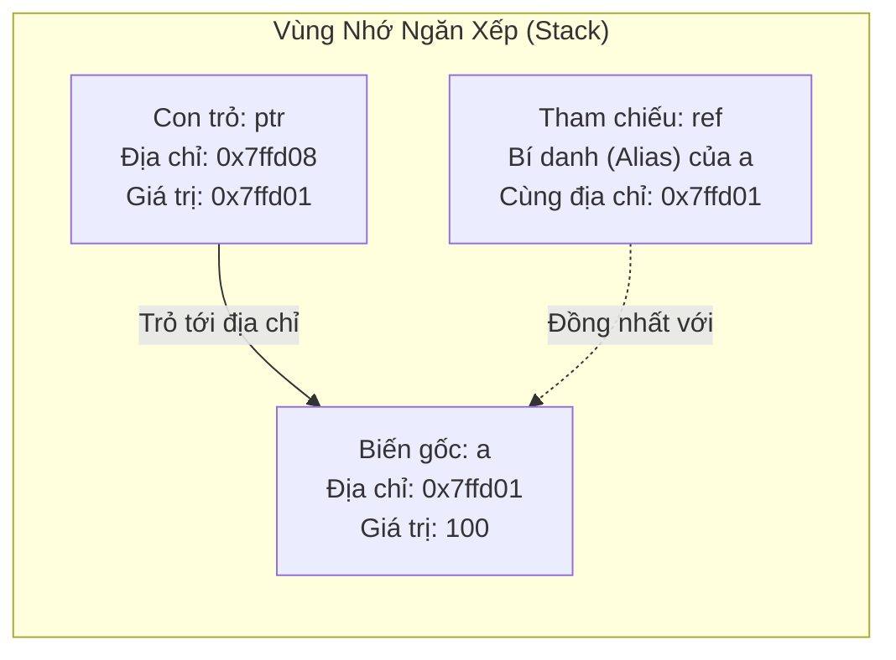

# 12.6 — Pass by const lvalue reference

---

## 🎯 Mục Tiêu Bài Học
- Nắm vững bản chất lý thuyết và cơ chế hoạt động của **Pass by const lvalue reference** trong tiêu chuẩn ISO C++.
- Hiểu rõ cách máy tính tổ chức bộ nhớ (RAM, CPU registers) khi thực thi mã nguồn liên quan.
- Nhận biết các cạm bẫy lỗi kinh điển (**Undefined Behavior**, Memory Leak, Bug logic) và cách phòng tránh.
- Áp dụng các quy tắc thực hành tốt nhất (**Best Practices**) chuẩn công nghiệp và cập nhật C++20/C++23 hiện đại.

---

# 12.6 &#8212; Pass by const lvalue tham chiếu

Unlike a tham chiếu to non-const (which can only bind to modifiable lvalues), a tham chiếu to const can bind to modifiable lvalues, non-modifiable lvalues, and rvalues.  Therefore, if we make a tham chiếu tham số const, then it will be able to bind to any type of đối số:

```cpp
#include <iostream>

void printRef(const int& y) // y is a const reference
{
    std::cout << y << '\n';
}

int main()
{
    int x { 5 };
    printRef(x);   // ok: x is a modifiable lvalue, y binds to x

    const int z { 5 };
    printRef(z);   // ok: z is a non-modifiable lvalue, y binds to z

    printRef(5);   // ok: 5 is rvalue literal, y binds to temporary int object

    return 0;
}
```

Passing by const tham chiếu offers the same primary benefit as pass by non-const tham chiếu (avoiding making a copy of the đối số), while also guaranteeing that the hàm can *not* change the value being referenced.

For example, the following is disallowed, because `ref` is const:

```cpp
void addOne(const int& ref)
{
    ++ref; // not allowed: ref is const
}
```

In most cases, we don’t want our các hàm modifying the value of đối số.

::: tip Thực hành tốt nhất (Best Practice)

Favor passing by const tham chiếu over passing by non-const tham chiếu unless you have a specific reason to do otherwise (e.g. the hàm needs to change the value of an đối số).

:::

Now we can understand the motivation for allowing const lvalue các tham chiếu to bind to rvalues: without that capability, there would be no way to pass các hằng giá trị (literals) (or other rvalues) to các hàm that used pass by tham chiếu!

Passing đối số of a different type to a const lvalue tham chiếu tham số

Trong bài học [12.4 -- Lvalue các tham chiếu to const](https://www.learncpp.com/cpp-tutorial/lvalue-các tham chiếu-to-const/), we noted that a const lvalue tham chiếu can bind to a value of a different type, as long as that value is convertible to the type of the tham chiếu.  The conversion creates a temporary object that the tham chiếu tham số can then bind to.

The primary motivation for allowing this is so that we can pass a value as an đối số to either a value tham số or a const tham chiếu tham số in exactly the same way:

```cpp
#include <iostream>

void printVal(double d)
{
    std::cout << d << '\n';
}

void printRef(const double& d)
{
    std::cout << d << '\n';
}

int main()
{
    printVal(5); // 5 converted to temporary double, copied to parameter d
    printRef(5); // 5 converted to temporary double, bound to parameter d
    
    return 0;
}
```

With pass-by-value, we expect a copy to be made, so if a conversion occurs first (resulting in an additional copy) it’s rarely an issue (and the trình biên dịch will likely optimize one of the two copies away).

However, we often use pass by tham chiếu when we *don’t* want a copy to be made.  If a conversion occurs first, this will typically result in a (possibly expensive) copy being made, which can be suboptimal.

::: danger Cảnh báo nguy hiểm

With pass by tham chiếu, ensure the type of the đối số matches the type of the tham chiếu, or it will result in an unexpected (and possibly expensive) conversion.

:::

Mixing truyền theo giá trị and pass by tham chiếu

A hàm with multiple tham số can determine whether each tham số is passed by value or passed by tham chiếu individually.

For example:

```cpp
#include <string>

void foo(int a, int& b, const std::string& c)
{
}

int main()
{
    int x { 5 };
    const std::string s { "Hello, world!" };

    foo(5, x, s);

    return 0;
}
```

In the above example, the first đối số is passed by value, the second by tham chiếu, and the third by const tham chiếu.

When to use truyền theo giá trị vs pass by tham chiếu

For most C++ beginners, the choice of whether to use truyền theo giá trị or pass by tham chiếu isn’t very obvious.  Fortunately, there’s a straightforward rule of thumb that will serve you well in the majority cases.

- Fundamental types and enumerated types are cheap to copy, so they are typically passed by value.

- Class types can be expensive to copy (sometimes significantly so), so they are typically passed by const tham chiếu.

::: tip Thực hành tốt nhất (Best Practice)

As a rule of thumb, pass các kiểu dữ liệu cơ bản by value and class types by const tham chiếu.

If you aren’t sure what to do, pass by const tham chiếu, as you’re less likely to encounter unexpected behavior.

:::

::: info Tip

Here’s a partial list of other interesting cases:

The following are often passed by value (because it is more efficient):

- Enumerated types (unscoped and scoped enumerations).

- Views and spans (e.g. `std::string_view`, `std::span`).

- Types that mimic các tham chiếu or (non-owning) các con trỏ (e.g. iterators, `std::reference_wrapper`).

- Cheap-to-copy class types that have value semantics (e.g. `std::pair` with elements of các kiểu dữ liệu cơ bản, `std::optional`, `std::expected`).

Pass by tham chiếu should be used for the following:

- Arguments that need to be modified by the hàm.

- Types that aren’t copyable (such as `std::ostream`).

- Types where copying has ownership implications that we want to avoid (e.g. `std::unique_ptr`, `std::shared_ptr`).

- Types that have virtual các hàm or are likely to be inherited from (due to object slicing concerns, covered in lesson [25.9 -- Object slicing](https://www.learncpp.com/cpp-tutorial/object-slicing/)).

:::

The cost of truyền theo giá trị vs pass by tham chiếu Advanced

Not all class types need to be passed by tham chiếu (such as `std::string_view`, which is normally passed by value).  And you may be wondering why we don’t just pass everything by tham chiếu.  In this section (which is optional reading), we discuss the cost of truyền theo giá trị vs pass by tham chiếu, and refine our thực hành tốt nhất (Best Practice) as to when we should use each.

First, we need to consider the cost of initializing the hàm tham số.  With truyền theo giá trị, sự khởi tạo means making a copy.  The cost of copying an object is generally proportional to two things:

- The size of the object.  Objects that use more memory take more time to copy.

- Any additional setup costs.  Some class types do additional setup when they are instantiated (e.g. such as opening a file or database, or allocating a certain amount of dynamic memory to hold an object of a biến size).  These setup costs must be paid each time an object is copied.

On the other hand, binding a tham chiếu to an object is always fast (about the same speed as copying a fundamental type).

Second, we need to consider the cost of using the hàm tham số.  When setting up a hàm call, the trình biên dịch may be able to optimize by placing a tham chiếu or copy of a passed-by-value đối số (if it is small in size) into a CPU register (which is fast to access) rather than into RAM (which is slower to access).

Each time a value tham số is used, the running program can directly access the storage location (CPU register or RAM) of the copied đối số.  However, when a tham chiếu tham số is used, there is usually an extra step.  The running program must first directly access the storage location (CPU register or RAM) allocated to the tham chiếu, in order to determine which object is being referenced.  Only then can it access the storage location of the referenced object (in RAM).

Therefore, each use of a value tham số is a single CPU register or RAM access, whereas each use of a tham chiếu tham số is a single CPU register or RAM access plus a second RAM access.

Third, the trình biên dịch can sometimes optimize code that uses truyền theo giá trị more effectively than code that uses pass by tham chiếu.  In particular, optimizers have to be conservative when there is any chance of **aliasing** (when two or more các con trỏ or các tham chiếu can access the same object).  Because truyền theo giá trị results in the copy of đối số values, there is no chance for aliasing to occur, allowing optimizers to be more aggressive.

We can now answer these question of why we don’t pass everything by tham chiếu:

- For đối tượng that are cheap to copy, the cost of copying is similar to the cost of binding, but accessing the đối tượng is faster and the trình biên dịch is likely to be able to optimize better.

- For đối tượng that are expensive to copy, the cost of the copy dominates other performance considerations.

The last question then is, how do we define “cheap to copy”?  There is no absolute answer here, as this varies by trình biên dịch, use case, and architecture.  However, we can formulate a good rule of thumb: An object is cheap to copy if it uses 2 or fewer “words” of memory (where a “word” is approximated by the size of a memory address) and it has no setup costs.

The following program defines a hàm-like macro that can be used to determine if a type (or object) is cheap to copy accordingly:

```cpp
#include <iostream>

// Function-like macro that evaluates to true if the type (or object) is equal to or smaller than
// the size of two memory addresses
#define isSmall(T) (sizeof(T) <= 2 * sizeof(void*))

struct S
{
    double a;
    double b;
    double c;
};

int main()
{
    std::cout << std::boolalpha; // print true or false rather than 1 or 0
    std::cout << isSmall(int) << '\n'; // true

    double d {};
    std::cout << isSmall(d) << '\n'; // true
    std::cout << isSmall(S) << '\n'; // false

    return 0;
}
```

::: info As an aside…

We use a preprocessor hàm-like macro here so that we can provide either an object OR a type name as a tham số (as C++ các hàm disallow passing types as a tham số).

:::

However, it can be hard to know whether a class type object has setup costs or not.  It’s best to assume that most standard library classes have setup costs, unless you know otherwise that they don’t.

::: info Tip

An object of type T is cheap to copy if `sizeof(T) <= 2 * sizeof(void*)` and has no additional setup costs.
:::

For hàm tham số, prefer `std::string_view` over `const std::string&` in most cases [](#stringparameter)

One question that comes up often in modern C++: when writing a hàm that has a string tham số, should the type of the tham số be `const std::string&` or `std::string_view`?

In most cases, `std::string_view` is the better choice, as it can handle a wider range of đối số types efficiently.  A `std::string_view` tham số also allows the caller to pass in a substring without having to copy that substring into its own string first.

```cpp
void doSomething(const std::string&);
void doSomething(std::string_view);   // prefer this in most cases
```

There are a few cases where using a `const std::string&` tham số may be more appropriate:

- If you’re using C++14 or older, `std::string_view` isn’t available.

- If your hàm needs to call some other hàm that takes a C-style string or `std::string` tham số, then `const std::string&` may be a better choice, as `std::string_view` is not guaranteed to be null-terminated (something that C-style string các hàm expect) and does not efficiently convert back to a `std::string`.

::: tip Thực hành tốt nhất (Best Practice)

Prefer passing strings using `std::string_view` (by value) instead of `const std::string&`, unless your hàm calls other các hàm that require C-style strings or `std::string` tham số.
:::

Why `std::string_view` tham số are more efficient than `const std::string&` Advanced

In C++, a string đối số will typically be a `std::string`, a `std::string_view`, or a C-style string/string hằng giá trị (literal).

As reminders:

- If the type of an đối số does not match the type of the corresponding tham số, the trình biên dịch will try to implicitly convert the đối số to match the type of the tham số.

- Converting a value creates a temporary object of the converted type.

- Creating (or copying) a `std::string_view` is inexpensive, as `std::string_view` does not make a copy of the string it is viewing.

- Creating (or copying) a `std::string` can be expensive, as each `std::string` object makes a copy of the string.

Here’s a table showing what happens when we try to pass each type:

 Argument Type 
 std::string_view tham số 
 const std::string& tham số 

 std::string              
 Inexpensive conversion       
 Inexpensive tham chiếu binding               

 std::string_view         
 Inexpensive copy             
 Expensive explicit conversion to `std::string` 

 C-style string / hằng giá trị (literal) 
 Inexpensive conversion       
 Expensive conversion 

With a `std::string_view` value tham số:

- If we pass in a `std::string` đối số, the trình biên dịch will convert the `std::string` to a `std::string_view`, which is inexpensive, so this is fine.

- If we pass in a `std::string_view` đối số, the trình biên dịch will copy the đối số into the tham số, which is inexpensive, so this is fine.

- If we pass in a C-style string or string hằng giá trị (literal), the trình biên dịch will convert these to a `std::string_view`, which is inexpensive, so this is fine.

As you can see, `std::string_view` handles all three cases inexpensively.

With a `const std::string&` tham chiếu tham số:

- If we pass in a `std::string` đối số, the tham số will tham chiếu bind to the đối số, which is inexpensive, so this is fine.

- If we pass in a `std::string_view` đối số, the trình biên dịch will refuse to do an implicit conversion, and produce a quá trình biên dịch error.  We can use `static_cast` to do an explicit conversion (to `std::string`), but this conversion is expensive (since `std::string` will make a copy of the string being viewed).  Once the conversion is done, the tham số will tham chiếu bind to the result, which is inexpensive.  But we’ve made an expensive copy to do the conversion, so this isn’t great.

- If we pass in a C-style string or string hằng giá trị (literal), the trình biên dịch will implicitly convert this to a `std::string`, which is expensive.  So this isn’t great either.

Thus, a `const std::string&` tham số only handles `std::string` đối số inexpensively.

The same, in code form:

```cpp
#include <iostream>
#include <string>
#include <string_view>

void printSV(std::string_view sv)
{
    std::cout << sv << '\n';
}

void printS(const std::string& s)
{
    std::cout << s << '\n';
}

int main()
{
    std::string s{ "Hello, world" };
    std::string_view sv { s };

    // Pass to `std::string_view` parameter
    printSV(s);              // ok: inexpensive conversion from std::string to std::string_view
    printSV(sv);             // ok: inexpensive copy of std::string_view
    printSV("Hello, world"); // ok: inexpensive conversion of C-style string literal to std::string_view

    // pass to `const std::string&` parameter
    printS(s);              // ok: inexpensive bind to std::string argument
    printS(sv);             // compile error: cannot implicit convert std::string_view to std::string
    printS(static_cast<std::string>(sv)); // bad: expensive creation of std::string temporary
    printS("Hello, world"); // bad: expensive creation of std::string temporary

    return 0;
}
```

Additionally, we need to consider the cost of accessing the tham số inside the hàm.  Because a `std::string_view` tham số is a normal object, the string being viewed can be accessed directly.  Accessing a `std::string&` tham số requires an additional step to get to the referenced object before the string can be accessed.

Finally, if we want to pass in a substring of an existing string (of any type), it is comparatively cheap to create a `std::string_view` substring, which can then be cheaply passed to a `std::string_view` tham số.  In comparison, passing a substring to a `const std::string&` is more expensive, as the substring must at some point be copied into the `std::string` that the tham chiếu tham số binds to.

  	
  	

---



::: danger Cạm Bẫy Thực Chiến: Con Trỏ Lơ Lửng (Dangling Pointer) & UB
Tuyệt đối không giải phóng vùng nhớ mà con trỏ đang trỏ tới rồi tiếp tục truy cập nó, hoặc trả về tham chiếu/con trỏ tới một biến cục bộ trên Stack. Khi hàm kết thúc, biến cục bộ bị hủy và con trỏ sẽ trỏ vào vùng nhớ rác, dẫn đến **Hành vi không xác định (Undefined Behavior)** cực kỳ nguy hiểm!
:::

::: tip Nâng Cấp C++ Hiện Đại: Thay Thế Con Trỏ Thô Bằng Smart Pointers
Trong C++ hiện đại (C++11 đến C++23), hãy hạn chế tối đa việc sử dụng con trỏ thô (`T*`) cùng các toán tử `new`/`delete`. Thay vào đó, hãy luôn ưu tiên:
- `std::unique_ptr<T>`: Sở hữu độc quyền tài nguyên (Zero-overhead, tự động giải phóng RAII).
- `std::shared_ptr<T>`: Sở hữu chia sẻ tài nguyên có cơ chế đếm tham chiếu (Reference counting).
- `std::span<T>` (C++20) hoặc `std::string_view` (C++17): Xem qua vùng nhớ mà không sở hữu, an toàn và tốc độ cực cao.
:::

::: tip 💡 Tóm Tắt Quy Tắc Vàng (Core Guidelines)
1. Luôn hiểu rõ vòng đời và quyền sở hữu (Ownership) của dữ liệu trước khi viết code.
2. Ưu tiên khởi tạo đồng nhất với dấu ngoặc nhọn `{}` để ngăn chặn lỗi thu hẹp kiểu dữ liệu (Narrowing conversions).
3. Bật toàn bộ cờ cảnh báo `-Wall -Wextra -Wpedantic` để compiler giúp bạn phát hiện bug từ sớm!
:::
