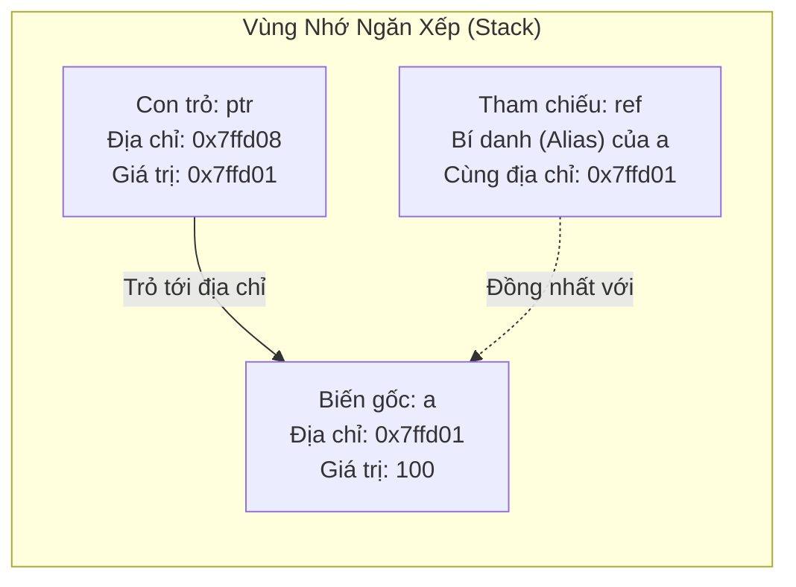

# 12.7 — Introduction to pointers

---

## 🎯 Mục Tiêu Bài Học
- Nắm vững bản chất lý thuyết và cơ chế hoạt động của **Introduction to pointers** trong tiêu chuẩn ISO C++.
- Hiểu rõ cách máy tính tổ chức bộ nhớ (RAM, CPU registers) khi thực thi mã nguồn liên quan.
- Nhận biết các cạm bẫy lỗi kinh điển (**Undefined Behavior**, Memory Leak, Bug logic) và cách phòng tránh.
- Áp dụng các quy tắc thực hành tốt nhất (**Best Practices**) chuẩn công nghiệp và cập nhật C++20/C++23 hiện đại.

---

# 12.7 &#8212; Introduction to các con trỏ

Pointers are one of C++’s historical boogeymen, and a place where many aspiring C++ learners have gotten stuck.  However, as you’ll see shortly, các con trỏ are nothing to be scared of.

In fact, các con trỏ behave a lot like lvalue các tham chiếu.  But before we explain that further, let’s do some setup.

::: info Related content

If you’re rusty or not familiar with lvalue các tham chiếu, now would be a good time to review them.  We cover lvalue các tham chiếu in lessons [12.3 --  Lvalue các tham chiếu](https://www.learncpp.com/cpp-tutorial/lvalue-các tham chiếu/), [12.4 -- Lvalue các tham chiếu to const](https://www.learncpp.com/cpp-tutorial/lvalue-các tham chiếu-to-const/), and [12.5 -- Pass by lvalue tham chiếu](https://www.learncpp.com/cpp-tutorial/pass-by-lvalue-tham chiếu/).

:::

Consider a normal biến, like this one:

```cpp
char x {}; // chars use 1 byte of memory
```

Simplifying a bit, when the code generated for this definition is executed, a piece of memory from RAM will be assigned to this object.  For the sake of example, let’s say that the biến `x` is assigned memory address `140`.  Whenever we use biến `x` in an biểu thức or câu lệnh, the program will go to memory address `140` to access the value stored there.

The nice thing about các biến is that we don’t need to worry about what specific memory addresses are assigned, or how many bytes are required to store the object’s value.  We just refer to the biến by its given identifier, and the trình biên dịch translates this name into the appropriately assigned memory address.  The trình biên dịch takes care of all the addressing.

This is also true with các tham chiếu:

```cpp
int main()
{
    char x {}; // assume this is assigned memory address 140
    char& ref { x }; // ref is an lvalue reference to x (when used with a type, & means lvalue reference)

    return 0;
}
```

Because `ref` acts as an alias for `x`, whenever we use `ref`, the program will go to memory address `140` to access the value.  Again the trình biên dịch takes care of the addressing, so that we don’t have to think about it.

The address-of toán tử (&)

Although the memory addresses used by các biến aren’t exposed to us by default, we do have access to this information.  The **address-of toán tử** (&) returns the memory address of its operand.  This is pretty straightforward:

```cpp
#include <iostream>

int main()
{
    int x{ 5 };
    std::cout << x << '\n';  // print the value of variable x
    std::cout << &x << '\n'; // print the memory address of variable x

    return 0;
}
```

On the author’s machine, the above program printed:

```cpp
5
0027FEA0
```

In the above example, we use the address-of toán tử (&) to retrieve the address assigned to biến `x` and print that address to the console.  Memory addresses are typically printed as hexadecimal values (we covered hex in lesson [5.3 -- Numeral systems (decimal, binary, hexadecimal, and octal)](https://www.learncpp.com/cpp-tutorial/numeral-systems-decimal-binary-hexadecimal-and-octal/)), often without the 0x prefix.

For đối tượng that use more than one byte of memory, address-of will return the memory address of the first byte used by the object.

::: info Tip

The & symbol tends to cause confusion because it has different meanings depending on context:

- When following a type name, & denotes an lvalue tham chiếu: `int& ref`.

- When used in a unary context in an biểu thức, & is the address-of toán tử: `std::cout << &x`.

- When used in a binary context in an biểu thức, & is the Bitwise AND toán tử: `std::cout << x & y`.

:::

The dereference toán tử (*)

Getting the address of a biến isn’t very useful by itself.

The most useful thing we can do with an address is access the value stored at that address.  The **dereference toán tử** (*) (also occasionally called the **indirection toán tử**) returns the value at a given memory address as an lvalue:

```cpp
#include <iostream>

int main()
{
    int x{ 5 };
    std::cout << x << '\n';  // print the value of variable x
    std::cout << &x << '\n'; // print the memory address of variable x

    std::cout << *(&x) << '\n'; // print the value at the memory address of variable x (parentheses not required, but make it easier to read)

    return 0;
}
```

On the author’s machine, the above program printed:

```cpp
5
0027FEA0
5
```

This program is pretty simple.  First we declare a biến `x` and print its value.  Then we print the address of biến `x`.  Finally, we use the dereference toán tử to get the value at the memory address of biến `x` (which is just the value of `x`), which we print to the console.

::: info Hiểu biết cốt lõi

Given a memory address, we can use the dereference toán tử (*) to get the value at that address (as an lvalue).

The address-of toán tử (&) and dereference toán tử (*) work as opposites: address-of gets the address of an object, and dereference gets the object at an address.

:::

::: info Tip

Although the dereference toán tử looks just like the multiplication toán tử, you can distinguish them because the dereference toán tử is unary, whereas the multiplication toán tử is binary.

:::

Getting the memory address of a biến and then immediately dereferencing that address to get a value isn’t that useful either (after all, we can just use the biến to access the value).

But now that we have the address-of toán tử (&) and dereference toán tử (*) added to our toolkits, we’re ready to talk about các con trỏ.

Pointers

A **con trỏ** is an object that holds a *memory address* (typically of another biến) as its value.  This allows us to store the address of some other object to use later.

::: info As an aside…

In modern C++, the các con trỏ we are talking about here are sometimes called “raw các con trỏ” or “dumb các con trỏ”, to help differentiate them from “smart các con trỏ” that were introduced into the language more recently.  We cover smart các con trỏ in [chapter 22](https://www.learncpp.com#Chapter22).

:::

A type that specifies a con trỏ (e.g. `int*`) is called a **con trỏ type**.  Much like tham chiếu types are declared using an ampersand (&) character, con trỏ types are declared using an asterisk (*):

```cpp
int;  // a normal int
int&; // an lvalue reference to an int value

int*; // a pointer to an int value (holds the address of an integer value)
```

To create a con trỏ biến, we simply define a biến with a con trỏ type:

```cpp
int main()
{
    int x { 5 };    // normal variable
    int& ref { x }; // a reference to an integer (bound to x)

    int* ptr;       // a pointer to an integer

    return 0;
}
```

Note that this asterisk is part of the declaration syntax for các con trỏ, not a use of the dereference toán tử.

::: tip Thực hành tốt nhất (Best Practice)

When declaring a con trỏ type, place the asterisk next to the type name.

:::

::: danger Cảnh báo nguy hiểm

Although you generally should not declare multiple các biến on a single line, if you do, the asterisk has to be included with each biến.

```cpp
int* ptr1, ptr2;   // incorrect: ptr1 is a pointer to an int, but ptr2 is just a plain int!
int* ptr3, * ptr4; // correct: ptr3 and ptr4 are both pointers to an int
```

Although this is sometimes used as an đối số to not place the asterisk with the type name (instead placing it next to the biến name), it’s a better đối số for avoiding defining multiple các biến in the same câu lệnh.

:::

Pointer sự khởi tạo

Like normal các biến, các con trỏ are *not* được khởi tạo by default.  A con trỏ that has not been được khởi tạo is sometimes called a **wild con trỏ**.  Wild các con trỏ contain a garbage address, and dereferencing a wild con trỏ will result in hành vi không xác định (Hành vi không xác định (Undefined Behavior - UB) - UB).  Because of this, you should always khởi tạo your các con trỏ to a known value.

::: tip Thực hành tốt nhất (Best Practice)

Always khởi tạo your các con trỏ.

:::

```cpp
int main()
{
    int x{ 5 };

    int* ptr;        // an uninitialized pointer (holds a garbage address)
    int* ptr2{};     // a null pointer (we'll discuss these in the next lesson)
    int* ptr3{ &x }; // a pointer initialized with the address of variable x

    return 0;
}
```

Since các con trỏ hold addresses, when we khởi tạo or assign a value to a con trỏ, that value has to be an address.  Typically, các con trỏ are used to hold the address of another biến (which we can get using the address-of toán tử (&)).

Once we have a con trỏ holding the address of another object, we can then use the dereference toán tử (*) to access the value at that address.  For example:

```cpp
#include <iostream>

int main()
{
    int x{ 5 };
    std::cout << x << '\n'; // print the value of variable x

    int* ptr{ &x }; // ptr holds the address of x
    std::cout << *ptr << '\n'; // use dereference operator to print the value at the address that ptr is holding (which is x's address)

    return 0;
}
```

This prints:

```cpp
5
5
```

Conceptually, you can think of the above snippet like this:


This is where các con trỏ get their name from -- `ptr` is holding the address of `x`, so we say that `ptr` is “pointing to” `x`.

::: info Author’s note

A note on con trỏ nomenclature: “X con trỏ” (where X is some type) is a commonly used shorthand for “con trỏ to an X”.  So when we say, “an integer con trỏ”, we really mean “a con trỏ to an integer”.  This understanding will be valuable when we talk about const các con trỏ.

:::

Much like the type of a tham chiếu has to match the type of object being referred to, the type of the con trỏ has to match the type of the object being pointed to:

```cpp
int main()
{
    int i{ 5 };
    double d{ 7.0 };

    int* iPtr{ &i };     // ok: a pointer to an int can point to an int object
    int* iPtr2 { &d };   // not okay: a pointer to an int can't point to a double object
    double* dPtr{ &d };  // ok: a pointer to a double can point to a double object
    double* dPtr2{ &i }; // not okay: a pointer to a double can't point to an int object

    return 0;
}
```

With one exception that we’ll discuss next lesson, initializing a con trỏ with a hằng giá trị (literal) value is disallowed:

```cpp
int* ptr{ 5 }; // not okay
int* ptr{ 0x0012FF7C }; // not okay, 0x0012FF7C is treated as an integer literal
```

Pointers and phép gán

We can use phép gán with các con trỏ in two different ways:

<ol start="1">
- To change what the con trỏ is pointing at (by assigning the con trỏ a new address)

- To change the value being pointed at (by assigning the dereferenced con trỏ a new value)

First, let’s look at a case where a con trỏ is changed to point at a different object:

```cpp
#include <iostream>

int main()
{
    int x{ 5 };
    int* ptr{ &x }; // ptr initialized to point at x

    std::cout << *ptr << '\n'; // print the value at the address being pointed to (x's address)

    int y{ 6 };
    ptr = &y; // // change ptr to point at y

    std::cout << *ptr << '\n'; // print the value at the address being pointed to (y's address)

    return 0;
}
```

The above prints:

```cpp
5
6
```

In the above example, we define con trỏ `ptr`, khởi tạo it with the address of `x`, and dereference the con trỏ to print the value being pointed to (`5`).  We then use the phép gán toán tử to change the address that `ptr` is holding to the address of `y`.  We then dereference the con trỏ again to print the value being pointed to (which is now `6`).

Now let’s look at how we can also use a con trỏ to change the value being pointed at:

```cpp
#include <iostream>

int main()
{
    int x{ 5 };
    int* ptr{ &x }; // initialize ptr with address of variable x

    std::cout << x << '\n';    // print x's value
    std::cout << *ptr << '\n'; // print the value at the address that ptr is holding (x's address)

    *ptr = 6; // The object at the address held by ptr (x) assigned value 6 (note that ptr is dereferenced here)

    std::cout << x << '\n';
    std::cout << *ptr << '\n'; // print the value at the address that ptr is holding (x's address)

    return 0;
}
```

This program prints:

```cpp
5
5
6
6
```

In this example, we define con trỏ `ptr`, khởi tạo it with the address of `x`, and then print the value of both `x` and `*ptr` (`5`).  Because `*ptr` returns an lvalue, we can use this on the left hand side of an phép gán câu lệnh, which we do to change the value being pointed at by `ptr` to `6`.  We then print the value of both `x` and `*ptr` again to show that the value has been updated as expected.

::: info Hiểu biết cốt lõi

When we use a con trỏ without a dereference (`ptr`), we are accessing the address held by the con trỏ.  Modifying this (`ptr = &y`) changes what the con trỏ is pointing at.

When we dereference a con trỏ (`*ptr`), we are accessing the object being pointed at.  Modifying this (`*ptr = 6;`) changes the value of the object being pointed at.
:::

<p class="cpp-section cpp-topline" style="clear: both">Pointers behave much like lvalue các tham chiếu

Pointers and lvalue các tham chiếu behave similarly.  Consider the following program:

```cpp
#include <iostream>

int main()
{
    int x{ 5 };
    int& ref { x };  // get a reference to x
    int* ptr { &x }; // get a pointer to x

    std::cout << x;
    std::cout << ref;  // use the reference to print x's value (5)
    std::cout << *ptr << '\n'; // use the pointer to print x's value (5)

    ref = 6; // use the reference to change the value of x
    std::cout << x;
    std::cout << ref;  // use the reference to print x's value (6)
    std::cout << *ptr << '\n'; // use the pointer to print x's value (6)

    *ptr = 7; // use the pointer to change the value of x
    std::cout << x;
    std::cout << ref;  // use the reference to print x's value (7)
    std::cout << *ptr << '\n'; // use the pointer to print x's value (7)

    return 0;
}
```

This program prints:

```cpp
555
666
777
```

In the above program, we create a normal biến `x` with value `5`, and then create an lvalue tham chiếu and a con trỏ to `x`.  Next, we use the lvalue tham chiếu to change the value from `5` to `6`, and show that we can access that updated value via all three methods.  Finally, we use the dereferenced con trỏ to change the value from `6` to `7`, and again show that we can access the updated value via all three methods.

Thus, các con trỏ and các tham chiếu both provide a way to indirectly access another object.  The primary difference is that with các con trỏ, we need to explicitly get the address to point at, and we have to explicitly dereference the con trỏ to get the value.  With các tham chiếu, the address-of and dereference happens implicitly.

There are some other differences between các con trỏ and các tham chiếu worth mentioning:

- References must be được khởi tạo, các con trỏ are not required to be được khởi tạo (but should be).

- References are not đối tượng, các con trỏ are.

- References can not be reseated (changed to tham chiếu something else), các con trỏ can change what they are pointing at.

- References must always be bound to an object, các con trỏ can point to nothing (we’ll see an example of this in the next lesson).

- References are “safe” (outside of dangling các tham chiếu), các con trỏ are inherently dangerous (we’ll also discuss this in the next lesson).

The address-of toán tử returns a con trỏ

It’s worth noting that the address-of toán tử (&) doesn’t return the address of its operand as a hằng giá trị (literal) (as C++ doesn’t support address các hằng giá trị (literals)).  Instead, it returns a con trỏ to the operand (whose value is the address of the operand).  In other words, given biến `int x`, `&x` returns an `int*` holding the address of `x`.

We can see this in the following example:

```cpp
#include <iostream>
#include <typeinfo>

int main()
{
	int x{ 4 };
	std::cout << typeid(x).name() << '\n';  // print the type of x
	std::cout << typeid(&x).name() << '\n'; // print the type of &x

	return 0;
}
```

On Visual Studio, this printed:

```cpp
int
int *
```

With gcc, this printed `i` (int) and `pi` (con trỏ to int) instead.  Because the result of typeid().name() is trình biên dịch-dependent, your trình biên dịch may print something different, but it will have the same meaning.

The size of các con trỏ

The size of a con trỏ is dependent upon the architecture the executable is compiled for -- a 32-bit executable uses 32-bit memory addresses -- consequently, a con trỏ on a 32-bit machine is 32 bits (4 bytes).  With a 64-bit executable, a con trỏ would be 64 bits (8 bytes).  Note that this is true regardless of the size of the object being pointed to:

```cpp
#include <iostream>

int main() // assume a 32-bit application
{
    char* chPtr{};        // chars are 1 byte
    int* iPtr{};          // ints are usually 4 bytes
    long double* ldPtr{}; // long doubles are usually 8 or 12 bytes

    std::cout << sizeof(chPtr) << '\n'; // prints 4
    std::cout << sizeof(iPtr) << '\n';  // prints 4
    std::cout << sizeof(ldPtr) << '\n'; // prints 4

    return 0;
}
```

The size of the con trỏ is always the same.  This is because a con trỏ is just a memory address, and the number of bits needed to access a memory address is hằng số.

Dangling các con trỏ

Much like a dangling tham chiếu, a **dangling con trỏ** is a con trỏ that is holding the address of an object that is no longer valid (e.g. because it has been destroyed).

Dereferencing a dangling con trỏ (e.g. in order to print the value being pointed at) will lead to hành vi không xác định (Hành vi không xác định (Undefined Behavior - UB) - UB), as you are trying to access an object that is no longer valid.

Perhaps surprisingly, the standard says “Any other use of an invalid con trỏ *value* has implementation-defined behavior”.  This means that you can assign an invalid con trỏ a new value, such as nullptr (because this doesn’t use the invalid con trỏ’s value).  However, any other operations that use the invalid con trỏ’s value (such as copying or incrementing an invalid con trỏ) will yield implementation-defined behavior.

::: info Hiểu biết cốt lõi

Dereferencing an invalid con trỏ will lead to hành vi không xác định (Hành vi không xác định (Undefined Behavior - UB) - UB).  Any other use of an invalid con trỏ value is implementation-defined.

:::

Here’s an example of creating a dangling con trỏ:

```cpp
#include <iostream>

int main()
{
    int x{ 5 };
    int* ptr{ &x };

    std::cout << *ptr << '\n'; // valid

    {
        int y{ 6 };
        ptr = &y;

        std::cout << *ptr << '\n'; // valid
    } // y goes out of scope, and ptr is now dangling

    std::cout << *ptr << '\n'; // undefined behavior from dereferencing a dangling pointer

    return 0;
}
```

The above program will probably print:

```cpp
5
6
6
```

But it may not, as the object that `ptr` was pointing at went out of phạm vi truy cập (scope) and was destroyed at the end of the inner block, leaving `ptr` dangling.

Conclusion

Pointers are các biến that hold a memory address.  They can be dereferenced using the dereference toán tử (*) to retrieve the value at the address they are holding.  Dereferencing a wild or dangling (or null) con trỏ will result in hành vi không xác định (Hành vi không xác định (Undefined Behavior - UB) - UB) and will probably crash your application.

Pointers are both more flexible than các tham chiếu and more dangerous.  We’ll continue to explore this in the upcoming lessons.

Hệ thống Câu hỏi & Quiz Tự Luyện

Câu hỏi #1

What values does this program print?  Assume a short is 2 bytes, and a 32-bit machine.

```cpp
#include <iostream>

int main()
{
	short value{ 7 }; // &value = 0012FF60
	short otherValue{ 3 }; // &otherValue = 0012FF54

	short* ptr{ &value };

	std::cout << &value << '\n';
	std::cout << value << '\n';
	std::cout << ptr << '\n';
	std::cout << *ptr << '\n';
	std::cout << '\n';

	*ptr = 9;

	std::cout << &value << '\n';
	std::cout << value << '\n';
	std::cout << ptr << '\n';
	std::cout << *ptr << '\n';
	std::cout << '\n';

	ptr = &otherValue;

	std::cout << &otherValue << '\n';
	std::cout << otherValue << '\n';
	std::cout << ptr << '\n';
	std::cout << *ptr << '\n';
	std::cout << '\n';

	std::cout << sizeof(ptr) << '\n';
	std::cout << sizeof(*ptr) << '\n';

	return 0;
}
```

::: details Xem lời giải (Solution)
```cpp
0012FF60
7
0012FF60
7

0012FF60
9
0012FF60
9

0012FF54
3
0012FF54
3

4
2
```

A brief explanation about the 4 and the 2.  A 32-bit machine means that các con trỏ will be 32 bits in length, but sizeof() always prints the size in bytes.  32 bits is 4 bytes.  Thus the `sizeof(ptr)` is 4.  Because `ptr` is a con trỏ to a short, `*ptr` is a short.  The size of a short in this example is 2 bytes.  Thus the `sizeof(*ptr)` is 2.
:::

<p class="cpp-quiz-question cpp-topline" style="clear: both">Câu hỏi #2

What’s wrong with this snippet of code?

```cpp
int v1{ 45 };
int* ptr{ &v1 }; // initialize ptr with address of v1

int v2 { 78 };
*ptr = &v2;     // assign ptr to address of v2
```

::: details Xem lời giải (Solution)

The last line of the above snippet doesn’t compile.

Let’s examine this program in more detail.

The first and fourth lines contain standard biến definitions, along with an sự khởi tạo value.  Nothing special here.

On the second line, the asterisk is part of the con trỏ declaration syntax (not a dereference).  So this line says, “assign the address of `v1` to `ptr`“.  This is fine, since các con trỏ hold addresses.

On line five, the asterisk represents a dereference, which is used to get the value that a con trỏ is pointing to.  So this line says, “assign the address of `v2` to the value pointed to by `ptr`“.  The value pointed to by `ptr` is an integer.  So this phép gán doesn’t make any sense -- you can’t assign an address to an integer!

The fifth line should be:

```cpp
ptr = &v2;
```

<p>This correctly assigns the address of `v2` to the con trỏ.
:::

</a>
  	<a class="nav-link" href="/">
  
    <i class="fa fa-home" aria-hidden="true"></i>
    
      Back to table of contents
    
</a>
  	<a class="nav-link" href="https://www.learncpp.com/cpp-tutorial/pass-by-const-lvalue-tham chiếu/">
  
    <i class="fa fa-chevron-circle-left" aria-hidden="true"></i>
    
      Previous lesson
      
        12.6Pass by const lvalue tham chiếu
      
    
  </a>


---





::: danger Cạm Bẫy Thực Chiến: Con Trỏ Lơ Lửng (Dangling Pointer) & UB
Tuyệt đối không giải phóng vùng nhớ mà con trỏ đang trỏ tới rồi tiếp tục truy cập nó, hoặc trả về tham chiếu/con trỏ tới một biến cục bộ trên Stack. Khi hàm kết thúc, biến cục bộ bị hủy và con trỏ sẽ trỏ vào vùng nhớ rác, dẫn đến **Hành vi không xác định (Undefined Behavior)** cực kỳ nguy hiểm!
:::


::: tip Nâng Cấp C++ Hiện Đại: Thay Thế Con Trỏ Thô Bằng Smart Pointers
Trong C++ hiện đại (C++11 đến C++23), hãy hạn chế tối đa việc sử dụng con trỏ thô (`T*`) cùng các toán tử `new`/`delete`. Thay vào đó, hãy luôn ưu tiên:
- `std::unique_ptr<T>`: Sở hữu độc quyền tài nguyên (Zero-overhead, tự động giải phóng RAII).
- `std::shared_ptr<T>`: Sở hữu chia sẻ tài nguyên có cơ chế đếm tham chiếu (Reference counting).
- `std::span<T>` (C++20) hoặc `std::string_view` (C++17): Xem qua vùng nhớ mà không sở hữu, an toàn và tốc độ cực cao.
:::


::: tip 💡 Tóm Tắt Quy Tắc Vàng (Core Guidelines)
1. Luôn hiểu rõ vòng đời và quyền sở hữu (Ownership) của dữ liệu trước khi viết code.
2. Ưu tiên khởi tạo đồng nhất với dấu ngoặc nhọn `{}` để ngăn chặn lỗi thu hẹp kiểu dữ liệu (Narrowing conversions).
3. Bật toàn bộ cờ cảnh báo `-Wall -Wextra -Wpedantic` để compiler giúp bạn phát hiện bug từ sớm!
:::
