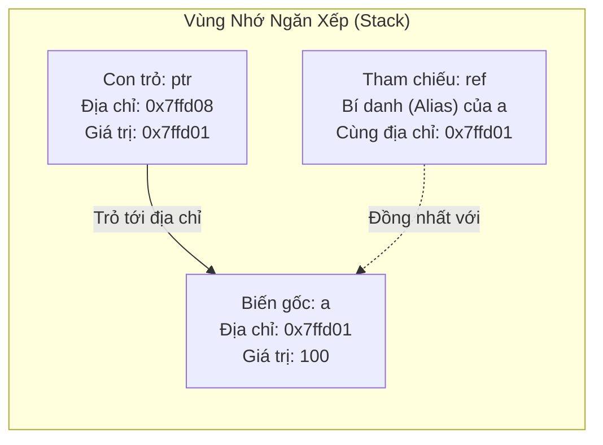

# 12.8 — Null pointers

---

## 🎯 Mục Tiêu Bài Học
- Nắm vững bản chất lý thuyết và cơ chế hoạt động của **Null pointers** trong tiêu chuẩn ISO C++.
- Hiểu rõ cách máy tính tổ chức bộ nhớ (RAM, CPU registers) khi thực thi mã nguồn liên quan.
- Nhận biết các cạm bẫy lỗi kinh điển (**Undefined Behavior**, Memory Leak, Bug logic) và cách phòng tránh.
- Áp dụng các quy tắc thực hành tốt nhất (**Best Practices**) chuẩn công nghiệp và cập nhật C++20/C++23 hiện đại.

---

# 12.8 &#8212; Null các con trỏ

In the previous lesson ([12.7 -- Introduction to các con trỏ](https://www.learncpp.com/cpp-tutorial/introduction-to-các con trỏ/)), we covered the basics of các con trỏ, which are đối tượng that hold the address of another object.  This address can be dereferenced using the dereference toán tử (*) to get the object at that address:

```cpp
#include <iostream>

int main()
{
    int x{ 5 };
    std::cout << x << '\n'; // print the value of variable x

    int* ptr{ &x }; // ptr holds the address of x
    std::cout << *ptr << '\n'; // use dereference operator to print the value of the object at the address that ptr is holding (which is x's address)

    return 0;
}
```

The above example prints:

```cpp
5
5
```

In the prior lesson, we also noted that các con trỏ do not need to point to anything.  In this lesson, we’ll explore such các con trỏ (and the various implications of pointing to nothing) further.

Null các con trỏ

Besides a memory address, there is one additional value that a con trỏ can hold: a null value.  A **null value** (often shortened to **null**) is a special value that means something has no value.  When a con trỏ is holding a null value, it means the con trỏ is not pointing at anything.  Such a con trỏ is called a **null con trỏ**.

The easiest way to create a null con trỏ is to use value sự khởi tạo:

```cpp
int main()
{
    int* ptr {}; // ptr is now a null pointer, and is not holding an address
 
    return 0;
}
```

::: tip Thực hành tốt nhất (Best Practice)

Value khởi tạo your các con trỏ (to be null các con trỏ) if you are not initializing them with the address of a valid object.

:::

Because we can use phép gán to change what a con trỏ is pointing at, a con trỏ that is initially set to null can later be changed to point at a valid object:

```cpp
#include <iostream>

int main()
{
    int* ptr {}; // ptr is a null pointer, and is not holding an address

    int x { 5 };
    ptr = &x; // ptr now pointing at object x (no longer a null pointer)

    std::cout << *ptr << '\n'; // print value of x through dereferenced ptr
 
    return 0;
}
```

The nullptr keyword

Much like the keywords `true` and `false` represent Boolean hằng giá trị (literal) values, the **nullptr** keyword represents a null con trỏ hằng giá trị (literal).  We can use `nullptr` to explicitly khởi tạo or assign a con trỏ a null value.

```cpp
int main()
{
    int* ptr { nullptr }; // can use nullptr to initialize a pointer to be a null pointer

    int value { 5 };
    int* ptr2 { &value }; // ptr2 is a valid pointer
    ptr2 = nullptr; // Can assign nullptr to make the pointer a null pointer

    someFunction(nullptr); // we can also pass nullptr to a function that has a pointer parameter

    return 0;
}
```

In the above example, we use phép gán to set the value of `ptr2` to `nullptr`, making `ptr2` a null con trỏ.

::: tip Thực hành tốt nhất (Best Practice)

Use `nullptr` when you need a null con trỏ hằng giá trị (literal) for sự khởi tạo, phép gán, or passing a null con trỏ to a hàm.
:::

Dereferencing a null con trỏ results in hành vi không xác định (Hành vi không xác định (Undefined Behavior - UB) - UB)

Much like dereferencing a dangling (or wild) con trỏ leads to hành vi không xác định (Hành vi không xác định (Undefined Behavior - UB) - UB), dereferencing a null con trỏ also leads to hành vi không xác định (Hành vi không xác định (Undefined Behavior - UB) - UB).  In most cases, it will crash your application.

The following program illustrates this, and will probably crash or terminate your application abnormally when you run it (go ahead, try it, you won’t harm your machine):

```cpp
#include <iostream>

int main()
{
    int* ptr {}; // Create a null pointer
    std::cout << *ptr << '\n'; // Dereference the null pointer

    return 0;
}
```

Conceptually, this makes sense. Dereferencing a con trỏ means “go to the address the con trỏ is pointing at and access the value there”.  A null con trỏ holds a null value, which semantically means the con trỏ is not pointing at anything.  So what value would it access?

Accidentally dereferencing null and dangling các con trỏ is one of the most common mistakes C++ programmers make, and is probably the most common reason that C++ programs crash in practice.

::: danger Cảnh báo nguy hiểm

Whenever you are using các con trỏ, you’ll need to be extra careful that your code isn’t dereferencing null or dangling các con trỏ, as this will cause hành vi không xác định (Hành vi không xác định (Undefined Behavior - UB) - UB) (probably an application crash).

:::

Checking for null các con trỏ

Much like we can use a conditional to test Boolean values for `true` or `false`, we can use a conditional to test whether a con trỏ has value `nullptr` or not:

```cpp
#include <iostream>

int main()
{
    int x { 5 };
    int* ptr { &x };

    if (ptr == nullptr) // explicit test for equivalence
        std::cout << "ptr is null\n";
    else
        std::cout << "ptr is non-null\n";

    int* nullPtr {};
    std::cout << "nullPtr is " << (nullPtr==nullptr ? "null\n" : "non-null\n"); // explicit test for equivalence

    return 0;
}
```

The above program prints:

```cpp
ptr is non-null
nullPtr is null
```

Trong bài học [4.9 -- Boolean values](https://www.learncpp.com/cpp-tutorial/boolean-values/), we noted that integral values will implicitly convert into Boolean values: an integral value of `0` converts to Boolean value `false`, and any other integral value converts to Boolean value `true`.

Similarly, các con trỏ will also implicitly convert to Boolean values: a null con trỏ converts to Boolean value `false`, and a non-null con trỏ converts to Boolean value `true`.  This allows us to skip explicitly testing for `nullptr` and just use the implicit conversion to Boolean to test whether a con trỏ is a null con trỏ.  The following program is equivalent to the prior one:

```cpp
#include <iostream>

int main()
{
    int x { 5 };
    int* ptr { &x };

    // pointers convert to Boolean false if they are null, and Boolean true if they are non-null
    if (ptr) // implicit conversion to Boolean
        std::cout << "ptr is non-null\n";
    else
        std::cout << "ptr is null\n";

    int* nullPtr {};
    std::cout << "nullPtr is " << (nullPtr ? "non-null\n" : "null\n"); // implicit conversion to Boolean

    return 0;
}
```

::: danger Cảnh báo nguy hiểm

Conditionals can only be used to differentiate null các con trỏ from non-null các con trỏ.  There is no convenient way to determine whether a non-null con trỏ is pointing to a valid object or dangling (pointing to an invalid object).

:::

Use nullptr to avoid dangling các con trỏ

Above, we mentioned that dereferencing a con trỏ that is either null or dangling will result in hành vi không xác định (Hành vi không xác định (Undefined Behavior - UB) - UB).  Therefore, we need to ensure our code does not do either of these things.

We can easily avoid dereferencing a null con trỏ by using a conditional to ensure a con trỏ is non-null before trying to dereference it:

```cpp
// Assume ptr is some pointer that may or may not be a null pointer
if (ptr) // if ptr is not a null pointer
    std::cout << *ptr << '\n'; // okay to dereference
else
    // do something else that doesn't involve dereferencing ptr (print an error message, do nothing at all, etc...)
```

But what about dangling các con trỏ?  Because there is no way to detect whether a con trỏ is dangling, we need to avoid having any dangling các con trỏ in our program in the first place.  We do that by ensuring that any con trỏ that is not pointing at a valid object is set to `nullptr`.

That way, before dereferencing a con trỏ, we only need to test whether it is null -- if it is non-null, we assume the con trỏ is not dangling.

::: tip Thực hành tốt nhất (Best Practice)

A con trỏ should either hold the address of a valid object, or be set to nullptr.  That way we only need to test các con trỏ for null, and can assume any non-null con trỏ is valid.

:::

Unfortunately, avoiding dangling các con trỏ isn’t always easy: when an object is destroyed, any các con trỏ to that object will be left dangling.  Such các con trỏ are *not* nulled automatically!  It is the programmer’s responsibility to ensure that all các con trỏ to an object that has just been destroyed are properly set to `nullptr`.

::: danger Cảnh báo nguy hiểm

When an object is destroyed, any các con trỏ to the destroyed object will be left dangling (they will not be automatically set to `nullptr`).  It is your responsibility to detect these cases and ensure those các con trỏ are subsequently set to `nullptr`.
:::

Legacy null con trỏ các hằng giá trị (literals): 0 and NULL

In older code, you may see two other hằng giá trị (literal) values used instead of `nullptr`.

The first is the hằng giá trị (literal) `0`.  In the context of a con trỏ, the hằng giá trị (literal) `0` is specially defined to mean a null value, and is the only time you can assign an integral hằng giá trị (literal) to a con trỏ.

```cpp
int main()
{
    float* ptr { 0 };  // ptr is now a null pointer (for example only, don't do this)

    float* ptr2; // ptr2 is uninitialized
    ptr2 = 0; // ptr2 is now a null pointer (for example only, don't do this)

    return 0;
}
```

::: info As an aside…

On modern architectures, the address `0` is typically used to represent a null con trỏ.  However, this value is not guaranteed by the C++ standard, and some architectures use other values.  The hằng giá trị (literal) `0`, when used in the context of a null con trỏ, will be translated into whatever address the architecture uses to represent a null con trỏ.
:::

Additionally, there is a preprocessor macro named `NULL` (defined in the `<cstddef>` header).  This macro is inherited from C, where it is commonly used to indicate a null con trỏ.

```cpp
#include <cstddef> // for NULL

int main()
{
    double* ptr { NULL }; // ptr is a null pointer

    double* ptr2; // ptr2 is uninitialized
    ptr2 = NULL; // ptr2 is now a null pointer

    return 0;
}
```

Both `0` and `NULL` should be avoided in modern C++ (use `nullptr` instead).  We discuss why in lesson [12.11 -- Pass by address (part 2)](https://www.learncpp.com/cpp-tutorial/pass-by-address-part-2/).

Favor các tham chiếu over các con trỏ whenever possible

Pointers and các tham chiếu both give us the ability to access some other object indirectly.

Pointers have the additional abilities of being able to change what they are pointing at, and to be pointed at null.  However, these con trỏ abilities are also inherently dangerous:  A null con trỏ runs the risk of being dereferenced, and the ability to change what a con trỏ is pointing at can make creating dangling các con trỏ easier:

```cpp
int main()
{
    int* ptr { };
    
    {
        int x{ 5 };
        ptr = &x; // assign the pointer to an object that will be destroyed (not possible with a reference)
    } // ptr is now dangling and pointing to invalid object

    if (ptr) // condition evaluates to true because ptr is not nullptr
        std::cout << *ptr; // undefined behavior

    return 0;
}
```

Since các tham chiếu can’t be bound to null, we don’t have to worry about null các tham chiếu.  And because các tham chiếu must be bound to a valid object upon creation and then can not be reseated, dangling các tham chiếu are harder to create.

Because they are safer, các tham chiếu should be favored over các con trỏ, unless the additional capabilities provided by các con trỏ are required.

::: tip Thực hành tốt nhất (Best Practice)

Favor các tham chiếu over các con trỏ unless the additional capabilities provided by các con trỏ are needed.

:::

A joke

Did you hear the joke about the null con trỏ?

That’s okay, you wouldn’t get dereference.

Hệ thống Câu hỏi & Quiz Tự Luyện

Câu hỏi #1

1a) Can we determine whether a con trỏ is a null con trỏ or not?  If so, how?

::: details Xem lời giải (Solution)

Yes, we can use a conditional (if câu lệnh or conditional toán tử) on the con trỏ.  A con trỏ will convert to Boolean `false` if it is a null con trỏ, and `true` otherwise.
:::

1b) Can we determine whether a non-null con trỏ is valid or dangling?  If so, how?

::: details Xem lời giải (Solution)

There is no easy way to determine this.

:::

Câu hỏi #2

For each subitem, answer whether the action described will result in behavior that is: predictable, undefined, or possibly undefined.  If the answer is “possibly undefined”, clarify when.

Assume that any đối tượng mentioned are of a type that the con trỏ can point to.

2a) Assigning the address of an object to a non-const con trỏ

::: details Xem lời giải (Solution)

Predictable.  This just copies the address into the con trỏ object.

:::

2b) Assigning nullptr to a con trỏ

::: details Xem lời giải (Solution)

Predictable.

:::

2c) Dereferencing a con trỏ to a valid object

::: details Xem lời giải (Solution)

Predictable.

:::

2d) Dereferencing a dangling con trỏ

::: details Xem lời giải (Solution)

Undefined.

:::

2e) Dereferencing a null con trỏ

::: details Xem lời giải (Solution)

Undefined.

:::

2f) Dereferencing a non-null con trỏ

::: details Xem lời giải (Solution)

Possibly undefined, if the con trỏ is dangling.

:::

Câu hỏi #3

Why should we set các con trỏ that aren’t pointing to a valid object to ‘nullptr’?

::: details Xem lời giải (Solution)

We can not determine whether a non-null con trỏ is valid or dangling, and accessing a dangling con trỏ will result in hành vi không xác định (Hành vi không xác định (Undefined Behavior - UB) - UB).  Therefore, we need to ensure that we do not have any dangling các con trỏ in our program.

If we ensure all các con trỏ are either pointing to valid đối tượng or set to `nullptr`, then we can use a conditional to test for null to ensure we don’t dereference a null con trỏ, and assume all non-null các con trỏ are pointing to valid đối tượng.
:::

  	
  	

---



::: danger Cạm Bẫy Thực Chiến: Con Trỏ Lơ Lửng (Dangling Pointer) & UB
Tuyệt đối không giải phóng vùng nhớ mà con trỏ đang trỏ tới rồi tiếp tục truy cập nó, hoặc trả về tham chiếu/con trỏ tới một biến cục bộ trên Stack. Khi hàm kết thúc, biến cục bộ bị hủy và con trỏ sẽ trỏ vào vùng nhớ rác, dẫn đến **Hành vi không xác định (Undefined Behavior)** cực kỳ nguy hiểm!
:::

::: tip Nâng Cấp C++ Hiện Đại: Thay Thế Con Trỏ Thô Bằng Smart Pointers
Trong C++ hiện đại (C++11 đến C++23), hãy hạn chế tối đa việc sử dụng con trỏ thô (`T*`) cùng các toán tử `new`/`delete`. Thay vào đó, hãy luôn ưu tiên:
- `std::unique_ptr<T>`: Sở hữu độc quyền tài nguyên (Zero-overhead, tự động giải phóng RAII).
- `std::shared_ptr<T>`: Sở hữu chia sẻ tài nguyên có cơ chế đếm tham chiếu (Reference counting).
- `std::span<T>` (C++20) hoặc `std::string_view` (C++17): Xem qua vùng nhớ mà không sở hữu, an toàn và tốc độ cực cao.
:::

::: tip 💡 Tóm Tắt Quy Tắc Vàng (Core Guidelines)
1. Luôn hiểu rõ vòng đời và quyền sở hữu (Ownership) của dữ liệu trước khi viết code.
2. Ưu tiên khởi tạo đồng nhất với dấu ngoặc nhọn `{}` để ngăn chặn lỗi thu hẹp kiểu dữ liệu (Narrowing conversions).
3. Bật toàn bộ cờ cảnh báo `-Wall -Wextra -Wpedantic` để compiler giúp bạn phát hiện bug từ sớm!
:::
