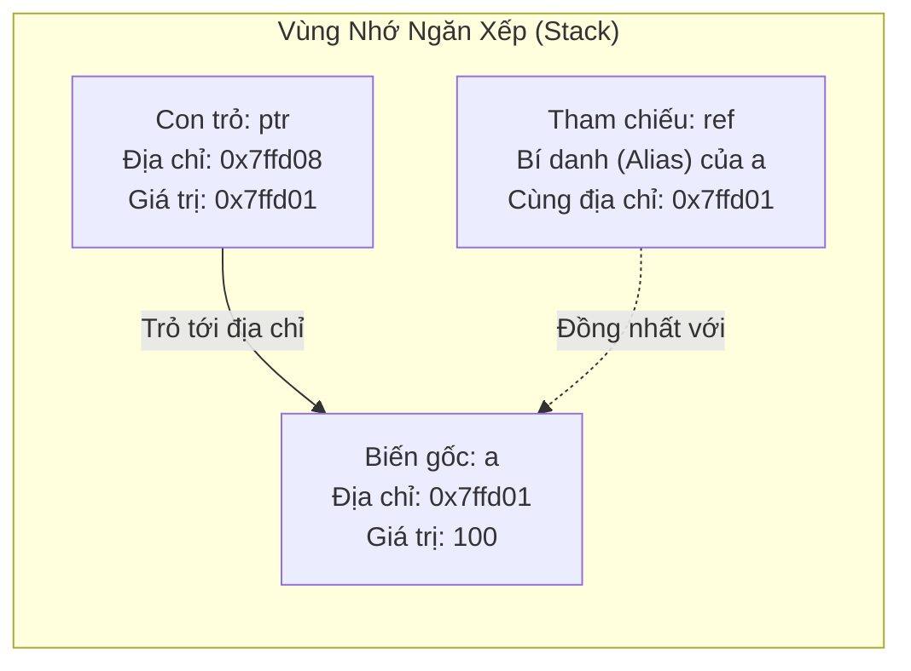

# 12.9 — Pointers and const

---

## 🎯 Mục Tiêu Bài Học
- Nắm vững bản chất lý thuyết và cơ chế hoạt động của **Pointers and const** trong tiêu chuẩn ISO C++.
- Hiểu rõ cách máy tính tổ chức bộ nhớ (RAM, CPU registers) khi thực thi mã nguồn liên quan.
- Nhận biết các cạm bẫy lỗi kinh điển (**Undefined Behavior**, Memory Leak, Bug logic) và cách phòng tránh.
- Áp dụng các quy tắc thực hành tốt nhất (**Best Practices**) chuẩn công nghiệp và cập nhật C++20/C++23 hiện đại.

---

# 12.9 &#8212; Pointers and const

Consider the following code snippet:

```cpp
int main()
{
    int x { 5 };
    int* ptr { &x }; // ptr is a normal (non-const) pointer

    int y { 6 };
    ptr = &y; // we can point at another value

    *ptr = 7; // we can change the value at the address being held

    return 0;
}
```

With normal (non-const) các con trỏ, we can change both what the con trỏ is pointing at (by assigning the con trỏ a new address to hold) or change the value at the address being held (by assigning a new value to the dereferenced con trỏ).

However, what happens if the value we want to point at is const?

```cpp
int main()
{
    const int x { 5 }; // x is now const
    int* ptr { &x };   // compile error: cannot convert from const int* to int*

    return 0;
}
```

The above snippet won’t compile -- we can’t set a normal con trỏ to point at a const biến.  This makes sense: a const biến is one whose value cannot be changed.  Allowing the programmer to set a non-const con trỏ to a const value would allow the programmer to dereference the con trỏ and change the value.  That would violate the const-ness of the biến.

Pointer to const value

A **con trỏ to a const value** (sometimes called a `con trỏ to const` for short) is a (non-const) con trỏ that points to a hằng số value.

To declare a con trỏ to a const value, use the `const` keyword before the con trỏ’s kiểu dữ liệu:

```cpp
int main()
{
    const int x{ 5 };
    const int* ptr { &x }; // okay: ptr is pointing to a "const int"

    *ptr = 6; // not allowed: we can't change a const value

    return 0;
}
```

In the above example, `ptr` points to a `const int`.  Because the kiểu dữ liệu being pointed to is const, the value being pointed to can’t be changed.

However, because a con trỏ to const is not const itself (it just points to a const value), we can change what the con trỏ is pointing at by assigning the con trỏ a new address:

```cpp
int main()
{
    const int x{ 5 };
    const int* ptr { &x }; // ptr points to const int x

    const int y{ 6 };
    ptr = &y; // okay: ptr now points at const int y

    return 0;
}
```

Just like a tham chiếu to const, a con trỏ to const can point to non-const các biến too.  A con trỏ to const treats the value being pointed to as hằng số, regardless of whether the object at that address was initially defined as const or not:

```cpp
int main()
{
    int x{ 5 }; // non-const
    const int* ptr { &x }; // ptr points to a "const int"

    *ptr = 6;  // not allowed: ptr points to a "const int" so we can't change the value through ptr
    x = 6; // allowed: the value is still non-const when accessed through non-const identifier x

    return 0;
}
```

Const các con trỏ

We can also make a con trỏ itself hằng số.  A **const con trỏ** is a con trỏ whose address can not be changed after sự khởi tạo.

To declare a const con trỏ, use the `const` keyword after the asterisk in the con trỏ declaration:

```cpp
int main()
{
    int x{ 5 };
    int* const ptr { &x }; // const after the asterisk means this is a const pointer

    return 0;
}
```

In the above case, `ptr` is a const con trỏ to a (non-const) int value.

Just like a normal const biến, a const con trỏ must be được khởi tạo upon definition, and this value can’t be changed via phép gán:

```cpp
int main()
{
    int x{ 5 };
    int y{ 6 };

    int* const ptr { &x }; // okay: the const pointer is initialized to the address of x
    ptr = &y; // error: once initialized, a const pointer can not be changed.

    return 0;
}
```

However, because the *value* being pointed to is non-const, it is possible to change the value being pointed to via dereferencing the const con trỏ:

```cpp
int main()
{
    int x{ 5 };
    int* const ptr { &x }; // ptr will always point to x

    *ptr = 6; // okay: the value being pointed to is non-const

    return 0;
}
```

Const con trỏ to a const value

Finally, it is possible to declare a **const con trỏ to a const value** by using the `const` keyword both before the type and after the asterisk:

```cpp
int main()
{
    int value { 5 };
    const int* const ptr { &value }; // a const pointer to a const value

    return 0;
}
```

A const con trỏ to a const value can not have its address changed, nor can the value it is pointing to be changed through the con trỏ.  It can only be dereferenced to get the value it is pointing at.

Pointer and const recap

To summarize, you only need to remember 4 rules, and they are pretty logical:

- A non-const con trỏ (e.g. `int* ptr`) can be assigned another address to change what it is pointing at.

- A const con trỏ (e.g. `int* const ptr`) always points to the same address, and this address can not be changed.

- A con trỏ to a non-const value (e.g. `int* ptr`) can change the value it is pointing to.  These can not point to a const value.

- A con trỏ to a const value (e.g. `const int* ptr`) treats the value as const when accessed through the con trỏ, and thus can not change the value it is pointing to.  These can be pointed to const or non-const l-values (but not r-values, which don’t have an address).

Keeping the declaration syntax straight can be a bit challenging:

- A `const` before the asterisk (e.g. `const int* ptr`) is associated with the type being pointed to.  Therefore, this is a con trỏ to a const value, and the value cannot be modified through the con trỏ.

- A `const` after the asterisk (e.g. `int* const ptr`) is associated with the con trỏ itself.  Therefore, this con trỏ cannot be assigned a new address.

```cpp
int main()
{
    int v{ 5 };
   
    int* ptr0 { &v };             // points to an "int" but is not const itself.  We can modify the value or the address.
    const int* ptr1 { &v };       // points to a "const int" but is not const itself.  We can only modify the address.
    int* const ptr2 { &v };       // points to an "int" and is const itself.   We can only modify the value.
    const int* const ptr3 { &v }; // points to a "const int" and is const itself.  We can't modify the value nor the address.

    // if the const is on the left side of the *, the const belongs to the value
    // if the const is on the right side of the *, the const belongs to the pointer

    return 0;
}
```

  	
  	

---



::: danger Cạm Bẫy Thực Chiến: Con Trỏ Lơ Lửng (Dangling Pointer) & UB
Tuyệt đối không giải phóng vùng nhớ mà con trỏ đang trỏ tới rồi tiếp tục truy cập nó, hoặc trả về tham chiếu/con trỏ tới một biến cục bộ trên Stack. Khi hàm kết thúc, biến cục bộ bị hủy và con trỏ sẽ trỏ vào vùng nhớ rác, dẫn đến **Hành vi không xác định (Undefined Behavior)** cực kỳ nguy hiểm!
:::

::: tip Nâng Cấp C++ Hiện Đại: Thay Thế Con Trỏ Thô Bằng Smart Pointers
Trong C++ hiện đại (C++11 đến C++23), hãy hạn chế tối đa việc sử dụng con trỏ thô (`T*`) cùng các toán tử `new`/`delete`. Thay vào đó, hãy luôn ưu tiên:
- `std::unique_ptr<T>`: Sở hữu độc quyền tài nguyên (Zero-overhead, tự động giải phóng RAII).
- `std::shared_ptr<T>`: Sở hữu chia sẻ tài nguyên có cơ chế đếm tham chiếu (Reference counting).
- `std::span<T>` (C++20) hoặc `std::string_view` (C++17): Xem qua vùng nhớ mà không sở hữu, an toàn và tốc độ cực cao.
:::

::: tip 💡 Tóm Tắt Quy Tắc Vàng (Core Guidelines)
1. Luôn hiểu rõ vòng đời và quyền sở hữu (Ownership) của dữ liệu trước khi viết code.
2. Ưu tiên khởi tạo đồng nhất với dấu ngoặc nhọn `{}` để ngăn chặn lỗi thu hẹp kiểu dữ liệu (Narrowing conversions).
3. Bật toàn bộ cờ cảnh báo `-Wall -Wextra -Wpedantic` để compiler giúp bạn phát hiện bug từ sớm!
:::
