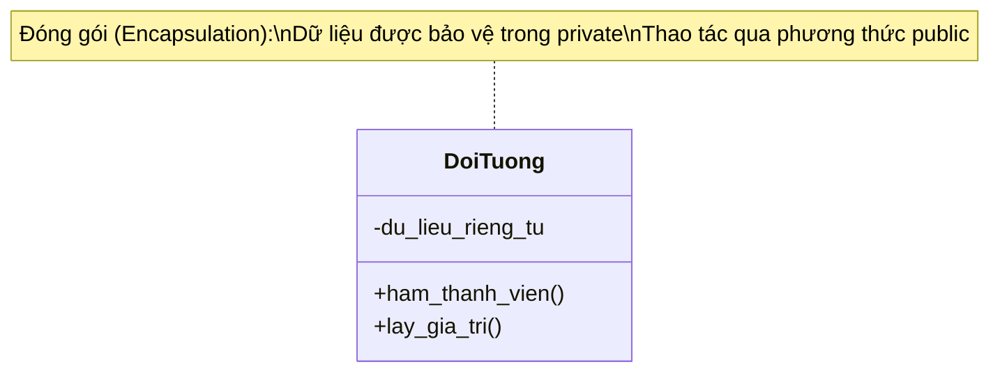

# 13.10 — Passing and returning structs

---

## 🎯 Mục Tiêu Bài Học
- Nắm vững bản chất lý thuyết và cơ chế hoạt động của **Passing and returning structs** trong tiêu chuẩn ISO C++.
- Hiểu rõ cách máy tính tổ chức bộ nhớ (RAM, CPU registers) khi thực thi mã nguồn liên quan.
- Nhận biết các cạm bẫy lỗi kinh điển (**Undefined Behavior**, Memory Leak, Bug logic) và cách phòng tránh.
- Áp dụng các quy tắc thực hành tốt nhất (**Best Practices**) chuẩn công nghiệp và cập nhật C++20/C++23 hiện đại.

---

# 13.10 &#8212; Passing and returning structs

Consider an employee represented by 3 loose các biến:

```cpp
int main()
{
    int id { 1 };
    int age { 24 };
    double wage { 52400.0 };

    return 0;
}
```

If we want to pass this employee to a hàm, we have to pass three các biến:

```cpp
#include <iostream>

void printEmployee(int id, int age, double wage)
{
    std::cout << "ID:   " << id << '\n';
    std::cout << "Age:  " << age << '\n';
    std::cout << "Wage: " << wage << '\n';
}

int main()
{
    int id { 1 };
    int age { 24 };
    double wage { 52400.0 };

    printEmployee(id, age, wage);

    return 0;
}
```

While passing 3 individual employee các biến isn’t that bad, consider a hàm where we need to pass 10 or 12 employee các biến.  Passing each biến independently would be time consuming and error prone.  Additionally, if we ever add a new attribute to our employee (e.g. name), we now have to modify all the các hàm declarations, definitions, and hàm calls to accept the new tham số and đối số!

Passing structs (by tham chiếu)

A big advantage of using structs over individual các biến is that we can pass the entire struct to a hàm that needs to work with the members.  Structs are generally passed by tham chiếu (typically by const tham chiếu) to avoid making copies.

```cpp
#include <iostream>

struct Employee
{
    int id {};
    int age {};
    double wage {};
};

void printEmployee(const Employee& employee) // note pass by reference here
{
    std::cout << "ID:   " << employee.id << '\n';
    std::cout << "Age:  " << employee.age << '\n';
    std::cout << "Wage: " << employee.wage << '\n';
}

int main()
{
    Employee joe { 14, 32, 24.15 };
    Employee frank { 15, 28, 18.27 };

    // Print Joe's information
    printEmployee(joe);

    std::cout << '\n';

    // Print Frank's information
    printEmployee(frank);

    return 0;
}
```

In the above example, we pass an entire `Employee` to `printEmployee()` (twice, once for `joe` and once for `frank`).

The above program outputs:

```cpp
ID:   14
Age:  32
Wage: 24.15

ID:   15
Age:  28
Wage: 18.27
```

Because we are passing the entire struct object (rather than individual members), we only need one tham số no matter how many members the struct object has.  And, in the future, if we ever decide to add new members to our `Employee` struct, we will not have to change the hàm declaration or hàm call!  The new member will automatically be included.

::: info Related content

We talk about when to pass structs by value vs tham chiếu in lesson [12.6 -- Pass by const lvalue tham chiếu](https://www.learncpp.com/cpp-tutorial/pass-by-const-lvalue-tham chiếu/).

:::

Passing temporary structs

In the prior example, we created Employee biến `joe` prior to passing it to the `printEmployee()` hàm.  This allows us to give the Employee biến a name, which can be useful for documentation purposes.  But it also requires two câu lệnh (one to create `joe`, one to use `joe`).

In cases where we only use a biến once, having to give the biến a name and separate the creation and use of that biến can increase complexity.  In such cases, it may be preferable to use a temporary object instead.  A temporary object is not a biến, so it does not have an identifier.

Here’s the same example as above, but we’ve replaced các biến `joe` and `frank` with temporary đối tượng:

```cpp
#include <iostream>

struct Employee
{
    int id {};
    int age {};
    double wage {};
};

void printEmployee(const Employee& employee) // note pass by reference here
{
    std::cout << "ID:   " << employee.id << '\n';
    std::cout << "Age:  " << employee.age << '\n';
    std::cout << "Wage: " << employee.wage << '\n';
}

int main()
{
    // Print Joe's information
    printEmployee(Employee { 14, 32, 24.15 }); // construct a temporary Employee to pass to function (type explicitly specified) (preferred)

    std::cout << '\n';

    // Print Frank's information
    printEmployee({ 15, 28, 18.27 }); // construct a temporary Employee to pass to function (type deduced from parameter)

    return 0;
}
```

We can create a temporary `Employee` in two ways.  In the first call, we use the syntax `Employee { 14, 32, 24.15 }`.  This tells the trình biên dịch to create an `Employee` object and khởi tạo it with the provided initializers.  This is the preferred syntax because it makes clear what kind of temporary object we are creating, and there is no way for the trình biên dịch to misinterpret our intentions.

In the second call, we use the syntax `{ 15, 28, 18.27 }`.  The trình biên dịch is smart enough to understand that the provided đối số must be converted to an `Employee` so that the hàm call will succeed.  Note that this form is considered an implicit conversion, so it will not work in cases where only explicit conversions are acceptable.

::: info Related content

We talk more about class type temporary đối tượng and conversions in lesson [14.13 -- Temporary class đối tượng](https://www.learncpp.com/cpp-tutorial/temporary-class-đối tượng/).

:::

A few more things about temporary đối tượng: they are created and được khởi tạo at the point of definition, and are destroyed at the end of the full biểu thức in which they are created.  And evaluation of a temporary object is an rvalue biểu thức, it can only be used in places where rvalues are accepted.  When a temporary object is used as a hàm đối số, it will only bind to tham số that accept rvalues.  This includes truyền theo giá trị and pass by const tham chiếu, and excludes pass by non-const tham chiếu and pass by address.

Returning structs

Consider the case where we have a hàm that needs to return a point in 3-dimensional Cartesian space. Such a point has 3 attributes: an x-coordinate, a y-coordinate, and a z-coordinate.  But các hàm can only return one value.  So how do we return all 3 coordinates back the user?

One common way is to return a struct:

```cpp
#include <iostream>

struct Point3d
{
    double x { 0.0 };
    double y { 0.0 };
    double z { 0.0 };
};

Point3d getZeroPoint()
{
    // We can create a variable and return the variable (we'll improve this below)
    Point3d temp { 0.0, 0.0, 0.0 };
    return temp;
}

int main()
{
    Point3d zero{ getZeroPoint() };

    if (zero.x == 0.0 && zero.y == 0.0 && zero.z == 0.0)
        std::cout << "The point is zero\n";
    else
        std::cout << "The point is not zero\n";

    return 0;
}
```

This prints:

```cpp
The point is zero
```

Structs defined inside các hàm are usually returned by value, so as not to return a dangling tham chiếu.

In the `getZeroPoint()` hàm above, we create a new named object (`temp`) just so we could return it:

```cpp
Point3d getZeroPoint()
{
    // We can create a variable and return the variable (we'll improve this below)
    Point3d temp { 0.0, 0.0, 0.0 };
    return temp;
}
```

The name of the object (`temp`) doesn’t really provide any documentation value here.

We can make our hàm slightly better by returning a temporary (unnamed/anonymous) object instead:

```cpp
Point3d getZeroPoint()
{
    return Point3d { 0.0, 0.0, 0.0 }; // return an unnamed Point3d
}
```

In this case, a temporary `Point3d` is constructed, copied back to the caller, and then destroyed at the end of the biểu thức.  Note how much cleaner this is (one line vs two, and no need to understand whether `temp` is used more than once).

::: info Related content

We discuss anonymous đối tượng in more detail in lesson [14.13 -- Temporary class đối tượng](https://www.learncpp.com/cpp-tutorial/temporary-class-đối tượng/).

:::

Deducing the return type

In the case where the hàm has an explicit return type (e.g. `Point3d`), we can even omit the type in the return câu lệnh:

```cpp
Point3d getZeroPoint()
{
    // We already specified the type at the function declaration
    // so we don't need to do so here again
    return { 0.0, 0.0, 0.0 }; // return an unnamed Point3d
}
```

This is considered to be an implicit conversion.

Also note that since in this case we’re returning all zero values, we can use empty braces to return a value-được khởi tạo Point3d:

```cpp
Point3d getZeroPoint()
{
    // We can use empty curly braces to value-initialize all members
    return {};
}
```

Structs are an important building block

While structs are useful in and of themselves, classes (which are the heart of C++ and object oriented programming) build directly on top of the concepts we’ve introduced here.  Having a good understanding of structs (especially data members, member selection, and default member sự khởi tạo) will make your transition to classes that much easier.

Hệ thống Câu hỏi & Quiz Tự Luyện

Câu hỏi #1

You are running a website, and you are trying to calculate your advertising revenue.  Write a program that allows you to enter 3 pieces of data:

- How many ads were watched.

- What percentage of users clicked on an ad.

- The average earnings per clicked ad.

Store those 3 values in a struct.  Pass that struct to another hàm that prints each of the values.  The print hàm should also print how much you made for that day (multiply the 3 fields together).

::: details Gợi ý (Hint)
Hint: If you store the percentage as an integer, you’ll also need to divide by 100 when you calculate how much you made for the day.
:::

::: details Xem lời giải (Solution)
```cpp
#include <iostream>

// First we need to define our Advertising struct
struct Advertising
{
    int adsShown {};
    double clickThroughRatePercentage {};
    double averageEarningsPerClick {};
};

Advertising getAdvertising()
{
    Advertising temp {};
    std::cout << "How many ads were shown today? ";
    std::cin >> temp.adsShown;
    std::cout << "What percentage of ads were clicked on by users? ";
    std::cin >> temp.clickThroughRatePercentage;
    std::cout << "What was the average earnings per click? ";
    std::cin >> temp.averageEarningsPerClick;

    return temp;
}

void printAdvertising(const Advertising& ad)
{
    std::cout << "Number of ads shown: " << ad.adsShown << '\n';
    std::cout << "Click through rate: " << ad.clickThroughRatePercentage << '\n';
    std::cout << "Average earnings per click: $" << ad.averageEarningsPerClick << '\n';

    // The following line is split up to reduce the length
    // We need to divide ad.clickThroughRatePercentage by 100 because it's a percent of 100, not a multiplier
    std::cout << "Total Earnings: $"
        << (ad.adsShown * ad.clickThroughRatePercentage / 100 * ad.averageEarningsPerClick) << '\n';
}

int main()
{
    // Declare an Advertising struct variable
    Advertising ad{ getAdvertising() };
    printAdvertising(ad);

    return 0;
}
```
:::

Câu hỏi #2

Create a struct to hold a fraction.  The struct should have an integer numerator and an integer denominator member.  

Write a hàm to read in a Fraction from the user, and use it to read-in two fraction đối tượng.  Write another hàm to multiply two Fractions together and return the result as a Fraction (you don’t need to reduce the fraction).  Write another hàm that prints a fraction.

Your program’s output should match the following:

```cpp
Enter a value for the numerator: 1
Enter a value for the denominator: 2

Enter a value for the numerator: 3
Enter a value for the denominator: 4

Your fractions multiplied together: 3/8
```

When multiplying two fractions together, the resulting numerator is the product of the two numerators, and the resulting denominator is the product of the two denominators.

::: details Xem lời giải (Solution)
```cpp
#include <iostream>

struct Fraction
{
    int numerator{ 0 };
    int denominator{ 1 };
};

Fraction getFraction()
{
    Fraction temp{};
    std::cout << "Enter a value for numerator: ";
    std::cin >> temp.numerator;
    std::cout << "Enter a value for denominator: ";
    std::cin >> temp.denominator;
    std::cout << '\n';

    return temp;
}

constexpr Fraction multiply(const Fraction& f1, const Fraction& f2)
{
    return { f1.numerator * f2.numerator, f1.denominator * f2.denominator };
}

void printFraction(const Fraction& f)
{
    std::cout << f.numerator << '/' << f.denominator << '\n';
}

int main()
{
    Fraction f1{ getFraction() };
    Fraction f2{ getFraction() };

    std::cout << "Your fractions multiplied together: ";

    printFraction(multiply(f1, f2));

    return 0;
}
```
:::

Câu hỏi #3

In the solution to the prior quiz question, why does `getFraction()` return by value instead of by tham chiếu?

::: details Xem lời giải (Solution)
<p>Because our `temp` Fraction is a local biến, it will go out of phạm vi truy cập (scope) at the end of the hàm.  If we were to return `temp` as tham chiếu, we’d return a dangling tham chiếu back to the caller.
:::

</a>
  	<a class="nav-link" href="/">
  
    <i class="fa fa-home" aria-hidden="true"></i>
    
      Back to table of contents
    
</a>
  	<a class="nav-link" href="https://www.learncpp.com/cpp-tutorial/default-member-sự khởi tạo/">
  
    <i class="fa fa-chevron-circle-left" aria-hidden="true"></i>
    
      Previous lesson
      
        13.9Default member sự khởi tạo
      
    
  </a>


---





::: warning Cạm Bẫy: Khởi Tạo Không Đồng Nhất (Initialization Pitfalls)
Hãy luôn khởi tạo biến thành viên ngay tại nơi khai báo hoặc sử dụng **Danh sách khởi tạo thành viên (Member Initializer List)** trong hàm tạo để tránh việc đối tượng bị gán giá trị 2 lần gây lãng phí chu kỳ CPU.
:::


::: tip 💡 Tóm Tắt Quy Tắc Vàng (Core Guidelines)
1. Luôn hiểu rõ vòng đời và quyền sở hữu (Ownership) của dữ liệu trước khi viết code.
2. Ưu tiên khởi tạo đồng nhất với dấu ngoặc nhọn `{}` để ngăn chặn lỗi thu hẹp kiểu dữ liệu (Narrowing conversions).
3. Bật toàn bộ cờ cảnh báo `-Wall -Wextra -Wpedantic` để compiler giúp bạn phát hiện bug từ sớm!
:::
