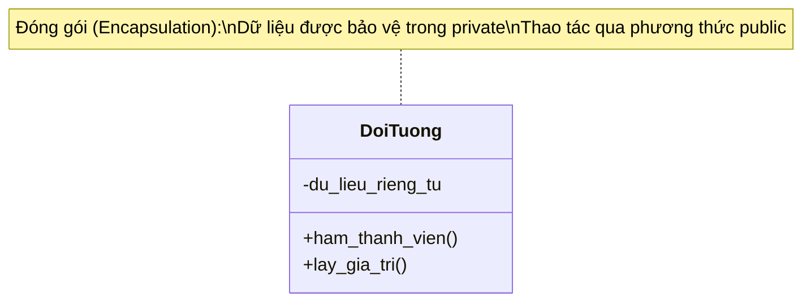

# 13.11 — Struct miscellany

---

## 🎯 Mục Tiêu Bài Học
- Nắm vững bản chất lý thuyết và cơ chế hoạt động của **Struct miscellany** trong tiêu chuẩn ISO C++.
- Hiểu rõ cách máy tính tổ chức bộ nhớ (RAM, CPU registers) khi thực thi mã nguồn liên quan.
- Nhận biết các cạm bẫy lỗi kinh điển (**Undefined Behavior**, Memory Leak, Bug logic) và cách phòng tránh.
- Áp dụng các quy tắc thực hành tốt nhất (**Best Practices**) chuẩn công nghiệp và cập nhật C++20/C++23 hiện đại.

---

# 13.11 &#8212; Struct miscellany

## Structs with program-defined members

In C++, structs (and classes) can have members that are other program-defined types.  There are two ways to do this.

First, we can define one program-defined type (in the global phạm vi truy cập (scope)) and then use it as a member of another program-defined type:

```cpp
#include <iostream>

struct Employee
{
    int id {};
    int age {};
    double wage {};
};

struct Company
{
    int numberOfEmployees {};
    Employee CEO {}; // Employee is a struct within the Company struct
};

int main()
{
    Company myCompany{ 7, { 1, 32, 55000.0 } }; // Nested initialization list to initialize Employee
    std::cout << myCompany.CEO.wage << '\n'; // print the CEO's wage

    return 0;
}
```

In the above case, we’ve defined an `Employee` struct, and then used that as a member in a `Company` struct.  When we khởi tạo our `Company`, we can also khởi tạo our `Employee` by using a nested sự khởi tạo list.  And if we want to know what the CEO’s salary was, we simply use the member selection toán tử twice: `myCompany.CEO.wage;`

Second, types can also be nested inside other types, so if an Employee only existed as part of a Company, the Employee type could be nested inside the Company struct:

```cpp
#include <iostream>

struct Company
{
    struct Employee // accessed via Company::Employee
    {
        int id{};
        int age{};
        double wage{};
    };

    int numberOfEmployees{};
    Employee CEO{}; // Employee is a struct within the Company struct
};

int main()
{
    Company myCompany{ 7, { 1, 32, 55000.0 } }; // Nested initialization list to initialize Employee
    std::cout << myCompany.CEO.wage << '\n'; // print the CEO's wage

    return 0;
}
```

This is more often done with classes, so we’ll talk more about this in a future lesson ([15.3 -- Nested types (member types)](https://www.learncpp.com/cpp-tutorial/nested-types-member-types/)).

Structs that are owners should have data members that are owners

Trong bài học [5.9 -- std::string_view (part 2)](https://www.learncpp.com/cpp-tutorial/stdstring_view-part-2/), we introduced the dual concepts of owners and viewers.  Owners manage their own data, and control when it is destroyed.  Viewers view someone else’s data, and do not control when it is altered or destroyed.

In most cases, we want our structs (and classes) to be owners of the data they contain.  This provides a few useful benefits:

- The data members will be valid for as long as the struct (or class) is.

- The value of those data members won’t change unexpectedly.

The easiest way to make a struct (or class) an owner is to give each data member a type that is an owner (e.g. not a viewer, con trỏ, or tham chiếu).  If a struct or class has data members that are all owners, then the struct or class itself is automatically an owner.

If a struct (or class) has a data member that is a viewer, it is possible that the object being viewed by that member will be destroyed before the data member that is viewing it.  If this happens, the struct will be left with a dangling member, and accessing that member will lead to hành vi không xác định (Hành vi không xác định (Undefined Behavior - UB) - UB).

::: tip Thực hành tốt nhất (Best Practice)

In most cases, we want our structs (and classes) to be owners.  The easiest way to enable this is to ensure each data member has an owning type (e.g. not a viewer, con trỏ, or tham chiếu).

:::

::: info Author’s note

Practice safe structs.  Don’t let your member dangle.

:::

This is why string data members are almost always of type `std::string` (which is an owner), and not of type `std::string_view` (which is a viewer).  The following example illustrates a case where this matters:

```cpp
#include <iostream>
#include <string>
#include <string_view>

struct Owner
{
    std::string name{}; // std::string is an owner
};

struct Viewer
{
    std::string_view name {}; // std::string_view is a viewer
};

// getName() returns the user-entered string as a temporary std::string
// This temporary std::string will be destroyed at the end of the full expression
// containing the function call.
std::string getName()
{
    std::cout << "Enter a name: ";
    std::string name{};
    std::cin >> name;
    return name;
}

int main()
{
    Owner o { getName() };  // The return value of getName() is destroyed just after initialization
    std::cout << "The owners name is " << o.name << '\n';  // ok

    Viewer v { getName() }; // The return value of getName() is destroyed just after initialization
    std::cout << "The viewers name is " << v.name << '\n'; // undefined behavior

    return 0;
}
```

The `getName()` hàm returns the name the user entered as a temporary `std::string`.  This temporary giá trị trả về is destroyed at the end of the full biểu thức in which the hàm is called.

In the case of `o`, this temporary `std::string` is used to khởi tạo `o.name`.  Since `o.name` is a `std::string`, `o.name` makes a copy of the temporary `std::string`.  The temporary `std::string` then dies, but `o.name` is not affected since it’s a copy.  When we print `o.name` in the subsequent câu lệnh, it works as we expect.

In the case of `v`, this temporary `std::string` is used to khởi tạo `v.name`.  Since `v.name` is a `std::string_view`, `v.name` is just a view of the temporary `std::string`, not a copy.  The temporary `std::string` then dies, leaving `v.name` dangling.  When we print `v.name` in the subsequent câu lệnh, we get hành vi không xác định (Hành vi không xác định (Undefined Behavior - UB) - UB).

Struct size and data structure alignment

Typically, the size of a struct is the sum of the size of all its members, but not always!

Consider the following program:

```cpp
#include <iostream>

struct Foo
{
    short a {};
    int b {};
    double c {};
};

int main()
{
    std::cout << "The size of short is " << sizeof(short) << " bytes\n";
    std::cout << "The size of int is " << sizeof(int) << " bytes\n";
    std::cout << "The size of double is " << sizeof(double) << " bytes\n";

    std::cout << "The size of Foo is " << sizeof(Foo) << " bytes\n";

    return 0;
}
```

On the author’s machine, this printed:

```cpp
The size of short is 2 bytes
The size of int is 4 bytes
The size of double is 8 bytes
The size of Foo is 16 bytes
```

Note that the size of `short` + `int` + `double` is 14 bytes, but the size of `Foo` is 16 bytes!

It turns out, we can only say that the size of a struct will be *at least* as large as the size of all the các biến it contains.  But it could be larger!  For performance reasons, the trình biên dịch will sometimes add gaps into structures (this is called **padding**).

In the `Foo` struct above, the trình biên dịch is invisibly adding 2 bytes of padding after member `a`, making the size of the structure 16 bytes instead of 14.

::: info For advanced readers

The reason các trình biên dịch may add padding is beyond the phạm vi truy cập (scope) of this tutorial, but readers who want to learn more can read about [data structure alignment](http://en.wikipedia.org/wiki/Data_structure_alignment) on Wikipedia.  This is optional reading and not required to understand structures or C++!
:::

This can actually have a pretty significant impact on the size of the struct, as the following program demonstrates:

```cpp
#include <iostream>

struct Foo1
{
    short a{}; // will have 2 bytes of padding after a
    int b{};
    short c{}; // will have 2 bytes of padding after c
};

struct Foo2
{
    int b{};
    short a{};
    short c{};
};

int main()
{
    std::cout << sizeof(Foo1) << '\n'; // prints 12
    std::cout << sizeof(Foo2) << '\n'; // prints 8

    return 0;
}
```

This program prints:

```cpp
12
8
```

Note that `Foo1` and `Foo2` have the same members, the only difference being the declaration order.  Yet `Foo1` is 50% larger due to the added padding.

::: info Tip

You can minimize padding by defining your members in decreasing order of size.

The C++ trình biên dịch is not allowed to reorder members, so this has to be done manually.

:::

  	
  	

---



::: warning Cạm Bẫy: Khởi Tạo Không Đồng Nhất (Initialization Pitfalls)
Hãy luôn khởi tạo biến thành viên ngay tại nơi khai báo hoặc sử dụng **Danh sách khởi tạo thành viên (Member Initializer List)** trong hàm tạo để tránh việc đối tượng bị gán giá trị 2 lần gây lãng phí chu kỳ CPU.
:::

::: tip 💡 Tóm Tắt Quy Tắc Vàng (Core Guidelines)
1. Luôn hiểu rõ vòng đời và quyền sở hữu (Ownership) của dữ liệu trước khi viết code.
2. Ưu tiên khởi tạo đồng nhất với dấu ngoặc nhọn `{}` để ngăn chặn lỗi thu hẹp kiểu dữ liệu (Narrowing conversions).
3. Bật toàn bộ cờ cảnh báo `-Wall -Wextra -Wpedantic` để compiler giúp bạn phát hiện bug từ sớm!
:::
