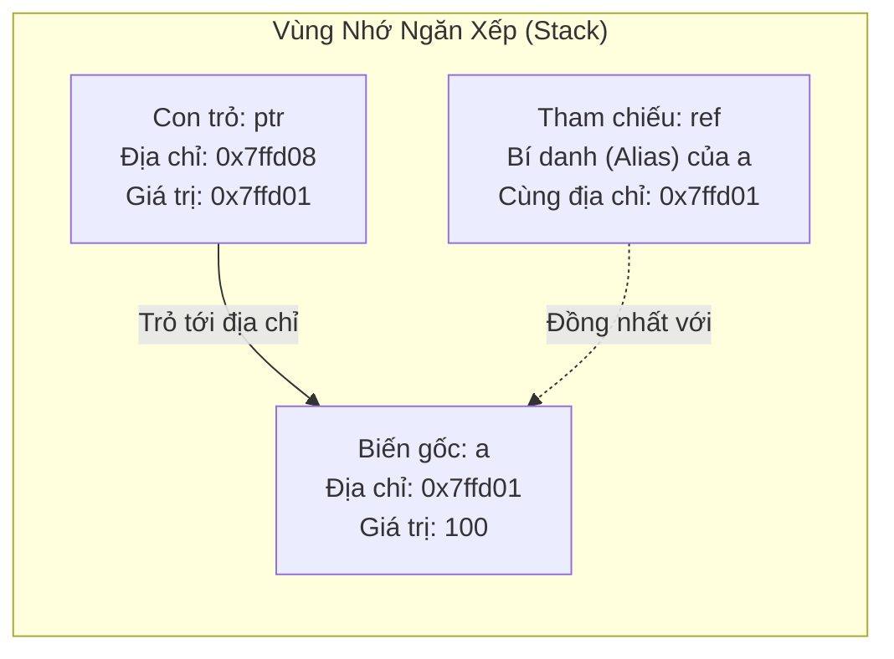

# 13.12 — Member selection with pointers and references

---

## 🎯 Mục Tiêu Bài Học
- Nắm vững bản chất lý thuyết và cơ chế hoạt động của **Member selection with pointers and references** trong tiêu chuẩn ISO C++.
- Hiểu rõ cách máy tính tổ chức bộ nhớ (RAM, CPU registers) khi thực thi mã nguồn liên quan.
- Nhận biết các cạm bẫy lỗi kinh điển (**Undefined Behavior**, Memory Leak, Bug logic) và cách phòng tránh.
- Áp dụng các quy tắc thực hành tốt nhất (**Best Practices**) chuẩn công nghiệp và cập nhật C++20/C++23 hiện đại.

---

# 13.12 &#8212; Member selection with các con trỏ and các tham chiếu

## Member selection for structs and các tham chiếu to structs

Trong bài học [13.7 -- Introduction to structs, members, and member selection](https://www.learncpp.com/cpp-tutorial/introduction-to-structs-members-and-member-selection/), we showed that you can use the member selection toán tử (.) to select a member from a struct object:

```cpp
#include <iostream>

struct Employee
{
    int id {};
    int age {};
    double wage {};
};

int main()
{
    Employee joe { 1, 34, 65000.0 };

    // Use member selection operator (.) to select a member from struct object
    ++joe.age; // Joe had a birthday
    joe.wage = 68000.0; // Joe got a promotion
    
    return 0;
}
```

Since các tham chiếu to an object act just like the object itself, we can also use the member selection toán tử (.) to select a member from a tham chiếu to a struct:

```cpp
#include <iostream>

struct Employee
{
    int id{};
    int age{};
    double wage{};
};

void printEmployee(const Employee& e)
{
    // Use member selection operator (.) to select member from reference to struct
    std::cout << "Id: " << e.id << '\n';
    std::cout << "Age: " << e.age << '\n';
    std::cout << "Wage: " << e.wage << '\n';
}

int main()
{
    Employee joe{ 1, 34, 65000.0 };

    ++joe.age;
    joe.wage = 68000.0;

    printEmployee(joe);

    return 0;
}
```

Member selection for các con trỏ to structs

However, the member selection toán tử (.) can’t be used directly on a con trỏ to a struct:

```cpp
#include <iostream>

struct Employee
{
    int id{};
    int age{};
    double wage{};
};

int main()
{
    Employee joe{ 1, 34, 65000.0 };

    ++joe.age;
    joe.wage = 68000.0;

    Employee* ptr{ &joe };
    std::cout << ptr.id << '\n'; // Compile error: can't use operator. with pointers

    return 0;
}
```

With normal các biến or các tham chiếu, we can access đối tượng directly.  However, because các con trỏ hold addresses, we first need to dereference the con trỏ to get the object before we can do anything with it.  So one way to access a member from a con trỏ to a struct is as follows:

```cpp
#include <iostream>

struct Employee
{
    int id{};
    int age{};
    double wage{};
};

int main()
{
    Employee joe{ 1, 34, 65000.0 };

    ++joe.age;
    joe.wage = 68000.0;

    Employee* ptr{ &joe };
    std::cout << (*ptr).id << '\n'; // Not great but works: First dereference ptr, then use member selection

    return 0;
}
```

However, this is a bit ugly, especially because we need to parenthesize the dereference operation so it will take precedence over the member selection operation.

To make for a cleaner syntax, C++ offers a **member selection from con trỏ toán tử (-&gt;)** (also sometimes called the **arrow toán tử**) that can be used to select members from a con trỏ to an object:

```cpp
#include <iostream>

struct Employee
{
    int id{};
    int age{};
    double wage{};
};

int main()
{
    Employee joe{ 1, 34, 65000.0 };

    ++joe.age;
    joe.wage = 68000.0;

    Employee* ptr{ &joe };
    std::cout << ptr->id << '\n'; // Better: use -> to select member from pointer to object

    return 0;
}
```

This member selection from con trỏ toán tử (-&gt;) works identically to the member selection toán tử (.) but does an implicit dereference of the con trỏ object before selecting the member.  Thus `ptr->id` is equivalent to `(*ptr).id`.

This arrow toán tử is not only easier to type, but is also much less prone to error because the indirection is implicitly done for you, so there are no precedence issues to worry about.  Consequently, when doing member access through a con trỏ, always use the -&gt; toán tử instead of the . toán tử.

::: tip Thực hành tốt nhất (Best Practice)

When using a con trỏ to access a member, use the member selection from con trỏ toán tử (-&gt;) instead of the member selection toán tử (.).

:::

Chaining `toán tử->`

If the member accessed via `toán tử->` is a con trỏ to a class type, `toán tử->` can be applied again in the same biểu thức to access the member of that class type.

The following example illustrates this (courtesy of reader Luna):

```cpp
#include <iostream>

struct Point
{
    double x {};
    double y {};
};

struct Triangle
{
    Point* a {};
    Point* b {};
    Point* c {};
};

int main()
{
    Point a {1,2};
    Point b {3,7};
    Point c {10,2};

    Triangle tr { &a, &b, &c };
    Triangle* ptr {&tr};

    // ptr is a pointer to a Triangle, which contains members that are pointers to a Point
    // To access member y of Point c of the Triangle pointed to by ptr, the following are equivalent:

    // access via operator.
    std::cout << (*(*ptr).c).y << '\n'; // ugly!

    // access via operator->
    std::cout << ptr -> c -> y << '\n'; // much nicer
}
```

When using more than one `toán tử->` in sequence (e.g `ptr->c->y`), the biểu thức can be hard to read.  Adding whitespace between the members and `toán tử->` (e.g. `ptr -> c -> y`) can make it a bit easier to distinguish the members being accessed from the toán tử.

Mixing các con trỏ and non-các con trỏ to members

The member selection toán tử is always applied to the currently selected biến. If you have a mix of các con trỏ and normal member các biến, you can see member selections where . and -&gt; are both used in sequence:

```cpp
#include <iostream>
#include <string>

struct Paw
{
    int claws{};
};
 
struct Animal
{
    std::string name{};
    Paw paw{};
};
 
int main()
{
    Animal puma{ "Puma", { 5 } };
 
    Animal* ptr{ &puma };
 
    // ptr is a pointer, use ->
    // paw is not a pointer, use .

    std::cout << (ptr->paw).claws << '\n';
 
    return 0;
}
```

Note that in the case of `(ptr->paw).claws`, parentheses aren’t necessary since both `toán tử->` and `toán tử.` evaluate in left to right order, but it does help readability slightly.

  	
  	

---



::: danger Cạm Bẫy Thực Chiến: Con Trỏ Lơ Lửng (Dangling Pointer) & UB
Tuyệt đối không giải phóng vùng nhớ mà con trỏ đang trỏ tới rồi tiếp tục truy cập nó, hoặc trả về tham chiếu/con trỏ tới một biến cục bộ trên Stack. Khi hàm kết thúc, biến cục bộ bị hủy và con trỏ sẽ trỏ vào vùng nhớ rác, dẫn đến **Hành vi không xác định (Undefined Behavior)** cực kỳ nguy hiểm!
:::

::: tip Nâng Cấp C++ Hiện Đại: Thay Thế Con Trỏ Thô Bằng Smart Pointers
Trong C++ hiện đại (C++11 đến C++23), hãy hạn chế tối đa việc sử dụng con trỏ thô (`T*`) cùng các toán tử `new`/`delete`. Thay vào đó, hãy luôn ưu tiên:
- `std::unique_ptr<T>`: Sở hữu độc quyền tài nguyên (Zero-overhead, tự động giải phóng RAII).
- `std::shared_ptr<T>`: Sở hữu chia sẻ tài nguyên có cơ chế đếm tham chiếu (Reference counting).
- `std::span<T>` (C++20) hoặc `std::string_view` (C++17): Xem qua vùng nhớ mà không sở hữu, an toàn và tốc độ cực cao.
:::

::: tip 💡 Tóm Tắt Quy Tắc Vàng (Core Guidelines)
1. Luôn hiểu rõ vòng đời và quyền sở hữu (Ownership) của dữ liệu trước khi viết code.
2. Ưu tiên khởi tạo đồng nhất với dấu ngoặc nhọn `{}` để ngăn chặn lỗi thu hẹp kiểu dữ liệu (Narrowing conversions).
3. Bật toàn bộ cờ cảnh báo `-Wall -Wextra -Wpedantic` để compiler giúp bạn phát hiện bug từ sớm!
:::
