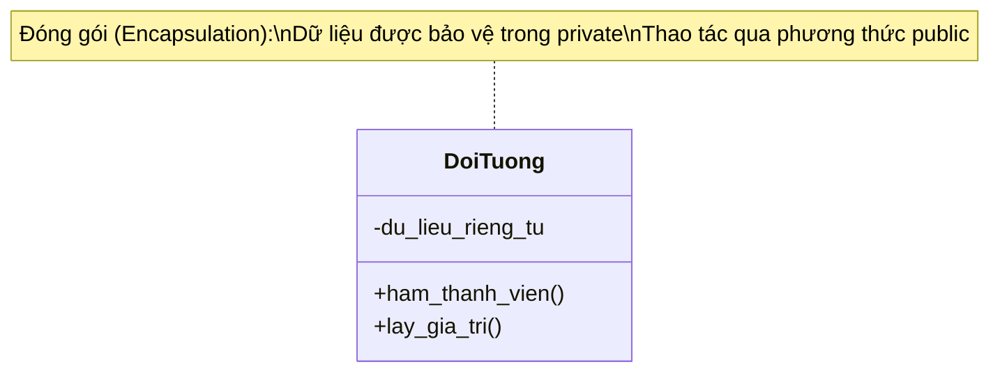

# 13.13 — Class templates

---

## 🎯 Mục Tiêu Bài Học
- Nắm vững bản chất lý thuyết và cơ chế hoạt động của **Class templates** trong tiêu chuẩn ISO C++.
- Hiểu rõ cách máy tính tổ chức bộ nhớ (RAM, CPU registers) khi thực thi mã nguồn liên quan.
- Nhận biết các cạm bẫy lỗi kinh điển (**Undefined Behavior**, Memory Leak, Bug logic) và cách phòng tránh.
- Áp dụng các quy tắc thực hành tốt nhất (**Best Practices**) chuẩn công nghiệp và cập nhật C++20/C++23 hiện đại.

---

# 13.13 &#8212; Class templates

Trong bài học [11.6 -- Function templates](https://www.learncpp.com/cpp-tutorial/hàm-templates/), we introduced the challenge of having to create a separate (overloaded) hàm for each different set of types we want to work with:

```cpp
#include <iostream>

// function to calculate the greater of two int values
int max(int x, int y)
{
    return (x < y) ? y : x;
}

// almost identical function to calculate the greater of two double values
// the only difference is the type information
double max(double x, double y)
{
    return (x < y) ? y : x;
}

int main()
{
    std::cout << max(5, 6);     // calls max(int, int)
    std::cout << '\n';
    std::cout << max(1.2, 3.4); // calls max(double, double)

    return 0;
}
```

The solution to this was to create a hàm template that the trình biên dịch can use to instantiate normal các hàm for whichever set of types we need:

```cpp
#include <iostream>

// a single function template for max
template <typename T>
T max(T x, T y)
{
    return (x < y) ? y : x;
}

int main()
{
    std::cout << max(5, 6);     // instantiates and calls max<int>(int, int)
    std::cout << '\n';
    std::cout << max(1.2, 3.4); // instantiates and calls max<double>(double, double)

    return 0;
}
```

::: info Related content

We cover how hàm template instantiation works in lesson [11.7 -- Function template instantiation](https://www.learncpp.com/cpp-tutorial/hàm-template-instantiation/).

:::

Aggregate types have similar challenges

We run into similar challenges with aggregate types (both structs/classes/unions and arrays).

For example, let’s say we’re writing a program where we need to work with pairs of `int` values, and need to determine which of the two numbers is larger.  We might write a program like this:

```cpp
#include <iostream>

struct Pair
{
    int first{};
    int second{};
};

constexpr int max(Pair p) // pass by value because Pair is small
{
    return (p.first < p.second ? p.second : p.first);
}

int main()
{
    Pair p1{ 5, 6 };
    std::cout << max(p1) << " is larger\n";

    return 0;
}
```

Later, we discover that we also need pairs of `double` values.  So we update our program to the following:

```cpp
#include <iostream>

struct Pair
{
    int first{};
    int second{};
};

struct Pair // compile error: erroneous redefinition of Pair
{
    double first{};
    double second{};
};

constexpr int max(Pair p)
{
    return (p.first < p.second ? p.second : p.first);
}

constexpr double max(Pair p) // compile error: overloaded function differs only by return type
{
    return (p.first < p.second ? p.second : p.first);
}

int main()
{
    Pair p1{ 5, 6 };
    std::cout << max(p1) << " is larger\n";

    Pair p2{ 1.2, 3.4 };
    std::cout << max(p2) << " is larger\n";

    return 0;
}
```

Unfortunately, this program won’t compile, and has a number of problems that need to be addressed.

First, unlike các hàm, type definitions can’t be overloaded.  The trình biên dịch will treat double second definition of `Pair` as an erroneous redeclaration of the first definition of `Pair`.  Second, although các hàm can be overloaded, our `max(Pair)` các hàm only differ by return type, and overloaded các hàm can’t be differentiated solely by return type.  Third, there is a lot of redundancy here.  Each `Pair` struct is identical (except for the kiểu dữ liệu) and same with our `max(Pair)` các hàm (except for the return type).

We could solve the first two issues by giving our `Pair` structs different names (e.g. `PairInt` and `PairDouble`).  But then we both have to remember our naming scheme, and essentially clone a bunch of code for each additional pair type we want, which doesn’t solve the redundancy problem.

Fortunately, we can do better.

::: info Author’s note

Before proceeding, please review lessons [11.6 -- Function templates](https://www.learncpp.com/cpp-tutorial/hàm-templates/) and [11.7 -- Function template instantiation](https://www.learncpp.com/cpp-tutorial/hàm-template-instantiation/) if you’re hazy on how hàm templates, template types, or hàm template instantiation works.

:::

Class templates

Much like a hàm template is a template definition for instantiating các hàm, a **class template** is a template definition for instantiating class types.

::: info A reminder

A “class type” is a struct, class, or union type.  Although we’ll be demonstrating “class templates” on structs for simplicity, everything here applies equally well to classes.

:::

As a reminder, here’s our `int` pair struct definition:

```cpp
struct Pair
{
    int first{};
    int second{};
};
```

Let’s rewrite our pair class as a class template:

```cpp
#include <iostream>

template <typename T>
struct Pair
{
    T first{};
    T second{};
};

int main()
{
    Pair<int> p1{ 5, 6 };        // instantiates Pair<int> and creates object p1
    std::cout << p1.first << ' ' << p1.second << '\n';

    Pair<double> p2{ 1.2, 3.4 }; // instantiates Pair<double> and creates object p2
    std::cout << p2.first << ' ' << p2.second << '\n';

    Pair<double> p3{ 7.8, 9.0 }; // creates object p3 using prior definition for Pair<double>
    std::cout << p3.first << ' ' << p3.second << '\n';

    return 0;
}
```

Just like with hàm templates, we start a class template definition with a template tham số declaration.  We begin with the `template` keyword.  Next, we specify all of the template types that our class template will use inside angled brackets (&lt;&gt;). For each template type that we need, we use the keyword `typename` (preferred) or `class` (not preferred), followed by the name of the template type (e.g. `T`).  In this case, since both of our members will be the same type, we only need one template type.

Next, we define our struct like usual, except we can use our template type (`T`) wherever we want a templated type that will be replaced with a real type later.  That’s it!  We’re done with the class template definition.

Inside main, we can instantiate `Pair` đối tượng using whatever types we desire.  First, we instantiate an object of type `Pair<int>`.  Because a type definition for `Pair<int>` doesn’t exist yet, the trình biên dịch uses the class template to instantiate a struct type definition named `Pair<int>`, where all occurrences of template type `T` are replaced by type `int`.

Next, we instantiate an object of type `Pair<double>`, which instantiates a struct type definition named `Pair<double>` where `T` is replaced by `double`.  For `p3`, `Pair<double>` has already been instantiated, so the trình biên dịch will use the prior type definition.

Here’s the same example as above, showing what the trình biên dịch actually compiles after all template instantiations are done:

```cpp
#include <iostream>

// A declaration for our Pair class template
// (we don't need the definition any more since it's not used)
template <typename T>
struct Pair;

// Explicitly define what Pair<int> looks like
template <> // tells the compiler this is a template type with no template parameters
struct Pair<int>
{
    int first{};
    int second{};
};

// Explicitly define what Pair<double> looks like
template <> // tells the compiler this is a template type with no template parameters
struct Pair<double>
{
    double first{};
    double second{};
};

int main()
{
    Pair<int> p1{ 5, 6 };        // instantiates Pair<int> and creates object p1
    std::cout << p1.first << ' ' << p1.second << '\n';

    Pair<double> p2{ 1.2, 3.4 }; // instantiates Pair<double> and creates object p2
    std::cout << p2.first << ' ' << p2.second << '\n';

    Pair<double> p3{ 7.8, 9.0 }; // creates object p3 using prior definition for Pair<double>
    std::cout << p3.first << ' ' << p3.second << '\n';

    return 0;
}
```

You can compile this example directly and see that it works as expected!

::: info For advanced readers

The above example makes use of a feature called class template specialization (covered in future lesson [26.4 -- Class template specialization](https://www.learncpp.com/cpp-tutorial/class-template-specialization/)).  Knowledge of how this feature works is not required at this point.

:::

Using our class template in a hàm

Now let’s return to the challenge of making our `max()` hàm work with different types.  Because the trình biên dịch treats `Pair<int>` and `Pair<double>` as separate types, we could use overloaded các hàm that are differentiated by tham số type:

```cpp
constexpr int max(Pair<int> p)
{
    return (p.first < p.second ? p.second : p.first);
}

constexpr double max(Pair<double> p) // okay: overloaded function differentiated by parameter type
{
    return (p.first < p.second ? p.second : p.first);
}
```

While this compiles, it doesn’t solve the redundancy problem.  What we really want is a hàm that can take a pair of any type.  In other words, we want a hàm that takes a tham số of type `Pair<T>`, where T is a template type tham số.  And that means we need a hàm template for this job!

Here’s a full example, with `max()` being implemented as a hàm template:

```cpp
#include <iostream>

template <typename T>
struct Pair
{
    T first{};
    T second{};
};

template <typename T>
constexpr T max(Pair<T> p)
{
    return (p.first < p.second ? p.second : p.first);
}

int main()
{
    Pair<int> p1{ 5, 6 };
    std::cout << max<int>(p1) << " is larger\n"; // explicit call to max<int>

    Pair<double> p2{ 1.2, 3.4 };
    std::cout << max(p2) << " is larger\n"; // call to max<double> using template argument deduction (prefer this)

    return 0;
}
```

The `max()` hàm template is pretty straightforward.  Because we want to pass in a `Pair<T>`, we need the trình biên dịch to understand what `T` is.  Therefore, we need to start our hàm with a template tham số declaration that defines template type T.  We can then use `T` as both our return type, and as the template type for `Pair<T>`.

When the `max()` hàm is called with a `Pair<int>` đối số, the trình biên dịch will instantiate the hàm `int max<int>(Pair<int>)` from the hàm template, where template type `T` is replaced with `int`.  The following snippet shows what the trình biên dịch actually instantiates in such a case:

```cpp
template <>
constexpr int max(Pair<int> p)
{
    return (p.first < p.second ? p.second : p.first);
}
```

As with all calls to a hàm template, we can either be explicit about the template type đối số (e.g. `max<int>(p1)`) or we can be implicit (e.g. `max(p2)`) and let the trình biên dịch use template đối số deduction to determine what the template type đối số should be.

Class templates with template type and non-template type members

Class templates can have some members using a template type and other members using a normal (non-template) type.  For example:

```cpp
template <typename T>
struct Foo
{
    T first{};    // first will have whatever type T is replaced with
    int second{}; // second will always have type int, regardless of what type T is
};
```

This works exactly like you’d expect: `first` will be whatever the template type `T` is, and `second` will always be an `int`.

Class templates with multiple template types

Class templates can also have multiple template types.  For example, if we wanted the two members of our `Pair` class to be able to have different types, we can define our `Pair` class template with two template types:

```cpp
#include <iostream>

template <typename T, typename U>
struct Pair
{
    T first{};
    U second{};
};

template <typename T, typename U>
void print(Pair<T, U> p)
{
    std::cout << '[' << p.first << ", " << p.second << ']';
}

int main()
{
    Pair<int, double> p1{ 1, 2.3 }; // a pair holding an int and a double
    Pair<double, int> p2{ 4.5, 6 }; // a pair holding a double and an int
    Pair<int, int> p3{ 7, 8 };      // a pair holding two ints

    print(p2);

    return 0;
}
```

To define multiple template types, in our template tham số declaration, we separate each of our desired template types with a comma.  In the above example we define two different template types, one named `T`, and one named `U`.  The actual template type đối số for `T` and `U` can be different (as in the case of `p1` and `p2` above) or the same (as in the case of `p3`).

Making a hàm template work with more than one class type

Consider the `print()` hàm template from the above example:

```cpp
template <typename T, typename U>
void print(Pair<T, U> p)
{
    std::cout << '[' << p.first << ", " << p.second << ']';
}
```

Because we’ve explicitly defined the hàm tham số as a `Pair<T, U>`, only đối số of type `Pair<T, U>` (or those that can be converted to a `Pair<T, U>`) will match.  This is ideal if we only want to be able to call our hàm with a `Pair<T, U>` đối số.

In some cases, we may write hàm templates that we want to use with any type that will successfully compile.  To do that, we simply use a type template tham số as the hàm tham số instead.

For example:

```cpp
#include <iostream>

template <typename T, typename U>
struct Pair
{
    T first{};
    U second{};
};

struct Point
{
    int first{};
    int second{};
};

template <typename T>
void print(T p) // type template parameter will match anything
{
    std::cout << '[' << p.first << ", " << p.second << ']'; // will only compile if type has first and second members
}

int main()
{
    Pair<double, int> p1{ 4.5, 6 };
    print(p1); // matches print(Pair<double, int>)

    std::cout << '\n';

    Point p2 { 7, 8 };
    print(p2); // matches print(Point)

    std::cout << '\n';
    
    return 0;
}
```

In the above example, we’ve rewritten `print()` so that it has only a single type template tham số (`T`), which will match any type.  The body of the hàm will compile successfully for any class type that has a `first` and `second` member.  We demonstrate this by calling `print()` with an object of type `Pair<double, int>`, and then again with an object of type `Point`.

There is one case that can be misleading.  Consider the following version of `print()`:

```cpp
template <typename T, typename U>
struct Pair // defines a class type named Pair
{
    T first{};
    U second{};
};

template <typename Pair> // defines a type template parameter named Pair (shadows Pair class type)
void print(Pair p)       // this refers to template parameter Pair, not class type Pair
{
    std::cout << '[' << p.first << ", " << p.second << ']';
}
```

You might expect that this hàm will only match when called with a `Pair` class type đối số.  But this version of `print()` is functionally identically to the prior version where the template tham số was named `T`, and will match with *any* type.  The issue here is that when we define `Pair` as a type template tham số, it shadows other uses of the name `Pair` within the global phạm vi truy cập (scope).  So within the hàm template, `Pair ` refers to the template tham số `Pair`, not the class type `Pair`.  And since a type template tham số will match to any type, this `Pair` matches to any đối số type, not just those of class type `Pair`!

This is a good reason to stick to simple template tham số names, such a `T`, `U`, `N`, as they are less likely to shadow a class type name.

std::pair

Because working with pairs of data is common, the C++ standard library contains a class template named `std::pair` (in the `` header) that is defined identically to the `Pair` class template with multiple template types in the preceding section.  In fact, we can swap out the `pair` struct we developed for `std::pair`:

```cpp
#include <iostream>
#include <utility>

template <typename T, typename U>
void print(std::pair<T, U> p)
{
    // the members of std::pair have predefined names `first` and `second`
    std::cout << '[' << p.first << ", " << p.second << ']';
}

int main()
{
    std::pair<int, double> p1{ 1, 2.3 }; // a pair holding an int and a double
    std::pair<double, int> p2{ 4.5, 6 }; // a pair holding a double and an int
    std::pair<int, int> p3{ 7, 8 };      // a pair holding two ints

    print(p2);

    return 0;
}
```

We developed our own `Pair` class in this lesson to show how things work, but in real code, you should favor `std::pair` over writing your own.

Using class templates in multiple files

Just like hàm templates, class templates are typically defined in header files so they can be included into any code file that needs them.  Both template definitions and type definitions are exempt from the one-definition rule, so this won’t cause problems:

pair.h:

```cpp
#ifndef PAIR_H
#define PAIR_H

template <typename T>
struct Pair
{
    T first{};
    T second{};
};

template <typename T>
constexpr T max(Pair<T> p)
{
    return (p.first < p.second ? p.second : p.first);
}

#endif
```

foo.cpp:

```cpp
#include "pair.h"
#include <iostream>

void foo()
{
    Pair<int> p1{ 1, 2 };
    std::cout << max(p1) << " is larger\n";
}
```

main.cpp:

```cpp
#include "pair.h"
#include <iostream>

void foo(); // forward declaration for function foo()

int main()
{
    Pair<double> p2 { 3.4, 5.6 };
    std::cout << max(p2) << " is larger\n";

    foo();

    return 0;
}
```

  	
  	

---



::: warning Cạm Bẫy: Khởi Tạo Không Đồng Nhất (Initialization Pitfalls)
Hãy luôn khởi tạo biến thành viên ngay tại nơi khai báo hoặc sử dụng **Danh sách khởi tạo thành viên (Member Initializer List)** trong hàm tạo để tránh việc đối tượng bị gán giá trị 2 lần gây lãng phí chu kỳ CPU.
:::

::: tip 💡 Tóm Tắt Quy Tắc Vàng (Core Guidelines)
1. Luôn hiểu rõ vòng đời và quyền sở hữu (Ownership) của dữ liệu trước khi viết code.
2. Ưu tiên khởi tạo đồng nhất với dấu ngoặc nhọn `{}` để ngăn chặn lỗi thu hẹp kiểu dữ liệu (Narrowing conversions).
3. Bật toàn bộ cờ cảnh báo `-Wall -Wextra -Wpedantic` để compiler giúp bạn phát hiện bug từ sớm!
:::
