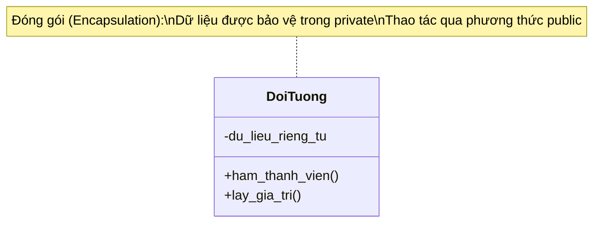

# 13.14 — Class template argument deduction (CTAD) and deduction guides

---

## 🎯 Mục Tiêu Bài Học
- Nắm vững bản chất lý thuyết và cơ chế hoạt động của **Class template argument deduction (CTAD) and deduction guides** trong tiêu chuẩn ISO C++.
- Hiểu rõ cách máy tính tổ chức bộ nhớ (RAM, CPU registers) khi thực thi mã nguồn liên quan.
- Nhận biết các cạm bẫy lỗi kinh điển (**Undefined Behavior**, Memory Leak, Bug logic) và cách phòng tránh.
- Áp dụng các quy tắc thực hành tốt nhất (**Best Practices**) chuẩn công nghiệp và cập nhật C++20/C++23 hiện đại.

---

# 13.14 &#8212; Class template đối số deduction (CTAD) and deduction guides

## Class template đối số deduction (CTAD) C++17 [](#CTAD)

Starting in C++17, when instantiating an object from a class template, the trình biên dịch can deduce the template types from the types of the object’s initializer (this is called **class template đối số deduction** or **CTAD** for short).  For example:

```cpp
#include <utility> // for std::pair

int main()
{
    std::pair<int, int> p1{ 1, 2 }; // explicitly specify class template std::pair<int, int> (C++11 onward)
    std::pair p2{ 1, 2 };           // CTAD used to deduce std::pair<int, int> from the initializers (C++17)

    return 0;
}
```

CTAD is only performed if no template đối số list is present.  Therefore, both of the following are errors:

```cpp
#include <utility> // for std::pair

int main()
{
    std::pair<> p1 { 1, 2 };    // error: too few template arguments, both arguments not deduced
    std::pair<int> p2 { 3, 4 }; // error: too few template arguments, second argument not deduced

    return 0;
}
```

::: info Author’s note

Many future lessons on this site make use of CTAD.  If you’re compiling these examples using the C++14 standard (or older), you’ll get an error about missing template đối số.  You’ll need to explicitly add such đối số to the example to make it compile.

:::

Since CTAD is a form of type deduction, we can use hằng giá trị (literal) suffixes to change the deduced type:

```cpp
#include <utility> // for std::pair

int main()
{
    std::pair p1 { 3.4f, 5.6f }; // deduced to pair<float, float>
    std::pair p2 { 1u, 2u };     // deduced to pair<unsigned int, unsigned int>

    return 0;
}
```

Template đối số deduction guides C++17 [](#DeductionGuide)

In most cases, CTAD works right out of the box.  However, in certain cases, the trình biên dịch may need a little extra help understanding how to deduce the template đối số properly.

You may be surprised to find that the following program (which is almost identical to the example that uses `std::pair` above) doesn’t compile in C++17 (only):

```cpp
// define our own Pair type
template <typename T, typename U>
struct Pair
{
    T first{};
    U second{};
};

int main()
{
    Pair<int, int> p1{ 1, 2 }; // ok: we're explicitly specifying the template arguments
    Pair p2{ 1, 2 };           // compile error in C++17 (okay in C++20)

    return 0;
}
```

If you compile this in C++17, you’ll likely get some error about “class template đối số deduction failed”  or “cannot deduce template đối số” or “No viable hàm tạo (constructor) or deduction guide”.  This is because in C++17, CTAD doesn’t know how to deduce the template đối số for aggregate class templates.  To address this, we can provide the trình biên dịch with a **deduction guide**, which tells the trình biên dịch how to deduce the template đối số for a given class template.

Here’s the same program with a deduction guide:

```cpp
template <typename T, typename U>
struct Pair
{
    T first{};
    U second{};
};

// Here's a deduction guide for our Pair (needed in C++17 only)
// Pair objects initialized with arguments of type T and U should deduce to Pair<T, U>
template <typename T, typename U>
Pair(T, U) -> Pair<T, U>;
    
int main()
{
    Pair<int, int> p1{ 1, 2 }; // explicitly specify class template Pair<int, int> (C++11 onward)
    Pair p2{ 1, 2 };           // CTAD used to deduce Pair<int, int> from the initializers (C++17)

    return 0;
}
```

This example should compile under C++17.

The deduction guide for our `Pair` class is pretty simple, but let’s take a closer look at how it works.

```cpp
// Here's a deduction guide for our Pair (needed in C++17 only)
// Pair objects initialized with arguments of type T and U should deduce to Pair<T, U>
template <typename T, typename U>
Pair(T, U) -> Pair<T, U>;
```

First, we use the same template type definition as in our `Pair` class.  This makes sense, because if our deduction guide is going to tell the trình biên dịch how to deduce the types for a `Pair<T, U>`, we have to define what `T` and `U` are (template types).  Second, on the right hand side of the arrow, we have the type that we’re helping the trình biên dịch to deduce.  In this case, we want the trình biên dịch to be able to deduce template đối số for đối tượng of type `Pair<T, U>`, so that’s exactly what we put here.  Finally, on the left side of the arrow, we tell the trình biên dịch what kind of declaration to look for.  In this case, we’re telling it to look for a declaration of some object named `Pair` with two đối số (one of type `T`, the other of type `U`).  We could also write this as `Pair(T t, U u)` (where `t` and `u` are the names of the tham số, but since we don’t use `t` and `u`, we don’t need to give them names).

Putting it all together, we’re telling the trình biên dịch that if it sees a declaration of a `Pair` with two đối số (of types `T` and `U` respectively), it should deduce the type to be a `Pair<T, U>`.

So when the trình biên dịch sees the definition `Pair p2{ 1, 2 };` in our program, it will say, “oh, this is a declaration of a `Pair` and there are two đối số of type `int` and `int`, so using the deduction guide, I should deduce this to be a `Pair<int, int>`“.

Here’s a similar example for a Pair that takes a single template type:

```cpp
template <typename T>
struct Pair
{
    T first{};
    T second{};
};

// Here's a deduction guide for our Pair (needed in C++17 only)
// Pair objects initialized with arguments of type T and T should deduce to Pair<T>
template <typename T>
Pair(T, T) -> Pair<T>;

int main()
{
    Pair<int> p1{ 1, 2 }; // explicitly specify class template Pair<int> (C++11 onward)
    Pair p2{ 1, 2 };      // CTAD used to deduce Pair<int> from the initializers (C++17)

    return 0;
}
```

In this case, our deduction guide maps a `Pair(T, T)` (a `Pair` with two đối số of type `T`) to a `Pair<T>`.

::: info Tip

C++20 added the ability for the trình biên dịch to automatically generate deduction guides for aggregates, so deduction guides should only need to be provided for C++17 compatibility.

Because of this, the version of `Pair` without the deduction guides should compile in C++20.

`std::pair` (and other standard library template types) come with pre-defined deduction guides, which is why our example above that uses `std::pair` compiles fine in C++17 without us having to provide deduction guides ourselves.
:::

::: info For advanced readers

Non-aggregates don’t need deduction guides in C++17 because the presence of a hàm tạo (constructor) serves the same purpose.

:::

Type template tham số with default values

Just like hàm tham số can have default đối số, template tham số can be given default values.  These will be used when the template tham số isn’t explicitly specified and can’t be deduced.

Here’s a modification of our `Pair<T, U>` class template program above, with type template tham số `T` and `U` defaulted to type `int`:

```cpp
template <typename T=int, typename U=int> // default T and U to type int
struct Pair
{
    T first{};
    U second{};
};

template <typename T, typename U>
Pair(T, U) -> Pair<T, U>;

int main()
{
    Pair<int, int> p1{ 1, 2 }; // explicitly specify class template Pair<int, int> (C++11 onward)
    Pair p2{ 1, 2 };           // CTAD used to deduce Pair<int, int> from the initializers (C++17)

    Pair p3;                   // uses default Pair<int, int>

    return 0;
}
```

Our definition for `p3` does not explicitly specify types for the type template tham số, nor is there an initializer for these types to be deduced from.  Therefore, the trình biên dịch will use the types specified in the defaults, which means `p3` will be of type `Pair<int, int>`.

CTAD doesn’t work with non-static member sự khởi tạo

When initializing the member of a class type using non-static member sự khởi tạo, CTAD will not work in this context.  All template đối số must be explicitly specified:

```cpp
#include <utility> // for std::pair

struct Foo
{
    std::pair<int, int> p1{ 1, 2 }; // ok, template arguments explicitly specified
    std::pair p2{ 1, 2 };           // compile error, CTAD can't be used in this context
};

int main()
{
    std::pair p3{ 1, 2 };           // ok, CTAD can be used here
    return 0;
}
```

CTAD doesn’t work with hàm tham số

CTAD stands for class template *đối số* deduction, not class template *tham số* deduction, so it will only deduce the type of template đối số, not template tham số.

Therefore, CTAD can’t be used in hàm tham số.

```cpp
#include <iostream>
#include <utility>

void print(std::pair p) // compile error, CTAD can't be used here
{
    std::cout << p.first << ' ' << p.second << '\n';
}

int main()
{
    std::pair p { 1, 2 }; // p deduced to std::pair<int, int>
    print(p);

    return 0;
}
```

In such cases, you should use a template instead:

```cpp
#include <iostream>
#include <utility>

template <typename T, typename U>
void print(std::pair<T, U> p)
{
    std::cout << p.first << ' ' << p.second << '\n';
}

int main()
{
    std::pair p { 1, 2 }; // p deduced to std::pair<int, int>
    print(p);

    return 0;
}
```

  	
  	

---



::: warning Cạm Bẫy: Khởi Tạo Không Đồng Nhất (Initialization Pitfalls)
Hãy luôn khởi tạo biến thành viên ngay tại nơi khai báo hoặc sử dụng **Danh sách khởi tạo thành viên (Member Initializer List)** trong hàm tạo để tránh việc đối tượng bị gán giá trị 2 lần gây lãng phí chu kỳ CPU.
:::

::: tip 💡 Tóm Tắt Quy Tắc Vàng (Core Guidelines)
1. Luôn hiểu rõ vòng đời và quyền sở hữu (Ownership) của dữ liệu trước khi viết code.
2. Ưu tiên khởi tạo đồng nhất với dấu ngoặc nhọn `{}` để ngăn chặn lỗi thu hẹp kiểu dữ liệu (Narrowing conversions).
3. Bật toàn bộ cờ cảnh báo `-Wall -Wextra -Wpedantic` để compiler giúp bạn phát hiện bug từ sớm!
:::
