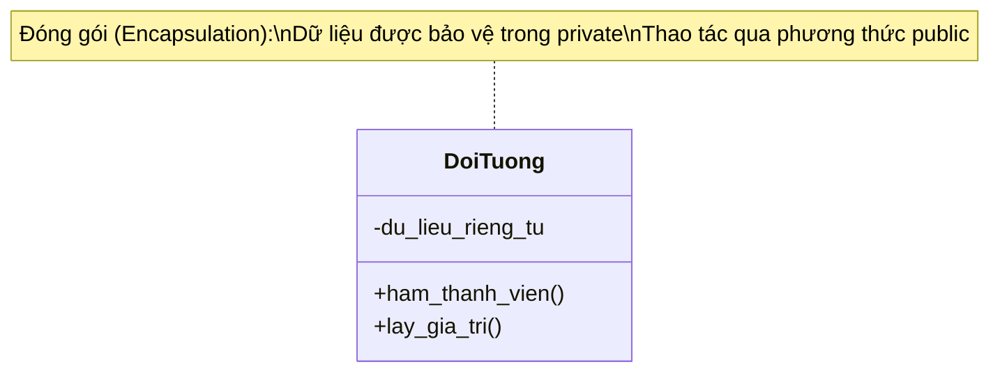

# 13.6 — Scoped enumerations (enum classes)

---

## 🎯 Mục Tiêu Bài Học
- Nắm vững bản chất lý thuyết và cơ chế hoạt động của **Scoped enumerations (enum classes)** trong tiêu chuẩn ISO C++.
- Hiểu rõ cách máy tính tổ chức bộ nhớ (RAM, CPU registers) khi thực thi mã nguồn liên quan.
- Nhận biết các cạm bẫy lỗi kinh điển (**Undefined Behavior**, Memory Leak, Bug logic) và cách phòng tránh.
- Áp dụng các quy tắc thực hành tốt nhất (**Best Practices**) chuẩn công nghiệp và cập nhật C++20/C++23 hiện đại.

---

# 13.6 &#8212; Scoped enumerations (enum classes)

Although unscoped enumerations are distinct types in C++, they are not type safe, and in some cases will allow you to do things that don’t make sense.  Consider the following case:

```cpp
#include <iostream>

int main()
{
    enum Color
    {
        red,
        blue,
    };

    enum Fruit
    {
        banana,
        apple,
    };
	
    Color color { red };
    Fruit fruit { banana };

    if (color == fruit) // The compiler will compare color and fruit as integers
        std::cout << "color and fruit are equal\n"; // and find they are equal!
    else
        std::cout << "color and fruit are not equal\n";

    return 0;
}
```

This prints:

```cpp
color and fruit are equal
```

When `color` and `fruit` are compared, the trình biên dịch will look to see if it knows how to compare a `Color` and a `Fruit`.  It doesn’t.  Next, it will try converting `Color` and/or `Fruit` to integers to see if it can find a match.  Eventually the trình biên dịch will determine that if it converts both to integers, it can do the comparison.  Since `color` and `fruit` are both set to enumerators that convert to integer value `0`, `color` will equal `fruit`.

This doesn’t make sense semantically since `color` and `fruit` are from different enumerations and are not intended to be comparable.  With standard enumerators, there’s no easy way to prevent this.

Because of such challenges, as well as the namespace pollution problem (unscoped enumerations defined in the global phạm vi truy cập (scope) put their enumerators in the global namespace), the C++ designers determined that a cleaner solution for enumerations would be of use.

Scoped enumerations

That solution is the **scoped enumeration** (often called an **enum class** in C++ for reasons that will become obvious shortly).

Scoped enumerations work similarly to unscoped enumerations ([13.2 -- Unscoped enumerations](https://www.learncpp.com/cpp-tutorial/unscoped-enumerations/)), but have two primary differences: They won’t implicitly convert to integers, and the enumerators are *only* placed into the phạm vi truy cập (scope) region of the enumeration (not into the phạm vi truy cập (scope) region where the enumeration is defined).

To make a scoped enumeration, we use the keywords `enum class`.  The rest of the scoped enumeration definition is the same as an unscoped enumeration definition.  Here’s an example:

```cpp
#include <iostream>
int main()
{
    enum class Color // "enum class" defines this as a scoped enumeration rather than an unscoped enumeration
    {
        red, // red is considered part of Color's scope region
        blue,
    };

    enum class Fruit
    {
        banana, // banana is considered part of Fruit's scope region
        apple,
    };

    Color color { Color::red }; // note: red is not directly accessible, we have to use Color::red
    Fruit fruit { Fruit::banana }; // note: banana is not directly accessible, we have to use Fruit::banana
	
    if (color == fruit) // compile error: the compiler doesn't know how to compare different types Color and Fruit
        std::cout << "color and fruit are equal\n";
    else
        std::cout << "color and fruit are not equal\n";

    return 0;
}
```

This program produces a compile error on line 19, since the scoped enumeration won’t convert to any type that can be compared with another type.

::: info As an aside…

The `class` keyword (along with the `static` keyword), is one of the most overloaded keywords in the C++ language, and can have different meanings depending on context.  Although scoped enumerations use the `class` keyword, they aren’t considered to be a “class type” (which is reserved for structs, classes, and unions).

`enum struct` also works in this context, and behaves identically to `enum class`.  However, use of `enum struct` is non-idiomatic, so avoid its use.
:::

Scoped enumerations define their own phạm vi truy cập (scope) regions

Unlike unscoped enumerations, which place their enumerators in the same phạm vi truy cập (scope) as the enumeration itself, scoped enumerations place their enumerators *only* in the phạm vi truy cập (scope) region of the enumeration.  In other words, scoped enumerations act like a namespace for their enumerators.  This built-in namespacing helps reduce global namespace pollution and the potential for name conflicts when scoped enumerations are used in the global phạm vi truy cập (scope).

To access a scoped enumerator, we do so just as if it was in a namespace having the same name as the scoped enumeration:

```cpp
#include <iostream>

int main()
{
    enum class Color // "enum class" defines this as a scoped enum rather than an unscoped enum
    {
        red, // red is considered part of Color's scope region
        blue,
    };

    std::cout << red << '\n';        // compile error: red not defined in this scope region
    std::cout << Color::red << '\n'; // compile error: std::cout doesn't know how to print this (will not implicitly convert to int)

    Color color { Color::blue }; // okay

    return 0;
}
```

Because scoped enumerations offer their own implicit namespacing for enumerators, there’s no need to put scoped enumerations inside another phạm vi truy cập (scope) region (such as a namespace), unless there’s some other compelling reason to do so, as it would be redundant.

Scoped enumerations don’t implicitly convert to integers

Unlike non-scoped enumerators, scoped enumerators won’t implicitly convert to integers.  In most cases, this is a good thing because it rarely makes sense to do so, and it helps prevent semantic errors, such as comparing enumerators from different enumerations, or biểu thức such as `red + 5`.

Note that you can still compare enumerators from within the same scoped enumeration (since they are of the same type):

```cpp
#include <iostream>
int main()
{
    enum class Color
    {
        red,
        blue,
    };

    Color shirt { Color::red };

    if (shirt == Color::red) // this Color to Color comparison is okay
        std::cout << "The shirt is red!\n";
    else if (shirt == Color::blue)
        std::cout << "The shirt is blue!\n";

    return 0;
}
```

There are occasionally cases where it is useful to be able to treat a scoped enumerator as an integral value.  In these cases, you can explicitly convert a scoped enumerator to an integer by using a `static_cast`.  A better choice in C++23 is to use `std::to_underlying()` (defined in the `<utility>` header), which converts an enumerator to a value of the underlying type of the enumeration.

```cpp
#include <iostream>
#include <utility> // for std::to_underlying() (C++23)

int main()
{
    enum class Color
    {
        red,
        blue,
    };

    Color color { Color::blue };

    std::cout << color << '\n'; // won't work, because there's no implicit conversion to int
    std::cout << static_cast<int>(color) << '\n';   // explicit conversion to int, will print 1
    std::cout << std::to_underlying(color) << '\n'; // convert to underlying type, will print 1 (C++23)

    return 0;
}
```

Conversely, you can also `static_cast` an integer to a scoped enumerator, which can be useful when doing input from users:

```cpp
#include <iostream>

int main()
{
    enum class Pet
    {
        cat, // assigned 0
        dog, // assigned 1
        pig, // assigned 2
        whale, // assigned 3
    };

    std::cout << "Enter a pet (0=cat, 1=dog, 2=pig, 3=whale): ";

    int input{};
    std::cin >> input; // input an integer

    Pet pet{ static_cast<Pet>(input) }; // static_cast our integer to a Pet

    return 0;
}
```

As of C++17, you can list khởi tạo a scoped enumeration using an integral value without the static_cast (and unlike an unscoped enumeration, you don’t need to specify a base):

```cpp
// using enum class Pet from prior example
   Pet pet { 1 }; // okay
```

::: tip Thực hành tốt nhất (Best Practice)

Favor scoped enumerations over unscoped enumerations unless there’s a compelling reason to do otherwise.

:::

Despite the benefits that scoped enumerations offer, unscoped enumerations are still commonly used in C++ because there are situations where we desire the implicit conversion to int (doing lots of static_casting gets annoying) and we don’t need the extra namespacing.

Easing the conversion of scoped enumerators to integers (advanced) [](#operatorplus)

Scoped enumerations are great, but the lack of implicit conversion to integers can sometimes be a pain point.  If we need to convert a scoped enumeration to integers often (e.g. cases where we want to use scoped enumerators as array indices), having to use static_cast every time we want a conversion can clutter our code significantly.

If you find yourself in the situation where it would be useful to make conversion of scoped enumerators to integers easier, a useful hack is to overload the unary `toán tử+` to perform this conversion:

```cpp
#include <iostream>
#include <type_traits> // for std::underlying_type_t

enum class Animals
{
    chicken, // 0
    dog, // 1
    cat, // 2
    elephant, // 3
    duck, // 4
    snake, // 5

    maxAnimals,
};

// Overload the unary + operator to convert an enum to the underlying type
// adapted from https://stackoverflow.com/a/42198760, thanks to Pixelchemist for the idea
// In C++23, you can #include <utility> and return std::to_underlying(a) instead
template <typename T>
constexpr auto operator+(T a) noexcept
{
    return static_cast<std::underlying_type_t<T>>(a);
}

int main()
{
    std::cout << +Animals::elephant << '\n'; // convert Animals::elephant to an integer using unary operator+

    return 0;
}
```

This prints:

```cpp
3
```

This method prevents unintended implicit conversions to an integral type, but provides a convenient way to explicitly request such conversions as needed.

`using enum` câu lệnh C++20

Introduced in C++20, a `using enum` câu lệnh imports all of the enumerators from an enum into the current phạm vi truy cập (scope).  When used with an enum class type, this allows us to access the enum class enumerators without having to prefix each with the name of the enum class.

This can be useful in cases where we would otherwise have many identical, repeated prefixes, such as within a switch câu lệnh:

```cpp
#include <iostream>
#include <string_view>

enum class Color
{
    black,
    red,
    blue,
};

constexpr std::string_view getColor(Color color)
{
    using enum Color; // bring all Color enumerators into current scope (C++20)
    // We can now access the enumerators of Color without using a Color:: prefix

    switch (color)
    {
    case black: return "black"; // note: black instead of Color::black
    case red:   return "red";
    case blue:  return "blue";
    default:    return "???";
    }
}

int main()
{
    Color shirt{ Color::blue };

    std::cout << "Your shirt is " << getColor(shirt) << '\n';

    return 0;
}
```

In the above example, `Color` is an enum class, so we normally would access the enumerators using a fully qualified name (e.g. `Color::blue`).  However, within hàm `getColor()`, we’ve added the câu lệnh `using enum Color;`, which allows us to access those enumerators without the `Color::` prefix.

This saves us from having multiple, redundant, obvious prefixes inside the switch câu lệnh.

Hệ thống Câu hỏi & Quiz Tự Luyện

Câu hỏi #1

Define an enum class named Animal that contains the following animals: pig, chicken, goat, cat, dog, duck.  Write a hàm named getAnimalName() that takes an Animal tham số and uses a switch câu lệnh to return the name for that animal as a std::string_view (or std::string if you’re using C++14).  Write another hàm named printNumberOfLegs() that uses a switch câu lệnh to print the number of legs each animal walks on.  Make sure both các hàm have a default case that prints an error message.  Call printNumberOfLegs() from main() with a cat and a chicken.  Your output should look like this:

```cpp
A cat has 4 legs.
A chicken has 2 legs.
```

::: details Xem lời giải (Solution)
```cpp
#include <iostream>
#include <string_view> // C++17
//#include <string> // for C++14

enum class Animal
{
    pig,
    chicken,
    goat,
    cat,
    dog,
    duck,
};

constexpr std::string_view getAnimalName(Animal animal) // C++17
// const std::string getAnimalName(Animal animal) // C++14
{
    // If C++20 capable, could use `using enum Animal` here to reduce Animal prefix redundancy
    switch (animal)
    {
        case Animal::chicken:
            return "chicken";
        case Animal::duck:
            return "duck";
        case Animal::pig:
            return "pig";
        case Animal::goat:
            return "goat";
        case Animal::cat:
            return "cat";
        case Animal::dog:
            return "dog";

        default:
            return "???";
    }
}

void printNumberOfLegs(Animal animal)
{
    std::cout << "A " << getAnimalName(animal) << " has ";

    // If C++20 capable, could use `using enum Animal` here to reduce Animal prefix redundancy
    switch (animal)
    {
        case Animal::chicken:
        case Animal::duck:
            std::cout << 2;
            break;

        case Animal::pig:
        case Animal::goat:
        case Animal::cat:
        case Animal::dog:
            std::cout << 4;
            break;

        default:
            std::cout << "???";
            break;
    }

    std::cout << " legs.\n";
}

int main()
{
    printNumberOfLegs(Animal::cat);
    printNumberOfLegs(Animal::chicken);

    return 0;
}
```
:::

  	
  	

---



::: warning Cạm Bẫy: Khởi Tạo Không Đồng Nhất (Initialization Pitfalls)
Hãy luôn khởi tạo biến thành viên ngay tại nơi khai báo hoặc sử dụng **Danh sách khởi tạo thành viên (Member Initializer List)** trong hàm tạo để tránh việc đối tượng bị gán giá trị 2 lần gây lãng phí chu kỳ CPU.
:::

::: tip 💡 Tóm Tắt Quy Tắc Vàng (Core Guidelines)
1. Luôn hiểu rõ vòng đời và quyền sở hữu (Ownership) của dữ liệu trước khi viết code.
2. Ưu tiên khởi tạo đồng nhất với dấu ngoặc nhọn `{}` để ngăn chặn lỗi thu hẹp kiểu dữ liệu (Narrowing conversions).
3. Bật toàn bộ cờ cảnh báo `-Wall -Wextra -Wpedantic` để compiler giúp bạn phát hiện bug từ sớm!
:::
