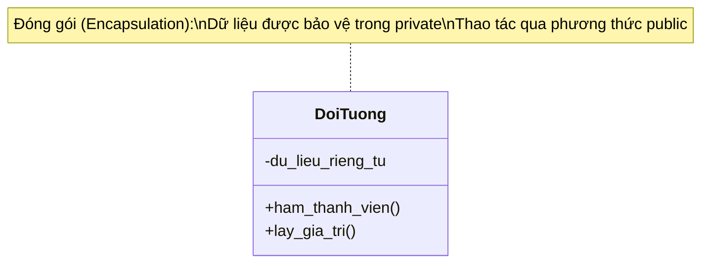

# 13.7 — Introduction to structs, members, and member selection

---

## 🎯 Mục Tiêu Bài Học
- Nắm vững bản chất lý thuyết và cơ chế hoạt động của **Introduction to structs, members, and member selection** trong tiêu chuẩn ISO C++.
- Hiểu rõ cách máy tính tổ chức bộ nhớ (RAM, CPU registers) khi thực thi mã nguồn liên quan.
- Nhận biết các cạm bẫy lỗi kinh điển (**Undefined Behavior**, Memory Leak, Bug logic) và cách phòng tránh.
- Áp dụng các quy tắc thực hành tốt nhất (**Best Practices**) chuẩn công nghiệp và cập nhật C++20/C++23 hiện đại.

---

# 13.7 &#8212; Introduction to structs, members, and member selection

There are many instances in programming where we need more than one biến in order to represent something of interest.  As we discussed in the introduction to the previous chapter ([12.1 -- Introduction to compound các kiểu dữ liệu](https://www.learncpp.com/cpp-tutorial/introduction-to-compound-data-types/)), a fraction has a numerator and denominator that are linked together into a single mathematical object.

Alternatively, lets say we want to write a program where we need to store information about the employees in a company.  We might be interested in keeping track of attributes such as the employee’s name, title, age, employee id, manager id, wage, birthday, hire date, etc…

If we were to use independent các biến to track all of this information, that might look something like this:

```cpp
std::string name;
std::string title;
int age;
int id;
int managerId;
double wage;
int birthdayYear;
int birthdayMonth;
int birthdayDay;
int hireYear;
int hireMonth;
int hireDay;
```

However, there are a number of problems with this approach.  First, it’s not immediately clear whether these các biến are actually related or not (you’d have to read comments, or see how they are used in context).  Second, there are now 12 các biến to manage.  If we wanted to pass this employee to a hàm, we’d have to pass 12 đối số (and in the correct order), which would make a mess of our hàm prototypes and hàm calls.  And since a hàm can only return a single value, how would a hàm even return an employee?

And if we wanted more than one employee, we’d need to define 12 more các biến for each additional employee (each of which would require a unique name)!  This clearly doesn’t scale at all.  What we really need is some way to organize all of these related pieces of data together, to make them easier to manage.

Fortunately, C++ comes with two các kiểu dữ liệu phức hợp designed to solve such challenges: structs (which we’ll introduce now) and classes (which we’ll explore soon).  A **struct** (short for **structure**) is a program-defined kiểu dữ liệu ([13.1 -- Introduction to program-defined (user-defined) types](https://www.learncpp.com/cpp-tutorial/introduction-to-program-defined-user-defined-types/)) that allows us to bundle multiple các biến together into a single type.  As you’ll see shortly, this makes management of related sets of các biến much simpler!

::: info A reminder

A struct is a class type (as are classes and unions).  As such, anything that applies to class types applies to structs.

:::

Defining structs

Because structs are a program-defined type, we first have to tell the trình biên dịch what our struct type looks like before we can begin using it.  Here is an example of a struct definition for a simplified employee:

```cpp
struct Employee
{
    int id {};
    int age {};
    double wage {};
};
```

The `struct` keyword is used to tell the trình biên dịch that we’re defining a struct, which we’ve named `Employee` (since program-defined types are typically given names starting with a capital letter).

Then, inside a pair of curly braces, we define the các biến that each Employee object will contain.  In this example, each `Employee` we create will have 3 các biến: an `int id`, an `int age`,  and a `double wage`.  The các biến that are part of the struct are called **data members** (or **member các biến**).

::: info Tip

In everyday language, a *member* is a individual who belongs to a group.  For example, you might be a member of the basketball team, and your sister might be a member of the choir.

In C++, a **member** is a biến, hàm, or type that belongs to a struct (or class).  All members must be declared within the struct (or class) definition.

We’ll use the term *member* a lot in future lessons, so make sure you remember what it means.
:::

<p>Just like we use an empty set of curly braces to value khởi tạo ([1.4 -- Variable phép gán and sự khởi tạo](https://www.learncpp.com/cpp-tutorial/biến-phép gán-and-sự khởi tạo/)) normal các biến, the empty curly braces after each member biến ensures that the member các biến inside our `Employee` are value được khởi tạo when an `Employee` is created.  We’ll talk more about this when we cover default member sự khởi tạo in a few lessons ([13.9 -- Default member sự khởi tạo](https://www.learncpp.com/cpp-tutorial/default-member-sự khởi tạo/)).

Finally, we end the type definition with a semicolon.

As a reminder, `Employee` is just a type definition -- no đối tượng are actually created at this point.

Defining struct đối tượng

In order to use the `Employee` type, we simply define a biến of type `Employee`:

```cpp
Employee joe {}; // Employee is the type, joe is the variable name
```

This defines a biến of type `Employee` named `joe`.  When the code is executed, an Employee object is instantiated that contains the 3 data members.  The empty braces ensures our object is value-được khởi tạo.

Just like any other type, it is possible to define multiple các biến of the same struct type:

```cpp
Employee joe {}; // create an Employee struct for Joe
Employee frank {}; // create an Employee struct for Frank
```

Accessing members

Consider the following example:

```cpp
struct Employee
{
    int id {};
    int age {};
    double wage {};
};

int main()
{
    Employee joe {};

    return 0;
}
```

In the above example, the name `joe` refers to the entire struct object (which contains the member các biến).  To access a specific member biến, we use the **member selection toán tử** (`toán tử.`) in between the struct biến name and the member name.  For example, to access Joe’s age member, we’d use `joe.age`.

Struct member các biến work just like normal các biến, so it is possible to do normal operations on them, including phép gán, arithmetic, comparison, etc…

```cpp
#include <iostream>

struct Employee
{
    int id {};
    int age {};
    double wage {};
};

int main()
{
    Employee joe {};

    joe.age = 32;  // use member selection operator (.) to select the age member of variable joe

    std::cout << joe.age << '\n'; // print joe's age

    return 0;
}
```

This prints:

```cpp
32
```

One of the biggest advantages of structs is that we only need to create one new name per struct biến (the member names are fixed as part of the struct type definition).  In the following example, we instantiate two `Employee` đối tượng: `joe` and `frank`.

```cpp
#include <iostream>

struct Employee
{
    int id {};
    int age {};
    double wage {};
};

int main()
{
    Employee joe {};
    joe.id = 14;
    joe.age = 32;
    joe.wage = 60000.0;

    Employee frank {};
    frank.id = 15;
    frank.age = 28;
    frank.wage = 45000.0;

    int totalAge { joe.age + frank.age };
    std::cout << "Joe and Frank have lived " << totalAge << " total years\n";

    if (joe.wage > frank.wage)
        std::cout << "Joe makes more than Frank\n";
    else if (joe.wage < frank.wage)
        std::cout << "Joe makes less than Frank\n";
    else
        std::cout << "Joe and Frank make the same amount\n";

    // Frank got a promotion
    frank.wage += 5000.0;

    // Today is Joe's birthday
    ++joe.age; // use pre-increment to increment Joe's age by 1

    return 0;
}
```

In the above example, it is very easy to tell which member các biến belong to Joe and which belong to Frank.  This provides a much higher level of organization than individual các biến would.  Furthermore, because Joe’s and Frank’s members have the same names, this provides consistency when you have multiple các biến of the same struct type.

We’ll continue our exploration of structs in the next lesson, including a look at how to khởi tạo them.

</a>
  	<a class="nav-link" href="/">
  
    <i class="fa fa-home" aria-hidden="true"></i>
    
      Back to table of contents
    
</a>
  	<a class="nav-link" href="https://www.learncpp.com/cpp-tutorial/scoped-enumerations-enum-classes/">
  
    <i class="fa fa-chevron-circle-left" aria-hidden="true"></i>
    
      Previous lesson
      
        13.6Scoped enumerations (enum classes)
      
    
  </a>


---





::: warning Cạm Bẫy: Khởi Tạo Không Đồng Nhất (Initialization Pitfalls)
Hãy luôn khởi tạo biến thành viên ngay tại nơi khai báo hoặc sử dụng **Danh sách khởi tạo thành viên (Member Initializer List)** trong hàm tạo để tránh việc đối tượng bị gán giá trị 2 lần gây lãng phí chu kỳ CPU.
:::


::: tip 💡 Tóm Tắt Quy Tắc Vàng (Core Guidelines)
1. Luôn hiểu rõ vòng đời và quyền sở hữu (Ownership) của dữ liệu trước khi viết code.
2. Ưu tiên khởi tạo đồng nhất với dấu ngoặc nhọn `{}` để ngăn chặn lỗi thu hẹp kiểu dữ liệu (Narrowing conversions).
3. Bật toàn bộ cờ cảnh báo `-Wall -Wextra -Wpedantic` để compiler giúp bạn phát hiện bug từ sớm!
:::
