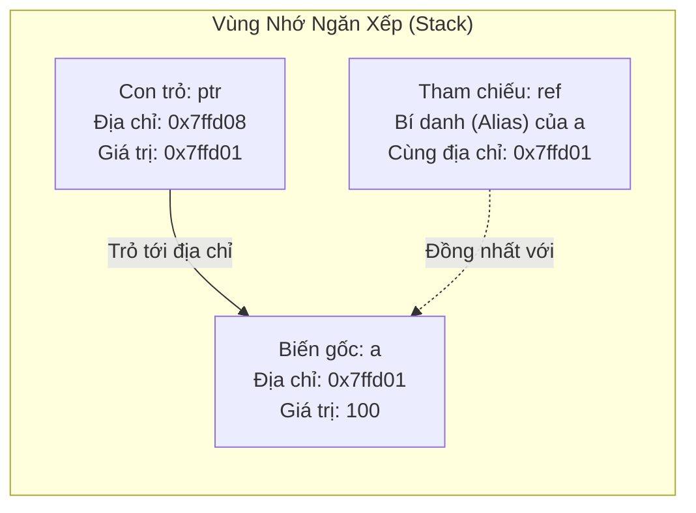

# 13.y — Using a language reference

---

## 🎯 Mục Tiêu Bài Học
- Nắm vững bản chất lý thuyết và cơ chế hoạt động của **Using a language reference** trong tiêu chuẩn ISO C++.
- Hiểu rõ cách máy tính tổ chức bộ nhớ (RAM, CPU registers) khi thực thi mã nguồn liên quan.
- Nhận biết các cạm bẫy lỗi kinh điển (**Undefined Behavior**, Memory Leak, Bug logic) và cách phòng tránh.
- Áp dụng các quy tắc thực hành tốt nhất (**Best Practices**) chuẩn công nghiệp và cập nhật C++20/C++23 hiện đại.

---

# 13.y &#8212; Using a language tham chiếu

Depending on where you’re at in your journey with learning programming languages (and specifically, C++), LearnCpp.com might be the only resource you’re using to learn C++ or to look something up.  LearnCpp.com is designed to explain concepts in a beginner-friendly fashion, but it simply can’t cover every aspect of the language.  As you begin to explore outside the topics that these tutorials cover, you’ll inevitably run into questions that these tutorials don’t answer.  In that case, you’ll need to leverage outside resources.

One such resource is [Stack Overflow](https://stackoverflow.com), where you can ask questions (or better, read the answer to the same question someone before you asked).  But sometimes a better first stop is a tham chiếu guide.  Unlike tutorials, which tend to focus on the most important topics and use informal/common language to make learning easier, tham chiếu guides describe C++ precisely using formal terminology.  Because of this, tham chiếu material tends to be comprehensive, accurate, and… hard to understand.

In this lesson, we’ll show how to use [cppreference](https://cppreference.com), a popular standard tham chiếu that we refer to throughout the lessons, by researching 3 examples.

Overview

Cppreference greets you with an [overview](https://en.cppreference.com/w/cpp) of the core language and libraries:


From here, you can get to everything cppreference has to offer, but it’s easier to use the search hàm, or a search engine. The overview is a great place to visit once you’ve finished the tutorials on LearnCpp.com, to delve deeper into the libraries, and to see what else the language has to offer that you might not be aware of.

The upper half of the table shows features currently in the language, while the bottom half shows technical specifications, which are features that may or may not be added to C++ in a future version, or have already been partially accepted into the language.  This can be useful if you want to see what new capabilities are coming soon.

Starting with C++11, cppreference marks all features with the language standard version they’ve been added in. The standard version is the little green number you can see next to some of the links in the above image. Features without a version number have been available since C++98/03. The version numbers are not only in the overview, but everywhere on cppreference, letting you know exactly what you can or cannot use in a specific C++ version.

::: danger Cảnh báo nguy hiểm

If you use a search engine and a technical specification has just been accepted into the standard, you might get linked to a technical specification rather than the official tham chiếu, which can differ.

:::

::: info Tip

Cppreference is a tham chiếu for both C++ and C. Since C++ shares some hàm names with C, you may find yourself in the C tham chiếu after searching for something. The URL and the navigation bar at the top of cppreference always show you if you’re browsing the C or C++ tham chiếu.

:::

std::string::length

We’ll start by researching a hàm that you know from a previous lesson, `std::string::length`, which returns the length of a string.

On the top right of cppreference, search for “string”. Doing so shows a long list of types and các hàm, of which only the top is relevant for now.


We could have searched for “string length” right away, but for the purpose of showing as much as possible in this lesson, we’re taking the long route. Clicking on “Strings library” takes us to a page talking about the various kinds of strings that C++ supports.


If we look under the “std::basic_string” section, we can see a list of typedefs, and within that list is std::string.

Clicking on “std::string” leads to the page for [`std::basic_string`](https://en.cppreference.com/w/cpp/string/basic_string). There is no page for `std::string`, because `std::string` is a `typedef` for `std::basic_string<char>`, which again can be seen in the `typedef` list:


The `<char>` means that each character of the string is of type `char`.  You’ll note that C++ offers other strings that use different character types.  These can be useful when using Unicode instead of ASCII.

Further down the same page, there’s a [list of member các hàm](https://en.cppreference.com/w/cpp/string/basic_string#Member_functions) (the behaviors that a type has). If you want to know what you can do with a type, this list is very convenient. In this list, you’ll find a row for `length` (and `size`).

Following the link brings us to the detailed hàm description of [`length` and `size`](https://en.cppreference.com/w/cpp/string/basic_string/size), which both do the same thing.

The top of each page starts with a short summary of the feature and syntax, overloads, or declarations:


The title of the page shows the name of the class and hàm with all template tham số. We can ignore this part.  Below the title, we see all of the different hàm overloads (different versions of the hàm that share the same name) and which language standard they apply to.

Below that, we can see the tham số that the hàm takes, and what the giá trị trả về means.

Because `std::string::length` is a simple hàm, there’s not a lot of content on this page.  Many pages show example uses of the feature they’re documenting, as does this one:


While you’re still learning C++, there will be features in the examples that you haven’t seen before. If there are enough examples, you’re probably able to understand a sufficient amount of it to get an idea of how the hàm is used and what it does. If the example is too complicated, you can search for an example somewhere else or read the tham chiếu of the parts you don’t understand (you can click on các hàm and types in the examples to see what they do).

Now we know what `std::string::length` does, but we knew that before. Let’s have a look at something new!

std::cin.ignore

Trong bài học [9.5 -- std::cin and handling invalid input](https://www.learncpp.com/cpp-tutorial/stdcin-and-handling-invalid-input/), we talked about `std::cin.ignore`, which is used to ignore everything up to a line break.  One of the tham số of this hàm is some long and verbose value. What was that again? Can’t you just use a big number? What does this đối số do anyway? Let’s figure it out!

Typing “std::cin.ignore” into the cppreference search yields the following results:


- `std::cin, std::wcin ` - We want `.ignore`, not plain `std::cin`.

- `std::basic_istream<CharT,Traits>::ignore` - Eew, what is this?  Let’s skip for now.

- `std::ignore` - No, that’s not it.

- `std::basic_istream` - That’s not it either.

It’s not there, what now? Let’s go to [`std::cin`](https://en.cppreference.com/w/cpp/io/cin) and work our way from there. There’s nothing immediately obvious on that page. On the top, we can see the declaration of `std::cin` and `std::wcin`, and it tells us which header we need to include to use `std::cin`:


We can see that `std::cin` is an object of type `std::istream`. Let’s follow the link to [`std::istream`](https://en.cppreference.com/w/cpp/io/basic_istream):


Hold up! We’ve seen `std::basic_istream` before when we searched for “std::cin.ignore” in our search engine.  It turns out that `istream` is a typedef name for `basic_istream`, so maybe our search wasn’t so wrong after all.

Scrolling down on that page, we’re greeted with familiar các hàm:


We’ve used many of these các hàm already: `toán tử>>`, `get`, `getline`, `ignore`. Scroll around on that page to get an idea of what else there is in `std::cin`. Then click [`ignore`](https://en.cppreference.com/w/cpp/io/basic_istream/ignore), since that’s what we’re interested in.


On the top of the page there’s the hàm signature and a description of what the hàm and its two tham số do. The `=` signs after the tham số indicate a **default đối số** (we cover this in lesson [11.5 -- Default đối số](https://www.learncpp.com/cpp-tutorial/default-đối số/)). If we don’t provide an đối số for a tham số that has a default value, the default value is used.

The first bullet point answers all of our questions.  We can see that `std::numeric_limits<std::streamsize>::max()` has special meaning to `std::cin.ignore`, in that it disables the character count check.  This means `std::cin.ignore` will continue ignoring characters until it finds the delimiter, or until it runs out of characters to look at.

Many times, you don’t need to read the entire description of a hàm if you already know it but forgot what the tham số or giá trị trả về mean. In such situations, reading the tham số or giá trị trả về description suffices.


The tham số description is brief. It doesn’t contain the special handling of `std::numeric_limits<std::streamsize>::max()` or the other stop conditions, but serves as a good reminder.

A language grammar example

Alongside the standard library, cppreference also documents the language grammar. Here’s a valid program:

```cpp
#include <iostream>

int getUserInput()
{
  int i{};
  std::cin >> i;
  return i;
}

int main()
{
  std::cout << "How many bananas did you eat today? \n";

  if (int iBananasEaten{ getUserInput() }; iBananasEaten <= 2)
  {
    std::cout << "Yummy\n";
  }
  else
  {
    std::cout << iBananasEaten << " is a lot!\n";
  }

  return 0;  
}
```

Why is there a biến definition inside the condition of the `if-câu lệnh`? Let’s use cppreference to figure out what it does by searching for “cppreference if câu lệnh” in our favorite search engine. Doing so leads us to [if câu lệnh](https://en.cppreference.com/w/cpp/language/if). At the top, there’s a syntax tham chiếu.


Look at the syntax for the `if-câu lệnh`.  If you remove all of the optional parts, you get an `if-câu lệnh` that you already know.  Before the `condition`, there’s an optional `init-câu lệnh`, that looks like what’s happening in the code above.

```cpp
if ( init-statement condition ) statement-true
if ( init-statement condition ) statement-true else statement-false
```

Below the syntax tham chiếu, there’s an explanation of each part of the syntax, including the `init-câu lệnh`. It says that the `init-câu lệnh` is typically a declaration of a biến with an initializer.

Following the syntax is an explanation of `if-câu lệnh` and simple examples:


We already know how `if-câu lệnh` work, and the examples don’t include an `init-câu lệnh`, so we scroll down a little to find a section dedicated to `if-câu lệnh` with initializers:


First, it is shown how the `init-câu lệnh` can be written without actually using an `init-câu lệnh`. Now we know what the code in question is doing. It’s a normal biến declaration, just merged into the `if-câu lệnh`.

The sentence after that is interesting, because it lets us know that the names from the `init-câu lệnh` are available in *both* câu lệnh (`câu lệnh-true` and `câu lệnh-false`).  This may be surprising, since you might otherwise assume the biến is only available in the `câu lệnh-true`.

The `init-câu lệnh` examples use features and types that we haven’t covered yet. You don’t have to understand everything you see to understand how the `init-câu lệnh` works. Let’s skip everything that’s too confusing until we find something we can work with:

```cpp
// Iterators, we don't know them. Skip.
if (auto it = m.find(10); it != m.end()) { return it->second.size(); }

// [10], what's that? Skip.
if (char buf[10]; std::fgets(buf, 10, stdin)) { m[0] += buf; }

// std::lock_guard, we don't know that, but it's some type. We know what types are!
if (std::lock_guard lock(mx); shared_flag) { unsafe_ping(); shared_flag = false; }

// This is easy, that's an int!
if (int s; int count = ReadBytesWithSignal(&s)) { publish(count); raise(s); }

// Whew, no thanks!
if (auto keywords = {"if", "for", "while"};
    std::any_of(keywords.begin(), keywords.end(),
                [&s](const char* kw) { return s == kw; })) {
  std::cerr << "Token must not be a keyword\n";
}
```

The easiest example seems to be the one with an `int`. Then we look after the semicolon and there’s another definition, odd… Let’s go back to the `std::lock_guard` example.

```cpp
if (std::lock_guard lock(mx); shared_flag)
{
  unsafe_ping();
  shared_flag = false;
}
```

From this, it’s relatively easy to see how an `init-câu lệnh` works. Define some biến (`lock`), then a semicolon, then the condition. That’s exactly what happened in our example.

A cảnh báo about the accuracy of cppreference

Cppreference is not an official documentation source -- rather, it is a wiki.  With wikis, anyone can add and modify content -- the content is sourced from the community.  Although this means that it’s easy for someone to add wrong information, that misinformation is typically quickly caught and removed, making cppreference a reliable source.

The only official source for C++ is [the standard](https://isocpp.org/std/the-standard) (Free drafts on [github](https://github.com/cplusplus/draft/tree/master/papers)), which is a formal document and not easily usable as a tham chiếu.

Hệ thống Câu hỏi & Quiz Tự Luyện

Câu hỏi #1

What does the following program print? Don’t run it, use a tham chiếu to figure out what `erase` does.

```cpp
#include <iostream>
#include <string>

int main()
{
  std::string str{ "The rice is cooking" };

  str.erase(4, 11);

  std::cout << str << '\n';

  return 0;
}
```

::: info Tip

When you find `erase` on cppreference, you can ignore the overloads that use iterators.
:::

::: info Tip

Indexes in C++ start at 0. The character at index 0 in the string “House” is ‘H’, at 1 it’s ‘o’, and so on.

:::

::: details Xem lời giải (Solution)
```cpp
The king
```

Here’s how you’d get there by using the search hàm on cppreference (you might have skipped the first step by using a search engine):

[Searching for string](https://en.cppreference.com/mwiki/index.php?title=Special%3ASearch&search=string&button=) and clicking “std::string” leads us to [`std::basic_string`](https://en.cppreference.com/w/cpp/string/basic_string).

Scrolling to the “Member các hàm” list, we find [erase](https://en.cppreference.com/w/cpp/string/basic_string/erase). As hinted in the tip above, the first **hàm overload** is used. It takes 2 `size_type` (Unsigned integer type) đối số. In our example, 4 and 11. According to the description of (1), it removes “`min(count, size() - index)` characters starting at `index`“. Plugging in our đối số, it removes `min(11, 19 - 4) = 11` characters starting at index 4.
:::

Câu hỏi #2

In the following code, modify `str` so that its value is “I saw a blue car yesterday.” without repeating the string.  For example, don’t do this:

```cpp
str = "I saw a blue car yesterday.";
```

You only need to call one hàm to *replace* “red” with “blue”.

```cpp
#include <iostream>
#include <string>

int main()
{
  std::string str{ "I saw a red car yesterday." };  

  // ...

  std::cout << str << '\n'; // I saw a blue car yesterday.

  return 0;
}
```

::: details Gợi ý (Hint)
Hint: [`std::basic_string`](https://en.cppreference.com/w/cpp/string/basic_string)
:::

::: details Gợi ý (Hint)
Hint: [Member các hàm of `std::basic_string`](https://en.cppreference.com/w/cpp/string/basic_string#Member_functions)
:::

::: details Gợi ý (Hint)
Hint: [Modifiers of `std::basic_string`](https://en.cppreference.com/w/cpp/string/basic_string#modifiers)
:::

::: details Gợi ý (Hint)
Hint: [`std::basic_string::replace`](https://en.cppreference.com/w/cpp/string/basic_string/replace)
:::

::: details Xem lời giải (Solution)
```cpp
#include <iostream>
#include <string>

int main()
{
  std::string str{ "I saw a red car yesterday." };  

  str.replace(8, 3, "blue");

  std::cout << str << '\n'; // I saw a blue car yesterday.

  return 0;
}
```
:::

  	
  	

---



::: danger Cạm Bẫy Thực Chiến: Con Trỏ Lơ Lửng (Dangling Pointer) & UB
Tuyệt đối không giải phóng vùng nhớ mà con trỏ đang trỏ tới rồi tiếp tục truy cập nó, hoặc trả về tham chiếu/con trỏ tới một biến cục bộ trên Stack. Khi hàm kết thúc, biến cục bộ bị hủy và con trỏ sẽ trỏ vào vùng nhớ rác, dẫn đến **Hành vi không xác định (Undefined Behavior)** cực kỳ nguy hiểm!
:::

::: tip Nâng Cấp C++ Hiện Đại: Thay Thế Con Trỏ Thô Bằng Smart Pointers
Trong C++ hiện đại (C++11 đến C++23), hãy hạn chế tối đa việc sử dụng con trỏ thô (`T*`) cùng các toán tử `new`/`delete`. Thay vào đó, hãy luôn ưu tiên:
- `std::unique_ptr<T>`: Sở hữu độc quyền tài nguyên (Zero-overhead, tự động giải phóng RAII).
- `std::shared_ptr<T>`: Sở hữu chia sẻ tài nguyên có cơ chế đếm tham chiếu (Reference counting).
- `std::span<T>` (C++20) hoặc `std::string_view` (C++17): Xem qua vùng nhớ mà không sở hữu, an toàn và tốc độ cực cao.
:::

::: tip 💡 Tóm Tắt Quy Tắc Vàng (Core Guidelines)
1. Luôn hiểu rõ vòng đời và quyền sở hữu (Ownership) của dữ liệu trước khi viết code.
2. Ưu tiên khởi tạo đồng nhất với dấu ngoặc nhọn `{}` để ngăn chặn lỗi thu hẹp kiểu dữ liệu (Narrowing conversions).
3. Bật toàn bộ cờ cảnh báo `-Wall -Wextra -Wpedantic` để compiler giúp bạn phát hiện bug từ sớm!
:::
