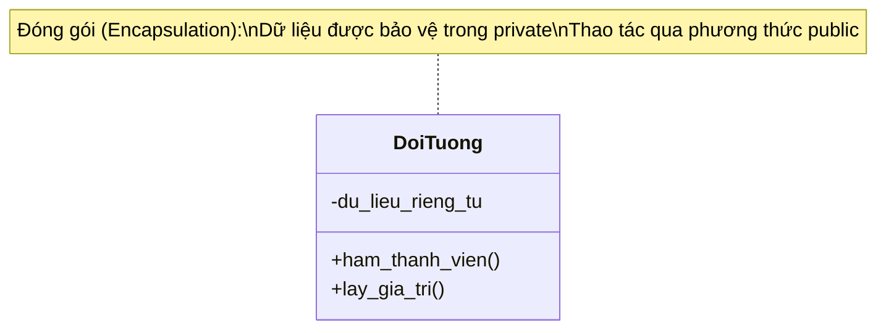

# 14.1 — Introduction to object-oriented programming

---

## 🎯 Mục Tiêu Bài Học
- Nắm vững bản chất lý thuyết và cơ chế hoạt động của **Introduction to object-oriented programming** trong tiêu chuẩn ISO C++.
- Hiểu rõ cách máy tính tổ chức bộ nhớ (RAM, CPU registers) khi thực thi mã nguồn liên quan.
- Nhận biết các cạm bẫy lỗi kinh điển (**Undefined Behavior**, Memory Leak, Bug logic) và cách phòng tránh.
- Áp dụng các quy tắc thực hành tốt nhất (**Best Practices**) chuẩn công nghiệp và cập nhật C++20/C++23 hiện đại.

---

# 14.1 &#8212; Introduction to object-oriented programming

## Procedural programming

Back in lesson [1.3 -- Introduction to đối tượng and các biến](https://www.learncpp.com/cpp-tutorial/introduction-to-đối tượng-and-các biến/), we defined an object in C++ as, “a piece of memory that can be used to store values”.  An object with a name is called a biến.  Our C++ programs have consisted of sequential lists of instructions to the computer that define data (via đối tượng) and operations performed on that data (via các hàm containing câu lệnh and biểu thức).

Up to now, we’ve been doing a type of programming called procedural programming.  In **procedural programming**, the focus is on creating “procedures” (which in C++ are called các hàm) that implement our program logic.  We pass data đối tượng to these các hàm, those các hàm perform operations on the data, and then potentially return a result to be used by the caller.

In procedural programming, the các hàm and the data those các hàm operate on are separate entities.  The programmer is responsible for combining the các hàm and the data together to produce the desired result.  This leads to code that looks like this:

```cpp
eat(you, apple);
```

Now, take a look around you -- everywhere you look are đối tượng: books and buildings and food and even you.  Such đối tượng have two major components to them: 1) Some number of associated properties (e.g. weight, color, size, solidity, shape, etc…), and 2) Some number of behaviors that they can exhibit (e.g. being opened, making something else hot, etc…).  These properties and behaviors are inseparable.

In programming, properties are represented by đối tượng, and behaviors are represented by các hàm.  And thus, procedural programming represents reality fairly poorly, as it separates properties (đối tượng) and behaviors (các hàm).

What is object-oriented programming?

In **object-oriented programming** (often abbreviated as OOP), the focus is on creating program-defined các kiểu dữ liệu that contain both properties and a set of well-defined behaviors.  The term “object” in OOP refers to the đối tượng that we can instantiate from such types.

This leads to code that looks more like this:

```cpp
you.eat(apple);
```

This makes it clearer who the subject is (`you`), what behavior is being invoked (`eat()`), and what đối tượng are accessories to that behavior (`apple`).

Because the properties and behaviors are no longer separate, đối tượng are easier to modularize, which makes our programs easier to write and understand, and also provides a higher degree of code reusability.  These đối tượng also provide a more intuitive way to work with our data by allowing us to define how we interact with the đối tượng, and how they interact with other đối tượng.

We’ll discuss how to create such đối tượng in the next lesson.

A procedural vs OOP-like example

Here’s a short program written in a procedural programming style that prints the name and number of legs of an animal:

```cpp
#include <iostream>
#include <string_view>

enum AnimalType
{
    cat,
    dog,
    chicken,
};

constexpr std::string_view animalName(AnimalType type)
{
    switch (type)
    {
    case cat: return "cat";
    case dog: return "dog";
    case chicken: return "chicken";
    default:  return "";
    }
}

constexpr int numLegs(AnimalType type)
{
    switch (type)
    {
    case cat: return 4;
    case dog: return 4;
    case chicken: return 2;
    default:  return 0;
    }
}


int main()
{
    constexpr AnimalType animal{ cat };
    std::cout << "A " << animalName(animal) << " has " << numLegs(animal) << " legs\n";

    return 0;
}
```

In this program, we have written các hàm that do allow us to do things like get the number of legs an animal has, and get the name of an animal.

While this works just fine, consider what happens when we want to update this program so that our animal is now a `snake`.  To add a snake to our code, we’d need to modify `AnimalType`, `numLegs()`, `animalName()`.  If this were a larger codebase, we’d also need to update any other hàm that uses `AnimalType` -- if `AnimalType` was used in a lot of places, that could be a lot of code that needs to get touched (and potentially broken).

Now let’s write that same program (producing the same output) using more of an OOP mindset:

```cpp
#include <iostream>
#include <string_view>

struct Cat
{
    std::string_view name{ "cat" };
    int numLegs{ 4 };
};

struct Dog
{
    std::string_view name{ "dog" };
    int numLegs{ 4 };
};

struct Chicken
{
    std::string_view name{ "chicken" };
    int numLegs{ 2 };
};

int main()
{
    constexpr Cat animal;
    std::cout << "a " << animal.name << " has " << animal.numLegs << " legs\n";

    return 0;
}
```

In this example, each animal is its own program-defined type, and that type manages everything related to that animal (which in this case, is just keeping track of the name and number of legs).

Now consider the case where we want to update our animal to a snake.  All we have to do is create a `Snake` type and use it instead of `Cat`.  Very little existing code needs to be changed, which means much less risk of breaking something that already works.

As presented, our `Cat`, `Dog`, and `Chicken` example above has a lot of repetition (as each defines the exact same set of members).  In such a case, creating a common `Animal` struct and creating an instance for each animal might be preferable.  But what if we want to add a new member to `Chicken` that’s not applicable to the other animals (e.g. `wormsPerDay`)?  With a common `Animal` struct, all animals will get that member.  With our OOP model, we can restrict that member to `Chicken` đối tượng.

OOP brings other benefits to the table

In school, when you submit your programming assignments, your work is essentially done.  Your professor or teacher’s assistant will run your code to see if it produces the correct result.  It either does or doesn’t, and you are graded accordingly.  Your code is likely discarded at that point.

On the other hand, when you submit your code into a repository that is used by other developers, or into an application that’s used by real users, it’s an entirely different ballgame.  Some new OS or software release will break your code.  Users will find some logic error you made.  A business partner will demand some new capability.  Other developers will need to extend your code without breaking it.  Your code needs to be able to evolve, perhaps significantly, and it needs to be able to do so with minimal time investment, minimal headaches, and minimal breakage.

The best way to address these is by keeping your code as modular (and non-redundant) as possible.  To assist with this, OOP also brings a number of other useful concepts to the table: tính kế thừa, encapsulation, abstraction, and tính đa hình.

::: info Author’s note

Language designers have a philosophy: never use a small word where a big one will do.

Also why is the word abbreviation so long?

:::

We’ll cover what all of these are in due time, and how they can assist in making your code less redundant, and easier to modify and extend.  Once you’ve been properly familiarized with OOP and it clicks, you will likely never want to go back to pure procedural programming again.

That said, OOP doesn’t replace procedural programming -- rather, it gives you additional tools in your programming tool belt to manage complexity when needed.

The term “object”

Note that the term “object” is overloaded a bit, and this causes some amount of confusion.  In traditional programming, an object is a piece of memory to store values.  And that’s it.  In object-oriented programming, an “object” implies that it is both an object in the traditional programming sense, and that it combines both properties and behaviors.  We will favor the traditional meaning of the term object in these tutorials, and prefer the term “class object” when specifically referring to OOP đối tượng.

Hệ thống Câu hỏi & Quiz Tự Luyện

Câu hỏi #1

Update the animal procedural example above and instantiate a snake instead of a cat.

::: details Xem lời giải (Solution)
```cpp
#include <iostream>
#include <string_view>

enum AnimalType
{
    cat,
    dog,
    chicken,
    snake,
};

constexpr std::string_view animalName(AnimalType type)
{
    switch (type)
    {
    case cat: return "cat";
    case dog: return "dog";
    case chicken: return "chicken";
    case snake: return "snake";
    default:  return "";
    }
}

constexpr int numLegs(AnimalType type)
{
    switch (type)
    {
    case cat: return 4;
    case dog: return 4;
    case chicken: return 2;
    case snake: return 0;

    default:  return 0;
    }
}


int main()
{
    constexpr AnimalType animal{ snake };
    std::cout << "A " << animalName(animal) << " has " << numLegs(animal) << " legs\n";

    return 0;
}
```
:::

Câu hỏi #2

Update the animal OOP-like example above and instantiate a snake instead of a cat.

::: details Xem lời giải (Solution)
```cpp
#include <iostream>
#include <string_view>

struct Cat
{
    std::string_view name{ "cat" };
    int numLegs{ 4 };
};

struct Dog
{
    std::string_view name{ "dog" };
    int numLegs{ 4 };
};

struct Chicken
{
    std::string_view name{ "chicken" };
    int numLegs{ 2 };
};

struct Snake
{
    std::string_view name{ "snake" };
    int numLegs{ 0 };
};

int main()
{
    constexpr Snake animal;
    std::cout << "a " << animal.name << " has " << animal.numLegs << " legs\n";

    return 0;
}
```
:::

</a>
  	<a class="nav-link" href="/">
  
    <i class="fa fa-home" aria-hidden="true"></i>
    
      Back to table of contents
    
</a>
  	<a class="nav-link" href="https://www.learncpp.com/cpp-tutorial/using-a-language-tham chiếu/">
  
    <i class="fa fa-chevron-circle-left" aria-hidden="true"></i>
    
      Previous lesson
      
        13.yUsing a language tham chiếu
      
    
  </a>


---





::: warning Cạm Bẫy: Khởi Tạo Không Đồng Nhất (Initialization Pitfalls)
Hãy luôn khởi tạo biến thành viên ngay tại nơi khai báo hoặc sử dụng **Danh sách khởi tạo thành viên (Member Initializer List)** trong hàm tạo để tránh việc đối tượng bị gán giá trị 2 lần gây lãng phí chu kỳ CPU.
:::


::: tip 💡 Tóm Tắt Quy Tắc Vàng (Core Guidelines)
1. Luôn hiểu rõ vòng đời và quyền sở hữu (Ownership) của dữ liệu trước khi viết code.
2. Ưu tiên khởi tạo đồng nhất với dấu ngoặc nhọn `{}` để ngăn chặn lỗi thu hẹp kiểu dữ liệu (Narrowing conversions).
3. Bật toàn bộ cờ cảnh báo `-Wall -Wextra -Wpedantic` để compiler giúp bạn phát hiện bug từ sớm!
:::
