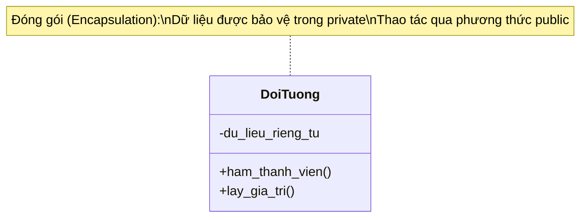

# 14.10 — Constructor member initializer lists

---

## 🎯 Mục Tiêu Bài Học
- Nắm vững bản chất lý thuyết và cơ chế hoạt động của **Constructor member initializer lists** trong tiêu chuẩn ISO C++.
- Hiểu rõ cách máy tính tổ chức bộ nhớ (RAM, CPU registers) khi thực thi mã nguồn liên quan.
- Nhận biết các cạm bẫy lỗi kinh điển (**Undefined Behavior**, Memory Leak, Bug logic) và cách phòng tránh.
- Áp dụng các quy tắc thực hành tốt nhất (**Best Practices**) chuẩn công nghiệp và cập nhật C++20/C++23 hiện đại.

---

# 14.10 &#8212; Constructor member initializer lists

This lesson continues our introduction of các hàm tạo (constructors) from lesson [14.9 -- Introduction to các hàm tạo (constructors)](https://www.learncpp.com/cpp-tutorial/introduction-to-các hàm tạo (constructors)/).

Member sự khởi tạo via a member sự khởi tạo list

To have a hàm tạo (constructor) khởi tạo members, we do so using a **member initializer list** (often called a “member sự khởi tạo list”).  Do not confuse this with the similarly named “initializer list” that is used to khởi tạo aggregates with a list of values.

Member sự khởi tạo lists are something that is best learned by example.  In the following example, our `Foo(int, int)` hàm tạo (constructor) has been updated to use a member initializer list to khởi tạo `m_x`, and `m_y`:

```cpp
#include <iostream>

class Foo
{
private:
    int m_x {};
    int m_y {};

public:
    Foo(int x, int y)
        : m_x { x }, m_y { y } // here's our member initialization list
    {
        std::cout << "Foo(" << x << ", " << y << ") constructed\n";
    }

    void print() const
    {
        std::cout << "Foo(" << m_x << ", " << m_y << ")\n";
    }
};

int main()
{
    Foo foo{ 6, 7 };
    foo.print();

    return 0;
}
```

The member initializer list is defined after the hàm tạo (constructor) tham số.  It begins with a colon (:), and then lists each member to khởi tạo along with the sự khởi tạo value for that biến, separated by a comma.  You must use a direct form of sự khởi tạo here (preferably using braces, but parentheses works as well) -- using copy sự khởi tạo (with an equals) does not work here.  Also note that the member initializer list does not end in a semicolon.

This program produces the following output:

```cpp
Foo(6, 7) constructed
Foo(6, 7)
```

When `foo` is instantiated, the members in the sự khởi tạo list are được khởi tạo with the specified sự khởi tạo values.  In this case, the member initializer list initializes `m_x` to the value of `x` (which is `6`), and `m_y` to the value of `y` (which is `7`).  Then the body of the hàm tạo (constructor) runs.

When the `print()` member hàm is called, you can see that `m_x` still has value `6` and `m_y` still has value `7`.

Member initializer list formatting

C++ provides a lot of freedom to format your member initializer lists as you prefer, as it doesn’t care where you put your colon, commas, or whitespace.

The following styles are all valid (and you’re likely to see all three in practice):

```cpp
Foo(int x, int y) : m_x { x }, m_y { y }
    {
    }
```

```cpp
Foo(int x, int y) :
        m_x { x },
        m_y { y }
    {
    }
```

```cpp
Foo(int x, int y)
        : m_x { x }
        , m_y { y }
    {
    }
```

Our recommendation is to use the third style above:

- Put the colon on the line after the hàm tạo (constructor) name, as this cleanly separates the member initializer list from the hàm prototype.

- Indent your member initializer list, to make it easier to see the hàm names.

If the member sự khởi tạo list is short/trivial, all initializers can go on one line:

```cpp
Foo(int x, int y)
        : m_x { x }, m_y { y }
    {
    }
```

Otherwise (or if you prefer), each member and initializer pair can be placed on a separate line (starting with a comma to maintain alignment):

```cpp
Foo(int x, int y)
        : m_x { x }
        , m_y { y }
    {
    }
```

Member sự khởi tạo order

Because the C++ standard says so, the members in a member initializer list are always được khởi tạo in the order in which they are defined inside the class (not in the order they are defined in the member initializer list).

In the above example, because `m_x` is defined before `m_y` in the class definition, `m_x` will be được khởi tạo first (even if it is not listed first in the member initializer list).

Because we intuitively expect các biến to be được khởi tạo left to right, this can cause subtle errors to occur.  Consider the following example:

```cpp
#include <algorithm> // for std::max
#include <iostream>

class Foo
{
private:
    int m_x{};
    int m_y{};

public:
    Foo(int x, int y)
        : m_y { std::max(x, y) }, m_x { m_y } // issue on this line
    {
    }

    void print() const
    {
        std::cout << "Foo(" << m_x << ", " << m_y << ")\n";
    }
};

int main()
{
    Foo foo { 6, 7 };
    foo.print();

    return 0;
}
```

In the above example, our intent is to calculate the larger of the sự khởi tạo values passed in (via `std::max(x, y)` and then use this value to khởi tạo both `m_x` and `m_y`.  However, on the author’s machine, the following result is printed:

```cpp
Foo(-858993460, 7)
```

What happened?  Even though `m_y` is listed first in the member sự khởi tạo list, because `m_x` is defined first in the class, `m_x` gets được khởi tạo first.  And `m_x` gets được khởi tạo to the value of `m_y`, which hasn’t been được khởi tạo yet.  Finally, `m_y` gets được khởi tạo to the greater of the sự khởi tạo values.

To help prevent such errors, members in the member initializer list should be listed in the order in which they are defined in the class.  Some các trình biên dịch will issue a cảnh báo if members are được khởi tạo out of order.

::: tip Thực hành tốt nhất (Best Practice)

Member các biến in a member initializer list should be listed in order that they are defined in the class.

:::

It’s also a good idea to avoid initializing members using the value of other members (if possible).  That way, even if you do make a mistake in the sự khởi tạo order, it shouldn’t matter because there are no dependencies between sự khởi tạo values.

Member initializer list vs default member initializers

Members can be được khởi tạo in a few different ways:

- If a member is listed in the member initializer list, that sự khởi tạo value is used

- Otherwise, if the member has a default member initializer, that sự khởi tạo value is used

- Otherwise, the member is default-được khởi tạo.

This means that if a member has both a default member initializer and is listed in the member initializer list for the hàm tạo (constructor), the member initializer list value takes precedence.

Here’s an example showing all three sự khởi tạo methods:

```cpp
#include <iostream>

class Foo
{
private:
    int m_x {};    // default member initializer (will be ignored)
    int m_y { 2 }; // default member initializer (will be used)
    int m_z;      // no initializer

public:
    Foo(int x)
        : m_x { x } // member initializer list
    {
        std::cout << "Foo constructed\n";
    }

    void print() const
    {
        std::cout << "Foo(" << m_x << ", " << m_y << ", " << m_z << ")\n";
    }
};

int main()
{
    Foo foo { 6 };
    foo.print();

    return 0;
}
```

On the author’s machine, this output:

```cpp
Foo constructed
Foo(6, 2, -858993460)
```

Here’s what’s happening.  When `foo` is constructed, only `m_x` appears in the member initializer list, so `m_x` is first được khởi tạo to `6`.  `m_y` is not in the member sự khởi tạo list, but it does have a default member initializer, so it is được khởi tạo to `2`.  `m_z` is neither in the member sự khởi tạo list, nor does it have a default member initializer, so it is default-được khởi tạo (which for các kiểu dữ liệu cơ bản, means it is left chưa được khởi tạo).  Thus, when we print the value of `m_z`, we get hành vi không xác định (Hành vi không xác định (Undefined Behavior - UB) - UB).

Constructor hàm bodies

The bodies of các hàm tạo (constructors) các hàm are most often left empty.  This is because we primarily use hàm tạo (constructor) for sự khởi tạo, which is done via the member initializer list.  If that is all we need to do, then we don’t need any câu lệnh in the body of the hàm tạo (constructor).

However, because the câu lệnh in the body of the hàm tạo (constructor) execute after the member initializer list has executed, we can add câu lệnh to do any other setup tasks required.  In the above examples, we print something to the console to show that the hàm tạo (constructor) executed, but we could do other things like open a file or database, allocate memory, etc…

New programmers sometimes use the body of the hàm tạo (constructor) to assign values to members:

```cpp
#include <iostream>

class Foo
{
private:
    int m_x { 0 };
    int m_y { 1 };

public:
    Foo(int x, int y)
    {
        m_x = x; // incorrect: this is an assignment, not an initialization
        m_y = y; // incorrect: this is an assignment, not an initialization
    }

    void print() const
    {
        std::cout << "Foo(" << m_x << ", " << m_y << ")\n";
    }
};

int main()
{
    Foo foo { 6, 7 };
    foo.print();

    return 0;
}
```

Although in this simple case this will produce the expected result, in case where members are required to be được khởi tạo (such as for data members that are const or các tham chiếu) phép gán will not work.

::: info Hiểu biết cốt lõi

Once the member initializer list has finished executing, the object is considered được khởi tạo.  Once the hàm body has finished executing, the object is considered constructed.

:::

::: tip Thực hành tốt nhất (Best Practice)

Prefer using the member initializer list to khởi tạo your members over assigning values in the body of the hàm tạo (constructor).

:::

Detecting and handling invalid đối số to các hàm tạo (constructors)

Consider the following Fraction class:

```cpp
class Fraction
{
private:
    int m_numerator {};
    int m_denominator {};

public:
    Fraction(int numerator, int denominator):
        m_numerator { numerator }, m_denominator { denominator }
    {
    }
};
```

Because a Fraction is a numerator divided by a denominator, the denominator of a fraction cannot be zero (otherwise we get a divide by zero, which is mathematically undefined).  In other words, this class has an invariant that `m_denominator` cannot be `0`.

::: info Related content

We discussed class invariants in lesson [14.2 -- Introduction to classes](https://www.learncpp.com/cpp-tutorial/introduction-to-classes/).

:::

So what do we do when the user tries to create a Fraction with a zero denominator (e.g. `Fraction f { 1, 0 };`)?

Inside a member initializer list, our tools for detecting and handling errors are quite limited.  We can use the conditional toán tử to detect an error, but then what?

```cpp
class Fraction
{
private:
    int m_numerator {};
    int m_denominator {};

public:
    Fraction(int numerator, int denominator):
        m_numerator { numerator }, m_denominator { denominator != 0.0 ? denominator : ??? } // what do we do here?
    {
    }
};
```

We could change the denominator to a valid value, but then the user is going to get a `Fraction` that doesn’t contain the values they asked for, and we don’t have any way to notify them that we did something unexpected.  Thus, we typically won’t try to do any kind of validation in the member initializer list -- we’ll just khởi tạo the members with the values passed in, and then try to deal with the situation.

Inside the body of the hàm tạo (constructor), we can use câu lệnh, so we have more options for detecting and handling errors.  This is a good place to `assert` or `static_assert` that the đối số passed in are semantically valid, but that doesn’t actually handle runtime errors in a production build.

When a hàm tạo (constructor) cannot construct a semantically valid object, we say it has failed.

When các hàm tạo (constructors) fail (a prelude)

Trong bài học [9.4 -- Detecting and handling errors](https://www.learncpp.com/cpp-tutorial/detecting-and-handling-errors/), we introduced the topic of error handling, and discussed some options for handling cases where a hàm cannot proceed due to an error occurring.  Since các hàm tạo (constructors) are các hàm, they are susceptible to the same issues.

In that lesson, we suggested 4 strategies for dealing with such errors:

- Resolve the error within the hàm.

- Pass the error back to the caller to deal with.

- Halt the program.

- Throw an exception.

In most cases, we don’t have enough information to resolve such issues entirely within the hàm tạo (constructor).  So fixing the issue is generally not an option.

With non-member and non-special member các hàm, we can pass an error back to the caller to deal with.  But các hàm tạo (constructors) have no giá trị trả về, so we don’t have a good way to do that.  In some cases, we can add an `isValid()` member hàm (or an overloaded conversion to `bool`) that returns whether the object is currently in a valid state or not.  For example, an `isValid()` hàm for `Fraction` would return `true` when `m_denominator != 0.0`.  But this means the caller has to remember to actually call the hàm any time a new Fraction is created.  And having semantically invalid đối tượng that are accessible is likely to lead to bugs.  So while this is better than nothing, it’s not that great of an option.

In certain types of programs, we can just halt the entire program and let the user rerun the program with the proper inputs… but in most cases, that’s just not acceptable.  So probably not.

And that leaves throwing an exception.  Exceptions abort the construction process entirely, which means the user never gets access to a semantically invalid object.  So in most cases, throwing an exception is the best thing to do in these situations.  

::: info Hiểu biết cốt lõi

Throwing an exception is usually the best thing to do when a hàm tạo (constructor) fails (and cannot recover).  We discuss this further in lessons [27.5 -- Exceptions, classes, and tính kế thừa](https://www.learncpp.com/cpp-tutorial/exceptions-classes-and-tính kế thừa/) and [27.7 -- Function try blocks](https://www.learncpp.com/cpp-tutorial/hàm-try-blocks/).

:::

::: info Author’s note

For now, we’ll generally assume that construction of our class object succeeds in creating a semantically valid object.

:::

::: info For advanced readers

If exceptions aren’t possible or desired (either because you’ve decided not to use them or because you haven’t learned about them yet), there is one other reasonable option.  Instead of letting the user create the class directly, provide a hàm that either returns an instance of the class or something that indicates failure.

In the following example, our `createFraction()` hàm returns a `std::optional<Fraction>` that optionally contains a valid `Fraction`.  If it does, then we can use that Fraction.  If not, then the caller can detect that and deal with it.  We cover `std::optional` in lesson [12.15 -- std::optional](https://www.learncpp.com/cpp-tutorial/stdoptional/) and friend các hàm in lesson [15.8 -- Friend non-member các hàm](https://www.learncpp.com/cpp-tutorial/friend-non-member-các hàm/).

```cpp
#include <iostream>
#include <optional>

class Fraction
{
private:
    int m_numerator { 0 };
    int m_denominator { 1 };

    // private constructor can't be called by public
    Fraction(int numerator, int denominator):
        m_numerator { numerator }, m_denominator { denominator }
    {
    }

public:
    // Allow this function to access private members
    friend std::optional<Fraction> createFraction(int numerator, int denominator);
};

std::optional<Fraction> createFraction(int numerator, int denominator)
{
    if (denominator == 0)
        return {};
    
    return Fraction{numerator, denominator};
}

int main()
{
    auto f1 { createFraction(0, 1) };
    if (f1)
    {
        std::cout << "Fraction created\n";
    }

    auto f2 { createFraction(0, 0) };
    if (!f2)
    {
        std::cout << "Bad fraction\n";
    }   
}
```
:::

Hệ thống Câu hỏi & Quiz Tự Luyện

Câu hỏi #1

Write a class named Ball.  Ball should have two private member các biến, one to hold a color, and one to hold a radius.  Also write a hàm to print out the color and radius of the ball.

The following sample program should compile:

```cpp
int main()
{
	Ball blue { "blue", 10.0 };
	print(blue);

	Ball red { "red", 12.0 };
	print(red);

	return 0;
}
```

and produce the result:

```cpp
Ball(blue, 10)
Ball(red, 12)
```

::: details Xem lời giải (Solution)
```cpp
#include <iostream>
#include <string>
#include <string_view>

class Ball
{
private:
	std::string m_color { "none" };
	double m_radius { 0.0 };

public:
	Ball(std::string_view color, double radius)
		: m_color { color }
		, m_radius { radius }
	{
	}

	const std::string& getColor() const { return m_color; }
	double getRadius() const { return m_radius; }
};

void print(const Ball& ball)
{
    std::cout << "Ball(" << ball.getColor() << ", " << ball.getRadius() << ")\n";
}

int main()
{
	Ball blue { "blue", 10.0 };
	print(blue);

	Ball red { "red", 12.0 };
	print(red);

	return 0;
}
```
:::

Câu hỏi #2

Why did we make `print()` a non-member hàm instead of a member hàm?

::: details Xem lời giải (Solution)

The rationale for this is given in lesson [14.8 -- The benefits of data hiding (encapsulation)](https://www.learncpp.com/cpp-tutorial/the-benefits-of-data-hiding-encapsulation/#prefer-non-member-các hàm).

:::

Câu hỏi #3

Why did we make `m_color` a `std::string` instead of a `std::string_view`?

::: details Xem lời giải (Solution)

In this particular example, it doesn’t matter (because our color đối số are C-style string các hằng giá trị (literals), which doesn’t go out of phạm vi truy cập (scope)). 

But conceptually, we want our `Ball` class to be an owner of the color passed in.  If `m_color` were a `std::string_view`, passing in a temporary object for the color đối số (e.g. a `std::string` returned from a hàm) would leave `m_color` dangling when the temporary color đối số was destroyed.

We discuss this case in more detail (and show an example) in lesson [13.11 -- Struct miscellany](https://www.learncpp.com/cpp-tutorial/struct-miscellany/).

:::

  	
  	

---



::: warning Cạm Bẫy: Khởi Tạo Không Đồng Nhất (Initialization Pitfalls)
Hãy luôn khởi tạo biến thành viên ngay tại nơi khai báo hoặc sử dụng **Danh sách khởi tạo thành viên (Member Initializer List)** trong hàm tạo để tránh việc đối tượng bị gán giá trị 2 lần gây lãng phí chu kỳ CPU.
:::

::: tip 💡 Tóm Tắt Quy Tắc Vàng (Core Guidelines)
1. Luôn hiểu rõ vòng đời và quyền sở hữu (Ownership) của dữ liệu trước khi viết code.
2. Ưu tiên khởi tạo đồng nhất với dấu ngoặc nhọn `{}` để ngăn chặn lỗi thu hẹp kiểu dữ liệu (Narrowing conversions).
3. Bật toàn bộ cờ cảnh báo `-Wall -Wextra -Wpedantic` để compiler giúp bạn phát hiện bug từ sớm!
:::
