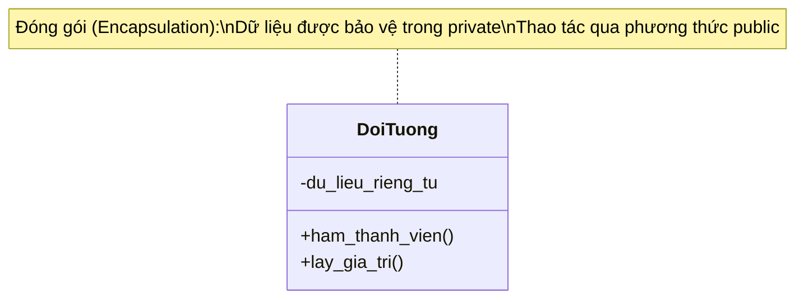

# 14.11 — Default constructors and default arguments

---

## 🎯 Mục Tiêu Bài Học
- Nắm vững bản chất lý thuyết và cơ chế hoạt động của **Default constructors and default arguments** trong tiêu chuẩn ISO C++.
- Hiểu rõ cách máy tính tổ chức bộ nhớ (RAM, CPU registers) khi thực thi mã nguồn liên quan.
- Nhận biết các cạm bẫy lỗi kinh điển (**Undefined Behavior**, Memory Leak, Bug logic) và cách phòng tránh.
- Áp dụng các quy tắc thực hành tốt nhất (**Best Practices**) chuẩn công nghiệp và cập nhật C++20/C++23 hiện đại.

---

# 14.11 &#8212; Default các hàm tạo (constructors) and default đối số

A **default hàm tạo (constructor)** is a hàm tạo (constructor) that accepts no đối số.  Typically, this is a hàm tạo (constructor) that has been defined with no tham số.

Here is an example of a class that has a default hàm tạo (constructor):

```cpp
#include <iostream>

class Foo
{
public:
    Foo() // default constructor
    {
        std::cout << "Foo default constructed\n";
    }
};

int main()
{
    Foo foo{}; // No initialization values, calls Foo's default constructor

    return 0;
}
```

When the above program runs, an object of type `Foo` is created.  Since no sự khởi tạo values have been provided, the default hàm tạo (constructor) `Foo()` is called, which prints:

```cpp
Foo default constructed
```

Value sự khởi tạo vs default sự khởi tạo for class types

If a class type has a default hàm tạo (constructor), both value sự khởi tạo and default sự khởi tạo will call the default hàm tạo (constructor).  Thus, for such a class such as the `Foo` class in the example above, the following are essentially equivalent:

```cpp
Foo foo{}; // value initialization, calls Foo() default constructor
    Foo foo2;  // default initialization, calls Foo() default constructor
```

However, as we already covered in lesson [13.9 -- Default member sự khởi tạo](https://www.learncpp.com/cpp-tutorial/default-member-sự khởi tạo/), value sự khởi tạo is safer for aggregates.  Since it’s difficult to tell whether a class type is an aggregate or non-aggregate, it’s safer to just use value sự khởi tạo for everything and not worry about it.

::: tip Thực hành tốt nhất (Best Practice)

Prefer value sự khởi tạo over default sự khởi tạo for all class types.

:::

Constructors with default đối số

As with all các hàm, the rightmost tham số of các hàm tạo (constructors) can have default đối số.

::: info Related content

We cover default đối số in lesson [11.5 -- Default đối số](https://www.learncpp.com/cpp-tutorial/default-đối số/).

:::

For example:

```cpp
#include <iostream>

class Foo
{
private:
    int m_x { };
    int m_y { };

public:
    Foo(int x=0, int y=0) // has default arguments
        : m_x { x }
        , m_y { y }
    {
        std::cout << "Foo(" << m_x << ", " << m_y << ") constructed\n";
    }
};

int main()
{
    Foo foo1{};     // calls Foo(int, int) constructor using default arguments
    Foo foo2{6, 7}; // calls Foo(int, int) constructor

    return 0;
}
```

This prints:

```cpp
Foo(0, 0) constructed
Foo(6, 7) constructed
```

If all of the tham số in a hàm tạo (constructor) have default đối số, the hàm tạo (constructor) is a default hàm tạo (constructor) (because it can be called with no đối số).

We’ll see examples of where this can be useful in the next lesson ([14.12 -- Delegating các hàm tạo (constructors)](https://www.learncpp.com/cpp-tutorial/delegating-các hàm tạo (constructors)/)).

Overloaded các hàm tạo (constructors)

Because các hàm tạo (constructors) are các hàm, they can be overloaded.  That is, we can have multiple các hàm tạo (constructors) so that we can construct đối tượng in different ways:

```cpp
#include <iostream>

class Foo
{
private:
    int m_x {};
    int m_y {};

public:
    Foo() // default constructor
    {
        std::cout << "Foo constructed\n";
    }

    Foo(int x, int y) // non-default constructor
        : m_x { x }, m_y { y }
    {
        std::cout << "Foo(" << m_x << ", " << m_y << ") constructed\n";
    }
};

int main()
{
    Foo foo1{};     // Calls Foo() constructor
    Foo foo2{6, 7}; // Calls Foo(int, int) constructor

    return 0;
}
```

A corollary of the above is that a class should only have one default hàm tạo (constructor).  If more than one default hàm tạo (constructor) is provided, the trình biên dịch will be unable to disambiguate which should be used:

```cpp
#include <iostream>

class Foo
{
private:
    int m_x {};
    int m_y {};

public:
    Foo() // default constructor
    {
        std::cout << "Foo constructed\n";
    }

    Foo(int x=1, int y=2) // default constructor
        : m_x { x }, m_y { y }
    {
        std::cout << "Foo(" << m_x << ", " << m_y << ") constructed\n";
    }
};

int main()
{
    Foo foo{}; // compile error: ambiguous constructor function call

    return 0;
}
```

In the above example, we instantiate `foo` with no đối số, so the trình biên dịch will look for a default hàm tạo (constructor).  It will find two, and be unable to disambiguate which hàm tạo (constructor) should be used.  This will result in a compile error.

An implicit default hàm tạo (constructor)

If a non-aggregate class type object has no user-declared các hàm tạo (constructors), the trình biên dịch will generate a public default hàm tạo (constructor) (so that the class can be value or default được khởi tạo).  This hàm tạo (constructor) is called an **implicit default hàm tạo (constructor)**.

Consider the following example:

```cpp
#include <iostream>

class Foo
{
private:
    int m_x{};
    int m_y{};

    // Note: no constructors declared
};

int main()
{
    Foo foo{};

    return 0;
}
```

This class has no user-declared các hàm tạo (constructors), so the trình biên dịch will generate an implicit default hàm tạo (constructor) for us.  That hàm tạo (constructor) will be used to instantiate `foo{}`.

The implicit default hàm tạo (constructor) is equivalent to a hàm tạo (constructor) that has no tham số, no member initializer list, and no câu lệnh in the body of the hàm tạo (constructor).  In other words, for the above `Foo` class, the trình biên dịch generates this:

```cpp
public:
    Foo() // implicitly generated default constructor
    {
    }
```

The implicit default hàm tạo (constructor) is useful mostly when we have classes that have no data members.  If a class has data members, we’ll probably want to make them initializable with values provided by the user, and the implicit default hàm tạo (constructor) isn’t sufficient for that.

Using `= default` to generate an explicitly defaulted default hàm tạo (constructor)

In cases where we would write a default hàm tạo (constructor) that is equivalent to the implicitly generated default hàm tạo (constructor), we can instead tell the trình biên dịch to generate a default hàm tạo (constructor) for us.  This hàm tạo (constructor) is called an **explicitly defaulted default hàm tạo (constructor)**, and it can be generated by using the `= default` syntax:

```cpp
#include <iostream>

class Foo
{
private:
    int m_x {};
    int m_y {};

public:
    Foo() = default; // generates an explicitly defaulted default constructor

    Foo(int x, int y)
        : m_x { x }, m_y { y }
    {
        std::cout << "Foo(" << m_x << ", " << m_y << ") constructed\n";
    }
};

int main()
{
    Foo foo{}; // calls Foo() default constructor

    return 0;
}
```

In the above example, since we have a user-declared hàm tạo (constructor) (`Foo(int, int)`), an implicit default hàm tạo (constructor) would not normally be generated.  However, because we’ve told the trình biên dịch to generate such a hàm tạo (constructor), it will.  This hàm tạo (constructor) will subsequently be used by our instantiation of `foo{}`.

::: tip Thực hành tốt nhất (Best Practice)

Prefer an explicitly defaulted default hàm tạo (constructor) (`= default`) over a default hàm tạo (constructor) with an empty body.
:::

Explicitly defaulted default hàm tạo (constructor) vs empty user-defined hàm tạo (constructor)

There are at least two cases where the explicitly defaulted default hàm tạo (constructor) behaves differently than an empty user-defined hàm tạo (constructor).

<ol start="1">
- When value initializing a class, if the class has a user-defined default hàm tạo (constructor), the object will be default được khởi tạo.  However, if the class has a default hàm tạo (constructor) that is not user-provided (that is, a default hàm tạo (constructor) that is either implicitly defined, or defined using `= default`), the object will be zero-được khởi tạo before being default được khởi tạo.

```cpp
#include <iostream>

class User
{
private:
    int m_a; // note: no default initialization value
    int m_b {};

public:
    User() {} // user-defined empty constructor

    int a() const { return m_a; }
    int b() const { return m_b; }
};

class Default
{
private:
    int m_a; // note: no default initialization value
    int m_b {};

public:
    Default() = default; // explicitly defaulted default constructor

    int a() const { return m_a; }
    int b() const { return m_b; }
};

class Implicit
{
private:
    int m_a; // note: no default initialization value
    int m_b {};

public:
    // implicit default constructor

    int a() const { return m_a; }
    int b() const { return m_b; }
};

int main()
{
    User user{}; // default initialized
    std::cout << user.a() << ' ' << user.b() << '\n';

    Default def{}; // zero initialized, then default initialized
    std::cout << def.a() << ' ' << def.b() << '\n';

    Implicit imp{}; // zero initialized, then default initialized
    std::cout << imp.a() << ' ' << imp.b() << '\n';

    return 0;
}
```

On the author’s machine, this prints:

```cpp
782510864 0
0 0
0 0
```

Note that `user.a` was not zero được khởi tạo before being default được khởi tạo, and thus was left chưa được khởi tạo.

In practice, this shouldn’t matter since you should be providing default member initializers for all data members!

::: info Tip

For a class that does not have a user-provided default hàm tạo (constructor), value sự khởi tạo will first zero-khởi tạo the class, while default sự khởi tạo will not.  Given this, default sự khởi tạo may be more performant than value sự khởi tạo (at the cost of being less safe).  If you are looking to squeeze out every bit of performance in a section of code that initializes a lot of đối tượng that do not have user-provided default các hàm tạo (constructors), changing those đối tượng to be default được khởi tạo may be worth exploring.  Alternatively, you could try changing the class to have a default hàm tạo (constructor) with an empty body.  This avoids the zero-sự khởi tạo case when using value sự khởi tạo, but may inhibit other optimizations.

:::

<ol start="2">
- Prior to C++20, a class with a user-defined default hàm tạo (constructor) (even if it has an empty body) makes the class a non-aggregate, whereas an explicitly defaulted default hàm tạo (constructor) does not.  Assuming the class was otherwise an aggregate, the former would cause the class to use list sự khởi tạo instead of aggregate sự khởi tạo.  In C++20 onward, this inconsistency was addressed, so that both make the class a non-aggregate.

Only create a default hàm tạo (constructor) when it makes sense

A default hàm tạo (constructor) allows us to create đối tượng of a non-aggregate class type with no user-provided sự khởi tạo values.  Thus, a class should only provide a default hàm tạo (constructor) when it makes sense for đối tượng of a class type to be created using all default values.

For example:

```cpp
#include <iostream>

class Fraction
{
private:
    int m_numerator{ 0 };
    int m_denominator{ 1 };

public:
    Fraction() = default;
    Fraction(int numerator, int denominator)
        : m_numerator{ numerator }
        , m_denominator{ denominator }
    {
    }

    void print() const
    {
        std::cout << "Fraction(" << m_numerator << ", " << m_denominator << ")\n";
    }
};

int main()
{
    Fraction f1 {3, 5};
    f1.print();

    Fraction f2 {}; // will get Fraction 0/1
    f2.print();

    return 0;
}
```

For a class representing a fraction, it makes sense to allow the user to create Fraction đối tượng with no initializers (in which case, the user will get the fraction 0/1).

Now consider this class:

```cpp
#include <iostream>
#include <string>
#include <string_view>

class Employee
{
private:
    std::string m_name{ };
    int m_id{ };

public:
    Employee(std::string_view name, int id)
        : m_name{ name }
        , m_id{ id }
    {
    }

    void print() const
    {
        std::cout << "Employee(" << m_name << ", " << m_id << ")\n";
    }
};

int main()
{
    Employee e1 { "Joe", 1 };
    e1.print();

    Employee e2 {}; // compile error: no matching constructor
    e2.print();

    return 0;
}
```

For a class representing an employee, it doesn’t make sense to allow creation of employees with no name.  Thus, such a class should not have a default hàm tạo (constructor), so that a quá trình biên dịch error will result if the user of the class tries to do so.

  	
  	

---



::: warning Cạm Bẫy: Khởi Tạo Không Đồng Nhất (Initialization Pitfalls)
Hãy luôn khởi tạo biến thành viên ngay tại nơi khai báo hoặc sử dụng **Danh sách khởi tạo thành viên (Member Initializer List)** trong hàm tạo để tránh việc đối tượng bị gán giá trị 2 lần gây lãng phí chu kỳ CPU.
:::

::: tip 💡 Tóm Tắt Quy Tắc Vàng (Core Guidelines)
1. Luôn hiểu rõ vòng đời và quyền sở hữu (Ownership) của dữ liệu trước khi viết code.
2. Ưu tiên khởi tạo đồng nhất với dấu ngoặc nhọn `{}` để ngăn chặn lỗi thu hẹp kiểu dữ liệu (Narrowing conversions).
3. Bật toàn bộ cờ cảnh báo `-Wall -Wextra -Wpedantic` để compiler giúp bạn phát hiện bug từ sớm!
:::
