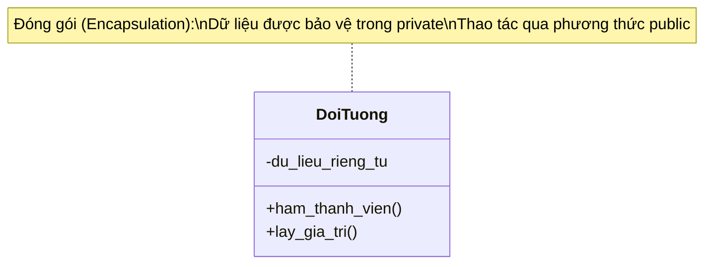

# 14.12 — Delegating constructors

---

## 🎯 Mục Tiêu Bài Học
- Nắm vững bản chất lý thuyết và cơ chế hoạt động của **Delegating constructors** trong tiêu chuẩn ISO C++.
- Hiểu rõ cách máy tính tổ chức bộ nhớ (RAM, CPU registers) khi thực thi mã nguồn liên quan.
- Nhận biết các cạm bẫy lỗi kinh điển (**Undefined Behavior**, Memory Leak, Bug logic) và cách phòng tránh.
- Áp dụng các quy tắc thực hành tốt nhất (**Best Practices**) chuẩn công nghiệp và cập nhật C++20/C++23 hiện đại.

---

# 14.12 &#8212; Delegating các hàm tạo (constructors)

Whenever possible, we want to reduce redundant code (following the DRY principle -- Don’t Repeat Yourself).

Consider the following các hàm:

```cpp
void A()
{
    // statements that do task A
}

void B()
{
    // statements that do task A
    // statements that do task B
}
```

Both các hàm have a set of câu lệnh that do exactly the same thing (task A).  In such a case, we can refactor like this:

```cpp
void A()
{
    // statements that do task A
}

void B()
{
    A();
    // statements that do task B
}
```

In that way, we’ve removed redundant code that existed in các hàm `A()` and `B()`.  This makes our code easier to maintain, as changes only need to be made in one place.

When a class contains multiple các hàm tạo (constructors), it’s extremely common for the code in each hàm tạo (constructor) to be similar if not identical, with lots of repetition.  We’d similarly like to remove hàm tạo (constructor) redundancy where possible.

Consider the following example:

```cpp
#include <iostream>
#include <string>
#include <string_view>

class Employee
{
private:
    std::string m_name { "???" };
    int m_id { 0 };
    bool m_isManager { false };

public:
    Employee(std::string_view name, int id) // Employees must have a name and an id
        : m_name{ name }, m_id { id }
    {
        std::cout << "Employee " << m_name << " created\n";
    }

    Employee(std::string_view name, int id, bool isManager) // They can optionally be a manager
        : m_name{ name }, m_id{ id }, m_isManager { isManager }
    {
        std::cout << "Employee " << m_name << " created\n";
    }
};

int main()
{
    Employee e1{ "James", 7 };
    Employee e2{ "Dave", 42, true };
}
```

The body of each hàm tạo (constructor) has the exact same print câu lệnh.

::: info Author’s note

It’s generally not a good idea to have a hàm tạo (constructor) print something (except for debugging purposes), as this means you can’t create an object using that hàm tạo (constructor) in cases where you do not want to print something.  We’re doing it in this example to help illustrate what’s happening.

:::

Constructors are allowed to call other các hàm, including other member các hàm of the class.  So we could refactor like this:

```cpp
#include <iostream>
#include <string>
#include <string_view>

class Employee
{
private:
    std::string m_name { "???" };
    int m_id{ 0 };
    bool m_isManager { false };

    void printCreated() const // our new helper function
    {
        std::cout << "Employee " << m_name << " created\n";
    }

public:
    Employee(std::string_view name, int id)
        : m_name{ name }, m_id { id }
    {
        printCreated(); // we call it here
    }

    Employee(std::string_view name, int id, bool isManager)
        : m_name{ name }, m_id{ id }, m_isManager { isManager }
    {
        printCreated(); // and here
    }
};

int main()
{
    Employee e1{ "James", 7 };
    Employee e2{ "Dave", 42, true };
}
```

While this is better than the prior version (as the redundant câu lệnh has been replaced by a redundant hàm call), it requires introduction of a new hàm.  And our two các hàm tạo (constructors) are also both initializing `m_name` and `m_id`.  Ideally we’d remove this redundancy too.

Can we do better?  We can.  But this is where many new programmers run into trouble.

Calling a hàm tạo (constructor) in the body of a hàm creates a temporary object

Analogous to how we had hàm `B()` call hàm `A()` in the example above, the obvious solution seems like it would be to call the `Employee(std::string_view, int)` hàm tạo (constructor) from the body of `Employee(std::string_view, int, bool)` in order to khởi tạo `m_name`, `m_id`, and print the câu lệnh.  Here’s what that looks like:

```cpp
#include <iostream>
#include <string>
#include <string_view>

class Employee
{
private:
    std::string m_name { "???" };
    int m_id { 0 };
    bool m_isManager { false };

public:
    Employee(std::string_view name, int id)
        : m_name{ name }, m_id { id } // this constructor initializes name and id
    {
        std::cout << "Employee " << m_name << " created\n"; // our print statement is back here
    }

    Employee(std::string_view name, int id, bool isManager)
        : m_isManager { isManager } // this constructor initializes m_isManager
    {
        // Call Employee(std::string_view, int) to initialize m_name and m_id
        Employee(name, id); // this doesn't work as expected!
    }

    const std::string& getName() const { return m_name; }
};

int main()
{
    Employee e2{ "Dave", 42, true };
    std::cout << "e2 has name: " << e2.getName() << "\n"; // print e2.m_name
}
```

But this doesn’t work correctly, as the program outputs the following:

```cpp
Employee Dave created
e2 has name: ???
```

Even though `Employee Dave created` printed, after `e2` finished construction, `e2.m_name` still appears to be set to its initial value of `"???"`.  How is that possible?

We were expecting `Employee(name, id)` to call the hàm tạo (constructor) in order to continue sự khởi tạo of the current implicit object (`e2`).  But sự khởi tạo of a class object is finished once the member initializer list has finished executing.  By the time we begin executing the hàm tạo (constructor)’s body, it’s too late to do more sự khởi tạo.

When called from the body of a hàm, what looks like a hàm call to a hàm tạo (constructor) usually creates and direct-initializes a temporary object (in one other case, you’ll get a compile error instead).  In our example above, `Employee(name, id);` creates a temporary (unnamed) Employee object.  This temporary object is the one whose `m_name` is set to `Dave`, and is the one that prints `Employee Dave created`.  Then the temporary is destroyed.  `e2` never has its `m_name` or `m_id` changed from the default values.

::: tip Thực hành tốt nhất (Best Practice)

Constructors should not be called directly from the body of another hàm.  Doing so will either result in a quá trình biên dịch error, or will direct-khởi tạo a temporary object.

If you do want a temporary object, prefer list-sự khởi tạo (which makes it clear you are intending to create an object).

:::

So if we can’t call a hàm tạo (constructor) from the body of another hàm tạo (constructor), then how do we solve this issue?

Delegating các hàm tạo (constructors)

Constructors are allowed to delegate (transfer responsibility for) sự khởi tạo to another hàm tạo (constructor) from the same class type.  This process is sometimes called **hàm tạo (constructor) chaining** and such các hàm tạo (constructors) are called **delegating các hàm tạo (constructors)**.

To make one hàm tạo (constructor) delegate sự khởi tạo to another hàm tạo (constructor), simply call the hàm tạo (constructor) in the member initializer list:

```cpp
#include <iostream>
#include <string>
#include <string_view>

class Employee
{
private:
    std::string m_name { "???" };
    int m_id { 0 };

public:
    Employee(std::string_view name)
        : Employee{ name, 0 } // delegate initialization to Employee(std::string_view, int) constructor
    {
    }

    Employee(std::string_view name, int id)
        : m_name{ name }, m_id { id } // actually initializes the members
    {
        std::cout << "Employee " << m_name << " created\n";
    }

};

int main()
{
    Employee e1{ "James" };
    Employee e2{ "Dave", 42 };
}
```

When `e1 { "James" }` is được khởi tạo, matching hàm tạo (constructor) `Employee(std::string_view)` is called with tham số `name` set to `"James"`.  The member initializer list of this hàm tạo (constructor) delegates sự khởi tạo to other hàm tạo (constructor), so `Employee(std::string_view, int)` is then called.  The value of `name` (`"James"`) is passed as the first đối số, and hằng giá trị (literal) `0` is passed as the second đối số.  The member initializer list of the delegated hàm tạo (constructor) then initializes the members.  The body of the delegated hàm tạo (constructor) then runs.  Then control returns to the initial hàm tạo (constructor), whose (empty) body runs.  Finally, control returns to the caller.

The downside of this method is that it sometimes requires duplication of sự khởi tạo values.  In the delegation to the `Employee(std::string_view, int)` hàm tạo (constructor), we need an sự khởi tạo value for the `int` tham số.  We had to hardcode hằng giá trị (literal) `0`, as there is no way to tham chiếu the default member initializer.

A few additional notes about delegating các hàm tạo (constructors).  First, a hàm tạo (constructor) that delegates to another hàm tạo (constructor) is not allowed to do any member sự khởi tạo itself.  So your các hàm tạo (constructors) can delegate or khởi tạo, but not both.

::: info As an aside…

Note that we had `Employee(std::string_view)` (the hàm tạo (constructor) with less tham số) delegate to `Employee(std::string_view name, int id)` (the hàm tạo (constructor) with more tham số).  It is common to have the hàm tạo (constructor) with fewer tham số delegate to the hàm tạo (constructor) with more tham số.

If we had instead chosen to have `Employee(std::string_view name, int id)` delegate to `Employee(std::string_view)`, then that would have left us unable to khởi tạo `m_id` using `id`, as a hàm tạo (constructor) can only delegate or khởi tạo, not both.
:::

<p>Second, it’s possible for one hàm tạo (constructor) to delegate to another hàm tạo (constructor), which delegates back to the first hàm tạo (constructor).  This forms an infinite loop, and will cause your program to run out of ngăn xếp Stack space and crash.  You can avoid this by ensuring all of your các hàm tạo (constructors) resolve to a non-delegating hàm tạo (constructor).

::: tip Thực hành tốt nhất (Best Practice)

If you have multiple các hàm tạo (constructors), consider whether you can use delegating các hàm tạo (constructors) to reduce duplicate code.

:::

Reducing các hàm tạo (constructors) using default đối số

Default values can also sometimes be used to reduce multiple các hàm tạo (constructors) into fewer các hàm tạo (constructors).  For example, by putting a default value on our `id` tham số, we can create a single `Employee` hàm tạo (constructor) that requires a name đối số but will optionally accept an id đối số:

```cpp
#include <iostream>
#include <string>
#include <string_view>

class Employee
{
private:
    std::string m_name{};
    int m_id{ 0 }; // default member initializer

public:

    Employee(std::string_view name, int id = 0) // default argument for id
        : m_name{ name }, m_id{ id }
    {
        std::cout << "Employee " << m_name << " created\n";
    }
};

int main()
{
    Employee e1{ "James" };
    Employee e2{ "Dave", 42 };
}
```

Since default values must be attached to the rightmost tham số in a hàm call, a good practice when defining classes is to define members for which a user *must* provide sự khởi tạo values for first (and then make those the leftmost tham số of the hàm tạo (constructor)).  Members for which the user can optionally provide (because the default values are acceptable) should be defined second (and then make those the rightmost tham số of the hàm tạo (constructor)). 

::: tip Thực hành tốt nhất (Best Practice)

Members for which the user must provide sự khởi tạo values should be defined first (and as the leftmost tham số of the hàm tạo (constructor)).  Members for which the user can optionally provide sự khởi tạo values (because the default values are acceptable) should be defined second (and as the rightmost tham số of the hàm tạo (constructor)).

:::

Note that this method also requires duplication of the default sự khởi tạo value for `m_id` (‘0’): once as a default member initializer, and once as a default đối số.

A conundrum: Redundant các hàm tạo (constructors) vs redundant default values

In the above examples, we used delegating các hàm tạo (constructors) and then default đối số to reduce hàm tạo (constructor) redundancy.  But both of these methods required us to duplicate sự khởi tạo values for our members in various places.  Unfortunately, there is currently no way to specify that a delegating hàm tạo (constructor) or default đối số should use the default member initializer value.

There are various opinions about whether it is better to have fewer các hàm tạo (constructors) (with duplication of sự khởi tạo values) or more các hàm tạo (constructors) (with no duplication of sự khởi tạo values).  Our opinion is that it’s usually more straightforward to have fewer các hàm tạo (constructors), even if it results in duplication of sự khởi tạo values.

::: info For advanced readers

When we have an sự khởi tạo value that is used in multiple places (e.g. as a default member initializer and a default đối số for a hàm tạo (constructor) tham số), we can define a named hằng số and use that wherever our sự khởi tạo value is needed.  This allows the sự khởi tạo value to be defined in one place.

Although you could use a constexpr global biến for this, a better option is to use a `static constexpr` member inside the class:

```cpp
#include <iostream>
#include <string>
#include <string_view>

class Employee
{
private:
    static constexpr int default_id { 0 }; // define a named constant with our desired initialization value
    
    std::string m_name {};
    int m_id { default_id }; // we can use it here

public:

    Employee(std::string_view name, int id = default_id) // and we can use it here
        : m_name { name }, m_id { id }
    {
        std::cout << "Employee " << m_name << " created\n";
    }
};

int main()
{
    Employee e1 { "James" };
    Employee e2 { "Dave", 42 };
}
```

Use of the `static` keyword in this context allows us to have a single `default_id` member that is shared by all `Employee` đối tượng.  Without the `static`, each `Employee` object would have its own independent `default_id` member (which would work, but be a waste of memory).

The downside of this approach is that each additional named hằng số adds another name that must be understood, making your class a little more cluttered and complex.  Whether this is worth it depends on how many of such các hằng số are required, and in how many places the sự khởi tạo values are needed.

We cover static data members in lesson [15.6 -- Static member các biến](https://www.learncpp.com/cpp-tutorial/static-member-các biến/).

:::

Hệ thống Câu hỏi & Quiz Tự Luyện

Câu hỏi #1

Write a class named Ball.  Ball should have two private member các biến, one to hold a color (default value: `black`), and one to hold a radius (default value: `10.0`).  Add 4 các hàm tạo (constructors), one to handle each case below:

```cpp
int main()
{
    Ball def{};
    Ball blue{ "blue" };
    Ball twenty{ 20.0 };
    Ball blueTwenty{ "blue", 20.0 };

    return 0;
}
```

The program should produce the following result:

```cpp
Ball(black, 10)
Ball(blue, 10)
Ball(black, 20)
Ball(blue, 20)
```

::: details Xem lời giải (Solution)
```cpp
#include <iostream>
#include <string>
#include <string_view>

class Ball
{
private:
	std::string m_color{ "black" };
	double m_radius{ 10.0 };

public:
	// Default constructor (color and radius will use default value)
	Ball()
	{
            print();
	}

	// Constructor with only radius parameter (color will use default value)
	Ball(double radius)
		: m_radius{ radius }
	{
            print();
	}

	// Constructor with only color parameter (radius will use default value)
	Ball(std::string_view color)
		: m_color{ color }
	{
            print();
	}

	// Constructor with both color and radius parameters
	Ball(std::string_view color, double radius)
		: m_color{ color }
		, m_radius{ radius }
	{
            print();
	}

    void print() const
    {
        std::cout << "Ball(" << m_color << ", " << m_radius << ")\n";
    }
};

int main()
{
    Ball def{};
    Ball blue{ "blue" };
    Ball twenty{ 20.0 };
    Ball blueTwenty{ "blue", 20.0 };

    return 0;
}
```
:::

Câu hỏi #2

Reduce the number of các hàm tạo (constructors) in the above program by using default đối số and delegating các hàm tạo (constructors).

::: details Xem lời giải (Solution)
```cpp
#include <iostream>
#include <string>
#include <string_view>

class Ball
{
private:
	std::string m_color{ "black" };
	double m_radius{ 10.0 };

public:
	// Handles Ball(radius)
	Ball(double radius)
		: Ball{ "black", radius } // delegate to the other constructor
	{
		// We don't need to call print() here since it will be called by
		// the constructor we delegate to		
	}

	// Handles Ball(color, radius), Ball(color), and Ball()
	Ball(std::string_view color="black", double radius=10.0)
		: m_color{ color }
		, m_radius{ radius }
	{
		print();
	}

	void print() const
	{
		std::cout << "Ball(" << m_color << ", " << m_radius << ")\n";
	}
};

int main()
{
    Ball def{};
    Ball blue{ "blue" };
    Ball twenty{ 20.0 };
    Ball blueTwenty{ "blue", 20.0 };

    return 0;
}
```
:::

</a>
  	<a class="nav-link" href="/">
  
    <i class="fa fa-home" aria-hidden="true"></i>
    
      Back to table of contents
    
</a>
  	<a class="nav-link" href="https://www.learncpp.com/cpp-tutorial/default-các hàm tạo (constructors)-and-default-đối số/">
  
    <i class="fa fa-chevron-circle-left" aria-hidden="true"></i>
    
      Previous lesson
      
        14.11Default các hàm tạo (constructors) and default đối số
      
    
  </a>


---





::: warning Cạm Bẫy: Khởi Tạo Không Đồng Nhất (Initialization Pitfalls)
Hãy luôn khởi tạo biến thành viên ngay tại nơi khai báo hoặc sử dụng **Danh sách khởi tạo thành viên (Member Initializer List)** trong hàm tạo để tránh việc đối tượng bị gán giá trị 2 lần gây lãng phí chu kỳ CPU.
:::


::: tip 💡 Tóm Tắt Quy Tắc Vàng (Core Guidelines)
1. Luôn hiểu rõ vòng đời và quyền sở hữu (Ownership) của dữ liệu trước khi viết code.
2. Ưu tiên khởi tạo đồng nhất với dấu ngoặc nhọn `{}` để ngăn chặn lỗi thu hẹp kiểu dữ liệu (Narrowing conversions).
3. Bật toàn bộ cờ cảnh báo `-Wall -Wextra -Wpedantic` để compiler giúp bạn phát hiện bug từ sớm!
:::
