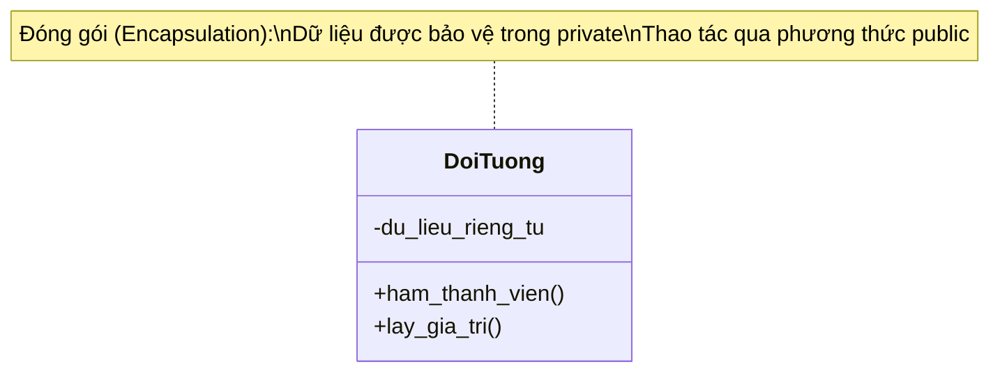

# 14.13 — Temporary class objects

---

## 🎯 Mục Tiêu Bài Học
- Nắm vững bản chất lý thuyết và cơ chế hoạt động của **Temporary class objects** trong tiêu chuẩn ISO C++.
- Hiểu rõ cách máy tính tổ chức bộ nhớ (RAM, CPU registers) khi thực thi mã nguồn liên quan.
- Nhận biết các cạm bẫy lỗi kinh điển (**Undefined Behavior**, Memory Leak, Bug logic) và cách phòng tránh.
- Áp dụng các quy tắc thực hành tốt nhất (**Best Practices**) chuẩn công nghiệp và cập nhật C++20/C++23 hiện đại.

---

# 14.13 &#8212; Temporary class đối tượng

Consider the following example:

```cpp
#include <iostream>

int add(int x, int y)
{
    int sum{ x + y }; // stores x + y in a variable
    return sum;       // returns value of that variable
}

int main()
{
    std::cout << add(5, 3) << '\n';

    return 0;
}
```

In the `add()` hàm, the biến `sum` is used to store the result of the biểu thức `x + y`.  This biến is then evaluated in the return câu lệnh to produce the value to be returned.  While this might be occasionally useful for debugging (so we can inspect the value of `sum` if desired), it actually makes the hàm more complex than it needs to be by defining an object that is then only used one time.

In most cases where a biến is used only once, we actually don’t need a biến.  Instead, we can substitute in the biểu thức used to khởi tạo the biến where the biến would have been used.  Here is the `add()` hàm rewritten in this manner:

```cpp
#include <iostream>

int add(int x, int y)
{
    return x + y; // just return x + y directly
}

int main()
{
    std::cout << add(5, 3) << '\n';

    return 0;
}
```

This works not only with các giá trị trả về, but also with most hàm đối số.  For example, instead of this:

```cpp
#include <iostream>

void printValue(int value)
{
    std::cout << value;
}

int main()
{
    int sum{ 5 + 3 };
    printValue(sum);

    return 0;
}
```

We can write this:

```cpp
#include <iostream>

void printValue(int value)
{
    std::cout << value;
}

int main()
{
    printValue(5 + 3);

    return 0;
}
```

Note how much cleaner this keeps our code.  We don’t have to define and give a name to a biến.  And we don’t have to scan through the entire hàm to determine whether that biến is actually used elsewhere.  Because `5 + 3` is an biểu thức, we know it is only used on that one line.

Do note that this only works in cases where an rvalue biểu thức is accepted.  In cases where an lvalue biểu thức is required, we must have an object:

```cpp
#include <iostream>

void addOne(int& value) // pass by non-const references requires lvalue
{
    ++value;
}

int main()
{
    int sum { 5 + 3 };
    addOne(sum);   // okay, sum is an lvalue

    addOne(5 + 3); // compile error: not an lvalue

    return 0;
}
```

Temporary class đối tượng

The same issue applies in the context of class types.

::: info Author’s note

We’ll use a class here, but everything in this lesson that uses list sự khởi tạo is equally applicable to structs that are được khởi tạo using aggregate sự khởi tạo.

:::

The following example is similar to the ones above, but uses program-defined class type `IntPair` instead of `int`:

```cpp
#include <iostream>

class IntPair
{
private:
    int m_x{};
    int m_y{};

public:
    IntPair(int x, int y)
        : m_x { x }, m_y { y }
    {}

    int x() const { return m_x; }
    int y() const { return m_y; }
};

void print(IntPair p)
{
    std::cout << "(" << p.x() << ", " << p.y() << ")\n";        
}
        
int main()
{
    // Case 1: Pass variable
    IntPair p { 3, 4 };
    print(p); // prints (3, 4)
    
    return 0;
}
```

In case 1, we’re instantiating biến `IntPair p` and then passing `p` to hàm `print()`.

However, `p` is only used once, and hàm `print()` will accept rvalues, so there is really no reason to define a biến here.  So let’s get rid of `p`.

We can do that by passing a temporary object instead of a named biến.  A **temporary object** (sometimes called an **anonymous object** or an **unnamed object**) is an object that has no name and exists only for the duration of a single biểu thức.

There are two common ways to create temporary class type đối tượng:

```cpp
#include <iostream>

class IntPair
{
private:
    int m_x{};
    int m_y{};

public:
    IntPair(int x, int y)
        : m_x { x }, m_y { y }
    {}

    int x() const { return m_x; }
    int y() const{ return m_y; }
};

void print(IntPair p)
{
    std::cout << "(" << p.x() << ", " << p.y() << ")\n";        
}
        
int main()
{
    // Case 1: Pass variable
    IntPair p { 3, 4 };
    print(p);

    // Case 2: Construct temporary IntPair and pass to function
    print(IntPair { 5, 6 } );

    // Case 3: Implicitly convert { 7, 8 } to a temporary Intpair and pass to function
    print( { 7, 8 } );
    
    return 0;
}
```

In case 2, we’re telling the trình biên dịch to construct an `IntPair` object, and initializing it with `{ 5, 6 }`.  Because this object has no name, it is a temporary.  The temporary object is then passed to tham số `p` of hàm `print()`.  When the hàm call returns, the temporary object is destroyed.

In case 3, we’re also creating a temporary `IntPair` object to pass to hàm `print()`.  However, because we have not explicitly specified what type to construct, the trình biên dịch will deduce the necessary type (`IntPair`) from the hàm tham số, and then implicitly convert `{ 7, 8 }` to an `IntPair` object.

To summarize:

```cpp
IntPair p { 1, 2 }; // create named object p initialized with { 1, 2 }
IntPair { 1, 2 };   // create temporary object initialized with { 1, 2 }
{ 1, 2 };           // compiler will try to convert { 1, 2 } to temporary object matching expected type (typically a parameter or return type)
```

We’ll discuss this last case in more detail in lesson [14.16 -- Converting các hàm tạo (constructors) and the explicit keyword](https://www.learncpp.com/cpp-tutorial/converting-các hàm tạo (constructors)-and-the-explicit-keyword/).

A few more examples:

```cpp
std::string { "Hello" }; // create a temporary std::string initialized with "Hello"
std::string {};          // create a temporary std::string using value initialization / default constructor
```

Creating temporary đối tượng via direct sự khởi tạo Optional

Since we can create temporary đối tượng via direct-list-sự khởi tạo, you might be wondering whether you can create temporary đối tượng via the other sự khởi tạo forms.  There is no syntax to create temporary đối tượng using copy sự khởi tạo.

However, you can create temporary đối tượng using direct sự khởi tạo.  For example:

```cpp
Foo (1, 2); //  temporary Foo, direct-initialized with (1, 2) (similar to `Foo { 1, 2 }`)
```

Putting aside the fact that it looks like a hàm call at first glance, this produces the same result as `Foo { 1, 2 }` (just with no narrowing conversion prevention).  Pretty normal right?

We’ll now spend the remainder of this section showing you why you probably shouldn’t do this.

::: info Author’s note

This is mostly here for your reading pleasure, not as something you need to digest, memorize, and be able to explain.

Even if you don’t have that much fun reading it, it might help you understand why list sự khởi tạo is preferred in modern C++!

:::

Now let’s look at the case where we don’t have any đối số:

```cpp
Foo();     // temporary Foo, value-initialized (identical to `Foo {}`)
```

You probably didn’t expect that `Foo()` would create a value-được khởi tạo temporary just like `Foo {}` does.  And that’s probably because this syntax has a completely different meaning when used with a named biến!

```cpp
Foo bar{}; // definition of variable bar, value-initialized
Foo bar(); // declaration of function bar that has no parameters and returns a Foo (inconsistent with `Foo bar{}` and `Foo()`)
```

Ready to get real weird?!?

```cpp
Foo(1);    // Function-style cast of literal 1, returns temporary Foo (similar to `Foo { 1 }`)
Foo(bar);  // Defines variable bar of type Foo (inconsistent with `Foo { bar }` and `Foo(1)`)
```

Wait, what?

- The version with hằng giá trị (literal) `1` in parentheses behaves consistently with all the other versions of this syntax that create temporary đối tượng.

- The version with identifier `bar` in parentheses defines a biến named `bar` (identical to `Foo bar;`).  If `bar` is already defined, this will cause a redefinition compile-error.

The trình biên dịch knows that các hằng giá trị (literals) can’t be used as identifiers for các biến, so it’s able to treat that case consistently with the others.

::: info As an aside…

If you’re wondering why `Foo(bar);` behaves identically to `Foo bar;`… 

One of the most common uses of parentheses is to group things.  For example, in mathematics: `(1 + 2) * 3` produces the result `9`, which is different than `1 + 2 * 3`, which produces the result `7`.  If we can do `(1 + 2) * 3`, there’s no reason we shouldn’t be able to do `(3) * 3`.

For similar reasons, the declaration syntax allows parenthesis-based grouping, and those groups can have a single thing in them.  `Foo(bar)` is interpreted as a biến definition consisting of type `Foo` followed by a group that consists only of identifier `bar`.  It just looks funny to us, mainly because the parentheses don’t serve any useful purpose in this case.  But there’s no compelling reason to disallow doing so (as that would just make the syntax of the language that much more complicated).
:::

::: info For advanced readers
<p>Let’s look at a slightly more complicated case.  Consider the câu lệnh `Foo * bar();`.  By using (or not using) parentheses, we can completely change the meaning of this câu lệnh:

- `Foo * bar();` (with no additional parenthesis) groups the `*` with `Foo` by default.  `Foo* bar();` is the declaration of a hàm named `bar` that has no tham số and returns a `Foo*`.

- `Foo (*bar)();` explicitly groups the `*` with `bar`.  This defines a hàm con trỏ named `bar` that holds the address of a hàm that takes no tham số and returns a `Foo`.

- `Foo (* bar());` is the same as `Foo * bar();` -- the parentheses are superfluous in this case.

Finally:

- `(Foo *) bar();`.  You might expect this to be the same as `Foo* bar()`, but this is actually an biểu thức câu lệnh that calls hàm `bar()`, C-style casts the giá trị trả về to type `Foo*`, and then discards it!

C++ is so weird sometimes.

:::

::: info Hiểu biết cốt lõi

Parentheses are complex because they are so overloaded, and used in the syntax of vastly different things.  This includes hàm calls, direct-sự khởi tạo of đối tượng, value sự khởi tạo of temporaries, C-style casts, groupings of symbols/identifiers, and biến definitions.  So when you see parentheses in some syntax… it’s not always obvious what you’re going to get!

On the other hand, if we see curly braces, we know we’re dealing with đối tượng.

:::

Okay, fun over.  Back to the boring stuff.

Temporary đối tượng and return by value

When a hàm returns by value, the object that is returned is a temporary object (được khởi tạo using the value or object identified in the return câu lệnh).

Here are some examples:

```cpp
#include <iostream>

class IntPair
{
private:
    int m_x{};
    int m_y{};

public:
    IntPair(int x, int y)
        : m_x { x }, m_y { y }
    {}

    int x() const { return m_x; }
    int y() const { return m_y; }
};

void print(IntPair p)
{
    std::cout << "(" << p.x() << ", " << p.y() << ")\n";        
}

// Case 1: Create named variable and return
IntPair ret1()
{
    IntPair p { 3, 4 };
    return p; // returns temporary object (initialized using p)
}

// Case 2: Create temporary IntPair and return
IntPair ret2()
{
    return IntPair { 5, 6 }; // returns temporary object (initialized using another temporary object)
}

// Case 3: implicitly convert { 7, 8 } to IntPair and return
IntPair ret3()
{
    return { 7, 8 }; // returns temporary object (initialized using another temporary object)
}
     
int main()
{
    print(ret1());
    print(ret2());
    print(ret3());

    return 0;
}
```

In case 1, when we `return p`, a temporary object is created and được khởi tạo using `p`.

The cases in this example are analogous to the cases in the prior example.

A few notes

First, just as in the case of an `int`, when used in an biểu thức, a temporary class object is an rvalue.  Thus, such đối tượng can only be used where rvalue biểu thức are accepted.

Second, temporary đối tượng are created at the point of definition, and destroyed at the end of the full biểu thức in which they are defined .  A full biểu thức is an biểu thức that is not a subexpression.

`static_cast` vs explicit instantiation of a temporary object

In cases where we need to convert a value from one type to another but narrowing conversions aren’t involved, we often have the option to use either `static_cast` or explicit instantiation of a temporary object.

For example:

```cpp
#include <iostream>

int main()
{
    char c { 'a' };

    std::cout << static_cast<int>( c ) << '\n'; // static_cast returns a temporary int direct-initialized with value of c
    std::cout << int { c } << '\n';             // explicitly creates a temporary int list-initialized with value c

    return 0;
}
```

`static_cast<int>(c)` returns a temporary `int` that is direct-được khởi tạo with the value of `c`.  `int { c }` creates a temporary `int` that is list-được khởi tạo with the value of `c`.  Either way, we get a temporary int được khởi tạo with the value of `c`, which is what we want.

Let’s show a slightly more complex example:

printString.h:

```cpp
#include <string>
void printString(const std::string &s)
{
    std::cout << s << '\n';
}
```

main.cpp:

```cpp
#include "printString.h"
#include <iostream>
#include <string>
#include <string_view>

int main()
{
    std::string_view sv { "Hello" };

    // We want to print sv using the printString() function
    
//    printString(sv); // compile error: a std::string_view won't implicitly convert to a std::string

    printString( static_cast<std::string>(sv) ); // Case 1: static_cast returns a temporary std::string direct-initialized with sv
    printString( std::string { sv } );           // Case 2: explicitly creates a temporary std::string list-initialized with sv
    printString( std::string ( sv ) );           // Case 3: C-style cast returns temporary std::string direct-initialized with sv (avoid this one!)

    return 0;
}
```

Let’s say the code in header file `printString.h` isn’t code we can modify (e.g. because it’s distributed with some 3rd party library we’re using, and has been written to be compatible with C++11, which doesn’t support `std::string_view`).  So how do we call `printString()` with `sv`?  Because a `std::string_view` won’t implicitly convert to a `std::string` (for efficiency reasons), we can’t just use `sv` as an đối số.  We must use some explicit form of conversion.

In case 1, `static_cast<std::string>(sv)` invokes the static_cast toán tử to cast `sv` to a `std::string`.  This returns a temporary `std::string` that has been direct-được khởi tạo using `sv`, which is then used as the đối số for the hàm call.

In case 2, `std::string { sv }` creates a temporary `std::string` that is list-được khởi tạo using `sv`.  Since this is an explicit construction, the conversion is allowed.  This temporary is then used as the đối số for the hàm call.

In case 3, `std::string ( sv )` use a C-style cast to cast `sv` to a `std::string`.  Although this works here, C-style casting can be dangerous in general and should be avoided.  Notice how similar this looks to the prior case!

::: tip Thực hành tốt nhất (Best Practice)

As a quick rule of thumb: Prefer `static_cast` when converting to a fundamental type, and a list-được khởi tạo temporary when converting to a class type.

Prefer `static_cast` when to create a temporary object when any of the following are true:

- We need to performing a narrowing conversion.

- We want to make it really obvious that we’re converting to a type that will result in some different behavior (e.g. a `char` to an `int`).

- We want to use direct-sự khởi tạo for some reason (e.g. to avoid list các hàm tạo (constructors) taking precedence).

Prefer creating a new object (using list sự khởi tạo) to create a temporary object when any of the following are true:

- We want to use list-sự khởi tạo (e.g. for the protection against narrowing conversions, or because we need to invoke a list hàm tạo (constructor)).

- We need to provide additional đối số to a hàm tạo (constructor) to facilitate the conversion.

:::

::: info Related content

We cover list các hàm tạo (constructors) in lesson [16.2 -- Introduction to std::vector and list các hàm tạo (constructors)](https://www.learncpp.com/cpp-tutorial/introduction-to-stdvector-and-list-các hàm tạo (constructors)/).

:::

</a>
  	<a class="nav-link" href="/">
  
    <i class="fa fa-home" aria-hidden="true"></i>
    
      Back to table of contents
    
</a>
  	<a class="nav-link" href="https://www.learncpp.com/cpp-tutorial/delegating-các hàm tạo (constructors)/">
  
    <i class="fa fa-chevron-circle-left" aria-hidden="true"></i>
    
      Previous lesson
      
        14.12Delegating các hàm tạo (constructors)
      
    
  </a>


---





::: warning Cạm Bẫy: Khởi Tạo Không Đồng Nhất (Initialization Pitfalls)
Hãy luôn khởi tạo biến thành viên ngay tại nơi khai báo hoặc sử dụng **Danh sách khởi tạo thành viên (Member Initializer List)** trong hàm tạo để tránh việc đối tượng bị gán giá trị 2 lần gây lãng phí chu kỳ CPU.
:::


::: tip 💡 Tóm Tắt Quy Tắc Vàng (Core Guidelines)
1. Luôn hiểu rõ vòng đời và quyền sở hữu (Ownership) của dữ liệu trước khi viết code.
2. Ưu tiên khởi tạo đồng nhất với dấu ngoặc nhọn `{}` để ngăn chặn lỗi thu hẹp kiểu dữ liệu (Narrowing conversions).
3. Bật toàn bộ cờ cảnh báo `-Wall -Wextra -Wpedantic` để compiler giúp bạn phát hiện bug từ sớm!
:::
