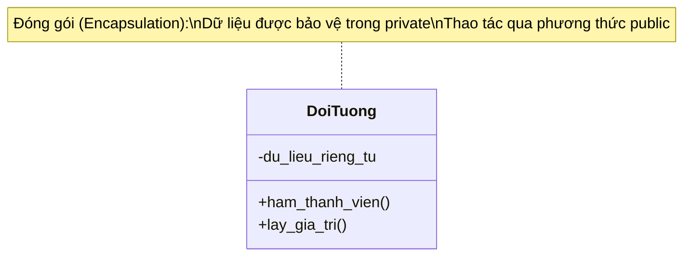

# 14.14 — Introduction to the copy constructor

---

## 🎯 Mục Tiêu Bài Học
- Nắm vững bản chất lý thuyết và cơ chế hoạt động của **Introduction to the copy constructor** trong tiêu chuẩn ISO C++.
- Hiểu rõ cách máy tính tổ chức bộ nhớ (RAM, CPU registers) khi thực thi mã nguồn liên quan.
- Nhận biết các cạm bẫy lỗi kinh điển (**Undefined Behavior**, Memory Leak, Bug logic) và cách phòng tránh.
- Áp dụng các quy tắc thực hành tốt nhất (**Best Practices**) chuẩn công nghiệp và cập nhật C++20/C++23 hiện đại.

---

# 14.14 &#8212; Introduction to the copy hàm tạo (constructor)

Consider the following program:

```cpp
#include <iostream>
 
class Fraction
{
private:
    int m_numerator{ 0 };
    int m_denominator{ 1 };
 
public:
    // Default constructor
    Fraction(int numerator=0, int denominator=1)
        : m_numerator{numerator}, m_denominator{denominator}
    {
    }

    void print() const
    {
        std::cout << "Fraction(" << m_numerator << ", " << m_denominator << ")\n";
    }
};

int main()
{
    Fraction f { 5, 3 };  // Calls Fraction(int, int) constructor
    Fraction fCopy { f }; // What constructor is used here?

    f.print();
    fCopy.print();

    return 0;
}
```

You might be surprised to find that this program compiles just fine, and produces the result:

```cpp
Fraction(5, 3)
Fraction(5, 3)
```

Let’s take a closer look at how this program works.

The sự khởi tạo of biến `f` is just a standard brace sự khởi tạo that calls the `Fraction(int, int)` hàm tạo (constructor).

But what about the next line?  The sự khởi tạo of biến `fCopy` is also clearly an sự khởi tạo, and you know that hàm tạo (constructor) các hàm are used to khởi tạo classes.  So what hàm tạo (constructor) is this line calling?

The answer is: the copy hàm tạo (constructor).

The copy hàm tạo (constructor)

A **copy hàm tạo (constructor)** is a hàm tạo (constructor) that is used to khởi tạo an object with an existing object of the same type.  After the copy hàm tạo (constructor) executes, the newly created object should be a copy of the object passed in as the initializer.

An implicit copy hàm tạo (constructor)

If you do not provide a copy hàm tạo (constructor) for your classes, C++ will create a public **implicit copy hàm tạo (constructor)** for you.  In the above example, the câu lệnh `Fraction fCopy { f };` is invoking the implicit copy hàm tạo (constructor) to khởi tạo `fCopy` with `f`.

By default, the implicit copy hàm tạo (constructor) will do memberwise sự khởi tạo.  This means each member will be được khởi tạo using the corresponding member of the class passed in as the initializer.  In the example above, `fCopy.m_numerator` is được khởi tạo using `f.m_numerator` (which has value `5`), and `fCopy.m_denominator` is được khởi tạo using `f.m_denominator` (which has value `3`).

After the copy hàm tạo (constructor) has executed, the members of `f` and `fCopy` have the same values, so `fCopy` is a copy of `f`.  Thus calling `print()` on either has the same result.  

Defining your own copy hàm tạo (constructor)

We can also explicitly define our own copy hàm tạo (constructor).  In this lesson, we’ll make our copy hàm tạo (constructor) print a message, so we can show you that it is indeed executing when copies are made.

The copy hàm tạo (constructor) looks just like you’d expect it to:

```cpp
#include <iostream>
 
class Fraction
{
private:
    int m_numerator{ 0 };
    int m_denominator{ 1 };
 
public:
    // Default constructor
    Fraction(int numerator=0, int denominator=1)
        : m_numerator{numerator}, m_denominator{denominator}
    {
    }

    // Copy constructor
    Fraction(const Fraction& fraction)
        // Initialize our members using the corresponding member of the parameter
        : m_numerator{ fraction.m_numerator }
        , m_denominator{ fraction.m_denominator }
    {
        std::cout << "Copy constructor called\n"; // just to prove it works
    }

    void print() const
    {
        std::cout << "Fraction(" << m_numerator << ", " << m_denominator << ")\n";
    }
};

int main()
{
    Fraction f { 5, 3 };  // Calls Fraction(int, int) constructor
    Fraction fCopy { f }; // Calls Fraction(const Fraction&) copy constructor

    f.print();
    fCopy.print();

    return 0;
}
```

When this program is run, you get:

```cpp
Copy constructor called
Fraction(5, 3)
Fraction(5, 3)
```

The copy hàm tạo (constructor) we defined above is functionally equivalent to the one we’d get by default, except we’ve added an output câu lệnh to prove the copy hàm tạo (constructor) is actually being called.   This copy hàm tạo (constructor) is invoked when `fCopy` is được khởi tạo with `f`. 

::: info A reminder

Access controls work on a per-class basis (not a per-object basis).  This means the member các hàm of a class can access the private members of any class object of the same type (not just the implicit object).

We use that to our advantage in the `Fraction` copy hàm tạo (constructor) above in order to directly access the private members of the `fraction` tham số.  Otherwise, we would have no way to access those members directly (without adding access các hàm, which we might not want to do).
:::

A copy hàm tạo (constructor) should not do anything other than copy an object.  This is because the trình biên dịch may optimize the copy hàm tạo (constructor) out in certain cases.  If you are relying on the copy hàm tạo (constructor) for some behavior other than just copying, that behavior may or may not occur.  We discuss this further in lesson [14.15 -- Class sự khởi tạo and copy elision](https://www.learncpp.com/cpp-tutorial/class-sự khởi tạo-and-copy-elision/).

::: tip Thực hành tốt nhất (Best Practice)

Copy các hàm tạo (constructors) should have no side effects beyond copying.

:::

Prefer the implicit copy hàm tạo (constructor)

Unlike the implicit default hàm tạo (constructor), which does nothing (and thus is rarely what we want), the memberwise sự khởi tạo performed by the implicit copy hàm tạo (constructor) is usually exactly what we want.  Therefore, in most cases, using the implicit copy hàm tạo (constructor) is perfectly fine.

::: tip Thực hành tốt nhất (Best Practice)

Prefer the implicit copy hàm tạo (constructor), unless you have a specific reason to create your own.

:::

We’ll see cases where the copy hàm tạo (constructor) needs to be overwritten when we discuss dynamic memory allocation ([21.13 -- Shallow vs. deep copying](https://www.learncpp.com/cpp-tutorial/shallow-vs-deep-copying/)).

The copy hàm tạo (constructor)’s tham số must be a tham chiếu

It is a requirement that the tham số of a copy hàm tạo (constructor) be an lvalue tham chiếu or const lvalue tham chiếu.  Because the copy hàm tạo (constructor) should not be modifying the tham số, using a const lvalue tham chiếu is preferred.

::: tip Thực hành tốt nhất (Best Practice)

If you write your own copy hàm tạo (constructor), the tham số should be a const lvalue tham chiếu.

:::

Pass by value and the copy hàm tạo (constructor)

When an object is passed by value, the đối số is copied into the tham số.  When the đối số and tham số are the same class type, the copy is made by implicitly invoking the copy hàm tạo (constructor).

This is illustrated in the following example:

```cpp
#include <iostream>

class Fraction
{
private:
    int m_numerator{ 0 };
    int m_denominator{ 1 };

public:
    // Default constructor
    Fraction(int numerator = 0, int denominator = 1)
        : m_numerator{ numerator }, m_denominator{ denominator }
    {
    }

    // Copy constructor
    Fraction(const Fraction& fraction)
        : m_numerator{ fraction.m_numerator }
        , m_denominator{ fraction.m_denominator }
    {
        std::cout << "Copy constructor called\n";
    }

    void print() const
    {
        std::cout << "Fraction(" << m_numerator << ", " << m_denominator << ")\n";
    }
};

void printFraction(Fraction f) // f is pass by value
{
    f.print();
}

int main()
{
    Fraction f{ 5, 3 };

    printFraction(f); // f is copied into the function parameter using copy constructor

    return 0;
}
```

On the author’s machine, this example prints:

```cpp
Copy constructor called
Fraction(5, 3)
```

In the above example, the call to `printFraction(f)` is passing `f` by value.  The copy hàm tạo (constructor) is invoked to copy `f` from `main` into the `f` tham số of hàm `printFraction()`.

Return by value and the copy hàm tạo (constructor)

Trong bài học [2.5 -- Introduction to local phạm vi truy cập (scope)](https://www.learncpp.com/cpp-tutorial/introduction-to-local-phạm vi truy cập (scope)/), we noted that return by value creates a temporary object (holding a copy of the giá trị trả về) that is passed back to the caller.  When the return type and the giá trị trả về are the same class type, the temporary object is được khởi tạo by implicitly invoking the copy hàm tạo (constructor).

For example:

```cpp
#include <iostream>

class Fraction
{
private:
    int m_numerator{ 0 };
    int m_denominator{ 1 };

public:
    // Default constructor
    Fraction(int numerator = 0, int denominator = 1)
        : m_numerator{ numerator }, m_denominator{ denominator }
    {
    }

    // Copy constructor
    Fraction(const Fraction& fraction)
        : m_numerator{ fraction.m_numerator }
        , m_denominator{ fraction.m_denominator }
    {
        std::cout << "Copy constructor called\n";
    }

    void print() const
    {
        std::cout << "Fraction(" << m_numerator << ", " << m_denominator << ")\n";
    }
};

void printFraction(Fraction f) // f is pass by value
{
    f.print();
}

Fraction generateFraction(int n, int d)
{
    Fraction f{ n, d };
    return f;
}

int main()
{
    Fraction f2 { generateFraction(1, 2) }; // Fraction is returned using copy constructor

    printFraction(f2); // f2 is copied into the function parameter using copy constructor

    return 0;
}
```

When `generateFraction` returns a `Fraction` back to `main`, a temporary `Fraction` object is created and được khởi tạo using the copy hàm tạo (constructor).

Because this temporary is used to khởi tạo `Fraction f2`, this invokes the copy hàm tạo (constructor) again to copy the temporary into `f2`.

And when `f2` is passed to `printFraction()`, the copy hàm tạo (constructor) is called a third time.

Thus, on the author’s machine, this example prints:

```cpp
Copy constructor called
Copy constructor called
Copy constructor called
Fraction(1, 2)
```

If you compile and execute the above example, you may find that only two calls to the copy hàm tạo (constructor) occur.  This is a trình biên dịch optimization known as *copy elision*.  We discuss copy elision further in lesson [14.15 -- Class sự khởi tạo and copy elision](https://www.learncpp.com/cpp-tutorial/class-sự khởi tạo-and-copy-elision/).

Using `= default` to generate a default copy hàm tạo (constructor)

If a class has no copy hàm tạo (constructor), the trình biên dịch will implicitly generate one for us.  If we prefer, we can explicitly request the trình biên dịch create a default copy hàm tạo (constructor) for us using the `= default` syntax:

```cpp
#include <iostream>
 
class Fraction
{
private:
    int m_numerator{ 0 };
    int m_denominator{ 1 };
 
public:
    // Default constructor
    Fraction(int numerator=0, int denominator=1)
        : m_numerator{numerator}, m_denominator{denominator}
    {
    }

    // Explicitly request default copy constructor
    Fraction(const Fraction& fraction) = default;

    void print() const
    {
        std::cout << "Fraction(" << m_numerator << ", " << m_denominator << ")\n";
    }
};

int main()
{
    Fraction f { 5, 3 };
    Fraction fCopy { f };

    f.print();
    fCopy.print();

    return 0;
}
```

Using `= delete` to prevent copies

Occasionally we run into cases where we do not want đối tượng of a certain class to be copyable.  We can prevent this by marking the copy hàm tạo (constructor) hàm as deleted, using the `= delete` syntax:

```cpp
#include <iostream>
 
class Fraction
{
private:
    int m_numerator{ 0 };
    int m_denominator{ 1 };
 
public:
    // Default constructor
    Fraction(int numerator=0, int denominator=1)
        : m_numerator{numerator}, m_denominator{denominator}
    {
    }

    // Delete the copy constructor so no copies can be made
    Fraction(const Fraction& fraction) = delete;

    void print() const
    {
        std::cout << "Fraction(" << m_numerator << ", " << m_denominator << ")\n";
    }
};

int main()
{
    Fraction f { 5, 3 };
    Fraction fCopy { f }; // compile error: copy constructor has been deleted

    return 0;
}
```

In the example, when the trình biên dịch goes to find a hàm tạo (constructor) to khởi tạo `fCopy` with `f`, it will see that the copy hàm tạo (constructor) has been deleted.  This will cause it to emit a compile error.

::: info As an aside…

You can also prevent the public from making copies of class object by making the copy hàm tạo (constructor) private (as private các hàm can’t be used by the public).  However, a private copy hàm tạo (constructor) *can* still be used by other members of the class, so this solution is not advised unless that is desired.
:::

::: info For advanced readers

The **rule of three** is a well known C++ principle that states that if a class requires a user-defined copy hàm tạo (constructor), hàm hủy (destructor), or copy phép gán toán tử, then it probably requires all three.  In C++11, this was expanded to the **rule of five**, which adds the move hàm tạo (constructor) and move phép gán toán tử to the list.

Not following the rule of three/rule of five is likely to lead to malfunctioning code.  We’ll revisit the rule of three and rule of five when we cover dynamic memory allocation.

We discuss các hàm hủy (destructors) in lesson [15.4 -- Introduction to các hàm hủy (destructors)](https://www.learncpp.com/cpp-tutorial/introduction-to-các hàm hủy (destructors)/) and [19.3 -- Destructors](https://www.learncpp.com/cpp-tutorial/các hàm hủy (destructors)/), and copy phép gán in lesson [21.12 -- Overloading the phép gán toán tử](https://www.learncpp.com/cpp-tutorial/overloading-the-phép gán-toán tử/).

:::

Hệ thống Câu hỏi & Quiz Tự Luyện

Câu hỏi #1

In the lesson above, we noted that the tham số for a copy hàm tạo (constructor) must be a (const) tham chiếu.  Why aren’t we allowed to use truyền theo giá trị?

::: details Gợi ý (Hint)
Hint: Think about what happens when we pass a class type đối số by value.
:::

::: details Xem lời giải (Solution)

When we pass a class type đối số by value, the copy hàm tạo (constructor) is implicitly invoked to copy the đối số into the tham số.

If the copy hàm tạo (constructor) used truyền theo giá trị, the copy hàm tạo (constructor) would need to call itself to copy the initializer đối số into the copy hàm tạo (constructor) tham số.  But that call to the copy hàm tạo (constructor) would also be truyền theo giá trị, so the copy hàm tạo (constructor) would be invoked again to copy the đối số into the hàm tham số.  This would lead to an infinite chain of calls to the copy hàm tạo (constructor).

:::

  	
  	

---



::: warning Cạm Bẫy: Khởi Tạo Không Đồng Nhất (Initialization Pitfalls)
Hãy luôn khởi tạo biến thành viên ngay tại nơi khai báo hoặc sử dụng **Danh sách khởi tạo thành viên (Member Initializer List)** trong hàm tạo để tránh việc đối tượng bị gán giá trị 2 lần gây lãng phí chu kỳ CPU.
:::

::: tip 💡 Tóm Tắt Quy Tắc Vàng (Core Guidelines)
1. Luôn hiểu rõ vòng đời và quyền sở hữu (Ownership) của dữ liệu trước khi viết code.
2. Ưu tiên khởi tạo đồng nhất với dấu ngoặc nhọn `{}` để ngăn chặn lỗi thu hẹp kiểu dữ liệu (Narrowing conversions).
3. Bật toàn bộ cờ cảnh báo `-Wall -Wextra -Wpedantic` để compiler giúp bạn phát hiện bug từ sớm!
:::
