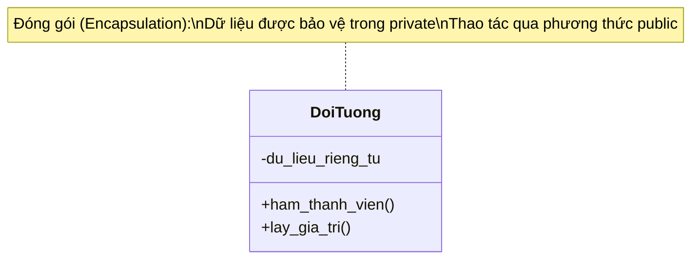

# 14.15 — Class initialization and copy elision

---

## 🎯 Mục Tiêu Bài Học
- Nắm vững bản chất lý thuyết và cơ chế hoạt động của **Class initialization and copy elision** trong tiêu chuẩn ISO C++.
- Hiểu rõ cách máy tính tổ chức bộ nhớ (RAM, CPU registers) khi thực thi mã nguồn liên quan.
- Nhận biết các cạm bẫy lỗi kinh điển (**Undefined Behavior**, Memory Leak, Bug logic) và cách phòng tránh.
- Áp dụng các quy tắc thực hành tốt nhất (**Best Practices**) chuẩn công nghiệp và cập nhật C++20/C++23 hiện đại.

---

# 14.15 &#8212; Class sự khởi tạo and copy elision

Way back in lesson [1.4 -- Variable phép gán and sự khởi tạo](https://www.learncpp.com/cpp-tutorial/biến-phép gán-and-sự khởi tạo/), we discuss 6 basic types of sự khởi tạo for đối tượng with các kiểu dữ liệu cơ bản:

```cpp
int a;         // no initializer (default initialization)
int b = 5;     // initializer after equals sign (copy initialization)
int c( 6 );    // initializer in parentheses (direct initialization)

// List initialization methods (C++11)
int d { 7 };   // initializer in braces (direct list initialization)
int e = { 8 }; // initializer in braces after equals sign (copy list initialization)
int f {};      // initializer is empty braces (value initialization)
```

All of these sự khởi tạo types are valid for object with class types:

```cpp
#include <iostream>

class Foo
{
public:
    
    // Default constructor
    Foo()
    {
        std::cout << "Foo()\n";
    }

    // Normal constructor
    Foo(int x)
    {
        std::cout << "Foo(int) " << x << '\n';
    }

    // Copy constructor
    Foo(const Foo&)
    {
        std::cout << "Foo(const Foo&)\n";
    }
};

int main()
{
    // Calls Foo() default constructor
    Foo f1;           // default initialization
    Foo f2{};         // value initialization (preferred)
    
    // Calls foo(int) normal constructor
    Foo f3 = 3;       // copy initialization (non-explicit constructors only)
    Foo f4(4);        // direct initialization
    Foo f5{ 5 };      // direct list initialization (preferred)
    Foo f6 = { 6 };   // copy list initialization (non-explicit constructors only)

    // Calls foo(const Foo&) copy constructor
    Foo f7 = f3;      // copy initialization
    Foo f8(f3);       // direct initialization
    Foo f9{ f3 };     // direct list initialization (preferred)
    Foo f10 = { f3 }; // copy list initialization

    return 0;
}
```

In modern C++, copy sự khởi tạo, direct sự khởi tạo, and list sự khởi tạo essentially do the same thing -- they khởi tạo an object.

For all types of sự khởi tạo:

- When initializing a class type, the set of các hàm tạo (constructors) for that class are examined, and overload resolution is used to determine the best matching hàm tạo (constructor).  This may involve implicit conversion of đối số.

- When initializing a non-class type, the implicit conversion rules are used to determine whether an implicit conversion exists.

::: info Hiểu biết cốt lõi

There are three key differences between the sự khởi tạo forms:

- List sự khởi tạo disallows narrowing conversions.

- Copy sự khởi tạo only considers non-explicit các hàm tạo (constructors)/conversion các hàm.  We’ll cover this in lesson [14.16 -- Converting các hàm tạo (constructors) and the explicit keyword](https://www.learncpp.com/cpp-tutorial/converting-các hàm tạo (constructors)-and-the-explicit-keyword/).

- List sự khởi tạo prioritizes matching list các hàm tạo (constructors) over other matching các hàm tạo (constructors).  We’ll cover this in lesson [16.2 -- Introduction to std::vector and list các hàm tạo (constructors)](https://www.learncpp.com/cpp-tutorial/introduction-to-stdvector-and-list-các hàm tạo (constructors)/).

:::

It is also worth noting that in some circumstances, certain forms of sự khởi tạo are disallowed (e.g. in a hàm tạo (constructor) member initializer list, we can only use direct forms of sự khởi tạo, not copy sự khởi tạo).

Unnecessary copies

Consider this simple program:

```cpp
#include <iostream>

class Something
{
    int m_x{};

public:
    Something(int x)
        : m_x{ x }
    {
        std::cout << "Normal constructor\n";
    }

    Something(const Something& s)
        : m_x { s.m_x }
    {
        std::cout << "Copy constructor\n";
    }

    void print() const { std::cout << "Something(" << m_x << ")\n"; }
};

int main()
{
    Something s { Something { 5 } }; // focus on this line
    s.print();

    return 0;
}
```

In the sự khởi tạo of biến `s` above, we first construct a temporary `Something`, được khởi tạo with value `5` (which uses the `Something(int)` hàm tạo (constructor)).  This temporary is then used to khởi tạo `s`.  Because the temporary and `s` have the same type (they are both `Something` đối tượng), the `Something(const Something&)` copy hàm tạo (constructor) would normally be called here to copy the values in the temporary into `s`.  The end result is that `s` is được khởi tạo with value `5`.

Without any optimizations, the above program would print:

```cpp
Normal constructor
Copy constructor
Something(5)
```

However, this program is needlessly inefficient, as we’ve had to make two hàm tạo (constructor) calls: one to `Something(int)`, and one to `Something(const Something&)`.  Note that the end result of the above is the same as if we had written the following instead:

```cpp
Something s { 5 }; // only invokes Something(int), no copy constructor
```

This version produces the same result, but is more efficient, as it only makes a call to `Something(int)` (no copy hàm tạo (constructor) is needed).

Copy elision

Since the trình biên dịch is free to rewrite câu lệnh to optimize them, one might wonder if the trình biên dịch can optimize away the unnecessary copy and treat `Something s { Something{5} };` as if we had written `Something s { 5 }` in the first place.

The answer is yes, and the process of doing so is called *copy elision*.  **Copy elision** is a trình biên dịch optimization technique that allows the trình biên dịch to remove unnecessary copying of đối tượng.  In other words, in cases where the trình biên dịch would normally call a copy hàm tạo (constructor), the trình biên dịch is free to rewrite the code to avoid the call to the copy hàm tạo (constructor) altogether.  When the trình biên dịch optimizes away a call to the copy hàm tạo (constructor), we say the hàm tạo (constructor) has been **elided**.

Unlike other types of optimization, copy elision is exempt from the “as-if” rule.  That is, copy elision is allowed to elide the copy hàm tạo (constructor) even if the copy hàm tạo (constructor) has side effects (such as printing text to the console)!  This is why copy các hàm tạo (constructors) should not have side effects other than copying -- if the trình biên dịch elides the call to the copy hàm tạo (constructor), the side effects won’t execute, and the observable behavior of the program will change!

::: info Related content

We discussed the as-if rule in lesson [5.4 -- The as-if rule and compile-time optimization](https://www.learncpp.com/cpp-tutorial/the-as-if-rule-and-compile-time-optimization/).

:::

We can see this in the above example.  If you run the program on a C++17 trình biên dịch, it will produce the following result:

```cpp
Normal constructor
Something(5)
```

The trình biên dịch has elided the copy hàm tạo (constructor) to avoid an unnecessary copy, and as a result, the câu lệnh that prints “Copy hàm tạo (constructor)” does not execute!  Our program’s observable behavior has changed due to copy elision!

Copy elision in truyền theo giá trị and return by value

The copy hàm tạo (constructor) is normally called when an đối số of the same type as the tham số is passed by value or return by value is used.  However, in certain cases, these copies may be elided.  The following program demonstrates some of these cases:

```cpp
#include <iostream>

class Something
{
public:
	Something() = default;
	Something(const Something&)
	{
		std::cout << "Copy constructor called\n";
	}
};

Something rvo()
{
	return Something{}; // calls Something() and copy constructor
}

Something nrvo()
{
	Something s{}; // calls Something()
	return s;      // calls copy constructor
}

int main()
{
	std::cout << "Initializing s1\n";
	Something s1 { rvo() }; // calls copy constructor

	std::cout << "Initializing s2\n";
	Something s2 { nrvo() }; // calls copy constructor

        return 0;
}
```

In C++14 or older, with copy elision disabled, the above program would call the copy hàm tạo (constructor) 4 times:

- Once when `rvo` returns `Something` to `main`.

- Once when the giá trị trả về of `rvo()` is used to khởi tạo `s1`.

- Once when `nrvo` returns `s` to `main`.

- Once when the giá trị trả về of `nrvo()` is used to khởi tạo `s2`.

However, due to copy elision, it’s likely that your trình biên dịch will elide most or all of these copy hàm tạo (constructor) calls.  Visual Studio 2022 elides 3 cases (it doesn’t elide the case where `nrvo()` returns by value), and GCC elides all 4.

It’s not important to memorize when the trình biên dịch does / doesn’t do copy elision.  Just know that it is an optimization that your trình biên dịch will perform if it can.  If you expect to see your copy hàm tạo (constructor) called and it isn’t, copy elision is probably why.

Mandatory copy elision in C++17 C++17

Prior to C++17, copy elision was strictly an optional optimization that các trình biên dịch could make.  In C++17, copy elision became mandatory in some cases.  In these cases, copy elision will be performed automatically (even if you tell your trình biên dịch not to perform copy elision).

Running the same example as above in C++17 or newer, the copy hàm tạo (constructor) calls that would otherwise occur when `rvo()` returns and when `s1` is được khởi tạo with that value are required to be elided.  The sự khởi tạo of `s2` with `nvro()` is not a mandatory elision case, and thus the 2 copy hàm tạo (constructor) calls that occur here may or may not be elided depending on your trình biên dịch and optimization settings.

In optional elision cases, an accessible copy hàm tạo (constructor) must be available (e.g. not deleted), even if the actual call to the copy hàm tạo (constructor) is elided.

In mandatory elision cases, an accessible copy hàm tạo (constructor) need not be available (in other words, mandatory elision can happen even if the copy hàm tạo (constructor) is deleted).

::: info For advanced readers

In cases where optional copy elision isn’t performed, move semantics may still allow an object to be moved instead of copied.  We introduce move semantics in lesson [16.5 -- Returning std::vector, and an introduction to move semantics](https://www.learncpp.com/cpp-tutorial/returning-stdvector-and-an-introduction-to-move-semantics/).

:::

  	
  	

---



::: warning Cạm Bẫy: Khởi Tạo Không Đồng Nhất (Initialization Pitfalls)
Hãy luôn khởi tạo biến thành viên ngay tại nơi khai báo hoặc sử dụng **Danh sách khởi tạo thành viên (Member Initializer List)** trong hàm tạo để tránh việc đối tượng bị gán giá trị 2 lần gây lãng phí chu kỳ CPU.
:::

::: tip 💡 Tóm Tắt Quy Tắc Vàng (Core Guidelines)
1. Luôn hiểu rõ vòng đời và quyền sở hữu (Ownership) của dữ liệu trước khi viết code.
2. Ưu tiên khởi tạo đồng nhất với dấu ngoặc nhọn `{}` để ngăn chặn lỗi thu hẹp kiểu dữ liệu (Narrowing conversions).
3. Bật toàn bộ cờ cảnh báo `-Wall -Wextra -Wpedantic` để compiler giúp bạn phát hiện bug từ sớm!
:::
