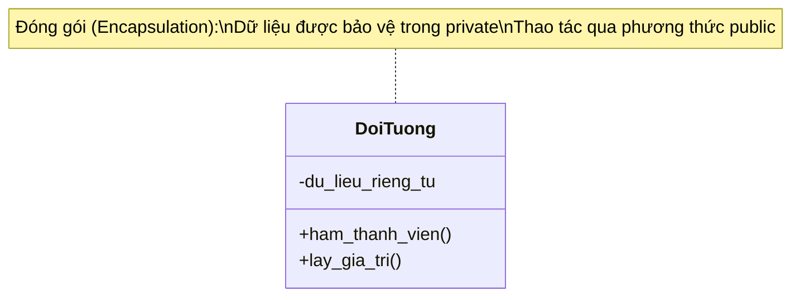

# 14.16 — Converting constructors and the explicit keyword

---

## 🎯 Mục Tiêu Bài Học
- Nắm vững bản chất lý thuyết và cơ chế hoạt động của **Converting constructors and the explicit keyword** trong tiêu chuẩn ISO C++.
- Hiểu rõ cách máy tính tổ chức bộ nhớ (RAM, CPU registers) khi thực thi mã nguồn liên quan.
- Nhận biết các cạm bẫy lỗi kinh điển (**Undefined Behavior**, Memory Leak, Bug logic) và cách phòng tránh.
- Áp dụng các quy tắc thực hành tốt nhất (**Best Practices**) chuẩn công nghiệp và cập nhật C++20/C++23 hiện đại.

---

# 14.16 &#8212; Converting các hàm tạo (constructors) and the explicit keyword

Trong bài học [10.1 -- Implicit type conversion](https://www.learncpp.com/cpp-tutorial/implicit-type-conversion/), we introduced type conversion and the concept of implicit type conversion, where the trình biên dịch will implicitly convert a value of one type to a value of another type as needed if such a conversion exists.

This allows us to do things like this:

```cpp
#include <iostream>

void printDouble(double d) // has a double parameter
{
    std::cout << d;
}

int main()
{
    printDouble(5); // we're supplying an int argument

    return 0;
}
```

In the above example, our `printDouble` hàm has a `double` tham số, but we’re passing in an đối số of type `int`.  Because the type of the tham số and the type of the đối số do not match, the trình biên dịch will see if it can implicitly convert the type of the đối số to the type of the tham số.  In this case, using the numeric conversion rules, int value `5` will be converted to double value `5.0` and because we’re passing by value, tham số `d` will be copy được khởi tạo with this value.

User-defined conversions

Now consider the following similar example:

```cpp
#include <iostream>

class Foo
{
private:
    int m_x{};
public:
    Foo(int x)
        : m_x{ x }
    {
    }

    int getX() const { return m_x; }
};

void printFoo(Foo f) // has a Foo parameter
{
    std::cout << f.getX();
}

int main()
{
    printFoo(5); // we're supplying an int argument

    return 0;
}
```

In this version, `printFoo` has a `Foo` tham số but we’re passing in an đối số of type `int`.  Because these types do not match, the trình biên dịch will try to implicitly convert int value `5` into a `Foo` object so the hàm can be called.

Unlike the first example, where our tham số and đối số types were both các kiểu dữ liệu cơ bản (and thus can be converted using the built-in numeric promotion/conversion rules), in this case, one of our types is a program-defined type.  The C++ standard doesn’t have specific rules that tell the trình biên dịch how to convert values to (or from) a program-defined type.

Instead, the trình biên dịch will look to see if we have defined some hàm that it can use to perform such a conversion.  Such a hàm is called a **user-defined conversion**.

Converting các hàm tạo (constructors)

In the above example, the trình biên dịch will find a hàm that lets it convert int value `5` into a `Foo` object.  That hàm is the `Foo(int)` hàm tạo (constructor).

Up to this point, we’ve typically used các hàm tạo (constructors) to explicitly construct đối tượng:

```cpp
Foo x { 5 }; // Explicitly convert int value 5 to a Foo
```

Think about what this does: we’re providing an `int` value (`5`) and getting a `Foo` object in return.

In the context of a hàm call, we’re trying to solve the same problem:

```cpp
printFoo(5); // Implicitly convert int value 5 into a Foo
```

We’re providing an `int` value (`5`), and we want a `Foo` object in return.  The `Foo(int)` hàm tạo (constructor) was designed for exactly that!

So in this case, when `printFoo(5)` is called, tham số `f` is copy được khởi tạo using the `Foo(int)` hàm tạo (constructor) with `5` as an đối số!

::: info As an aside…

Prior to C++17, when `printFoo(5)` is called, `5` is implicitly converted to a temporary `Foo` using the `Foo(int)` hàm tạo (constructor).  This temporary `Foo` is then copy constructed into tham số `f`.

In C++17 onward, the copy is mandatorily elided.  Parameter `f` is copy được khởi tạo with value `5`, and no call to the copy hàm tạo (constructor) is required (and it will work even if the copy hàm tạo (constructor) is deleted).
:::

A hàm tạo (constructor) that can be used to perform an implicit conversion is called a **converting hàm tạo (constructor)**.  By default, all các hàm tạo (constructors) are converting các hàm tạo (constructors).

Only one user-defined conversion may be applied

Now consider the following example:

```cpp
#include <iostream>
#include <string>
#include <string_view>

class Employee
{
private:
    std::string m_name{};

public:
    Employee(std::string_view name)
        : m_name{ name }
    {
    }

    const std::string& getName() const { return m_name; }
};

void printEmployee(Employee e) // has an Employee parameter
{
    std::cout << e.getName();
}

int main()
{
    printEmployee("Joe"); // we're supplying an string literal argument

    return 0;
}
```

In this version, we’ve swapped out our `Foo` class for an `Employee` class.  `printEmployee` has an `Employee` tham số, and we’re passing in a C-style string hằng giá trị (literal).  And we have a converting hàm tạo (constructor): `Employee(std::string_view)`.

You might be surprised to find that this version doesn’t compile.  The reason is simple: only one user-defined conversion may be applied to perform an implicit conversion, and this example requires two.  First, our C-style string hằng giá trị (literal) has to be converted to a `std::string_view` (using a `std::string_view` converting hàm tạo (constructor)), and then our `std::string_view` has to be converted into an `Employee` (using the `Employee(std::string_view)` converting hàm tạo (constructor)).

There are two ways to make this example work:

<ol start="1">
- Use a `std::string_view` hằng giá trị (literal):

```cpp
int main()
{
    using namespace std::literals;
    printEmployee( "Joe"sv); // now a std::string_view literal

    return 0;
}
```

This works because only one user-defined conversion is now required (from `std::string_view` to `Employee`).

<ol start="2">
- Explicitly construct an `Employee` rather than implicitly create one:

```cpp
int main()
{
    printEmployee(Employee{ "Joe" });

    return 0;
}
```

This also works because only one user-defined conversion is now required (from the string hằng giá trị (literal) to the `std::string_view` used to khởi tạo the `Employee` object).  Passing our explicitly constructed `Employee` object to the hàm does not require a second conversion to take place.

This latter example brings up a useful technique: it is trivial to convert an implicit conversion into an explicit definition.  We’ll see more examples of this later in this lesson.

::: info Hiểu biết cốt lõi

An implicit conversion can be trivially converted into an explicit definition by using direct list sự khởi tạo (or direct sự khởi tạo).

:::

When converting các hàm tạo (constructors) go wrong

Consider the following program:

```cpp
#include <iostream>

class Dollars
{
private:
    int m_dollars{};

public:
    Dollars(int d)
        : m_dollars{ d }
    {
    }

    int getDollars() const { return m_dollars; }
};

void print(Dollars d)
{
    std::cout << "$" << d.getDollars();
}

int main()
{
    print(5);

    return 0;
}
```

When we call `print(5)`, the `Dollars(int)` converting hàm tạo (constructor) will be used to convert `5` into a `Dollars` object.  Thus, this program prints:

```cpp
$5
```

Although this may have been the caller’s intent, it’s hard to tell because the caller did not provide any indication that this is what they actually wanted.  It’s entirely possible that the caller assumed this would print `5`, and did not expect the trình biên dịch to silently and implicitly convert our `int` value to a `Dollars` object so that it could satisfy this hàm call.

While this example is trivial, in a larger and more complex program, it’s fairly easy to be surprised by the trình biên dịch performing some implicit conversion that you did not expect, resulting in unexpected behavior at runtime.

It would be better if our `print(Dollars)` hàm could only be called with a `Dollars` object, not any value that can be implicitly converted to a `Dollars` (especially a fundamental type like `int`).  This would reduce the possibility of inadvertent errors.

The explicit keyword

To address such issues, we can use the **explicit** keyword to tell the trình biên dịch that a hàm tạo (constructor) should not be used as a converting hàm tạo (constructor).

Making a hàm tạo (constructor) `explicit` has two notable consequences:

- An explicit hàm tạo (constructor) cannot be used to do copy sự khởi tạo or copy list sự khởi tạo.

- An explicit hàm tạo (constructor) cannot be used to do implicit conversions (since this uses copy sự khởi tạo or copy list sự khởi tạo).

Let’s update the `Dollars(int)` hàm tạo (constructor) from the prior example to be an explicit hàm tạo (constructor):

```cpp
#include <iostream>

class Dollars
{
private:
    int m_dollars{};

public:
    explicit Dollars(int d) // now explicit
        : m_dollars{ d }
    {
    }

    int getDollars() const { return m_dollars; }
};

void print(Dollars d)
{
    std::cout << "$" << d.getDollars();
}

int main()
{
    print(5); // compilation error because Dollars(int) is explicit

    return 0;
}
```

Because the trình biên dịch can no longer use `Dollars(int)` as a converting hàm tạo (constructor), it can not find a way to convert `5` to a `Dollars`.  Consequently, it will generate a quá trình biên dịch error.

For các hàm tạo (constructors) with a separate declaration (inside the class) and definition (outside the class), the `explicit` keyword is used only on the declaration.

Explicit các hàm tạo (constructors) can be used for direct and direct list sự khởi tạo

An explicit hàm tạo (constructor) can still be used for direct and direct list sự khởi tạo:

```cpp
// Assume Dollars(int) is explicit
int main()
{
    Dollars d1(5); // ok
    Dollars d2{5}; // ok
}
```

Now, let’s go back to our prior example, where we made our `Dollars(int)` hàm tạo (constructor) explicit, and therefore the following generated a quá trình biên dịch error:

```cpp
print(5); // compilation error because Dollars(int) is explicit
```

What if we actually want to call `print()` with `int` value `5` but the hàm tạo (constructor) is explicit?  The workaround is simple: instead of having the trình biên dịch implicitly convert `5` into a `Dollars` that can be passed to `print()`, we can explicitly define the `Dollars` object ourselves:

```cpp
print(Dollars{5}); // ok: explicitly create a Dollars
```

This is allowed because we can still use explicit các hàm tạo (constructors) to list khởi tạo đối tượng.  And since we’ve now explicitly constructed a `Dollars`, the đối số type matches the tham số type, so no conversion is required!

This not only compiles and runs, it also better documents our intent, as it is explicit about the fact that we meant to call this hàm with a `Dollars` object.

Note that `static_cast` returns an object that is direct-được khởi tạo, so it will consider explicit các hàm tạo (constructors) while performing the conversion:

```cpp
print(static_cast<Dollars>(5)); // ok: static_cast will use explicit constructors
```

Return by value and explicit các hàm tạo (constructors)

When we return a value from a hàm, if that value does not match the return type of the hàm, an implicit conversion will occur.  Just like with truyền theo giá trị, such conversions cannot use explicit các hàm tạo (constructors).

The following programs shows a few variations in các giá trị trả về, and their results:

```cpp
#include <iostream>

class Foo
{
public:
    explicit Foo() // note: explicit (just for sake of example)
    {
    }

    explicit Foo(int x) // note: explicit
    {
    }
};

Foo getFoo()
{
    // explicit Foo() cases
    return Foo{ };   // ok
    return { };      // error: can't implicitly convert initializer list to Foo

    // explicit Foo(int) cases
    return 5;        // error: can't implicitly convert int to Foo
    return Foo{ 5 }; // ok
    return { 5 };    // error: can't implicitly convert initializer list to Foo
}

int main()
{
    return 0;
}
```

Perhaps surprisingly, `return { 5 }` is considered a conversion.

Best practices for use of `explicit`

The modern thực hành tốt nhất (Best Practice) is to make any hàm tạo (constructor) that will accept a single đối số `explicit` by default.  This includes các hàm tạo (constructors) with multiple tham số where most or all of them have default values.  This will disallow the trình biên dịch from using that hàm tạo (constructor) for implicit conversions.  If an implicit conversion is required, only non-explicit các hàm tạo (constructors) will be considered.  If no non-explicit hàm tạo (constructor) can be found to perform the conversion, the trình biên dịch will error.

If such a conversion is actually desired in a particular case, it is trivial to convert the implicit conversion into an explicit definition using direct list sự khởi tạo.

The following **should not** be made explicit:

- Copy (and move) các hàm tạo (constructors) (as these do not perform conversions).

The following **are typically not** made explicit:

- Default các hàm tạo (constructors) with no tham số (as these are only used to convert `{}` to a default object, not something we typically need to restrict).

- Constructors that only accept multiple đối số (as these are typically not a candidate for conversions anyway).

However, if you prefer, the above can be marked as explicit to prevent implicit conversions with empty and multiple-đối số lists.

The following **should usually** be made explicit:

- Constructors that take a single đối số.

There are some occasions when it does make sense to make a single-đối số hàm tạo (constructor) non-explicit.  This can be useful when all of the following are true:

- The constructed object is semantically equivalent to the đối số value.

- The conversion is performant.

For example, the `std::string_view` hàm tạo (constructor) that accepts a C-style string đối số is not explicit, because there is unlikely to be a case when we wouldn’t be okay with a C-style string being treated as a `std::string_view` instead.  Conversely, the `std::string` hàm tạo (constructor) that takes a `std::string_view` is marked as explicit, because while a `std::string` value is semantically equivalent to a `std::string_view` value, constructing a `std::string` is not performant.

::: tip Thực hành tốt nhất (Best Practice)

Make any hàm tạo (constructor) that accepts a single đối số `explicit` by default.  If an implicit conversion between types is both semantically equivalent and performant, you can consider making the hàm tạo (constructor) non-explicit.

Do not make copy or move các hàm tạo (constructors) explicit, as these do not perform conversions.

:::

  	
  	

---



::: warning Cạm Bẫy: Khởi Tạo Không Đồng Nhất (Initialization Pitfalls)
Hãy luôn khởi tạo biến thành viên ngay tại nơi khai báo hoặc sử dụng **Danh sách khởi tạo thành viên (Member Initializer List)** trong hàm tạo để tránh việc đối tượng bị gán giá trị 2 lần gây lãng phí chu kỳ CPU.
:::

::: tip 💡 Tóm Tắt Quy Tắc Vàng (Core Guidelines)
1. Luôn hiểu rõ vòng đời và quyền sở hữu (Ownership) của dữ liệu trước khi viết code.
2. Ưu tiên khởi tạo đồng nhất với dấu ngoặc nhọn `{}` để ngăn chặn lỗi thu hẹp kiểu dữ liệu (Narrowing conversions).
3. Bật toàn bộ cờ cảnh báo `-Wall -Wextra -Wpedantic` để compiler giúp bạn phát hiện bug từ sớm!
:::
