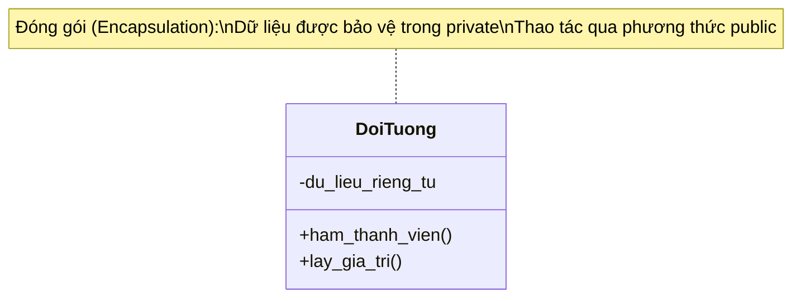

# 14.17 — Constexpr aggregates and classes

---

## 🎯 Mục Tiêu Bài Học
- Nắm vững bản chất lý thuyết và cơ chế hoạt động của **Constexpr aggregates and classes** trong tiêu chuẩn ISO C++.
- Hiểu rõ cách máy tính tổ chức bộ nhớ (RAM, CPU registers) khi thực thi mã nguồn liên quan.
- Nhận biết các cạm bẫy lỗi kinh điển (**Undefined Behavior**, Memory Leak, Bug logic) và cách phòng tránh.
- Áp dụng các quy tắc thực hành tốt nhất (**Best Practices**) chuẩn công nghiệp và cập nhật C++20/C++23 hiện đại.

---

# 14.17 &#8212; Constexpr aggregates and classes

Trong bài học [F.1 -- Constexpr các hàm](https://www.learncpp.com/cpp-tutorial/constexpr-các hàm/), we covered constexpr các hàm, which are các hàm that may be evaluated at either compile-time or runtime.  For example:

```cpp
#include <iostream>

constexpr int greater(int x, int y)
{
    return (x > y ? x : y);
}

int main()
{
    std::cout << greater(5, 6) << '\n'; // greater(5, 6) may be evaluated at compile-time or runtime

    constexpr int g { greater(5, 6) };  // greater(5, 6) must be evaluated at compile-time
    std::cout << g << '\n';             // prints 6

    return 0;
}
```

In this example, `greater()` is a constexpr hàm, and `greater(5, 6)` is a hằng số biểu thức, which may be evaluated at either compile-time or runtime.  Because `std::cout << greater(5, 6)` calls `greater(5, 6)` in a non-constexpr context, the trình biên dịch is free to choose whether to evaluate `greater(5, 6`) at compile-time or runtime.  When `greater(5, 6)` is used to khởi tạo constexpr biến `g`, `greater(5, 6)` is called in a constexpr context, and must be evaluated at compile-time.

Now consider the following similar example:

```cpp
#include <iostream>

struct Pair
{
    int m_x {};
    int m_y {};

    int greater() const
    {
        return (m_x > m_y  ? m_x : m_y);
    }
};

int main()
{
    Pair p { 5, 6 };                  // inputs are constexpr values
    std::cout << p.greater() << '\n'; // p.greater() evaluates at runtime

    constexpr int g { p.greater() };  // compile error: greater() not constexpr
    std::cout << g << '\n';

    return 0;
}
```

In this version, we have an aggregate struct named `Pair`, and `greater()` is now a member hàm.  However, because member hàm `greater()` is not constexpr, `p.greater()` is not a hằng số biểu thức.  When `std::cout << p.greater()` calls `p.greater()` (in a non-constexpr context), `p.greater()` will be evaluated at runtime.  However, when we try to use `p.greater()` to khởi tạo constexpr biến `g`, we get a compile error, as `p.greater()` cannot be evaluated at compile-time.

Since the inputs to `p` are constexpr values (`5` and `6`), it seems like `p.greater()` should be capable of being evaluated at compile-time.  But how do we do that?

Constexpr member các hàm

Just like non-member các hàm, member các hàm can be made constexpr via use of the `constexpr` keyword.  Constexpr member các hàm can be evaluated at either compile-time or runtime.

```cpp
#include <iostream>

struct Pair
{
    int m_x {};
    int m_y {};

    constexpr int greater() const // can evaluate at either compile-time or runtime
    {
        return (m_x > m_y  ? m_x : m_y);
    }
};

int main()
{
    Pair p { 5, 6 };
    std::cout << p.greater() << '\n'; // okay: p.greater() evaluates at runtime

    constexpr int g { p.greater() };  // compile error: p not constexpr
    std::cout << g << '\n';

    return 0;
}
```

In this example, we’ve made `greater()` a constexpr hàm, so the trình biên dịch can evaluate it at either runtime or compile-time.

When we call `p.greater()` in runtime biểu thức `std::cout << p.greater()`, it evaluates at runtime.

However, when `p.greater()` is used to khởi tạo constexpr biến `g`, we get a trình biên dịch error.  Although `greater()` is now constexpr, `p` is still not constexpr, therefore `p.greater()` is not a hằng số biểu thức.

Constexpr aggregates

Okay, so if we need `p` to be constexpr, let’s just make it constexpr:

```cpp
#include <iostream>

struct Pair // Pair is an aggregate
{
    int m_x {};
    int m_y {};

    constexpr int greater() const
    {
        return (m_x > m_y  ? m_x : m_y);
    }
};

int main()
{
    constexpr Pair p { 5, 6 };        // now constexpr
    std::cout << p.greater() << '\n'; // p.greater() evaluates at runtime or compile-time

    constexpr int g { p.greater() };  // p.greater() must evaluate at compile-time
    std::cout << g << '\n';

    return 0;
}
```

Since `Pair` is an aggregate, and aggregates implicitly support constexpr, we’re done.  This works!  Since `p` is a constexpr type, and `greater()` is a constexpr member hàm, `p.greater()` is a hằng số biểu thức and can be used in places where only hằng số biểu thức are allowed.

::: info Related content

We covered aggregates in lesson [13.8 -- Struct aggregate sự khởi tạo](https://www.learncpp.com/cpp-tutorial/struct-aggregate-sự khởi tạo/).

:::

Constexpr class đối tượng and constexpr các hàm tạo (constructors)

Now let’s make our `Pair` a non-aggregate:

```cpp
#include <iostream>

class Pair // Pair is no longer an aggregate
{
private:
    int m_x {};
    int m_y {};

public:
    Pair(int x, int y): m_x { x }, m_y { y } {}

    constexpr int greater() const
    {
        return (m_x > m_y  ? m_x : m_y);
    }
};

int main()
{
    constexpr Pair p { 5, 6 };       // compile error: p is not a literal type
    std::cout << p.greater() << '\n';

    constexpr int g { p.greater() };
    std::cout << g << '\n';

    return 0;
}
```

This example is almost identical to the prior one, except `Pair` is no longer an aggregate (due to having private data members and a hàm tạo (constructor)).

When we compile this program, we get a trình biên dịch error about `Pair` not being a “hằng giá trị (literal) type”.  Say what?

In C++, a **hằng giá trị (literal) type** is any type for which it might be possible to create an object within a hằng số biểu thức.  Put another way, an object can’t be constexpr unless the type qualifies as a hằng giá trị (literal) type.  And our non-aggregate `Pair` does not qualify.

::: info Nomenclature

A hằng giá trị (literal) and a hằng giá trị (literal) type are distinct (but related) things.  A hằng giá trị (literal) is a constexpr value that is inserted into the source code.  A hằng giá trị (literal) type is a type that can be used as the type of a constexpr value.  A hằng giá trị (literal) always has a hằng giá trị (literal) type.  However, a value or object with a hằng giá trị (literal) type need not be a hằng giá trị (literal).

:::

The definition of a hằng giá trị (literal) type is complex, and a summary can be found on [cppreference](https://en.cppreference.com/w/cpp/named_req/LiteralType).  However, it’s worth noting that hằng giá trị (literal) types include:

- Scalar types (those holding a single value, such as các kiểu dữ liệu cơ bản and các con trỏ)

- Reference types

- Most aggregates

- Classes that have a constexpr hàm tạo (constructor)

And now we see why our `Pair` isn’t a hằng giá trị (literal) type.  When a class object is instantiated, the trình biên dịch will call the hàm tạo (constructor) hàm to khởi tạo the object.  And the hàm tạo (constructor) hàm in our `Pair` class is not constexpr, so it can’t be invoked at compile-time.  Therefore, `Pair` đối tượng cannot be constexpr.

The fix for this is simple: we just make our hàm tạo (constructor) `constexpr` as well:

```cpp
#include <iostream>

class Pair
{
private:
    int m_x {};
    int m_y {};

public:
    constexpr Pair(int x, int y): m_x { x }, m_y { y } {} // now constexpr

    constexpr int greater() const
    {
        return (m_x > m_y  ? m_x : m_y);
    }
};

int main()
{
    constexpr Pair p { 5, 6 };
    std::cout << p.greater() << '\n';

    constexpr int g { p.greater() };
    std::cout << g << '\n';

    return 0;
}
```

This works as expected, just like our aggregate version of `Pair` did.

::: tip Thực hành tốt nhất (Best Practice)

If you want your class to be able to be evaluated at compile-time, make your member các hàm and hàm tạo (constructor) constexpr.

:::

Implicitly defined các hàm tạo (constructors) are constexpr if they can be defined as such.  Explicitly defaulted các hàm tạo (constructors) must be explicitly defined as constexpr.

::: info Tip

Constexpr is part of the interface of the class, and removing it later will break callers who are calling the hàm in a hằng số context.

:::

Constexpr members may be needed with non-constexpr/non-const đối tượng

In the above example, since the initializer of constexpr biến `g` must be a hằng số biểu thức, it’s clear that `p.greater()` must be a hằng số biểu thức, and therefore `p`, the `Pair` hàm tạo (constructor), and `greater()` must all be constexpr.

However, if we replace `p.greater()` with a constexpr hàm, things get a little less obvious:

```cpp
#include <iostream>

class Pair
{
private:
    int m_x {};
    int m_y {};

public:
    constexpr Pair(int x, int y): m_x { x }, m_y { y } {}

    constexpr int greater() const
    {
        return (m_x > m_y  ? m_x : m_y);
    }
};

constexpr int init()
{
    Pair p { 5, 6 };    // requires constructor to be constexpr when evaluated at compile-time
    return p.greater(); // requires greater() to be constexpr when evaluated at compile-time
}

int main()
{
    constexpr int g { init() }; // init() evaluated in compile-time context
    std::cout << g << '\n';

    return 0;
}
```

Remember that a constexpr hàm can evaluate at either runtime or compile-time.  And when a constexpr hàm evaluates at compile-time, it can only call các hàm capable of evaluating at compile-time.  In the case of a class type, that means constexpr member các hàm.

Since `g` is constexpr, `init()` must be evaluated at compile-time.  Within the `init()` hàm, we define `p` as non-constexpr/non-const (because we can, not because we should).  Even though `p` is not defined as constexpr, `p` still needs to be created at compile-time, and therefore requires a constexpr `Pair` hàm tạo (constructor).  Similarly, in order for `p.greater()` to evaluate at compile-time, `greater()` must be a constexpr member hàm.  If either the `Pair` hàm tạo (constructor) or `greater()` were not constexpr, the trình biên dịch would error.

::: info Hiểu biết cốt lõi

When a constexpr hàm is evaluating in a compile-time context, only constexpr các hàm can be called.

:::

Constexpr member các hàm may be const or non-const C++14

In C++11, non-static constexpr member các hàm are implicitly const (except các hàm tạo (constructors)).

However, as of C++14, constexpr member các hàm are no longer implicitly const.  This means that if you want a constexpr hàm to be a const hàm, you must explicitly mark it as such.

Constexpr non-const member các hàm can change data members Optional

A constexpr non-const member hàm can change data members of the class, so long as the implicit object isn’t const.  This is true even if the hàm is evaluating at compile-time.

Here’s a contrived example of this:

```cpp
#include <iostream>

class Pair
{
private:
    int m_x {};
    int m_y {};

public:
    constexpr Pair(int x, int y): m_x { x }, m_y { y } {}

    constexpr int greater() const // constexpr and const
    {
        return (m_x > m_y  ? m_x : m_y);
    }

    constexpr void reset() // constexpr but non-const
    {
        m_x = m_y = 0; // non-const member function can change members
    }

    constexpr const int& getX() const { return m_x; }
};

// This function is constexpr
constexpr Pair zero()
{
    Pair p { 1, 2 }; // p is non-const
    p.reset();       // okay to call non-const member function on non-const object
    return p;
}

int main()
{
    Pair p1 { 3, 4 };
    p1.reset();                     // okay to call non-const member function on non-const object
    std::cout << p1.getX() << '\n'; // prints 0
    
    Pair p2 { zero() };             // zero() will be evaluated at runtime
    p2.reset();                     // okay to call non-const member function on non-const object
    std::cout << p2.getX() << '\n'; // prints 0

    constexpr Pair p3 { zero() };   // zero() will be evaluated at compile-time
//    p3.reset();                   // Compile error: can't call non-const member function on const object
    std::cout << p3.getX() << '\n'; // prints 0

    return 0;
}
```

As we work through this example, remember:

- A non-const member hàm can modify members of non-const đối tượng.

- A constexpr member hàm can be called in either runtime contexts or compile-time contexts.

These two things work independently.

In the case of `p1`, `p1` is non-const.  Therefore, we are allowed to call non-const member hàm `p1.reset()` to modify `p1`.  The fact that `reset()` is constexpr doesn’t matter here because nothing we’re doing requires compile-time evaluation.

The `p2` case is similar.  In this case, the initializer to `p2` is a hàm call to `zero()`.  Even though `zero()` is a constexpr hàm, in this case it is invoked in a runtime context, and acts just like a normal hàm.  Within `zero()`, we instantiate non-const `p`, call non-const member hàm `p.reset()` on it, and then return `p`.  The returned `Pair` is used as the initializer for `p2`.  The fact that `zero()` and `reset()` are constexpr don’t matter in this case, because nothing we’re doing requires compile-time evaluation.

The `p3` case is the interesting one.  Because `p3` is constexpr, it must have a hằng số biểu thức initializer.  Therefore, this call to `zero()` must evaluate at compile-time.  And because we’re evaluating in a compile-time context, we can only call constexpr các hàm.  Inside `zero()`, `p` is non-const (which is allowed, even though we’re evaluating at compile-time).  However, because we’re in a compile-time context, the hàm tạo (constructor) used to create `p` must be constexpr.  And just like the `p2` case, we’re allowed to call non-const member hàm `p.reset()` on non-const object `p`.  But because we’re in a compile-time context, the `reset()` member hàm must be constexpr.  The hàm then returns `p`, which is used to khởi tạo `p3`.

::: info Author’s note

Yes, we used a non-const object to khởi tạo a constexpr object.  If this breaks your brain, it’s probably because you haven’t fully separated const from constexpr.

There is no requirement that a constexpr biến be được khởi tạo with a const value.  It may seem that way because most of the time we khởi tạo constexpr biến using các hằng giá trị (literals) (which are const) or other constexpr các biến (which are implicitly const), and because the terms `const` and `constexpr` have similar names.

The requirement is actually that a constexpr biến be được khởi tạo with a hằng số biểu thức.  For các hàm (and các toán tử), constexpr does not imply const, and constexpr các hàm (and các toán tử) can make use of non-const đối tượng and even return them.

The important thing isn’t the const, its that the trình biên dịch can determine the value of the object at compile-time.  And in the case of constexpr các hàm, that’s possible even when they return a non-const object!

:::

Constexpr các hàm that return const các tham chiếu (or các con trỏ) Optional

Normally you won’t see `constexpr` and `const` used right next to each other, but one case where this does happen is when you have a constexpr member hàm that returns a const tham chiếu (or (const) con trỏ-to-const).

In our `Pair` class above, `getX()` is a constexpr member hàm that returns a const tham chiếu:

```cpp
constexpr const int& getX() const { return m_x; }
```

That’s a lot of const-ing!

The `constexpr` indicates that the member hàm can be evaluated at compile-time.  The `const int&` is the return type of the hàm.  The rightmost `const` means the member-hàm itself is const so it can be called on const đối tượng.

::: info As an aside…

A member hàm that returned a const con trỏ to const instead might look something like this:

```cpp
constexpr const int* const getXPtr() const { return &m_x; }
```

Isn’t it beautiful?  No?  Okay, fine.

:::

  	
  	

---



::: warning Cạm Bẫy: Khởi Tạo Không Đồng Nhất (Initialization Pitfalls)
Hãy luôn khởi tạo biến thành viên ngay tại nơi khai báo hoặc sử dụng **Danh sách khởi tạo thành viên (Member Initializer List)** trong hàm tạo để tránh việc đối tượng bị gán giá trị 2 lần gây lãng phí chu kỳ CPU.
:::

::: tip 💡 Tóm Tắt Quy Tắc Vàng (Core Guidelines)
1. Luôn hiểu rõ vòng đời và quyền sở hữu (Ownership) của dữ liệu trước khi viết code.
2. Ưu tiên khởi tạo đồng nhất với dấu ngoặc nhọn `{}` để ngăn chặn lỗi thu hẹp kiểu dữ liệu (Narrowing conversions).
3. Bật toàn bộ cờ cảnh báo `-Wall -Wextra -Wpedantic` để compiler giúp bạn phát hiện bug từ sớm!
:::
