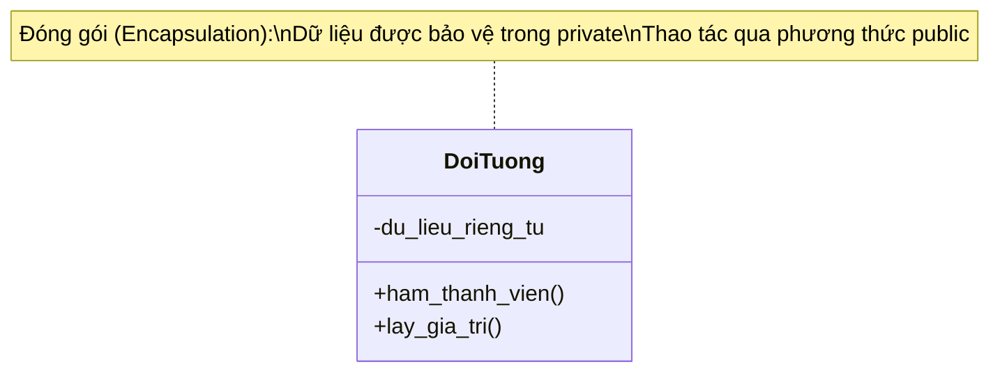

# 14.2 — Introduction to classes

---

## 🎯 Mục Tiêu Bài Học
- Nắm vững bản chất lý thuyết và cơ chế hoạt động của **Introduction to classes** trong tiêu chuẩn ISO C++.
- Hiểu rõ cách máy tính tổ chức bộ nhớ (RAM, CPU registers) khi thực thi mã nguồn liên quan.
- Nhận biết các cạm bẫy lỗi kinh điển (**Undefined Behavior**, Memory Leak, Bug logic) và cách phòng tránh.
- Áp dụng các quy tắc thực hành tốt nhất (**Best Practices**) chuẩn công nghiệp và cập nhật C++20/C++23 hiện đại.

---

# 14.2 &#8212; Introduction to classes

In the previous chapter, we covered structs ([13.7 -- Introduction to structs, members, and member selection](https://www.learncpp.com/cpp-tutorial/introduction-to-structs-members-and-member-selection/)), and discussed how they are great for bundling multiple member các biến into a single object that can be được khởi tạo and passed around as a unit.  In other words, structs provide a convenient package for storing and moving related data values.

Consider the following struct:

```cpp
#include <iostream>

struct Date
{
    int day{};
    int month{};
    int year{};
};

void printDate(const Date& date)
{
    std::cout << date.day << '/' << date.month << '/' << date.year; // assume DMY format
}

int main()
{
    Date date{ 4, 10, 21 }; // initialize using aggregate initialization
    printDate(date);        // can pass entire struct to function

    return 0;
}
```

In the above example, we create a `Date` object and then pass it to a hàm that prints the date.  This program prints:

```cpp
4/10/21
```

::: info A reminder

In these tutorials, all of our structs are aggregates.  We discuss aggregates in lesson [13.8 -- Struct aggregate sự khởi tạo](https://www.learncpp.com/cpp-tutorial/struct-aggregate-sự khởi tạo/).

:::

As useful as structs are, structs have a number of deficiencies that can present challenges when trying to build large, complex programs (especially those worked on by multiple developers).

The class invariant problem

Perhaps the biggest difficulty with structs is that they do not provide an effective way to document and enforce class invariants.  Trong bài học [9.6 -- Assert and static_assert](https://www.learncpp.com/cpp-tutorial/assert-and-static_assert/), we defined an invariant as, “a condition that must be true while some component is executing”.

In the context of class types (which include structs, classes, and unions), a **class invariant** is a condition that must be true throughout the lifetime of an object in order for the object to remain in a valid state.  An object that has a violated class invariant is said to be in an **invalid state**, and unexpected or hành vi không xác định (Hành vi không xác định (Undefined Behavior - UB) - UB) may result from further use of that object.

::: info Hiểu biết cốt lõi

Using an object whose class invariant has been violated may result in unexpected or hành vi không xác định (Hành vi không xác định (Undefined Behavior - UB) - UB).

:::

First, consider the following struct:

```cpp
struct Pair
{
    int first {};
    int second {};
};
```

The `first` and `second` members can be independently set to any value, so `Pair` struct has no invariant.

Now consider the following almost-identical struct:

```cpp
struct Fraction
{
    int numerator { 0 };
    int denominator { 1 };
};
```

We know from mathematics that a fraction with a denominator of `0` is mathematically undefined (because the value of a fraction is its numerator divided by its denominator -- and division by `0` is mathematically undefined).  Therefore, we want to ensure the `denominator` member of a Fraction object is never set to `0`.  If it is, then that Fraction object is in an invalid state, and hành vi không xác định (Hành vi không xác định (Undefined Behavior - UB) - UB) may result from further use of that object.

For example:

```cpp
#include <iostream>

struct Fraction
{
    int numerator { 0 };
    int denominator { 1 }; // class invariant: should never be 0
};

void printFractionValue(const Fraction& f)
{
     std::cout << f.numerator / f.denominator << '\n';
}

int main()
{
    Fraction f { 5, 0 };   // create a Fraction with a zero denominator
    printFractionValue(f); // cause divide by zero error

    return 0;
}
```

In the above example, we use a comment to document the invariant of Fraction.  We also provide a default member initializer to ensure that denominator is set to `1` if the user does not provide an sự khởi tạo value.  This ensures our Fraction object will be valid if the user decides to value khởi tạo a Fraction object.  That’s an okay start.

But nothing prevents us from explicitly violating this class invariant: When we create `Fraction f`, we use aggregate sự khởi tạo to explicitly khởi tạo the denominator to `0`.  While this does not cause an immediate issue, our object is now in an invalid state, and further use of the object may cause unexpected or hành vi không xác định (Hành vi không xác định (Undefined Behavior - UB) - UB).

And that is exactly what we see later, when we call `printFractionValue(f)`: the program terminates due to a divide-by-zero error.

::: info As an aside…

A small improvement would be to `assert(f.denominator != 0);` at the top of the body of `printFractionValue`.  This adds documentation value to the code, and makes it more obvious what precondition is being violated.  However, behaviorally, this doesn’t really change anything.  We really want to catch these problems at the source of the problem (when the member is được khởi tạo or assigned a bad value), not somewhere downstream (when the bad value is used).
:::

<p>Given the relative simplicitly of the Fraction example, it shouldn’t be too difficult to simply avoid creating invalid Fraction đối tượng.  However, in a more complex code base that uses many structs, structs with many members, or structs whose members have complex relationships, understanding what combination of values might violate some class invariant may not be so obvious.

A more complex class invariant

The class invariant for Fraction is a simple one -- the `denominator` member cannot be `0`.  That’s conceptually easy to understand and not overly difficult to avoid.

Class invariants become more of a challenge when the members of a struct must have correlated values.

```cpp
#include <string>

struct Employee
{
    std::string name { };
    char firstInitial { }; // should always hold first character of `name` (or `0`)
};
```

In the above (poorly designed) struct, the character value stored in member `firstInitial` should always match the first character of `name`.

When an `Employee` object is được khởi tạo, the user is responsible for making sure the class invariant is maintained.  And if `name` is ever assigned a new value, the user is also responsible for ensuring `firstInitial` is updated as well.  This correlation may not be obvious to a developer using an Employee object, and even if it is, they may forget to do it.

Even if we write các hàm to help us create and update Employee đối tượng (ensuring that `firstInitial` is always set from the first character of `name`), we’re still relying on the user to be aware of and use these các hàm.

In short, relying on the user of an object to maintain class invariants is likely to result in problematic code.

::: info Hiểu biết cốt lõi

Relying on the user of an object to maintain class invariants is likely to result in problems.

:::

Ideally, we’d love to bulletproof our class types so that an object either can’t be put into an invalid state, or can signal immediately if it is (rather than letting hành vi không xác định (Hành vi không xác định (Undefined Behavior - UB) - UB) occur at some random point in the future).

Structs (as aggregates) just don’t have the mechanics required to solve this problem in an elegant way.

Introduction to classes

When developing C++, Bjarne Stroustrup wanted to introduce capabilities that would allow developers to create program-defined types that could be used more intuitively.  He was also interested in finding elegant solutions to some of the frequent pitfalls and maintenance challenges that plague large, complex programs (such as the previously mentioned class invariant issue).

Drawing upon his experience with other programming languages (particularly Simula, the first object-oriented programming language), Bjarne was convinced that it was possible to develop a program-defined type that was general and powerful enough to be used for almost anything.  In a nod to Simula, he called this type a *class*.

Just like structs, a **class** is a program-defined compound type that can have many member các biến with different types.  

::: info Hiểu biết cốt lõi

From a technical standpoint, structs and classes are almost identical -- therefore, any example that is implemented using a struct could be implemented using a class, or vice-versa.  However, from a practical standpoint, we use structs and classes differently.

We cover both the technical and practical differences between structs and classes in lesson [14.5 -- Public and private members and access specifiers](https://www.learncpp.com/cpp-tutorial/public-and-private-members-and-access-specifiers/)

:::

::: info Related content

We cover how classes solve the invariant problem in lesson [14.8 -- The benefits of data hiding (encapsulation)](https://www.learncpp.com/cpp-tutorial/the-benefits-of-data-hiding-encapsulation/).

:::

Defining a class

Because a class is a program-defined kiểu dữ liệu, it must be defined before it can be used.  Classes are defined similarly to structs, except we use the `class` keyword instead of `struct`.  For example, here is a definition for a simple employee class:

```cpp
class Employee
{
    int m_id {};
    int m_age {};
    double m_wage {};
};
```

::: info Related content

We discuss why member các biến of a class are often prefixed with an “m_” in upcoming lesson [14.5 -- Public and private members and access specifiers](https://www.learncpp.com/cpp-tutorial/public-and-private-members-and-access-specifiers/)

:::

To demonstrate how similar classes and structs can be, the following program is equivalent to the one we presented at the top of the lesson, but `Date` is now a class instead of a struct:

```cpp
#include <iostream>

class Date       // we changed struct to class
{
public:          // and added this line, which is called an access specifier
    int m_day{}; // and added "m_" prefixes to each of the member names
    int m_month{};
    int m_year{};
};

void printDate(const Date& date)
{
    std::cout << date.m_day << '/' << date.m_month << '/' << date.m_year;
}

int main()
{
    Date date{ 4, 10, 21 };
    printDate(date);

    return 0;
}
```

This prints:

```cpp
4/10/21
```

::: info Related content

We cover what an access specifier is in upcoming lesson [14.5 -- Public and private members and access specifiers](https://www.learncpp.com/cpp-tutorial/public-and-private-members-and-access-specifiers/).

:::

Most of the C++ standard library is classes

You have already been using class đối tượng, perhaps without knowing it.  Both `std::string` and `std::string_view` are defined as classes.  In fact, most of the non-aliased types in the standard library are defined as classes!

Classes are really the heart and soul of C++ -- they are so foundational that C++ was originally named “C with classes”!  Once you are familiar with classes, much of your time in C++ will be spent writing, testing, and using them.

Hệ thống Câu hỏi & Quiz Tự Luyện

Câu hỏi #1

Given some set of values (ages, address numbers, etc…), we might want to know what the minimum and maximum values are in that set.  Since the minimum and maximum values are related, we can organize them in a struct, like so:

```cpp
struct minMax
{
    int min; // holds the minimum value seen so far
    int max; // holds the maximum value seen so far
};
```

However, as written, this struct has an unspecified class invariant.  What is the invariant?

::: details Xem lời giải (Solution)
<p>The invariant is that `min <= max`.  If `min` is ever greater than `max`, any code that uses this struct may malfunction.
:::

</a>
  	<a class="nav-link" href="/">
  
    <i class="fa fa-home" aria-hidden="true"></i>
    
      Back to table of contents
    
</a>
  	<a class="nav-link" href="https://www.learncpp.com/cpp-tutorial/introduction-to-object-oriented-programming/">
  
    <i class="fa fa-chevron-circle-left" aria-hidden="true"></i>
    
      Previous lesson
      
        14.1Introduction to object-oriented programming
      
    
  </a>


---





::: warning Cạm Bẫy: Khởi Tạo Không Đồng Nhất (Initialization Pitfalls)
Hãy luôn khởi tạo biến thành viên ngay tại nơi khai báo hoặc sử dụng **Danh sách khởi tạo thành viên (Member Initializer List)** trong hàm tạo để tránh việc đối tượng bị gán giá trị 2 lần gây lãng phí chu kỳ CPU.
:::


::: tip 💡 Tóm Tắt Quy Tắc Vàng (Core Guidelines)
1. Luôn hiểu rõ vòng đời và quyền sở hữu (Ownership) của dữ liệu trước khi viết code.
2. Ưu tiên khởi tạo đồng nhất với dấu ngoặc nhọn `{}` để ngăn chặn lỗi thu hẹp kiểu dữ liệu (Narrowing conversions).
3. Bật toàn bộ cờ cảnh báo `-Wall -Wextra -Wpedantic` để compiler giúp bạn phát hiện bug từ sớm!
:::
