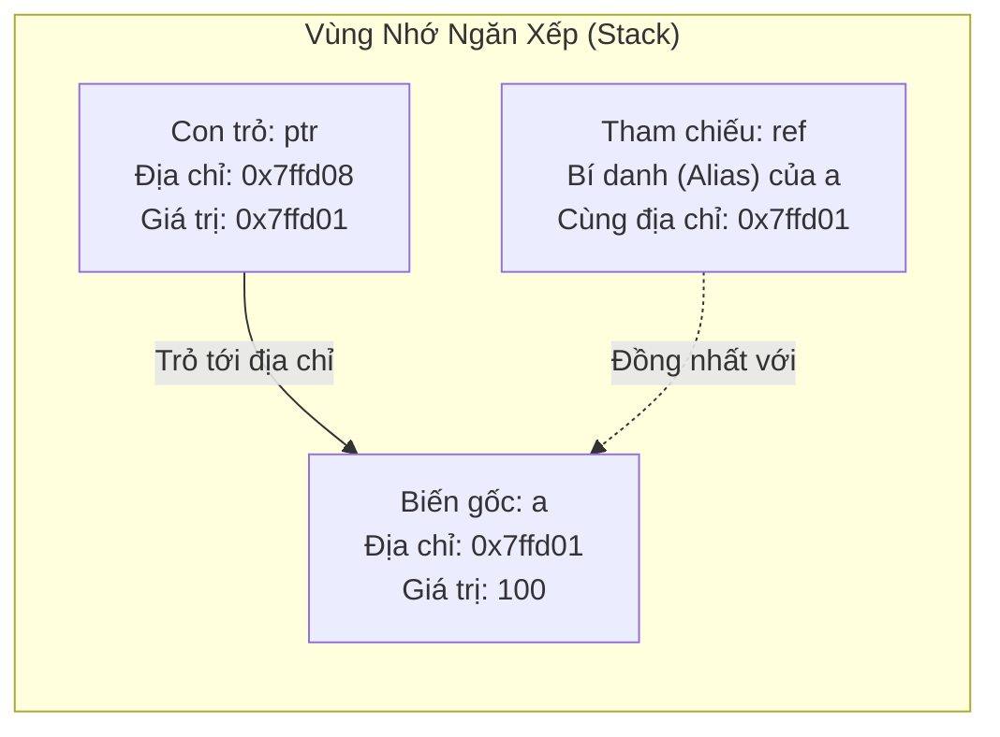

# 14.7 — Member functions returning references to data members

---

## 🎯 Mục Tiêu Bài Học
- Nắm vững bản chất lý thuyết và cơ chế hoạt động của **Member functions returning references to data members** trong tiêu chuẩn ISO C++.
- Hiểu rõ cách máy tính tổ chức bộ nhớ (RAM, CPU registers) khi thực thi mã nguồn liên quan.
- Nhận biết các cạm bẫy lỗi kinh điển (**Undefined Behavior**, Memory Leak, Bug logic) và cách phòng tránh.
- Áp dụng các quy tắc thực hành tốt nhất (**Best Practices**) chuẩn công nghiệp và cập nhật C++20/C++23 hiện đại.

---

# 14.7 &#8212; Member các hàm returning các tham chiếu to data members

Trong bài học [12.12 -- Return by tham chiếu and return by address](https://www.learncpp.com/cpp-tutorial/return-by-tham chiếu-and-return-by-address/), we covered return by tham chiếu.  In particular, we noted, “The object being returned by tham chiếu must exist after the hàm returns”.  This means we should not return local các biến by tham chiếu, as the tham chiếu will be left dangling after the local biến is destroyed.  However, it is generally okay to return by tham chiếu either hàm tham số passed by tham chiếu, or các biến with static duration (either static local các biến or global các biến), as they will generally not be destroyed after the hàm returns.

For example:

```cpp
// Takes two std::string objects, returns the one that comes first alphabetically
const std::string& firstAlphabetical(const std::string& a, const std::string& b)
{
	return (a < b) ? a : b; // We can use operator< on std::string to determine which comes first alphabetically
}

int main()
{
	std::string hello { "Hello" };
	std::string world { "World" };

	std::cout << firstAlphabetical(hello, world); // either hello or world will be returned by reference

	return 0;
}
```

Member các hàm can also return by tham chiếu, and they follow the same rules for when it is safe to return by tham chiếu as non-member các hàm.  However, member các hàm have one additional case we need to discuss: member các hàm that return data members by tham chiếu.

This is most commonly seen with getter access các hàm, so we’ll illustrate this topic using getter member các hàm.  But note that this topic applies to any member hàm returning a tham chiếu to a data member.

Returning data members by value can be expensive

Consider the following example:

```cpp
#include <iostream>
#include <string>

class Employee
{
	std::string m_name{};

public:
	void setName(std::string_view name) { m_name = name; }
	std::string getName() const { return m_name; } //  getter returns by value
};

int main()
{
	Employee joe{};
	joe.setName("Joe");
	std::cout << joe.getName();

	return 0;
}
```

In this example, the `getName()` access hàm returns `std::string m_name` by value.

While this is the safest thing to do, it also means that an expensive copy of `m_name` will be made every time `getName()` is called.  Since access các hàm tend to be called a lot, this is generally not the best choice.

Returning data members by lvalue tham chiếu

Member các hàm can also return data members by (const) lvalue tham chiếu.

Data members have the same lifetime as the object containing them.  Since member các hàm are always called on an object, and that object must exist in the phạm vi truy cập (scope) of the caller, it is generally safe for a member hàm to return a data member by (const) lvalue tham chiếu (as the member being returned by tham chiếu will still exist in the phạm vi truy cập (scope) of the caller when the hàm returns).

Let’s update the example above so that `getName()` returns `m_name` by const lvalue tham chiếu:

```cpp
#include <iostream>
#include <string>

class Employee
{
	std::string m_name{};

public:
	void setName(std::string_view name) { m_name = name; }
	const std::string& getName() const { return m_name; } //  getter returns by const reference
};

int main()
{
	Employee joe{}; // joe exists until end of function
	joe.setName("Joe");

	std::cout << joe.getName(); // returns joe.m_name by reference

	return 0;
}
```

Now when `joe.getName()` is invoked, `joe.m_name` is returned by tham chiếu to the caller, avoiding having to make a copy.  The caller then uses this tham chiếu to print `joe.m_name` to the console.

Because `joe` exists in the phạm vi truy cập (scope) of the caller until the end of the `main()` hàm, the tham chiếu to `joe.m_name` is also valid for the same duration.

::: info Hiểu biết cốt lõi

It is okay to return a (const) lvalue tham chiếu to a data member.  The implicit object (containing the data member) still exists in the phạm vi truy cập (scope) of the caller after the hàm returns, so any returned các tham chiếu will be valid.

:::

The return type of a member hàm returning a tham chiếu to a data member should match the data member’s type

In general, the return type of a member hàm returning by tham chiếu should match the type of the data member being returned.  In the above example, `m_name` is of type `std::string`, so `getName()` returns `const std::string&`.

Returning a `std::string_view` would require a temporary `std::string_view` to be created and returned every time the hàm was called.  That’s needlessly inefficient.  If the caller wants a `std::string_view`, they can do the conversion themselves.

::: tip Thực hành tốt nhất (Best Practice)

A member hàm returning a tham chiếu should return a tham chiếu of the same type as the data member being returned, to avoid unnecessary conversions.

:::

For getters, using `auto` to have the trình biên dịch deduce the return type from the member being returned is a useful way to ensure that no conversions occur:

```cpp
#include <iostream>
#include <string>

class Employee
{
	std::string m_name{};

public:
	void setName(std::string_view name) { m_name = name; }
	const auto& getName() const { return m_name; } // uses `auto` to deduce return type from m_name
};

int main()
{
	Employee joe{}; // joe exists until end of function
	joe.setName("Joe");

	std::cout << joe.getName(); // returns joe.m_name by reference

	return 0;
}
```

::: info Related content

We cover `auto` return types in lesson [10.9 -- Type deduction for các hàm](https://www.learncpp.com/cpp-tutorial/type-deduction-for-các hàm/).
:::

However, using an `auto` return type obscures the return type of the getter from a documentation perspective.  For example:

```cpp
const auto& getName() const { return m_name; } // uses `auto` to deduce return type from m_name
```

It’s unclear what kind of string this hàm actually returns (it could be a `std::string`, `std::string_view`, `C-style string`, or something else entirely!).

For this reason, we’ll generally prefer explicit return types.

Rvalue implicit đối tượng and return by tham chiếu

There’s one case we need to be a little careful with.  In the above example, `joe` is an lvalue object that exists until the end of the hàm.  Therefore, the tham chiếu returned by `joe.getName()` will also be valid until the end of the hàm.

But what if our implicit object is an rvalue instead (such as the giá trị trả về of some hàm that returns by value)?  Rvalue đối tượng are destroyed at the end of the full biểu thức in which they are created.  When an rvalue object is destroyed, any các tham chiếu to members of that rvalue will be invalidated and left dangling, and use of such các tham chiếu will produce hành vi không xác định (Hành vi không xác định (Undefined Behavior - UB) - UB).

Therefore, a tham chiếu to a member of an rvalue object can only be safely used within the full biểu thức where the rvalue object is created.

::: info Tip

We covered what a full biểu thức is in lesson [1.10 -- Introduction to biểu thức](https://www.learncpp.com/cpp-tutorial/introduction-to-biểu thức/).

:::

::: danger Cảnh báo nguy hiểm

An rvalue object is destroyed at the end of the full biểu thức in which it is created.  Any các tham chiếu to members of the rvalue object are left dangling at that point.

A tham chiếu to a member of an rvalue object can only be safely used within the full biểu thức where the rvalue object is created.

:::

Let’s explore some cases related to this:

```cpp
#include <iostream>
#include <string>
#include <string_view>

class Employee
{
	std::string m_name{};

public:
	void setName(std::string_view name) { m_name = name; }
	const std::string& getName() const { return m_name; } //  getter returns by const reference
};

// createEmployee() returns an Employee by value (which means the returned value is an rvalue)
Employee createEmployee(std::string_view name)
{
	Employee e;
	e.setName(name);
	return e;
}

int main()
{
	// Case 1: okay: use returned reference to member of rvalue class object in same expression
	std::cout << createEmployee("Frank").getName();

	// Case 2: bad: save returned reference to member of rvalue class object for use later
	const std::string& ref { createEmployee("Garbo").getName() }; // reference becomes dangling when return value of createEmployee() is destroyed
	std::cout << ref; // undefined behavior

	// Case 3: okay: copy referenced value to local variable for use later
	std::string val { createEmployee("Hans").getName() }; // makes copy of referenced member
	std::cout << val; // okay: val is independent of referenced member

	return 0;
}
```

When `createEmployee()` is called, it will return an `Employee` object by value.  This returned `Employee` object is an rvalue that will exist until the end of the full biểu thức containing the call to `createEmployee()`.  When that rvalue object is destroyed, any các tham chiếu to members of that object will become dangling.

In case 1, we call `createEmployee("Frank")`, which returns an rvalue `Employee` object.  We then call `getName()` on this rvalue object, which returns a tham chiếu to `m_name`.  This tham chiếu is then used immediately to print the name to the console.  At this point, the full biểu thức containing the call to `createEmployee("Frank")` ends, and the rvalue object and its members are destroyed.  Since neither the rvalue object or its members are used beyond this point, this case is fine.

In case 2, we run into problems.  First, `createEmployee("Garbo")` returns an rvalue object.  We then call `getName()` to get a tham chiếu to the `m_name` member of this rvalue.  This `m_name` member is then used to khởi tạo `ref`.  At this point, the full biểu thức containing the call to `createEmployee("Garbo")` ends, and the rvalue object and its members are destroyed.  This leaves `ref` dangling.  Thus, when we use `ref` in the subsequent câu lệnh, we’re accessing a dangling tham chiếu, and hành vi không xác định (Hành vi không xác định (Undefined Behavior - UB) - UB) results.

::: info Hiểu biết cốt lõi

The evaluation of a full biểu thức ends *after* any uses of that full biểu thức as an initializer.  This allows đối tượng to be được khởi tạo with an rvalue of the same type (as the rvalue won’t be destroyed until after sự khởi tạo occurs).
:::

But what if we want to save a value from a hàm that returns a member by tham chiếu for use later?  Instead of using the returned tham chiếu to khởi tạo a local tham chiếu biến, we can instead use the returned tham chiếu to khởi tạo a non-tham chiếu local biến.

In case 3, we’re using the returned tham chiếu to khởi tạo non-tham chiếu local biến `val`.  This will cause the member being referenced to be copied into `val`.  After sự khởi tạo, `val` exists independently of the tham chiếu.  So when the rvalue object is subsequently destroyed, `val` is not impacted by this.  Thus `val` can be output in future câu lệnh without issue.

Using member các hàm that return by tham chiếu safely

Despite the potential danger with rvalue implicit đối tượng, it is conventional for getters to return types that are expensive to copy by const tham chiếu, not by value.

Given that, let’s talk about how we can use the các giá trị trả về from such các hàm safely.  The three cases in the example above illustrate the three key points:

- Prefer to use the giá trị trả về of a member hàm that returns by tham chiếu immediately (illustrated in case 1).  Since this works with both lvalue and rvalue đối tượng, if you always do this, you will avoid trouble.

- Do not “save” a returned tham chiếu to use later (illustrated in case 2), unless you are sure the implicit object is an lvalue.  If you do this with an rvalue implicit object, hành vi không xác định (Hành vi không xác định (Undefined Behavior - UB) - UB) will result when you use the now-dangling tham chiếu.

- If you do need to persist a returned tham chiếu for use later and aren’t sure that the implicit object is an lvalue, using the returned tham chiếu as the initializer for a non-tham chiếu local biến, which will make a copy of the member being referenced into the local biến (illustrated in case 3).

::: tip Thực hành tốt nhất (Best Practice)

Prefer to use the giá trị trả về of a member hàm that returns by tham chiếu immediately, to avoid issues with dangling các tham chiếu when the implicit object is an rvalue.

:::

Do not return non-const các tham chiếu to private data members

Because a tham chiếu acts just like the object being referenced, a member hàm that returns a non-const tham chiếu provides direct access to that member (even if the member is private).

For example:

```cpp
#include <iostream>

class Foo
{
private:
    int m_value{ 4 }; // private member

public:
    int& value() { return m_value; } // returns a non-const reference (don't do this)
};

int main()
{
    Foo f{};                // f.m_value is initialized to default value 4
    f.value() = 5;          // The equivalent of m_value = 5
    std::cout << f.value(); // prints 5

    return 0;
}
```

Because `value()` returns a non-const tham chiếu to `m_value`, the caller is able to use that tham chiếu to directly access (and change the value of) `m_value`.

This allows the caller to subvert the access control system.

Const member các hàm can’t return non-const các tham chiếu to data members

A const member hàm is not allowed to return a non-const tham chiếu to members.  This makes sense -- a const member hàm is not allowed to modify the state of the object, nor is it allowed to call các hàm that would modify the state of the object.  It should not be doing anything that might lead to the modification of the object.

If a const member hàm was allowed to return a non-const tham chiếu to a member, it would be handing the caller a way to directly modify that member.  This violates the intent of a const member hàm.

  	
  	

---



::: danger Cạm Bẫy Thực Chiến: Con Trỏ Lơ Lửng (Dangling Pointer) & UB
Tuyệt đối không giải phóng vùng nhớ mà con trỏ đang trỏ tới rồi tiếp tục truy cập nó, hoặc trả về tham chiếu/con trỏ tới một biến cục bộ trên Stack. Khi hàm kết thúc, biến cục bộ bị hủy và con trỏ sẽ trỏ vào vùng nhớ rác, dẫn đến **Hành vi không xác định (Undefined Behavior)** cực kỳ nguy hiểm!
:::

::: tip Nâng Cấp C++ Hiện Đại: Thay Thế Con Trỏ Thô Bằng Smart Pointers
Trong C++ hiện đại (C++11 đến C++23), hãy hạn chế tối đa việc sử dụng con trỏ thô (`T*`) cùng các toán tử `new`/`delete`. Thay vào đó, hãy luôn ưu tiên:
- `std::unique_ptr<T>`: Sở hữu độc quyền tài nguyên (Zero-overhead, tự động giải phóng RAII).
- `std::shared_ptr<T>`: Sở hữu chia sẻ tài nguyên có cơ chế đếm tham chiếu (Reference counting).
- `std::span<T>` (C++20) hoặc `std::string_view` (C++17): Xem qua vùng nhớ mà không sở hữu, an toàn và tốc độ cực cao.
:::

::: tip 💡 Tóm Tắt Quy Tắc Vàng (Core Guidelines)
1. Luôn hiểu rõ vòng đời và quyền sở hữu (Ownership) của dữ liệu trước khi viết code.
2. Ưu tiên khởi tạo đồng nhất với dấu ngoặc nhọn `{}` để ngăn chặn lỗi thu hẹp kiểu dữ liệu (Narrowing conversions).
3. Bật toàn bộ cờ cảnh báo `-Wall -Wextra -Wpedantic` để compiler giúp bạn phát hiện bug từ sớm!
:::
