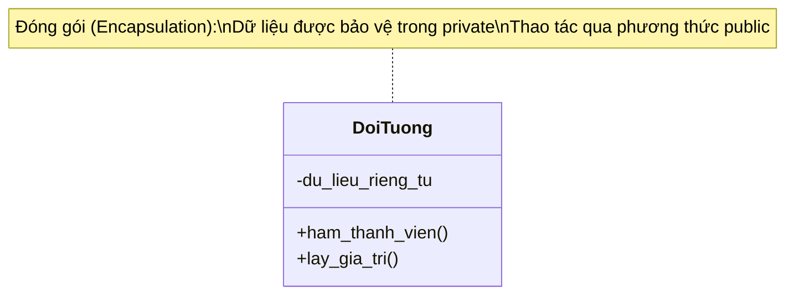

# 14.9 — Introduction to constructors

---

## 🎯 Mục Tiêu Bài Học
- Nắm vững bản chất lý thuyết và cơ chế hoạt động của **Introduction to constructors** trong tiêu chuẩn ISO C++.
- Hiểu rõ cách máy tính tổ chức bộ nhớ (RAM, CPU registers) khi thực thi mã nguồn liên quan.
- Nhận biết các cạm bẫy lỗi kinh điển (**Undefined Behavior**, Memory Leak, Bug logic) và cách phòng tránh.
- Áp dụng các quy tắc thực hành tốt nhất (**Best Practices**) chuẩn công nghiệp và cập nhật C++20/C++23 hiện đại.

---

# 14.9 &#8212; Introduction to các hàm tạo (constructors)

When a class type is an aggregate, we can use aggregate sự khởi tạo to khởi tạo the class type directly:

```cpp
struct Foo // Foo is an aggregate
{
    int x {};
    int y {};
};

int main()
{
    Foo foo { 6, 7 }; // uses aggregate initialization

    return 0;
}
```

Aggregate inititalization does memberwise sự khởi tạo (members are được khởi tạo in the order in which they are defined).  So when `foo` is instantiated in the above example, `foo.x` is được khởi tạo to `6`, and `foo.y` is được khởi tạo to `7`.

::: info Related content

We discuss the definition of an aggregate and aggregate sự khởi tạo in lesson [13.8 -- Struct aggregate sự khởi tạo](https://www.learncpp.com/cpp-tutorial/struct-aggregate-sự khởi tạo/).

:::

However, as soon as we make any member các biến private (to hide our data), our class type is no longer an aggregate (because aggregates cannot have private members).  And that means we’re no longer able to use aggregate sự khởi tạo:

```cpp
class Foo // Foo is not an aggregate (has private members)
{
    int m_x {};
    int m_y {};
};

int main()
{
    Foo foo { 6, 7 }; // compile error: can not use aggregate initialization

    return 0;
}
```

Not allowing class types with private members to be được khởi tạo via aggregate sự khởi tạo makes sense for a number of reasons:

- Aggregate sự khởi tạo requires knowing about the implementation of the class (since you have to know what the members are, and what order they were defined in), which we’re intentionally trying to avoid when we hide our data members.

- If our class had some kind of invariant, we’d be relying on the user to khởi tạo the class in a way that preserves the invariant.

So then how do we khởi tạo a class with private member các biến?  The error message given by the trình biên dịch for the prior example provides a clue: “error: no matching hàm tạo (constructor) for sự khởi tạo of ‘Foo'”

We must need a matching hàm tạo (constructor).  But what the heck is that?

Constructors

A **hàm tạo (constructor)** is a special member hàm that is automatically called after a non-aggregate class type object is created.

When a non-aggregate class type object is defined, the trình biên dịch looks to see if it can find an accessible hàm tạo (constructor) that is a match for the sự khởi tạo values provided by the caller (if any).

- If an accessible matching hàm tạo (constructor) is found, memory for the object is allocated, and then the hàm tạo (constructor) hàm is called.

- If no accessible matching hàm tạo (constructor) can be found, a quá trình biên dịch error will be generated.

::: info Hiểu biết cốt lõi

Many new programmers are confused about whether các hàm tạo (constructors) create the đối tượng or not.  They do not -- the trình biên dịch sets up the memory allocation for the object prior to the hàm tạo (constructor) call.  The hàm tạo (constructor) is then called on the chưa được khởi tạo object.

However, if a matching hàm tạo (constructor) cannot be found for a set of initializers, the trình biên dịch will error.  So while các hàm tạo (constructors) don’t create đối tượng, the lack of a matching hàm tạo (constructor) will prevent creation of an object.

:::

Beyond determining how an object may be created, các hàm tạo (constructors) generally perform two các hàm:

- They typically perform sự khởi tạo of any member các biến (via a member sự khởi tạo list)

- They may perform other setup các hàm (via câu lệnh in the body of the hàm tạo (constructor)).  This might include things such as error checking the sự khởi tạo values, opening a file or database, etc…

After the hàm tạo (constructor) finishes executing, we say that the object has been “constructed”, and the object should now be in a consistent, usable state.

Note that aggregates are not allowed to have các hàm tạo (constructors) -- so if you add a hàm tạo (constructor) to an aggregate, it is no longer an aggregate.

Naming các hàm tạo (constructors)

Unlike normal member các hàm, các hàm tạo (constructors) have specific rules for how they must be named:

- Constructors must have the same name as the class (with the same capitalization).  For template classes, this name excludes the template tham số.

- Constructors have no return type (not even `void`).

Because các hàm tạo (constructors) are typically part of the interface for your class, they are usually public.

A basic hàm tạo (constructor) example

Let’s add a basic hàm tạo (constructor) to our example above:

```cpp
#include <iostream>

class Foo
{
private:
    int m_x {};
    int m_y {};

public:
    Foo(int x, int y) // here's our constructor function that takes two initializers
    {
        std::cout << "Foo(" << x << ", " << y << ") constructed\n";
    }

    void print() const
    {
        std::cout << "Foo(" << m_x << ", " << m_y << ")\n";
    }
};

int main()
{
    Foo foo{ 6, 7 }; // calls Foo(int, int) constructor
    foo.print();

    return 0;
}
```

This program will now compile and produce the result:

```cpp
Foo(6, 7) constructed
Foo(0, 0)
```

When the trình biên dịch sees the definition `Foo foo{ 6, 7 }`, it looks for a matching `Foo` hàm tạo (constructor) that will accept two `int` đối số.  `Foo(int, int)` is a match, so the trình biên dịch will allow the definition.

At runtime, when `foo` is instantiated, memory for `foo` is allocated, and then the `Foo(int, int)` hàm tạo (constructor) is called with tham số `x` được khởi tạo to `6` and tham số `y` được khởi tạo to `7`.  The body of the hàm tạo (constructor) hàm then executes and prints `Foo(6, 7) constructed`.

When we call the `print()` member hàm, you’ll note that members `m_x` and `m_y` have value 0.  This is because although our `Foo(int, int)` hàm tạo (constructor) hàm was called, it did not actually khởi tạo the members.  We’ll show how to do that in the next lesson.

::: info Related content

We discuss the differences between using copy, direct, and list sự khởi tạo to khởi tạo đối tượng with a hàm tạo (constructor) in lesson [14.15 -- Class sự khởi tạo and copy elision](https://www.learncpp.com/cpp-tutorial/class-sự khởi tạo-and-copy-elision/).

:::

Constructor implicit conversion of đối số

Trong bài học [10.1 -- Implicit type conversion](https://www.learncpp.com/cpp-tutorial/implicit-type-conversion/), we noted that the trình biên dịch will perform implicit conversion of đối số in a hàm call (if needed) in order to match a hàm definition where the tham số are a different type:

```cpp
void foo(int, int)
{
}

int main()
{
    foo('a', true); // will match foo(int, int)

    return 0;
}
```

This is no different for các hàm tạo (constructors): the `Foo(int, int)` hàm tạo (constructor) will match any call whose đối số are implicitly convertible to `int`:

```cpp
class Foo
{
public:
    Foo(int x, int y)
    {
    }
};

int main()
{
    Foo foo{ 'a', true }; // will match Foo(int, int) constructor

    return 0;
}
```

Constructors should not be const

A hàm tạo (constructor) needs to be able to khởi tạo the object being constructed -- therefore, a hàm tạo (constructor) must not be const.

```cpp
#include <iostream>

class Something
{
private:
    int m_x{};

public:
    Something() // constructors must be non-const
    {
        m_x = 5; // okay to modify members in non-const constructor
    }

    int getX() const { return m_x; } // const
};

int main()
{
    const Something s{}; // const object, implicitly invokes (non-const) constructor

    std::cout << s.getX(); // prints 5
    
    return 0;
}
```

Normally a non-const member hàm can’t be invoked on a const object.  However, the C++ standard explicitly states (per [class.ctor.general#5](https://eel.is/c++draft/class.ctor.general#5)) that const doesn’t apply to an object under construction, and only comes into effect after the hàm tạo (constructor) ends.

Constructors vs setters

Constructors are designed to khởi tạo an entire object at the point of instantiation.  Setters are designed to assign a value to a single member of an existing object.

</a>
  	<a class="nav-link" href="/">
  
    <i class="fa fa-home" aria-hidden="true"></i>
    
      Back to table of contents
    
</a>
  	<a class="nav-link" href="https://www.learncpp.com/cpp-tutorial/the-benefits-of-data-hiding-encapsulation/">
  
    <i class="fa fa-chevron-circle-left" aria-hidden="true"></i>
    
      Previous lesson
      
        14.8The benefits of data hiding (encapsulation)
      
    
  </a>


---





::: warning Cạm Bẫy: Khởi Tạo Không Đồng Nhất (Initialization Pitfalls)
Hãy luôn khởi tạo biến thành viên ngay tại nơi khai báo hoặc sử dụng **Danh sách khởi tạo thành viên (Member Initializer List)** trong hàm tạo để tránh việc đối tượng bị gán giá trị 2 lần gây lãng phí chu kỳ CPU.
:::


::: tip 💡 Tóm Tắt Quy Tắc Vàng (Core Guidelines)
1. Luôn hiểu rõ vòng đời và quyền sở hữu (Ownership) của dữ liệu trước khi viết code.
2. Ưu tiên khởi tạo đồng nhất với dấu ngoặc nhọn `{}` để ngăn chặn lỗi thu hẹp kiểu dữ liệu (Narrowing conversions).
3. Bật toàn bộ cờ cảnh báo `-Wall -Wextra -Wpedantic` để compiler giúp bạn phát hiện bug từ sớm!
:::
