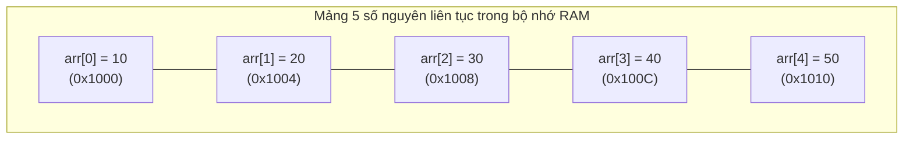

# 16.1 — Nhập Môn Container và Mảng (Introduction to Containers and Arrays)

---

## 🎯 Mục Tiêu Bài Học
- Hiểu bài toán mở rộng biến số (Variable Scalability Challenge) khi làm việc với tập hợp dữ liệu lớn.
- Định nghĩa khái niệm **Container (Bộ chứa)** và **Mảng (Array)** trong khoa học máy tính và C++.
- Nắm bắt cấu trúc tổ chức phần tử liên tục trong bộ nhớ RAM và lợi thế vượt trội về hiệu năng phần cứng (CPU Cache Locality).
- Nhận biết các loại mảng trong C++: Mảng kích thước cố định (`std::array`, C-style array) và Mảng động (`std::vector`).

---

## 1. Vấn Nạn Mở Rộng Biến Số (The Variable Scalability Challenge)

Hãy tưởng tượng bạn được giao nhiệm vụ viết một chương trình quản lý điểm thi của một lớp học gồm 30 học sinh và tính điểm trung bình của cả lớp. Nếu chỉ sử dụng các biến rời rạc như đã học ở các chương trước, bạn sẽ phải làm như sau:

```cpp
int diem1 { 0 };
int diem2 { 0 };
int diem3 { 0 };
// ... định nghĩa thủ công thêm 27 biến nữa ...
int diem30 { 0 };
```

Khi cần tính điểm trung bình, bạn sẽ phải viết một biểu thức khổng lồ:

```cpp
int trungBinh { (diem1 + diem2 + diem3 + diem4 + /* ... */ + diem30) / 30 };
```

Cách tiếp cận này gặp phải 3 vấn đề chí mạng:
1. **Khó bảo trì và dễ sai sót**: Chỉ cần gõ nhầm một ký tự hoặc bỏ sót một biến (ví dụ cộng 29 biến nhưng lại chia cho 30), chương trình sẽ trả về kết quả sai hoàn toàn mà compiler không thể cảnh báo.
2. **Không thể mở rộng (Not scalable)**: Nếu sĩ số lớp tăng lên 100 học sinh, bạn phải sửa toàn bộ mã nguồn, thêm 70 biến và viết lại toàn bộ các phép tính.
3. **Không thể lặp (Non-iterable)**: Các biến `diem1`, `diem2`... là các định danh độc lập, bạn không thể sử dụng vòng lặp `for` hay `while` để duyệt qua chúng một cách tự động.

Giải pháp chuẩn mực cho bài toán này chính là sử dụng một **Container**.

---

## 2. Container Là Gì? Mảng Là Gì?

### 2.1. Khái niệm Container (Bộ chứa)
Trong C++, một **Container** là một kiểu dữ liệu cho phép lưu trữ một tập hợp các đối tượng khác. Thay vì quản lý hàng chục biến đơn lẻ, ta chỉ cần quản lý một đối tượng container duy nhất.

### 2.2. Khái niệm Mảng (Array)
**Mảng (Array)** là loại container cơ bản và quan trọng nhất trong lập trình. Một mảng là một chuỗi các phần tử có **cùng kiểu dữ liệu**, được lưu trữ **hoàn toàn liên tục (contiguous)** trong bộ nhớ máy tính. Mỗi phần tử trong mảng có thể được truy cập trực tiếp thông qua một chỉ số nguyên (**Index / Subscript**).



---

## 3. Lợi Thế Phần Cứng: Tính Liên Tục Trong Bộ Nhớ (Contiguous Memory & Cache Locality)

Tại sao mảng lại là cấu trúc dữ liệu được ưu tiên số một trong mọi ứng dụng đòi hỏi hiệu năng cao (từ Game Engine, AI đến High-Frequency Trading)?

Bí mật nằm ở **Phần cứng CPU và Bộ nhớ đệm (CPU Cache)**:
- Khi CPU cần đọc một phần tử tại địa chỉ `0x1000`, hệ điều hành không chỉ tải đúng 4 bytes của phần tử đó vào CPU. Thay vào đó, bộ điều khiển bộ nhớ sẽ nạp nguyên một khối bộ nhớ gọi là **Đường đệm Cache (Cache Line - thường là 64 bytes)** từ RAM vào bộ nhớ đệm L1/L2/L3 cực nhanh của CPU.
- Vì các phần tử mảng nằm liên tiếp nhau (`0x1000`, `0x1004`, `0x1008`...), khi bạn duyệt từ phần tử `0` sang phần tử `1`, dữ liệu của phần tử `1` **đã nằm sẵn trong Cache** (**Cache Hit**). CPU đọc tức thì trong 1-2 xung nhịp thay vì phải mất hàng trăm xung nhịp để với tới RAM (**Cache Miss**).

::: tip Triết lý Bjarne Stroustrup
Bjarne Stroustrup từng khẳng định: *"Theo mặc định, hãy luôn sử dụng `std::vector` trừ khi bạn có một lý do cực kỳ chính đáng để dùng cấu trúc dữ liệu khác."* Tính liên tục trong bộ nhớ của mảng biến nó thành cấu trúc dữ liệu thân thiện nhất với phần cứng máy tính hiện đại.
:::

---

## 4. Phân Loại Mảng Trong C++ Hiện Đại

Trong C++, chúng ta có 3 hình thức mảng chính:

| Tiêu chí | C-style Array | `std::array` | `std::vector` |
| :--- | :--- | :--- | :--- |
| **Tiêu chuẩn** | Kế thừa từ C | C++11 trở lên | C++98 / Chuẩn C++ hiện đại |
| **Kích thước** | Cố định tại compile-time | Cố định tại compile-time | **Động, co giãn linh hoạt tại runtime** |
| **Vùng nhớ lưu dữ liệu** | Stack (hoặc Heap nếu dùng `new[]`) | Hoàn toàn trên **Stack** | Phần tử nằm trên **Heap**, bộ điều khiển trên **Stack** |
| **An toàn** | Rất nguy hiểm (Pointer decay, tràn bộ đệm) | Rất an toàn, biết kích thước của chính nó | Cực kỳ an toàn, quản lý tài nguyên tự động (RAII) |
| **Khuyến nghị sử dụng** | **Nên tránh tuyệt đối** | Dùng khi biết trước số lượng phần tử cố định | **Lựa chọn mặc định số 1** |

---

## 5. 💡 Hộp Thực Hành Tốt Nhất (Best Practice)

::: warning Nguyên tắc vàng về chọn Container
1. Khi bạn cần lưu trữ một danh sách các phần tử có số lượng thay đổi trong quá trình chạy chương trình: **Luôn sử dụng `std::vector`**.
2. Khi bạn biết chắc chắn số lượng phần tử cố định tại thời điểm biên dịch (ví dụ: 7 ngày trong tuần, 12 tháng trong năm): **Sử dụng `std::array`**.
3. **Tuyệt đối không sử dụng mảng kiểu C (`int arr[10];`)** trong mã nguồn C++ hiện đại vì chúng dễ gây ra lỗi tràn bộ đệm (Buffer Overflow) và hiện tượng suy biến con trỏ (Pointer Decay).
:::

---

## 6. 📝 Hệ Thống Quiz & Bài Tập Tự Luyện

::: details Câu hỏi 1: Bộ nhớ liên tục (Contiguous memory) mang lại lợi ích gì cho hiệu năng của chương trình?
**Lời giải chi tiết**:
Khi các phần tử nằm liên tục cạnh nhau trong RAM, CPU tận dụng tối đa cơ chế nạp trước đường đệm (Cache Line prefetching). Khi truy cập phần tử thứ nhất, các phần tử kế tiếp cũng được nạp sẵn vào L1/L2 Cache của CPU. Khi chương trình duyệt qua mảng, hầu hết các lượt đọc dữ liệu đều là Cache Hit, giúp tăng tốc độ xử lý lên gấp nhiều lần so với các cấu trúc dữ liệu phân tán (như danh sách liên kết `std::list` nơi mỗi node nằm rải rác trên Heap).
:::

::: details Câu hỏi 2: Tại sao việc sử dụng 100 biến riêng lẻ (`v1`, `v2`, ... `v100`) lại tệ hơn rất nhiều so với dùng một mảng 100 phần tử?
**Lời giải chi tiết**:
- 100 biến riêng lẻ không thể duyệt qua bằng vòng lặp (`for`/`while`), khiến mã nguồn trùng lặp và không thể bảo trì.
- 100 biến riêng lẻ không được compiler đảm bảo sẽ nằm liên tục trong bộ nhớ RAM, dẫn đến mất lợi thế Cache Locality.
- Không thể truyền linh hoạt tập hợp 100 biến này vào một hàm chỉ với một tham số duy nhất như mảng.
:::
