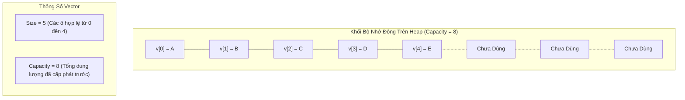
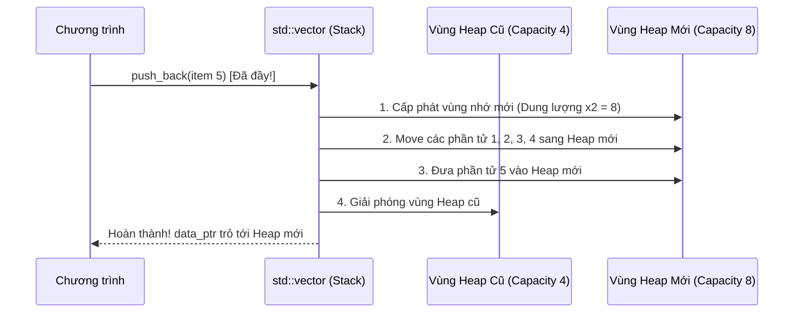

# 16.10 — Tái Định Kích Thước và Sức Chứa (std::vector Resizing and Capacity)

---

## 🎯 Mục Tiêu Bài Học
- Phân biệt rạch ròi giữa **Kích thước (Size)** và **Sức chứa (Capacity)** của `std::vector`.
- Trực quan hóa quy trình **Tái phân bổ bộ nhớ (Reallocation)** trên Heap và hệ số tăng trưởng (Growth Factor).
- Làm chủ các hàm quản lý bộ nhớ: `.size()`, `.capacity()`, `.resize()`, `.reserve()`, `.shrink_to_fit()`.
- Nhận diện và phòng chống cạm bẫy nguy hiểm nhất: **Vô hiệu hóa Iterator (Iterator Invalidation)**.

---

## 1. Size vs Capacity: Phân Biệt Hai Khái Niệm Sống Còn

Nhiều người nghĩ rằng kích thước của vector chính là lượng bộ nhớ nó đang chiếm giữ trên Heap. Thực tế, `std::vector` luôn phân tách rõ hai thuộc tính:
1. **Size (Kích thước - `v.size()`)**: Số lượng phần tử thực tế hiện đang được sử dụng và chứa dữ liệu hợp lệ trong vector.
2. **Capacity (Sức chứa - `v.capacity()`)**: Tổng số lượng phần tử mà vùng nhớ Heap hiện tại có thể chứa được **trước khi bắt buộc phải xin thêm bộ nhớ mới**.



---

## 2. Quá Trình Reallocation Diễn Ra Như Thế Nào?

Khi bạn thêm một phần tử mới vào vector (ví dụ gọi `push_back`) nhưng vector đã đầy (`size == capacity`):
1. **Cấp phát mới**: Vector sẽ xin hệ điều hành cấp phát một khối bộ nhớ Heap mới lớn hơn (thường gấp **1.5 lần** trên MSVC hoặc gấp **2 lần** trên GCC/Clang - gọi là **Growth Factor**).
2. **Di chuyển/Sao chép**: Di chuyển (Move) hoặc sao chép (Copy) toàn bộ các phần tử cũ từ vùng nhớ cũ sang vùng nhớ mới.
3. **Thêm phần tử mới**: Khởi tạo phần tử mới vào ô trống tiếp theo.
4. **Giải phóng**: Hủy và giải phóng toàn bộ khối nhớ Heap cũ.



::: danger Chi phí đắt đỏ của Reallocation
Mỗi lần reallocation diễn ra, chương trình phải tốn chi phí xin bộ nhớ hệ thống và copy/move toàn bộ dữ liệu. Nếu bạn liên tục thêm 100.000 phần tử mà không tối ưu, reallocation sẽ xảy ra hàng chục lần, làm tụt giảm nghiêm trọng tốc độ thực thi!
:::

---

## 3. Cạm Bẫy Chí Mạng: Vô Hiệu Hóa Iterator & Con Trỏ (Iterator Invalidation)

Khi reallocation xảy ra, toàn bộ khối nhớ cũ trên Heap bị xóa sổ. Hệ quả là:
**Mọi con trỏ, tham chiếu và Iterator đang trỏ vào các phần tử của vector cũ đều bị biến thành con trỏ rác (Dangling Pointer / Invalidated Iterator)!**

```cpp
#include <iostream>
#include <vector>

int main()
{
    std::vector<int> v{ 1, 2, 3 }; // Giả sử capacity = 3

    int& refFirst{ v[0] }; // Lấy tham chiếu tới phần tử đầu tiên
    std::cout << "Truoc push_back: " << refFirst << '
'; // In ra: 1

    v.push_back(4); // VƯỢT QUÁ CAPACITY -> REALLOCATION XẢY RA! Vùng nhớ cũ bị xóa!

    // CẠM BẪY CHÍ MẠNG: Undefined Behavior!
    // refFirst giờ đây trỏ tới vùng nhớ đã bị giải phóng!
    std::cout << "Sau push_back: " << refFirst << '
'; // Nguy hiểm: Giá trị rác hoặc Crash!

    return 0;
}
```

---

## 4. Tối Ưu Hóa Tuyệt Đỉnh: Hàm `reserve()`

Nếu bạn đã biết trước hoặc ước lượng được số lượng phần tử vector sẽ chứa (ví dụ đọc 10.000 dòng từ tệp), hãy gọi **`reserve()`** ngay từ đầu:

```cpp
#include <iostream>
#include <vector>

int main()
{
    std::vector<int> v;
    v.reserve(1000); // Cấp phát trước bộ nhớ cho 1000 phần tử trên Heap!
    // Lúc này: size = 0, capacity = 1000

    for (int i{ 0 }; i < 1000; ++i)
    {
        v.push_back(i); // ĐẢM BẢO 100% KHÔNG CÓ BẤT KỲ LẦN REALLOCATION NÀO!
    }

    return 0;
}
```

### Phân biệt `reserve()` và `resize()`:
- **`v.reserve(n)`**: Chỉ thay đổi **Capacity** (chuẩn bị sẵn bộ nhớ đệm), **không làm thay đổi Size**. Các phần tử chưa thực sự tồn tại, bạn không thể truy cập `v[0]`.
- **`v.resize(n)`**: Thực sự thay đổi **Size** của vector. Tạo mới các phần tử với giá trị mặc định nếu $n > 	ext{size}$, hoặc cắt bỏ các phần tử thừa nếu $n < 	ext{size}$.

---

## 5. 💡 Hộp Thực Hành Tốt Nhất (Best Practice)

::: tip Quy tắc tối ưu hóa bộ nhớ vector
1. Luôn sử dụng `v.reserve()` nếu bạn biết trước số lượng phần tử sẽ thêm vào vector bằng `push_back`.
2. Tránh lưu giữ tham chiếu hoặc con trỏ lâu dài tới phần tử của vector nếu vector đó còn tiếp tục được thêm/xóa phần tử.
3. Sử dụng `v.shrink_to_fit()` (C++11) nếu bạn vừa xóa một lượng lớn phần tử và muốn giải phóng phần bộ nhớ dư thừa về cho hệ điều hành.
:::

---

## 6. 📝 Hệ Thống Quiz & Bài Tập Tự Luyện

::: details Câu hỏi 1: Sau khi thực thi đoạn mã sau, giá trị của `v.size()` và `v.capacity()` là bao nhiêu?
```cpp
std::vector<int> v;
v.reserve(10);
v.resize(5);
```
**Lời giải chi tiết**:
- `v.reserve(10)` cấp phát vùng nhớ đủ chứa 10 phần tử trên Heap nhưng chưa khởi tạo phần tử nào: `size = 0`, `capacity = 10`.
- `v.resize(5)` khởi tạo 5 phần tử giá trị 0 (`[0, 0, 0, 0, 0]`): `size = 5`. Vì 5 vẫn nhỏ hơn dung lượng 10 đã có sẵn nên không cần tái cấp phát: `capacity = 10`.
:::
