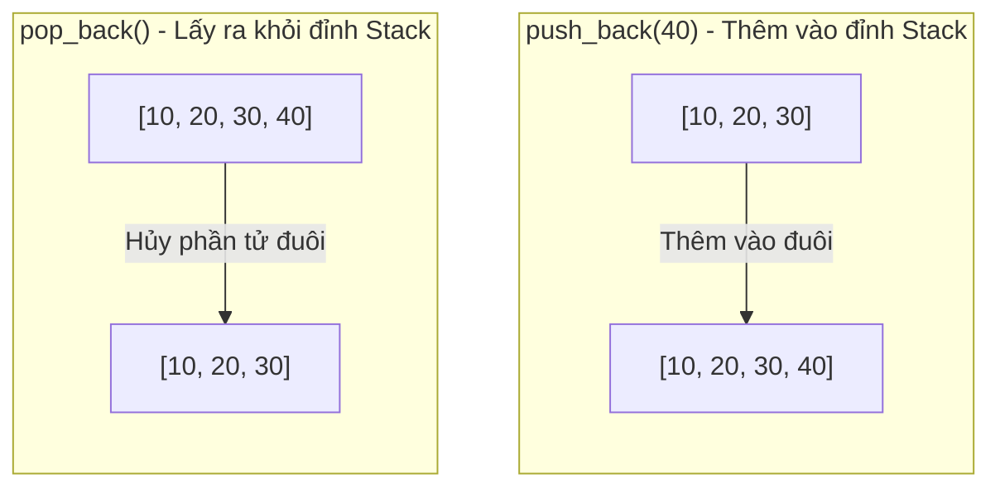

# 16.11 — std::vector Như Một Ngăn Xếp (Stack Behavior)

---

## 🎯 Mục Tiêu Bài Học
- Hiểu cấu trúc dữ liệu Ngăn xếp (Stack) theo nguyên lý LIFO (Last-In, First-Out).
- Sử dụng `std::vector` để mô phỏng Stack hiệu quả với `push_back()` và `pop_back()`.
- Phân biệt sự khác biệt về cơ chế và hiệu năng giữa `push_back()` và `emplace_back()`.
- Phòng tránh lỗi Undefined Behavior khi lấy phần tử từ ngăn xếp rỗng.

---

## 1. Hành Vi Ngăn Xếp (Stack Behavior - LIFO)

Một **Ngăn xếp (Stack)** là cấu trúc dữ liệu hoạt động theo nguyên tắc **Vào sau, Ra trước (Last-In, First-Out - LIFO)**. Hãy tưởng tượng một chồng đĩa ăn: chiếc đĩa nào được đặt vào sau cùng sẽ là chiếc đĩa đầu tiên được lấy ra.

`std::vector` hỗ trợ các thao tác ngăn xếp ở phần đuôi với độ phức tạp cực nhanh **$O(1)$ amortized**:



---

## 2. Các Hàm Thao Tác Ngăn Xếp Trên `std::vector`

| Hàm thành viên | Ý nghĩa | Độ phức tạp |
| :--- | :--- | :--- |
| **`v.push_back(val)`** | Đẩy một phần tử vào đỉnh ngăn xếp (đuôi vector) | $O(1)$ (nếu chưa đầy capacity) |
| **`v.pop_back()`** | Loại bỏ phần tử ở đỉnh ngăn xếp (không trả về giá trị) | $O(1)$ |
| **`v.back()`** | Truy cập tham chiếu tới phần tử ở đỉnh ngăn xếp | $O(1)$ |
| **`v.empty()`** | Kiểm tra ngăn xếp có rỗng không | $O(1)$ |
| **`v.emplace_back(args)`** | Khởi tạo phần tử trực tiếp tại đỉnh ngăn xếp | $O(1)$ |

```cpp
#include <iostream>
#include <vector>

int main()
{
    std::vector<int> stack;

    // Đẩy phần tử vào stack
    stack.push_back(10);
    stack.push_back(20);
    stack.push_back(30);

    // Xem phần tử trên đỉnh
    std::cout << "Dinh stack: " << stack.back() << '
'; // 30

    // Rút phần tử khỏi stack
    stack.pop_back();
    std::cout << "Dinh stack sau khi pop: " << stack.back() << '
'; // 20

    return 0;
}
```

::: danger Cạm bẫy gọi pop_back() hoặc back() trên vector rỗng
Hàm `pop_back()` và `back()` **KHÔNG kiểm tra vector rỗng**. Nếu bạn gọi chúng trên một vector rỗng, chương trình sẽ rơi vào trạng thái **Undefined Behavior** (thường gây sập chương trình lập tức). Hãy luôn kiểm tra `if (!v.empty())` trước khi thao tác!
:::

---

## 3. Tối Ưu Hóa C++11: `push_back()` vs `emplace_back()`

Khi thêm một đối tượng phức tạp (như class/struct) vào vector:
- **`push_back()`**: Tạo một đối tượng tạm thời, sau đó copy hoặc move đối tượng đó vào vùng nhớ của vector, rồi hủy đối tượng tạm thời.
- **`emplace_back()`**: Nhận trực tiếp các đối số của hàm tạo và **xây dựng đối tượng trực tiếp ngay tại ô nhớ của vector** (Construct in-place). Không tạo đối tượng tạm, không tốn chi phí copy/move!

```cpp
#include <iostream>
#include <string>
#include <vector>

struct Item
{
    std::string name;
    int price;

    Item(std::string n, int p) : name{ std::move(n) }, price{ p }
    {
        std::cout << "Tao Item: " << name << '
';
    }
};

int main()
{
    std::vector<Item> inventory;

    // push_back: Cần tạo đối tượng tạm Item{"Kiem", 100}
    inventory.push_back(Item{ "Kiem", 100 });

    // emplace_back: Truyền trực tiếp đối số, khởi tạo in-place tại Heap!
    inventory.emplace_back("Giap", 200);

    return 0;
}
```

---

## 4. 💡 Hộp Thực Hành Tốt Nhất (Best Practice)

::: tip Thực hành tốt nhất
1. Sử dụng `emplace_back()` khi bạn cần thêm một đối tượng mới được tạo từ danh sách tham số.
2. Nếu đã có sẵn một biến đối tượng lvalue trong tay, việc dùng `push_back(obj)` hoặc `push_back(std::move(obj))` là hoàn toàn tương đương và rõ nghĩa hơn.
:::

---

## 5. 📝 Hệ Thống Quiz & Bài Tập Tự Luyện

::: details Câu hỏi 1: Viết chương trình kiểm tra xem một chuỗi dấu ngoặc đơn `()` có hợp lệ hay không (sử dụng `std::vector<char>` làm stack).
**Lời giải chi tiết**:
```cpp
#include <iostream>
#include <string_view>
#include <vector>

bool isBalanced(std::string_view str)
{
    std::vector<char> stack;

    for (char ch : str)
    {
        if (ch == '(')
        {
            stack.push_back(ch);
        }
        else if (ch == ')')
        {
            if (stack.empty())
                return false; // Thừa dấu đóng ngoặc
            stack.pop_back(); // Khớp 1 cặp ngoặc
        }
    }

    return stack.empty(); // Nếu stack rỗng tức là tất cả các cặp đều khớp
}

int main()
{
    std::cout << std::boolalpha;
    std::cout << isBalanced("(())()") << '
'; // true
    std::cout << isBalanced("(()") << '
';     // false
    std::cout << isBalanced(")") << '
';       // false
    return 0;
}
```
:::
