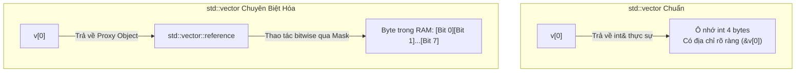

# 16.12 — Cạm Bẫy Kỳ Dị Của std::vector&lt;bool&gt;

---

## 🎯 Mục Tiêu Bài Học
- Hiểu tại sao `std::vector<bool>` là một trong những thiết kế gây tranh cãi nhất lịch sử C++.
- Cơ chế nén bit (1 bit / 1 boolean) và sự đánh đổi về hiệu năng.
- Khái niệm đối tượng đại diện (**Proxy Object**) và lý do tại sao `std::vector<bool>` không phải là một container tiêu chuẩn.
- Cạm bẫy nguy hiểm khi kết hợp `std::vector<bool>` với từ khóa `auto`.
- Các giải pháp thay thế chuẩn mực: `std::vector<char>`, `std::bitset`, `std::deque<bool>`.

---

## 1. Nguồn Gốc Kỳ Dị Của `std::vector<bool>`

Thông thường trong C++, một biến kiểu `bool` chiếm dụng **1 byte (8 bits)** trong bộ nhớ (vì 1 byte là đơn vị nhỏ nhất có thể đánh địa chỉ độc lập trên phần cứng máy tính).

Khi thiết kế thư viện chuẩn C++98, ủy ban tiêu chuẩn đã đưa ra một đặc tả chuyên biệt hóa (**Template Specialization**) cho `std::vector<bool>` với ý đồ tốt: **Tiết kiệm bộ nhớ tối đa bằng cách nén 8 giá trị boolean vào trong 1 byte duy nhất**. Nhờ đó, một vector chứa 8 phần tử bool chỉ tốn 1 byte thay vì 8 bytes!

Tuy nhiên, "ý đồ tốt" này đã dẫn tới một cơn ác mộng về mặt kỹ thuật.

---

## 2. Tại Sao `std::vector<bool>` Không Phải Là Một Container Chuẩn?

Một trong những yêu cầu bất di bất dịch của một Container trong C++ là:
> Toán tử `operator[]` phải trả về một **tham chiếu thực sự (`T&`)** tới phần tử trong bộ nhớ, cho phép ta lấy địa chỉ `&v[i]`.

Nhưng trên phần cứng máy tính:
- CPU **không thể lấy địa chỉ của một bit đơn lẻ** (địa chỉ bộ nhớ RAM chỉ đánh tới cấp độ Byte).
- Vì vậy, `std::vector<bool>::operator[]` **KHÔNG THỂ trả về `bool&`**!

Thay vào đó, nó phải trả về một **Đối tượng đại diện (Proxy Object)** có kiểu là `std::vector<bool>::reference`. Đối tượng này đóng vai trò trung gian, lưu giữ con trỏ tới byte chứa bit đó kèm theo mặt nạ bit (bitmask) để đọc/ghi giá trị bit.



---

## 3. Cạm Bẫy Trí Mạng Với Từ Khóa `auto`

Hãy xem đoạn mã sau:

```cpp
#include <iostream>
#include <vector>

int main()
{
    std::vector<bool> flags{ true, false, true };

    // CẠM BẪY NGUY HIỂM:
    auto b = flags[0]; // Kiểu của b KHÔNG PHẢI LÀ bool! Mà là std::vector<bool>::reference (Proxy)

    flags.flip(); // Đảo toàn bộ bit trong vector

    // Biến b bị thay đổi theo ngoài ý muốn!
    std::cout << std::boolalpha << b << '
'; // In ra false thay vì true!

    return 0;
}
```

### Chuyện gì đã xảy ra?
Vì `auto` suy luận kiểu của `flags[0]` thành `std::vector<bool>::reference` thay vì `bool`. Biến `b` trở thành một proxy tham chiếu tới bit bên trong vector. Tệ hơn nữa, nếu vector bị hủy hoặc bị reallocation, biến `b` sẽ trở thành một **dangling proxy** dẫn đến crash bộ nhớ!

---

## 4. Các Giải Pháp Thay Thế Chuẩn Mực

Nếu bạn cần lưu trữ danh sách các giá trị boolean trong C++ hiện đại:

1. **Nếu cần tốc độ tối đa**: Dùng **`std::vector<char>`** hoặc **`std::vector<uint8_t>`**. Mỗi phần tử chiếm 1 byte, hoàn toàn là container chuẩn, hỗ trợ đầy đủ `operator[]` trả về tham chiếu thực sự và nhanh hơn nhiều vì không tốn chi phí giải mã bit.
2. **Nếu số lượng bit cố định tại compile-time**: Dùng **`std::bitset<N>`**. Tối ưu bit cực mạnh và hỗ trợ đầy đủ các phép toán logic bit (`&`, `|`, `^`, `~`).
3. **Nếu cần vector co giãn nhưng hoạt động đúng chuẩn container**: Dùng **`std::deque<bool>`**.

---

## 5. 💡 Hộp Thực Hành Tốt Nhất (Best Practice)

::: warning Lời khuyên vàng về std::vector&lt;bool&gt;
- **Hạn chế tối đa sử dụng `std::vector<bool>`** trong các dự án thực tế.
- Nếu bắt buộc phải dùng `std::vector<bool>`, khi gán giá trị cho một biến, hãy ghi rõ kiểu tường minh `bool b = flags[0];` hoặc ép kiểu bằng `static_cast<bool>(flags[0])`. **Tuyệt đối không dùng `auto`** với phần tử của `std::vector<bool>`.
:::

---

## 6. 📝 Hệ Thống Quiz & Bài Tập Tự Luyện

::: details Câu hỏi 1: Tại sao đoạn mã sau không thể biên dịch được?
```cpp
#include <vector>

int main()
{
    std::vector<bool> v{ true };
    bool* ptr = &v[0]; // LỖI BIÊN DỊCH!
    return 0;
}
```
**Lời giải chi tiết**:
Vì `v[0]` không trả về một biến `bool` thực sự nằm ở một địa chỉ byte riêng biệt trong bộ nhớ, mà trả về một đối tượng tạm thời `std::vector<bool>::reference` (Proxy). Bạn không thể lấy địa chỉ bộ nhớ (`&`) của một bit đơn lẻ trên kiến trúc CPU hiện đại. Trình biên dịch sẽ báo lỗi không thể chuyển đổi từ kiểu proxy sang con trỏ `bool*`.
:::
