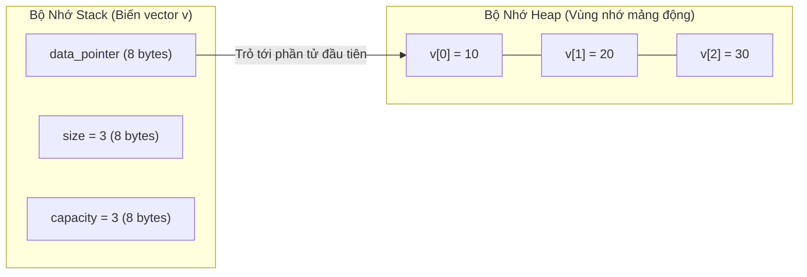

# 16.2 — Nhập Môn std::vector và List Constructors

---

## 🎯 Mục Tiêu Bài Học
- Khai báo và sử dụng `std::vector` từ thư viện `<vector>`.
- Hiểu cấu trúc tổ chức bộ nhớ Heap vs Stack của `std::vector`.
- Làm chủ kỹ thuật suy luận kiểu mẫu đối số (CTAD - Class Template Argument Deduction) trong C++17.
- Phân biệt triệt để giữa khởi tạo danh sách `{}` (List Constructor) và khởi tạo kích thước `()` (Size Constructor).
- So sánh hiệu năng và độ an toàn giữa toán tử chỉ số `operator[]` và hàm thành viên `.at()`.

---

## 1. Khai Báo và Khởi Tạo std::vector

Để sử dụng `std::vector`, bạn cần bao gồm thư viện `<vector>`:

```cpp
#include <iostream>
#include <vector>

int main()
{
    // Khởi tạo vector rỗng chứa các số nguyên int
    std::vector<int> emptyVec;

    // Khởi tạo vector với danh sách giá trị ban đầu (List Initialization)
    std::vector<int> primeNumbers { 2, 3, 5, 7, 11 };

    // Từ C++17: CTAD tự động suy luận kiểu std::vector<double>
    std::vector temperatures { 36.5, 37.0, 36.8 };

    return 0;
}
```

---

## 2. Trực Quan Hóa Cấu Trúc Bộ Nhớ: Heap vs Stack Của std::vector

Rất nhiều người mới học lầm tưởng toàn bộ `std::vector` nằm trên Stack hoặc toàn bộ nằm trên Heap. Thực tế là sự kết hợp hoàn hảo giữa cả hai:



- **Trên Stack (Vỏ bọc 24 bytes trên kiến trúc x64)**:
  1. `data_pointer`: Con trỏ thô trỏ tới phần tử đầu tiên nằm trên Heap.
  2. `size`: Số lượng phần tử hiện đang có (`3`).
  3. `capacity`: Sức chứa bộ nhớ hiện đã được cấp phát trước trên Heap (`3`).
- **Trên Heap (Vùng chứa dữ liệu thực tế)**:
  - Một khối bộ nhớ liên tục chứa các phần tử thực tế (`10`, `20`, `30`).
  - Khi đối tượng vector trên Stack rời khỏi phạm vi (scope), hàm hủy (Destructor) của vector sẽ tự động gọi `delete[]` để giải phóng toàn bộ vùng nhớ Heap này theo nguyên lý **RAII**. Không bao giờ lo rò rỉ bộ nhớ (Memory Leak)!

---

## 3. Cạm Bẫy Chí Mạng: Khởi Tạo Bằng `{}` vs `()`

Một trong những cạm bẫy gây nhầm lẫn kinh điển nhất trong C++ chính là sự khác biệt giữa cặp dấu ngoặc nhọn `{}` và cặp ngoặc tròn `()` khi khởi tạo `std::vector`:

```cpp
#include <vector>

std::vector<int> v1(5);     // Khởi tạo KÍCH THƯỚC: Tạo 5 phần tử, mỗi phần tử có giá trị mặc định là 0
std::vector<int> v2{ 5 };    // Khởi tạo DANH SÁCH: Tạo 1 phần tử duy nhất có giá trị là 5!

std::vector<int> v3(5, 2);  // Khởi tạo: Tạo 5 phần tử, mỗi phần tử có giá trị là 2 -> [2, 2, 2, 2, 2]
std::vector<int> v4{ 5, 2 }; // Khởi tạo: Tạo 2 phần tử với giá trị 5 và 2 -> [5, 2]
```

::: danger Cảnh báo cạm bẫy ngoặc nhọn `{}`
Trình biên dịch C++ luôn ưu tiên khớp với **List Constructor** (`std::initializer_list`) nếu bạn sử dụng cặp ngoặc nhọn `{}`. Hãy luôn nhớ:
- Dùng `()` khi muốn chỉ định **kích thước** (Size) hoặc **giá trị lặp lại**.
- Dùng `{}` khi muốn liệt kê **các phần tử cụ thể** của vector.
:::

---

## 4. Truy Cập Phần Tử: `operator[]` vs `.at()`

```cpp
#include <iostream>
#include <vector>

int main()
{
    std::vector v{ 10, 20, 30 };

    // Cách 1: Toán tử [] (Subscript Operator)
    std::cout << v[1] << '
'; // In ra 20 - Tốc độ cực nhanh, KHÔNG kiểm tra biên

    // Cách 2: Hàm thành viên .at()
    std::cout << v.at(1) << '
'; // In ra 20 - Có kiểm tra biên (Bounds Checking)

    // Điều gì xảy ra khi truy cập vượt quá biên?
    // std::cout << v[5]; // NGUY HIỂM: Undefined Behavior! Truy cập vùng nhớ rác
    try {
        std::cout << v.at(5); // Ném ngoại lệ std::out_of_range
    }
    catch (const std::out_of_range& e) {
        std::cerr << "Lỗi vượt biên: " << e.what() << '
';
    }

    return 0;
}
```

::: tip Quy tắc sử dụng
- Hãy sử dụng `operator[]` trong các vòng lặp nơi bạn đã chắc chắn 100% chỉ số nằm trong phạm vi hợp lệ `[0, size - 1]` để đạt hiệu năng tối đa.
- Sử dụng `.at()` khi chỉ số đến từ dữ liệu người dùng nhập hoặc nguồn bên ngoài chưa được kiểm định.
:::

---

## 5. 💡 Hộp Thực Hành Tốt Nhất (Best Practice)

::: tip Thực hành tốt nhất với std::vector
1. Tận dụng **CTAD** từ C++17 (`std::vector v{ 1, 2, 3 };`) để mã nguồn ngắn gọn, dễ đọc.
2. Kiểm tra vector rỗng bằng `.empty()` thay vì so sánh `v.size() == 0` (hàm `.empty()` có độ phức tạp $O(1)$ cho mọi container trong STL).
3. Sử dụng `v.front()` để lấy phần tử đầu tiên và `v.back()` để lấy phần tử cuối cùng thay vì `v[0]` và `v[v.size() - 1]`.
:::

---

## 6. 📝 Hệ Thống Quiz & Bài Tập Tự Luyện

::: details Câu hỏi 1: Kích thước `sizeof(std::vector<int>)` trên hệ điều hành 64-bit là bao nhiêu byte? Kích thước này có thay đổi khi vector chứa 0 phần tử so với khi chứa 1.000.000 phần tử không?
**Lời giải chi tiết**:
Trên kiến trúc 64-bit, `sizeof(std::vector<int>)` thường là **24 bytes**. Kích thước này **hoàn toàn không thay đổi** dù vector rỗng hay chứa 1 triệu phần tử! Bởi vì toán tử `sizeof` chỉ đo kích thước của đối tượng điều khiển nằm trên Stack (gồm 3 con trỏ: con trỏ dữ liệu 8 bytes, size 8 bytes, capacity 8 bytes). Toàn bộ 1.000.000 phần tử (tương đương 4MB) nằm trên Heap và được quản lý thông qua con trỏ dữ liệu này.
:::

::: details Câu hỏi 2: Đoạn mã sau in ra kết quả gì?
```cpp
std::vector<int> a(3);
std::vector<int> b{ 3 };
std::cout << a.size() << " va " << b.size() << '
';
```
**Lời giải chi tiết**:
Chương trình in ra: `3 va 1`.
- `std::vector<int> a(3)` gọi Size Constructor, tạo một vector có 3 phần tử `[0, 0, 0]`. Do đó `a.size()` bằng 3.
- `std::vector<int> b{ 3 }` gọi List Constructor, tạo một vector có đúng 1 phần tử mang giá trị 3 (`[3]`). Do đó `b.size()` bằng 1.
:::
