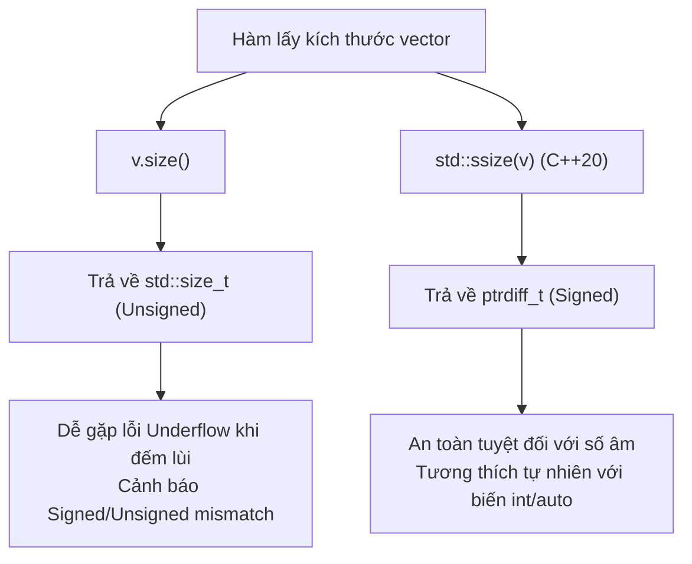

# 16.3 — std::vector và Vấn Nạn Kiểu Không Dấu (Unsigned Length & Subscript Problem)

---

## 🎯 Mục Tiêu Bài Học
- Hiểu tại sao hàm `.size()` của `std::vector` lại trả về kiểu số nguyên không dấu `std::size_t`.
- Nhận diện các lỗi logic nguy hiểm khi trộn lẫn kiểu có dấu (signed) và không dấu (unsigned).
- Hiểu cạm bẫy tràn số (Underflow) khi duyệt mảng ngược dẫn tới vòng lặp vô tận.
- Áp dụng giải pháp hiện đại của C++20: hàm `std::ssize()` trả về kiểu có dấu.

---

## 1. Tại Sao `.size()` Lại Trả Về `std::size_t`?

Trong chuẩn C++, kiểu trả về của hàm `.size()` được định nghĩa là `size_type`, thực chất là một bí danh (alias) của kiểu `std::size_t`. Đây là một kiểu số nguyên **không dấu (unsigned integer)** có kích thước phụ thuộc vào kiến trúc phần cứng (thường là 32-bit trên hệ 32-bit và 64-bit trên hệ 64-bit).

Lý do lịch sử của ủy ban tiêu chuẩn C++:
1. Số lượng phần tử của một mảng không bao giờ âm.
2. Kiểu không dấu nhân đôi được giá trị dương tối đa có thể biểu diễn trên kiến trúc bộ nhớ (ví dụ trên 32-bit, `size_t` có thể đếm tới 4 tỷ byte thay vì 2 tỷ byte như số có dấu).

Tuy nhiên, quyết định lịch sử này đã để lại một trong những "hố tử thần" lớn nhất của ngôn ngữ C++: **Sự xung đột giữa kiểu có dấu và không dấu (Signed/Unsigned Mismatch)**.

---

## 2. Cạm Bẫy Vòng Lặp Ngược Dẫn Tới Vô Hạn (The Infinite Reverse Loop Trap)

Hãy xem xét đoạn mã duyệt ngược mảng kinh điển sau đây mà hầu như lập trình viên C++ nào cũng từng viết sai:

```cpp
#include <iostream>
#include <vector>

int main()
{
    std::vector v{ 10, 20, 30 };

    // NGUY HIỂM: VÒNG LẶP VÔ HẠN VÀ CRASH BỘ NHỚ!
    for (std::size_t i{ v.size() - 1 }; i >= 0; --i)
    {
        std::cout << v[i] << ' ';
    }

    return 0;
}
```

### Tại sao vòng lặp trên không bao giờ kết thúc?
1. Biến `i` có kiểu `std::size_t` là số không dấu (Unsigned).
2. Khi `i = 0`, vòng lặp in ra `v[0]`.
3. Câu lệnh `--i` được thực thi. Vì `i` là số không dấu, `0 - 1` **không trở thành `-1`**, mà bị **tràn số ngược (Underflow)** và biến thành giá trị dương cực đại: `18446744073709551615` (trên hệ 64-bit)!
4. Điều kiện `i >= 0` hiển nhiên **luôn luôn đúng** với mọi số không dấu!
5. Ở bước lặp tiếp theo, chương trình truy cập `v[18446744073709551615]`, gây lỗi truy cập bộ nhớ bất hợp pháp (**Segmentation Fault / Crash** ngay lập tức).

---

## 3. Cảnh Báo Trình Biên Dịch (Compiler Warnings)

Khi bạn so sánh một biến số nguyên có dấu với `v.size()`, trình biên dịch sẽ cảnh báo:
```cpp
int index { 2 };
if (index < v.size()) // Warning: comparison of integer expressions of different signedness: 'int' and 'std::size_t'
{
    // ...
}
```
Nếu bạn bật cờ `-Wsign-conversion` hoặc `-Werror`, trình biên dịch sẽ chặn đứng quá trình biên dịch. Nếu cố tình ép kiểu không cẩn thận, số âm như `-1` bị ép thành `unsigned` sẽ trở thành một số dương khổng lồ, vượt qua phép kiểm tra và gây crash!

---

## 4. Giải Pháp Hiện Đại: C++20 `std::ssize()`

Nhận thấy sự phiền toái và nguy hiểm của kiểu không dấu, chuẩn **C++20** đã chính thức bổ sung hàm **`std::ssize()`** (Signed Size) nằm trong thư viện `<vector>`:

```cpp
#include <iostream>
#include <vector>

int main()
{
    std::vector v{ 10, 20, 30 };

    // std::ssize(v) trả về một số nguyên CÓ DẤU (ptrdiff_t)
    // Giờ đây bạn có thể dùng 'int' hoặc 'auto' hoàn toàn an toàn!
    for (auto i{ std::ssize(v) - 1 }; i >= 0; --i)
    {
        std::cout << v[static_cast<std::size_t>(i)] << ' ';
    }
    std::cout << '
';

    return 0;
}
```



---

## 5. 💡 Hộp Thực Hành Tốt Nhất (Best Practice)

::: tip Quy tắc xử lý chỉ số và kích thước mảng
1. **Trong C++20 trở lên**: Hãy ưu tiên dùng `std::ssize(v)` cho các vòng lặp cần duyệt chỉ số có dấu hoặc đếm lùi.
2. **Nếu làm việc trên C++14/C++17**:
   - Nếu duyệt tiến từ đầu đến cuối: Dùng `std::size_t` cho biến đếm (`for (std::size_t i{ 0 }; i < v.size(); ++i)`).
   - Nếu duyệt lùi: Hãy duyệt từ `v.size()` xuống `1` rồi trừ 1:
     ```cpp
     for (std::size_t i{ v.size() }; i > 0; --i)
     {
         std::cout << v[i - 1] << ' ';
     }
     ```
3. Tránh việc ép kiểu thô bạo bằng `(int)v.size()` trong code C++ hiện đại.
:::

---

## 6. 📝 Hệ Thống Quiz & Bài Tập Tự Luyện

::: details Câu hỏi 1: Điều gì xảy ra khi thực thi đoạn mã sau trên trình biên dịch 64-bit?
```cpp
std::vector<int> v{};
std::size_t len{ v.size() };
std::cout << len - 1 << '
';
```
**Lời giải chi tiết**:
Vector `v` rỗng nên `v.size()` bằng 0. Biểu thức `len - 1` là phép trừ trên kiểu số nguyên không dấu: `0u - 1u`. Do quy tắc số học modulo của số không dấu trong C++, kết quả sẽ bị tràn ngược (underflow) thành giá trị cực đại của `std::size_t` là `18446744073709551615` ($2^{64} - 1$).
:::

::: details Câu hỏi 2: Viết một đoạn mã C++20 sử dụng `std::ssize()` để in các phần tử ở vị trí chẵn (0, 2, 4...) của một `std::vector` theo thứ tự từ cuối về đầu.
**Lời giải chi tiết**:
```cpp
#include <iostream>
#include <vector>

int main()
{
    std::vector nums{ 10, 20, 30, 40, 50, 60, 70 };

    auto lastIndex{ std::ssize(nums) - 1 };
    // Nếu chỉ số cuối là lẻ, lùi về chỉ số chẵn gần nhất
    if (lastIndex % 2 != 0)
        --lastIndex;

    for (auto i{ lastIndex }; i >= 0; i -= 2)
    {
        std::cout << nums[static_cast<std::size_t>(i)] << ' ';
    }
    std::cout << '
';

    return 0;
}
```
:::
