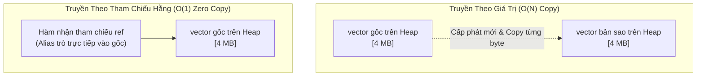

# 16.4 — Truyền std::vector Vào Hàm (Passing std::vector)

---

## 🎯 Mục Tiêu Bài Học
- Hiểu chi phí hiệu năng thảm họa khi truyền `std::vector` theo giá trị (Pass by Value).
- Nắm vững quy tắc vàng: Truyền theo tham chiếu hằng (`const std::vector<T>&`).
- Sử dụng tham chiếu không hằng (`std::vector<T>&`) khi cần chỉnh sửa dữ liệu gốc.
- Mở rộng kiến thức C++20: Giới thiệu `std::span` như một giải pháp chuẩn mực để tiếp nhận mọi loại mảng liên tục.

---

## 1. Cạm Bẫy Hiệu Năng: Truyền Theo Giá Trị (Pass by Value)

Hãy xem xét hàm sau:

```cpp
#include <iostream>
#include <vector>

void printVector(std::vector<int> vec) // TRUYỀN THEO GIÁ TRỊ: NGUY HIỂM!
{
    for (int x : vec)
        std::cout << x << ' ';
    std::cout << '
';
}

int main()
{
    std::vector<int> bigData(1'000'000, 42); // 1 triệu phần tử (khoảng 4 MB)
    printVector(bigData); // TOÀN BỘ 4 MB BỊ SAO CHÉP TRÊN HEAP!
    return 0;
}
```

### Chuyện gì thực sự diễn ra dưới bộ nhớ?
Khi bạn truyền `bigData` theo giá trị:
1. `std::vector` sẽ gọi **Hàm tạo sao chép (Copy Constructor)**.
2. Chương trình phải xin cấp phát một khối bộ nhớ mới trên Heap có kích thước **4 MB**.
3. Sao chép từng phần tử một từ `bigData` sang `vec`.
4. Khi hàm `printVector` kết thúc, vùng nhớ 4 MB vừa sao chép lại bị hủy bỏ ngay lập tức!
5. Nếu bạn gọi hàm này trong một vòng lặp 1.000 lần, chương trình của bạn sẽ phân mảnh bộ nhớ và chạy chậm chạp như rùa bò!

---

## 2. Quy Tắc Vàng: Truyền Theo Tham Chiếu Hằng (`const std::vector<T>&`)

Nếu hàm của bạn chỉ có nhiệm vụ **đọc dữ liệu** mà không chỉnh sửa vector, hãy **luôn luôn truyền theo tham chiếu hằng**:

```cpp
// Chi phí sao chép: 0 byte! Chỉ truyền địa chỉ con trỏ (8 bytes)
void printVector(const std::vector<int>& vec)
{
    for (int x : vec)
        std::cout << x << ' ';
    std::cout << '
';
}
```



---

## 3. Truyền Theo Tham Chiếu Không Hằng (`std::vector<T>&`)

Khi một hàm có nhiệm vụ thay đổi dữ liệu của vector (thêm phần tử, xóa phần tử, sắp xếp lại), hãy truyền theo tham chiếu không hằng:

```cpp
#include <iostream>
#include <vector>

void doubleElements(std::vector<int>& vec)
{
    for (auto& x : vec)
        x *= 2;
}

int main()
{
    std::vector nums{ 1, 2, 3, 4 };
    doubleElements(nums);

    for (int x : nums)
        std::cout << x << ' '; // In ra: 2 4 6 8
    return 0;
}
```

---

## 4. Góc Hiện Đại C++20: Khái Niệm `std::span`

Nếu một hàm chỉ cần duyệt qua các phần tử của một mảng liên tục, việc nhận tham số là `const std::vector<int>&` có một nhược điểm: Hàm đó **chỉ nhận được `std::vector`**. Nếu bạn có một mảng `std::array` hoặc một mảng C-style, bạn không thể truyền vào hàm đó được!

Chuẩn C++20 giải quyết hoàn hảo vấn đề này bằng **`std::span`** (nằm trong thư viện `<span>`):

```cpp
#include <iostream>
#include <span>
#include <vector>
#include <array>

// std::span là một view (chế độ xem không sở hữu) cực kỳ nhẹ: chỉ gồm con trỏ + độ dài
void printContiguous(std::span<const int> s)
{
    for (int x : s)
        std::cout << x << ' ';
    std::cout << '
';
}

int main()
{
    std::vector<int> v{ 1, 2, 3 };
    std::array<int, 3> a{ 4, 5, 6 };
    int rawArr[]{ 7, 8, 9 };

    printContiguous(v);      // Chấp nhận std::vector!
    printContiguous(a);      // Chấp nhận std::array!
    printContiguous(rawArr); // Chấp nhận mảng C-style!

    return 0;
}
```

---

## 5. 💡 Hộp Thực Hành Tốt Nhất (Best Practice)

::: tip Tổng kết nguyên tắc truyền mảng vào hàm
1. Nếu hàm chỉ đọc vector: **Luôn dùng `const std::vector<T>&`**.
2. Nếu hàm sửa đổi vector (thêm, xóa, sửa): **Dùng `std::vector<T>&`**.
3. **Trong C++20 trở lên**: Khi viết hàm tiện ích chỉ cần đọc một chuỗi phần tử liên tục, hãy ưu tiên dùng **`std::span<const T>`** để hàm có thể nhận cả `std::vector`, `std::array` lẫn mảng thuần kiểu C.
:::

---

## 6. 📝 Hệ Thống Quiz & Bài Tập Tự Luyện

::: details Câu hỏi 1: Tại sao việc viết `void process(std::vector<int> v)` lại được coi là lỗi thiết kế nghiêm trọng nếu hàm không có nhu cầu sửa đổi bản sao độc lập?
**Lời giải chi tiết**:
Vì `std::vector` quản lý bộ nhớ động trên Heap, việc truyền theo giá trị sẽ kích hoạt cơ chế Deep Copy: phân bổ một khối nhớ mới trên Heap và sao chép toàn bộ phần tử sang. Với một vector có hàng chục nghìn phần tử, điều này làm suy giảm nghiêm trọng hiệu năng CPU và tiêu tốn bộ nhớ RAM một cách hoàn toàn vô ích.
:::

::: details Câu hỏi 2: Viết một hàm `void reverseVector(std::vector<int>& v)` nhận vào một tham chiếu vector và đảo ngược thứ tự các phần tử của nó tại chỗ (in-place) mà không dùng `std::reverse`.
**Lời giải chi tiết**:
```cpp
#include <iostream>
#include <vector>
#include <utility> // for std::swap

void reverseVector(std::vector<int>& v)
{
    if (v.empty())
        return;

    std::size_t left{ 0 };
    std::size_t right{ v.size() - 1 };

    while (left < right)
    {
        std::swap(v[left], v[right]);
        ++left;
        --right;
    }
}

int main()
{
    std::vector test{ 1, 2, 3, 4, 5 };
    reverseVector(test);
    for (int x : test)
        std::cout << x << ' '; // In ra: 5 4 3 2 1
    return 0;
}
```
:::
