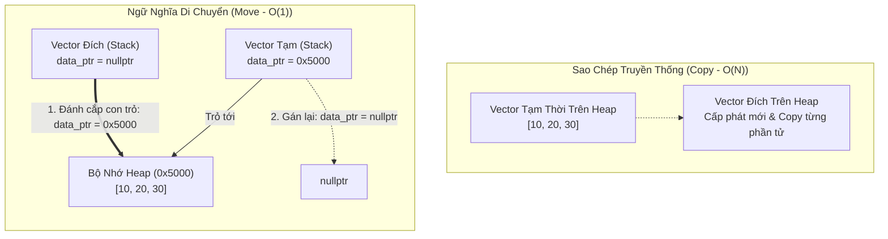

# 16.5 — Trả Về std::vector Từ Hàm & Nhập Môn Move Semantics

---

## 🎯 Mục Tiêu Bài Học
- Giải mã thắc mắc: "Trả về một `std::vector` theo giá trị có bị tốn chi phí sao chép không?".
- Hiểu cơ chế tối ưu hóa giá trị trả về của trình biên dịch: **RVO (Return Value Optimization)** và **NRVO (Named Return Value Optimization)**.
- Khám phá bước đầu về **Move Semantics (Ngữ nghĩa di chuyển)** - tính năng thay đổi cục diện C++ từ C++11.
- Nắm vững quy tắc trả về container trong C++ hiện đại.

---

## 1. Nỗi Lo Sợ Lỗi Thời: "Trả Về Vector Sẽ Bị Sao Chép Tốn Kém?"

Trong C++98 cổ điển, các lập trình viên thường viết code trả về dữ liệu qua tham số con trỏ hoặc tham chiếu:

```cpp
// Phong cách C++98 cổ lỗ sĩ (Tránh dùng trong C++ hiện đại)
void generateDataOld(std::vector<int>& outVector)
{
    outVector.clear();
    outVector.push_back(1);
    outVector.push_back(2);
}
```

Họ làm vậy vì sợ rằng nếu viết:
```cpp
std::vector<int> generateData()
{
    std::vector<int> v{ 1, 2, 3 };
    return v; // Liệu có bị sao chép toàn bộ mảng khi trả về?
}
```
thì toàn bộ các phần tử trên Heap sẽ bị sao chép vào biến nhận kết quả ở hàm gọi.

**Trong C++ hiện đại, nỗi sợ hãi này là hoàn toàn vô căn cứ!** Bạn hãy tự tin trả về `std::vector` theo giá trị nhờ vào hai cơ chế tối tân: **RVO** và **Move Semantics**.

---

## 2. Tối Ưu Hóa Giá Trị Trả Về: RVO & NRVO

Trình biên dịch C++ hiện đại cực kỳ thông minh. Khi một hàm trả về một đối tượng tạm thời hoặc biến cục bộ:
- **RVO (Return Value Optimization)**: Trình biên dịch sẽ xây dựng trực tiếp đối tượng vector vào vùng nhớ của đối tượng nhận kết quả ở hàm gọi. Hoàn toàn **không có bất kỳ phép sao chép nào diễn ra** (Zero Copy)!
- Từ chuẩn **C++17**, RVO được đưa vào quy chuẩn bắt buộc (**Mandatory Copy Elision**). Compiler không được phép sao chép dù bạn không bật cờ tối ưu hóa!

---

## 3. Nếu Không Thể RVO? Move Semantics Sẽ Xuất Hiện!

Trong trường hợp luồng rẽ nhánh phức tạp khiến trình biên dịch không thể thực hiện RVO, **Move Semantics (Ngữ nghĩa di chuyển - C++11)** sẽ kích hoạt như một chiếc lưới an toàn hoàn hảo:



### Bản chất của Move Semantics: "Đánh cắp quyền sở hữu"
- Thay vì cấp phát một khối Heap mới và copy từng phần tử (tốn thời gian $O(N)$), vector đích chỉ đơn giản là **sao chép giá trị của con trỏ dữ liệu** (`data_pointer`) của vector nguồn.
- Sau đó, con trỏ của vector nguồn được gán về `nullptr` để khi vector nguồn bị hủy, nó không vô tình giải phóng vùng nhớ Heap vừa được bàn giao.
- Toàn bộ thao tác di chuyển chỉ là vài lệnh gán con trỏ trên Stack (24 bytes), diễn ra trong **chưa đầy 1 nano-giây ($O(1)$)**, bất kể vector có chứa 3 phần tử hay 30 triệu phần tử!

---

## 4. Ví Dụ Minh Họa Code Thực Tế

```cpp
#include <iostream>
#include <vector>

std::vector<int> createSquares(int n)
{
    std::vector<int> result;
    result.reserve(n);
    for (int i{ 1 }; i <= n; ++i)
    {
        result.push_back(i * i);
    }
    return result; // Hoàn toàn an toàn và cực nhanh nhờ RVO / Move Semantics!
}

int main()
{
    // Nhận trực tiếp giá trị trả về
    std::vector<int> squares{ createSquares(5) };

    for (int x : squares)
        std::cout << x << ' '; // In ra: 1 4 9 16 25
    std::cout << '
';

    return 0;
}
```

---

## 5. 💡 Hộp Thực Hành Tốt Nhất (Best Practice)

::: tip Quy tắc trả về Container
1. **Hãy tự tin trả về `std::vector` theo giá trị** khi hàm có nhiệm vụ tạo mới và trả về một tập hợp dữ liệu. Mã nguồn sẽ tự nhiên, trong sáng và đạt hiệu năng tối đa.
2. **Không bao giờ trả về tham chiếu tới biến cục bộ (`std::vector<int>&`)**:
   ```cpp
   std::vector<int>& badFunction()
   {
       std::vector<int> local{ 1, 2, 3 };
       return local; // THẢM HỌA: Trả về tham chiếu tới vùng nhớ đã chết (Dangling Reference)!
   }
   ```
:::

---

## 6. 📝 Hệ Thống Quiz & Bài Tập Tự Luyện

::: details Câu hỏi 1: Giải thích sự khác nhau căn bản giữa Copy Semantics và Move Semantics khi truyền chuyển dữ liệu của `std::vector`.
**Lời giải chi tiết**:
- **Copy Semantics (Ngữ nghĩa sao chép)**: Tạo ra một bản sao độc lập hoàn toàn. Nó cấp phát một khối bộ nhớ mới trên Heap có cùng dung lượng và sao chép từng phần tử từ nguồn sang đích. Độ phức tạp là $O(N)$ và tiêu tốn thêm RAM.
- **Move Semantics (Ngữ nghĩa di chuyển)**: Chuyển giao quyền sở hữu tài nguyên Heap từ đối tượng nguồn sang đối tượng đích. Đối tượng đích sao chép con trỏ Heap của nguồn, sau đó con trỏ nguồn được đưa về trạng thái rỗng (`nullptr`). Thao tác này chỉ tốn chi phí hoán đổi con trỏ trên Stack với độ phức tạp $O(1)$, không cấp phát thêm bộ nhớ Heap.
:::

::: details Câu hỏi 2: Đoạn mã sau có an toàn không? Tại sao?
```cpp
const std::vector<int>& getPrimes()
{
    return std::vector<int>{ 2, 3, 5, 7 };
}
```
**Lời giải chi tiết**:
Đoạn mã **cực kỳ nguy hiểm** và dẫn đến **Undefined Behavior**.
Hàm trả về một tham chiếu hằng (`const&`) trỏ tới một đối tượng vector tạm thời (rvalue). Khi câu lệnh `return` hoàn thành, đối tượng tạm thời đó ngay lập tức bị tiêu hủy trên Stack và giải phóng bộ nhớ Heap. Tham chiếu trả về trở thành một **Tham chiếu lơ lửng (Dangling Reference)**. Bất kỳ nỗ lực truy cập nào vào kết quả trả về của hàm này đều sẽ đọc dữ liệu rác hoặc làm crash chương trình.
:::
