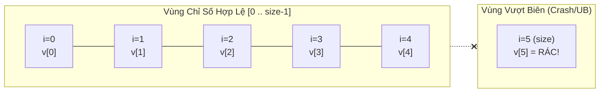

# 16.6 — Mảng và Vòng Lặp Truyền Thống (Arrays and Loops)

---

## 🎯 Mục Tiêu Bài Học
- Làm chủ kỹ thuật duyệt mảng bằng vòng lặp `for` và `while` truyền thống.
- Thực hiện các bài toán kinh điển: Tính tổng, tính trung bình, tìm phần tử lớn nhất/nhỏ nhất (Min/Max).
- Nhận diện và tiêu diệt cạm bẫy lỗi lệch 1 (Off-by-one error).
- Thực hành tìm kiếm tuyến tính (Linear Search) trên mảng.

---

## 1. Duyệt Mảng Bằng Vòng Lặp `for` Truyền Thống

Sức mạnh lớn nhất của mảng xuất hiện khi kết hợp với vòng lặp. Vì các phần tử của mảng được đánh chỉ số từ `0` đến `size - 1`, một vòng lặp `for` với biến đếm tăng dần là công cụ hoàn hảo để duyệt qua từng phần tử:

```cpp
#include <iostream>
#include <vector>

int main()
{
    std::vector scores{ 85, 92, 78, 90, 88 };

    std::cout << "Danh sach diem thi: ";
    for (std::size_t i{ 0 }; i < scores.size(); ++i)
    {
        std::cout << scores[i] << ' ';
    }
    std::cout << '
';

    return 0;
}
```

---

## 2. Các Bài Toán Xử Lý Dữ Liệu Kinh Điển

### 2.1. Tính Tổng và Giá Trị Trung Bình
```cpp
#include <iostream>
#include <vector>

int main()
{
    std::vector testScores{ 8.5, 7.0, 9.25, 6.5, 10.0 };

    if (testScores.empty())
    {
        std::cout << "Vector rong, khong the tinh trung binh!
";
        return 0;
    }

    double sum{ 0.0 };
    for (std::size_t i{ 0 }; i < testScores.size(); ++i)
    {
        sum += testScores[i];
    }

    double average{ sum / static_cast<double>(testScores.size()) };

    std::cout << "Tong diem: " << sum << '
';
    std::cout << "Diem trung binh: " << average << '
';

    return 0;
}
```

### 2.2. Tìm Phần Tử Lớn Nhất và Nhỏ Nhất (Min/Max)
```cpp
#include <iostream>
#include <vector>

int main()
{
    std::vector numbers{ 45, 12, 89, 34, 99, 23 };

    if (numbers.empty())
        return 0;

    int maxVal{ numbers[0] };
    std::size_t maxIndex{ 0 };

    for (std::size_t i{ 1 }; i < numbers.size(); ++i)
    {
        if (numbers[i] > maxVal)
        {
            maxVal = numbers[i];
            maxIndex = i;
        }
    }

    std::cout << "Gia tri lon nhat la: " << maxVal << " tai chi so: " << maxIndex << '
';
    return 0;
}
```

---

## 3. Cạm Bẫy Kinh Điển: Lỗi Lệch 1 (Off-by-One Error)

Lỗi lệch một đơn vị (**Off-by-one error**) là lỗi logic xảy ra khi vòng lặp lặp nhiều hơn hoặc ít hơn 1 lần so với dự tính.

```cpp
std::vector v{ 1, 2, 3, 4, 5 }; // size = 5, chi so tu 0 den 4

// CẠM BẪY NGUY HIỂM: Dùng dấu <= thay vì <
for (std::size_t i{ 0 }; i <= v.size(); ++i) // Khi i = 5, v[5] la vuot bien!
{
    std::cout << v[i] << ' '; // Undefined Behavior tai buoc lap cuoi cung!
}
```



---

## 4. 💡 Hộp Thực Hành Tốt Nhất (Best Practice)

::: tip Quy tắc an toàn với vòng lặp mảng
1. Luôn sử dụng toán tử `<` khi so sánh với kích thước mảng: `i < v.size()`. Tuyệt đối không dùng `<=`.
2. Luôn kiểm tra mảng có rỗng hay không bằng `v.empty()` trước khi truy cập `v[0]` để tìm Min/Max hoặc tính toán, tránh lỗi crash ngay từ bước đầu tiên.
3. Khi tìm kiếm một phần tử, hãy dừng vòng lặp ngay khi tìm thấy bằng câu lệnh `break` để tiết kiệm tài nguyên CPU.
:::

---

## 5. 📝 Hệ Thống Quiz & Bài Tập Tự Luyện

::: details Câu hỏi 1: Viết một hàm nhận vào một `const std::vector<int>&` và một giá trị `target`, trả về chỉ số đầu tiên của `target` trong mảng, hoặc `-1` nếu không tìm thấy.
**Lời giải chi tiết**:
```cpp
#include <iostream>
#include <vector>

int linearSearch(const std::vector<int>& arr, int target)
{
    for (std::size_t i{ 0 }; i < arr.size(); ++i)
    {
        if (arr[i] == target)
            return static_cast<int>(i); // Tim thay
    }
    return -1; // Khong tim thay
}

int main()
{
    std::vector nums{ 10, 25, 40, 55, 70 };
    std::cout << "Vi tri cua 40: " << linearSearch(nums, 40) << '
'; // In ra: 2
    std::cout << "Vi tri cua 99: " << linearSearch(nums, 99) << '
'; // In ra: -1
    return 0;
}
```
:::
