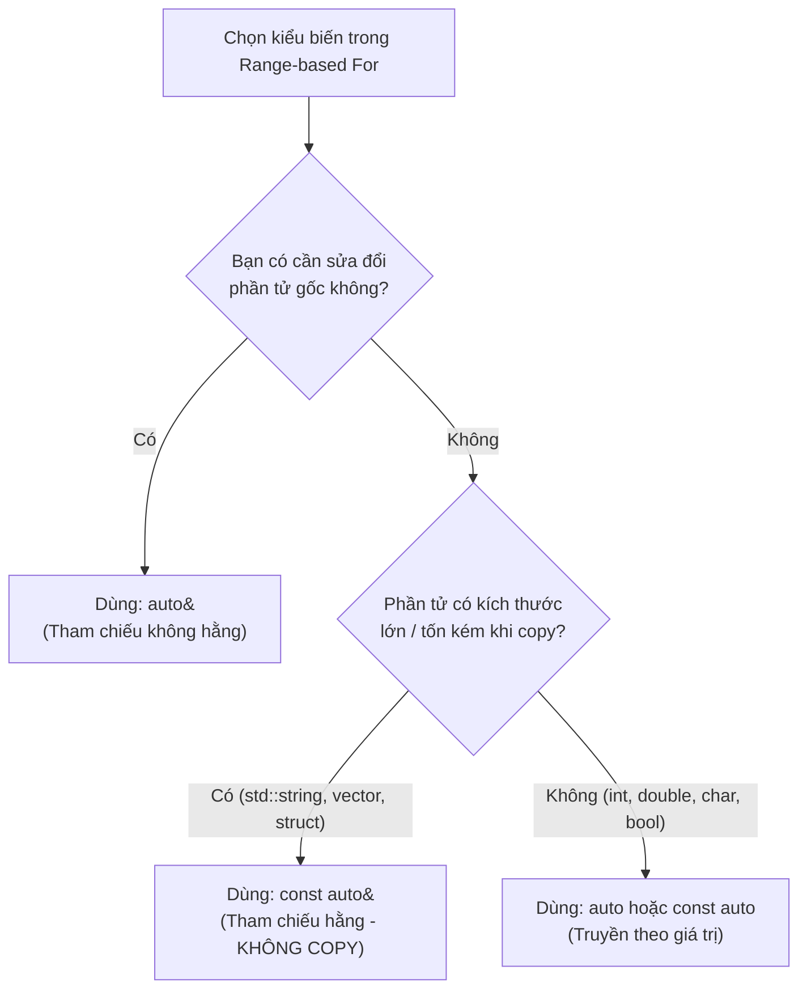

# 16.8 — Vòng Lặp Dựa Trên Phạm Vi (Range-Based For Loops / For-Each)

---

## 🎯 Mục Tiêu Bài Học
- Hiểu cú pháp và nguyên lý hoạt động của vòng lặp dựa trên phạm vi (Range-based for loop).
- Phân biệt khi nào dùng: `auto`, `auto&`, và `const auto&`.
- Hiểu cơ chế biến đổi mã nguồn (Lowering) của Compiler thành Iterator bên dưới.
- Khám phá tính năng mới của C++20: Range-based for loop với câu lệnh khởi tạo (Init-statement).

---

## 1. Cuộc Cách Mạng Range-Based For Loop (C++11)

Trong các bài học trước, để in các phần tử của vector, ta phải dùng biến chỉ số `i`:
```cpp
for (std::size_t i{ 0 }; i < v.size(); ++i)
    std::cout << v[i] << ' ';
```
Cách viết này có nhiều nhược điểm: dài dòng, dễ mắc lỗi off-by-one, phải bận tâm về signed/unsigned.

Từ C++11, C++ giới thiệu **Range-based for loop** (hay còn gọi là vòng lặp for-each), giúp duyệt qua toàn bộ container một cách trực quan, thanh lịch và an toàn tuyệt đối:

```cpp
#include <iostream>
#include <vector>

int main()
{
    std::vector fibonacci{ 0, 1, 1, 2, 3, 5, 8, 13 };

    // Đọc là: "Với mỗi phần tử num trong container fibonacci"
    for (int num : fibonacci)
    {
        std::cout << num << ' ';
    }
    std::cout << '
';

    return 0;
}
```

---

## 2. Lựa Chọn Kiểu Biến: `auto`, `auto&`, hay `const auto&`?

Đây là kiến thức quan trọng nhất khi sử dụng vòng lặp range-based for:



### Minh họa bằng mã nguồn:
```cpp
#include <iostream>
#include <string>
#include <vector>

int main()
{
    std::vector<std::string> words{ "Lap", "Trinh", "C++", "Hien", "Dai" };

    // 1. const auto&: TỐT NHẤT KHI CHỈ ĐỌC ĐỐI TƯỢNG PHỨC TẠP
    // Tránh sao chép các chuỗi string tốn bộ nhớ Heap!
    for (const auto& w : words)
    {
        std::cout << w << ' ';
    }
    std::cout << '
';

    // 2. auto&: KHI CẦN THAY ĐỔI DỮ LIỆU GỐC TRONG CONTAINER
    for (auto& w : words)
    {
        w += "!"; // Thêm dấu chấm than vào mỗi từ
    }

    // 3. auto: KHI PHẦN TỬ LÀ KIỂU NGUYÊN THỦY (int, double, char)
    std::vector numbers{ 10, 20, 30 };
    for (auto x : numbers) // Copy 4 bytes của int rất rẻ, thậm chí nhanh hơn dùng con trỏ
    {
        std::cout << x << ' ';
    }
    std::cout << '
';

    return 0;
}
```

---

## 3. Compiler Thực Sự Làm Gì Bên Dưới? (Lowering to Iterators)

Range-based for loop không phải là phép thuật. Nó chỉ là một lớp "đường cú pháp" (**Syntactic Sugar**). Khi bạn viết:

```cpp
for (const auto& x : container)
{
    // thân hàm
}
```

Trình biên dịch sẽ tự động mở rộng nó thành đoạn mã tương đương sử dụng **Iterator**:

```cpp
auto __begin = container.begin();
auto __end = container.end();
for (; __begin != __end; ++__begin)
{
    const auto& x = *__begin;
    // thân hàm
}
```
Chính vì vậy, bất kỳ lớp đối tượng nào tự định nghĩa hàm thành viên `begin()` và `end()` đều có thể dùng được với range-based for loop!

---

## 4. Tính Năng C++20: Range-Based For Loop Với Init-Statement

Trong C++17 trở về trước, nếu bạn duyệt một container tạm thời trả về từ hàm, bạn có nguy cơ gặp lỗi dangling reference:

```cpp
// C++20 cho phép khởi tạo biến ngay trong vòng lặp:
for (auto data = getBigVector(); const auto& item : data)
{
    std::cout << item << ' ';
}
// Biến 'data' sống an toàn trong toàn bộ vòng lặp và tự hủy khi vòng lặp kết thúc!
```

---

## 5. 💡 Hộp Thực Hành Tốt Nhất (Best Practice)

::: tip Quy tắc vàng Range-Based For Loop
1. Mặc định luôn ưu tiên dùng **`const auto&`** cho hầu hết mọi trường hợp để đảm bảo không vô tình làm hỏng dữ liệu và không phát sinh chi phí sao chép ngoài ý muốn.
2. Chỉ dùng `auto&` khi thực sự cần ghi đè giá trị vào container.
3. Chỉ dùng `auto` (pass-by-value) cho các kiểu dữ liệu cơ bản nhỏ hơn hoặc bằng 2 con trỏ (`sizeof(T) <= 2 * sizeof(void*)`).
:::

---

## 6. 📝 Hệ Thống Quiz & Bài Tập Tự Luyện

::: details Câu hỏi 1: Đoạn mã sau có lỗi gì về mặt hiệu năng không?
```cpp
std::vector<std::string> names{ "Nguyen Van A", "Tran Thi B", "Le Van C" };
for (auto name : names)
{
    std::cout << name << '
';
}
```
**Lời giải chi tiết**:
Có! Đoạn mã dùng `auto name : names` (truyền theo giá trị). Với mỗi bước lặp, một đối tượng `std::string` mới được tạo ra bằng cách sao chép từ phần tử trong vector (kèm theo cấp phát bộ nhớ Heap nếu chuỗi dài vượt quá cơ chế Small String Optimization). Cách sửa chuẩn mực là đổi thành `for (const auto& name : names)`, loại bỏ hoàn toàn 100% chi phí sao chép chuỗi.
:::
