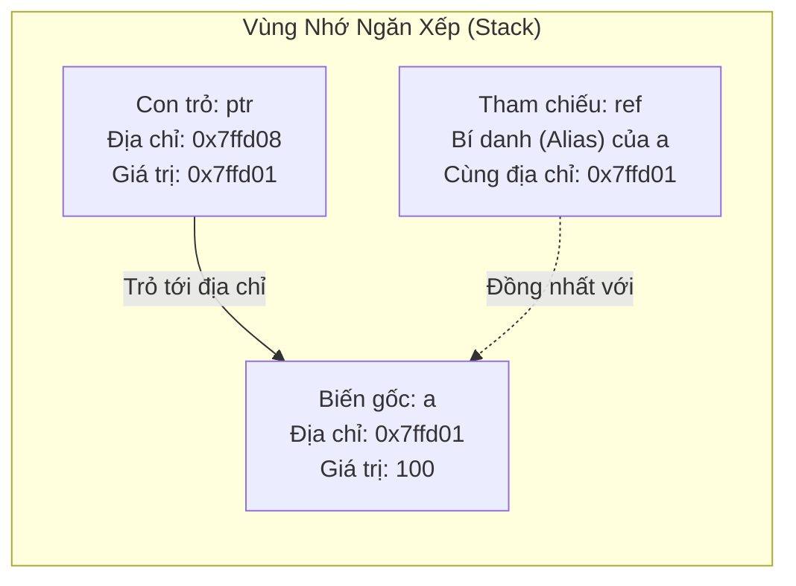

# 15.1 — The hidden &#8220;this&#8221; pointer and member function chaining

---

## 🎯 Mục Tiêu Bài Học
- Nắm vững bản chất lý thuyết và cơ chế hoạt động của **The hidden &#8220;this&#8221; pointer and member function chaining** trong tiêu chuẩn ISO C++.
- Hiểu rõ cách máy tính tổ chức bộ nhớ (RAM, CPU registers) khi thực thi mã nguồn liên quan.
- Nhận biết các cạm bẫy lỗi kinh điển (**Undefined Behavior**, Memory Leak, Bug logic) và cách phòng tránh.
- Áp dụng các quy tắc thực hành tốt nhất (**Best Practices**) chuẩn công nghiệp và cập nhật C++20/C++23 hiện đại.

---

# 15.1 &#8212; The hidden &#8220;this&#8221; con trỏ and member hàm chaining

One of the questions about classes that new programmers often ask is, “When a member hàm is called, how does C++ keep track of which object it was called on?”.

First, let’s define a simple class to work with.  This class encapsulates an integer value, and provides some access các hàm to get and set that value:

```cpp
#include <iostream>

class Simple
{
private:
    int m_id{};
 
public:
    Simple(int id)
        : m_id{ id }
    {
    }

    int getID() const { return m_id; }
    void setID(int id) { m_id = id; }

    void print() const { std::cout << m_id; }
};

int main()
{
    Simple simple{1};
    simple.setID(2);

    simple.print();

    return 0;
}
```

As you would expect, this program produces the result:

```cpp
2
```

Somehow, when we call `simple.setID(2);`, C++ knows that hàm `setID()` should operate on object `simple`, and that `m_id` actually refers to `simple.m_id`.

The answer is that C++ utilizes a hidden con trỏ named `this`!  In this lesson, we’ll take a look at `this` in more detail.

The hidden `this` con trỏ

Inside every member hàm, the keyword **this** is a const con trỏ that holds the address of the current implicit object.

Most of the time, we don’t mention `this` explicitly, but just to prove we can:

```cpp
#include <iostream>

class Simple
{
private:
    int m_id{};

public:
    Simple(int id)
        : m_id{ id }
    {
    }

    int getID() const { return m_id; }
    void setID(int id) { m_id = id; }

    void print() const { std::cout << this->m_id; } // use `this` pointer to access the implicit object and operator-> to select member m_id
};

int main()
{
    Simple simple{ 1 };
    simple.setID(2);
    
    simple.print();

    return 0;
}
```

This works identically to prior example, and prints:

```cpp
2
```

Note that the `print()` member các hàm from the prior two examples do exactly the same thing:

```cpp
void print() const { std::cout << m_id; }       // implicit use of this
    void print() const { std::cout << this->m_id; } // explicit use of this
```

It turns out that the former is shorthand for the latter.  When we compile our programs, the trình biên dịch will implicitly prefix any member referencing the implicit object with `this->`.  This helps keep our code more concise and prevents the redundancy from having to explicitly write `this->` over and over.

::: info A reminder

We use `->` to select a member from a con trỏ to an object.  `this->m_id` is the equivalent of `(*this).m_id`.  

We cover `toán tử->` in lesson [13.12 -- Member selection with các con trỏ and các tham chiếu](https://www.learncpp.com/cpp-tutorial/member-selection-with-các con trỏ-and-các tham chiếu/).
:::

How is `this` set?

Let’s take a closer look at this hàm call:

```cpp
simple.setID(2);
```

Although the call to hàm `setID(2)` looks like it only has one đối số, it actually has two!  When compiled, the trình biên dịch rewrites the biểu thức `simple.setID(2);` as follows:

```cpp
Simple::setID(&simple, 2); // note that simple has been changed from an object prefix to a function argument!
```

Note that this is now just a standard hàm call, and the object `simple` (which was formerly an object prefix) is now passed by address as an đối số to the hàm.

But that’s only half of the answer.  Since the hàm call now has an added đối số, the member hàm definition also needs to be modified to accept (and use) this đối số as a tham số.  Here’s our original member hàm definition for `setID()`:

```cpp
void setID(int id) { m_id = id; }
```

How the trình biên dịch rewrites các hàm is an implementation-specific detail, but the end-result is something like this:

```cpp
static void setID(Simple* const this, int id) { this->m_id = id; }
```

Note that our `setId` hàm has a new leftmost tham số named `this`, which is a const con trỏ (meaning it cannot be re-pointed, but the contents of the con trỏ can be modified).  The `m_id` member has also been rewritten as `this->m_id`, utilizing the `this` con trỏ.

::: info For advanced readers

In this context, the `static` keyword means the hàm is not associated with đối tượng of the class, but instead is treated as if it were a normal hàm inside the phạm vi truy cập (scope) region of the class.  We cover static member các hàm in lesson [15.7 -- Static member các hàm](https://www.learncpp.com/cpp-tutorial/static-member-các hàm/).
:::

Putting it all together:


- When we call `simple.setID(2)`, the trình biên dịch actually calls `Simple::setID(&simple, 2)`, and `simple` is passed by address to the hàm.

- The hàm has a hidden tham số named `this` which receives the address of `simple`.

- Member các biến inside setID() are prefixed with `this->`, which points to `simple`.  So when the trình biên dịch evaluates `this->m_id`, it’s actually resolving to `simple.m_id`.

The good news is that all of this happens automatically, and it doesn’t really matter whether you remember how it works or not.  All you need to remember is that all non-static member các hàm have a `this` con trỏ that refers to the object the hàm was called on.

::: info Hiểu biết cốt lõi

All non-static member các hàm have a `this` const con trỏ that holds the address of the implicit object.
:::

`this` always points to the object being operated on

New programmers are sometimes confused about how many `this` các con trỏ exist. Each member hàm has a single `this` con trỏ tham số that points to the implicit object.  Consider:

```cpp
int main()
{
    Simple a{1}; // this = &a inside the Simple constructor
    Simple b{2}; // this = &b inside the Simple constructor
    a.setID(3); // this = &a inside member function setID()
    b.setID(4); // this = &b inside member function setID()

    return 0;
}
```

Note that the `this` con trỏ alternately holds the address of object `a` or `b` depending on whether we’ve called a member hàm on object `a` or `b`.

Because `this` is just a hàm tham số (and not a member), it does not make instances of your class larger memory-wise.

Explicitly referencing `this`

Most of the time, you won’t need to explicitly tham chiếu the `this` con trỏ.  However, there are a few occasions where doing so can be useful:

First, if you have a member hàm that has a tham số with the same name as a data member, you can disambiguate them by using `this`:

```cpp
struct Something
{
    int data{}; // not using m_ prefix because this is a struct

    void setData(int data)
    {
        this->data = data; // this->data is the member, data is the local parameter
    }
};
```

This `Something` class has a member named `data`.  The hàm tham số of `setData()` is also named `data`.  Within the `setData()` hàm, `data` refers to the hàm tham số (because the hàm tham số shadows the data member), so if we want to tham chiếu the `data` member, we use `this->data`.

Some developers prefer to explicitly add `this->` to all class members to make it clear that they are referencing a member.  We recommend that you avoid doing so, as it tends to make your code less readable for little benefit.  Using the “m_” prefix is a more concise way to differentiate private member các biến from non-member (local) các biến.

Returning `*this`

Second, it can sometimes be useful to have a member hàm return the implicit object as a giá trị trả về.  The primary reason to do this is to allow member các hàm to be “chained” together, so several member các hàm can be called on the same object in a single biểu thức!  This is called **hàm chaining** (or **method chaining**).

Consider this common example where you’re outputting several bits of text using `std::cout`:

```cpp
std::cout << "Hello, " << userName;
```

The trình biên dịch evaluates the above snippet like this:

```cpp
(std::cout << "Hello, ") << userName;
```

First, `toán tử<<` uses `std::cout` and the string hằng giá trị (literal) `"Hello, "` to print `"Hello, "` to the console.  However, since this is part of an biểu thức, `toán tử<<` also needs to return a value (or `void`).  If `toán tử<<` returned `void`, you’d end up with this as the partially evaluated biểu thức:

```cpp
void{} << userName;
```

which clearly doesn’t make any sense (and the trình biên dịch would throw an error).  Instead, `toán tử<<` returns the stream object that was passed in, which in this case is `std::cout`.  That way, after the first `toán tử<<` has been evaluated, we get:

```cpp
(std::cout) << userName;
```

which then prints the user’s name.

This way, we only need to specify `std::cout` once, and then we can chain as many pieces of text together using `toán tử<<` as we want.  Each call to `toán tử<<` returns `std::cout` so the next call to `toán tử<<` uses `std::cout` as the left operand.

We can implement this kind of behavior in our member các hàm too.  Consider the following class:

```cpp
class Calc
{
private:
    int m_value{};

public:

    void add(int value) { m_value += value; }
    void sub(int value) { m_value -= value; }
    void mult(int value) { m_value *= value; }

    int getValue() const { return m_value; }
};
```

If you wanted to add 5, subtract 3, and multiply by 4, you’d have to do this:

```cpp
#include <iostream>

int main()
{
    Calc calc{};
    calc.add(5); // returns void
    calc.sub(3); // returns void
    calc.mult(4); // returns void

    std::cout << calc.getValue() << '\n';

    return 0;
}
```

However, if we make each hàm return `*this` by tham chiếu, we can chain the calls together.  Here is the new version of `Calc` with “chainable” các hàm:

```cpp
class Calc
{
private:
    int m_value{};

public:
    Calc& add(int value) { m_value += value; return *this; }
    Calc& sub(int value) { m_value -= value; return *this; }
    Calc& mult(int value) { m_value *= value; return *this; }

    int getValue() const { return m_value; }
};
```

Note that `add()`, `sub()` and `mult()` are now returning `*this` by tham chiếu.  Consequently, this allows us to do the following:

```cpp
#include <iostream>

int main()
{
    Calc calc{};
    calc.add(5).sub(3).mult(4); // method chaining

    std::cout << calc.getValue() << '\n';

    return 0;
}
```

We have effectively condensed three lines into one biểu thức!  Let’s take a closer look at how this works.

First, `calc.add(5)` is called, which adds `5` to `m_value`.  `add()` then returns a tham chiếu to `*this`, which is a tham chiếu to implicit object `calc`, so `calc` will be the object used in the subsequent evaluation.  Next `calc.sub(3)` evaluates, which subtracts `3` from `m_value` and again returns `calc`.  Finally, `calc.mult(4)` multiplies `m_value` by `4` and returns `calc`, which isn’t used further, and is thus ignored.

Since each hàm modified `calc` as it was executed, the `m_value` of `calc` now contains the value (((0 + 5) - 3) * 4), which is `8`.

This is probably the most common explicit use of `this`, and is one you should consider whenever it makes sense to have chainable member các hàm.

Because `this` always points to the implicit object, we don’t need to check whether it is a null con trỏ before dereferencing it.

Resetting a class back to default state

If your class has a default hàm tạo (constructor), you may be interested in providing a way to return an existing object back to its default state.

As noted in previous lessons ([14.12 -- Delegating các hàm tạo (constructors)](https://www.learncpp.com/cpp-tutorial/delegating-các hàm tạo (constructors)/)), các hàm tạo (constructors) are only for sự khởi tạo of new đối tượng, and should not be called directly.  Doing so will result in unexpected behavior.

The best way to reset a class back to a default state is to create a `reset()` member hàm, have that hàm create a new object (using the default hàm tạo (constructor)), and then assign that new object to the current implicit object, like this:

```cpp
void reset()
    {
        *this = {}; // value initialize a new object and overwrite the implicit object
    }
```

Here’s a full program demonstrating this `reset()` hàm in action:

```cpp
#include <iostream>

class Calc
{
private:
    int m_value{};

public:
    Calc& add(int value) { m_value += value; return *this; }
    Calc& sub(int value) { m_value -= value; return *this; }
    Calc& mult(int value) { m_value *= value; return *this; }

    int getValue() const { return m_value; }

    void reset() { *this = {}; }
};

int main()
{
    Calc calc{};
    calc.add(5).sub(3).mult(4);

    std::cout << calc.getValue() << '\n'; // prints 8

    calc.reset();
    
    std::cout << calc.getValue() << '\n'; // prints 0

    return 0;
}
```

`this` and const đối tượng

For non-const member các hàm, `this` is a const con trỏ to a non-const value (meaning `this` cannot be pointed at something else, but the object pointing to may be modified).  With const member các hàm, `this` is a const con trỏ to a const value (meaning the con trỏ cannot be pointed at something else, nor may the object being pointed to be modified).

The errors generated from attempting to call a non-const member hàm on a const object can be a little cryptic:

```cpp
error C2662: 'int Something::getValue(void)': cannot convert 'this' pointer from 'const Something' to 'Something &'
error: passing 'const Something' as 'this' argument discards qualifiers [-fpermissive]
```

When we call a non-const member hàm on a const object, the implicit `this` hàm tham số is a const con trỏ to a *non-const* object.  But the đối số has type const con trỏ to a *const* object.  Converting a con trỏ to a const object into a con trỏ to a non-const object requires discarding the const qualifier, which cannot be done implicitly.  The trình biên dịch error generated by some các trình biên dịch reflects the trình biên dịch complaining about being asked to perform such a conversion.

Why `this` a con trỏ and not a tham chiếu

Since the `this` con trỏ always points to the implicit object (and can never be a null con trỏ unless we’ve done something to cause hành vi không xác định (Hành vi không xác định (Undefined Behavior - UB) - UB)), you may be wondering why `this` is a con trỏ instead of a tham chiếu.  The answer is simple: when `this` was added to C++, các tham chiếu didn’t exist yet.

If `this` were added to the C++ language today, it would undoubtedly be a tham chiếu instead of a con trỏ.  In other more modern C++-like languages, such as Java and C#, `this` is implemented as a tham chiếu.

  	
  	

---



::: danger Cạm Bẫy Thực Chiến: Con Trỏ Lơ Lửng (Dangling Pointer) & UB
Tuyệt đối không giải phóng vùng nhớ mà con trỏ đang trỏ tới rồi tiếp tục truy cập nó, hoặc trả về tham chiếu/con trỏ tới một biến cục bộ trên Stack. Khi hàm kết thúc, biến cục bộ bị hủy và con trỏ sẽ trỏ vào vùng nhớ rác, dẫn đến **Hành vi không xác định (Undefined Behavior)** cực kỳ nguy hiểm!
:::

::: tip Nâng Cấp C++ Hiện Đại: Thay Thế Con Trỏ Thô Bằng Smart Pointers
Trong C++ hiện đại (C++11 đến C++23), hãy hạn chế tối đa việc sử dụng con trỏ thô (`T*`) cùng các toán tử `new`/`delete`. Thay vào đó, hãy luôn ưu tiên:
- `std::unique_ptr<T>`: Sở hữu độc quyền tài nguyên (Zero-overhead, tự động giải phóng RAII).
- `std::shared_ptr<T>`: Sở hữu chia sẻ tài nguyên có cơ chế đếm tham chiếu (Reference counting).
- `std::span<T>` (C++20) hoặc `std::string_view` (C++17): Xem qua vùng nhớ mà không sở hữu, an toàn và tốc độ cực cao.
:::

::: tip 💡 Tóm Tắt Quy Tắc Vàng (Core Guidelines)
1. Luôn hiểu rõ vòng đời và quyền sở hữu (Ownership) của dữ liệu trước khi viết code.
2. Ưu tiên khởi tạo đồng nhất với dấu ngoặc nhọn `{}` để ngăn chặn lỗi thu hẹp kiểu dữ liệu (Narrowing conversions).
3. Bật toàn bộ cờ cảnh báo `-Wall -Wextra -Wpedantic` để compiler giúp bạn phát hiện bug từ sớm!
:::
