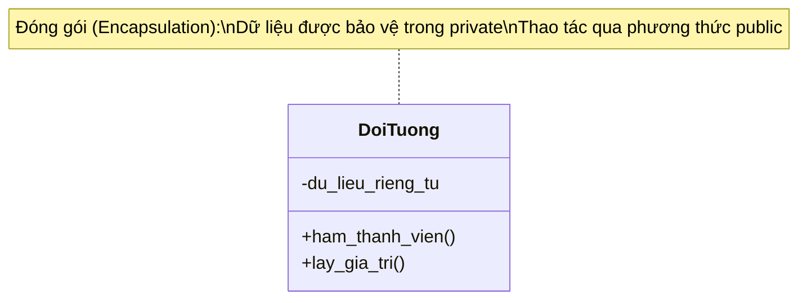

# 15.4 — Introduction to destructors

---

## 🎯 Mục Tiêu Bài Học
- Nắm vững bản chất lý thuyết và cơ chế hoạt động của **Introduction to destructors** trong tiêu chuẩn ISO C++.
- Hiểu rõ cách máy tính tổ chức bộ nhớ (RAM, CPU registers) khi thực thi mã nguồn liên quan.
- Nhận biết các cạm bẫy lỗi kinh điển (**Undefined Behavior**, Memory Leak, Bug logic) và cách phòng tránh.
- Áp dụng các quy tắc thực hành tốt nhất (**Best Practices**) chuẩn công nghiệp và cập nhật C++20/C++23 hiện đại.

---

# 15.4 &#8212; Introduction to các hàm hủy (destructors)

## The cleanup problem

Let’s say that you are writing a program that needs to send some data over a network.  However, establishing a connection to the server is expensive, so you want to collect a bunch of data and then send it all at once.  Such a class might be structured like this:

```cpp
// This example won't compile because it is (intentionally) incomplete
class NetworkData
{
private:
    std::string m_serverName{};
    DataStore m_dataQueue{};

public:
	NetworkData(std::string_view serverName)
		: m_serverName { serverName }
	{
	}

	void addData(std::string_view data)
	{
		m_dataQueue.add(data);
	}

	void sendData()
	{
		// connect to server
		// send all data
		// clear data
	}
};

int main()
{
    NetworkData n("someipAddress");

    n.addData("somedata1");
    n.addData("somedata2");

    n.sendData();

    return 0;
}
```

However, this `NetworkData` has a potential issue.  It relies on `sendData()` being explicitly called before the program is shut down.  If the user of `NetworkData` forgets to do this, the data will not be sent to the server, and will be lost when the program exits.  Now, you might say, “well, it’s not hard to remember to do this!”, and in this particular case, you’d be right.  But consider a slightly more complex example, like this hàm:

```cpp
bool someFunction()
{
    NetworkData n("someipAddress");

    n.addData("somedata1");
    n.addData("somedata2");

    if (someCondition)
        return false;

    n.sendData();
    return true;
}
```

In this case, if `someCondition` is `true`, then the hàm will return early, and `sendData()` will not be called.  This is an easier mistake to make, because the `sendData()` call is present, the program just isn’t pathing to it in all cases.

To generalize this issue, classes that use a resource (most often memory, but sometimes files, databases, network connections, etc…) often need to be explicitly sent or closed before the class object using them is destroyed.  In other cases, we may want to do some record-keeping prior to the destruction of the object, such as writing information to a log file, or sending a piece of telemetry to a server.  The term “clean up” is often used to refer to any set of tasks that a class must perform before an object of the class is destroyed in order to behave as expected.  If we have to rely on the user of such a class to ensure that the hàm that performs clean up is called prior to the object being destroyed, we are likely to run into errors somewhere.

But why are we even requiring the user to ensure this?  If the object is being destroyed, then we know that cleanup needs to be performed at that point.  Should that cleanup happen automatically?

Destructors to the rescue

Trong bài học [14.9 -- Introduction to các hàm tạo (constructors)](https://www.learncpp.com/cpp-tutorial/introduction-to-các hàm tạo (constructors)/) we covered các hàm tạo (constructors), which are special member các hàm that are called when an object of a non-aggregate class type is created.  Constructors are used to khởi tạo members các biến, and do any other set up tasks required to ensure đối tượng of the class are ready for use.

Analogously, classes have another type of special member hàm that is called automatically when an object of a non-aggregate class type is destroyed.  This hàm is called a **hàm hủy (destructor)**.  Destructors are designed to allow a class to do any necessary clean up before an object of the class is destroyed.

Destructor naming

Like các hàm tạo (constructors), các hàm hủy (destructors) have specific naming rules:

<ol start="1">
- The hàm hủy (destructor) must have the same name as the class, preceded by a tilde (~).

- The hàm hủy (destructor) can not take đối số.

- The hàm hủy (destructor) has no return type.

A class can only have a single hàm hủy (destructor).

Generally you should not call a hàm hủy (destructor) explicitly (as it will be called automatically when the object is destroyed), since there are rarely cases where you’d want to clean up an object more than once.

Destructors may safely call other member các hàm since the object isn’t destroyed until after the hàm hủy (destructor) executes.

A hàm hủy (destructor) example

```cpp
#include <iostream>

class Simple
{
private:
    int m_id {};

public:
    Simple(int id)
        : m_id { id }
    {
        std::cout << "Constructing Simple " << m_id << '\n';
    }

    ~Simple() // here's our destructor
    {
        std::cout << "Destructing Simple " << m_id << '\n';
    }

    int getID() const { return m_id; }
};

int main()
{
    // Allocate a Simple
    Simple simple1{ 1 };
    {
        Simple simple2{ 2 };
    } // simple2 dies here

    return 0;
} // simple1 dies here
```

This program produces the following result:

```cpp
Constructing Simple 1
Constructing Simple 2
Destructing Simple 2
Destructing Simple 1
```

Note that when each `Simple` object is destroyed, the hàm hủy (destructor) is called, which prints a message.  “Destructing Simple 1” is printed after “Destructing Simple 2” because `simple2` was destroyed before the end of the hàm, whereas `simple1` was not destroyed until the end of `main()`.

Remember that static các biến (including global các biến and static local các biến) are constructed at program startup and destroyed at program shutdown.

Improving the NetworkData program

Back to our example at the top of the lesson, we can remove the need for the user to explicitly call `sendData()` by having a hàm hủy (destructor) call that hàm:

```cpp
class NetworkData
{
private:
    std::string m_serverName{};
    DataStore m_dataQueue{};

public:
	NetworkData(std::string_view serverName)
		: m_serverName { serverName }
	{
	}

	~NetworkData()
	{
		sendData(); // make sure all data is sent before object is destroyed
	}

	void addData(std::string_view data)
	{
		m_dataQueue.add(data);
	}

	void sendData()
	{
		// connect to server
		// send all data
		// clear data
	}
};

int main()
{
    NetworkData n("someipAddress");

    n.addData("somedata1");
    n.addData("somedata2");

    return 0;
}
```

With such a hàm hủy (destructor), our `NetworkData` object will always send whatever data it has before the object is destroyed!  The cleanup happens automatically, which means less chance for errors, and less things to think about.

An implicit hàm hủy (destructor)

If a non-aggregate class type object has no user-declared hàm hủy (destructor), the trình biên dịch will generate a hàm hủy (destructor) with an empty body.  This hàm hủy (destructor) is called an implicit hàm hủy (destructor), and it is effectively just a placeholder.

If your class does not need to do any cleanup on destruction, it’s fine to not define a hàm hủy (destructor) at all, and let the trình biên dịch generate an implicit hàm hủy (destructor) for your class.

A cảnh báo about the `std::exit()` hàm

Trong bài học [8.12 -- Halts (exiting your program early)](https://www.learncpp.com/cpp-tutorial/halts-exiting-your-program-early/), we discussed the `std::exit()` hàm, can be used to terminate your program immediately.  When the program is terminated immediately, the program just ends.  Local các biến are not destroyed first, and because of this, no các hàm hủy (destructors) will be called.  Be wary if you’re relying on your các hàm hủy (destructors) to do necessary cleanup work in such a case.

::: info For advanced readers

Unhandled exceptions will also cause the program to terminate, and may not unwind the ngăn xếp Stack before doing so.  If ngăn xếp Stack unwinding does not happen, các hàm hủy (destructors) will not be called prior to the termination of the program.

:::

</a>
  	<a class="nav-link" href="/">
  
    <i class="fa fa-home" aria-hidden="true"></i>
    
      Back to table of contents
    
</a>
  	<a class="nav-link" href="https://www.learncpp.com/cpp-tutorial/nested-types-member-types/">
  
    <i class="fa fa-chevron-circle-left" aria-hidden="true"></i>
    
      Previous lesson
      
        15.3Nested types (member types)
      
    
  </a>


---





::: warning Cạm Bẫy: Khởi Tạo Không Đồng Nhất (Initialization Pitfalls)
Hãy luôn khởi tạo biến thành viên ngay tại nơi khai báo hoặc sử dụng **Danh sách khởi tạo thành viên (Member Initializer List)** trong hàm tạo để tránh việc đối tượng bị gán giá trị 2 lần gây lãng phí chu kỳ CPU.
:::


::: tip 💡 Tóm Tắt Quy Tắc Vàng (Core Guidelines)
1. Luôn hiểu rõ vòng đời và quyền sở hữu (Ownership) của dữ liệu trước khi viết code.
2. Ưu tiên khởi tạo đồng nhất với dấu ngoặc nhọn `{}` để ngăn chặn lỗi thu hẹp kiểu dữ liệu (Narrowing conversions).
3. Bật toàn bộ cờ cảnh báo `-Wall -Wextra -Wpedantic` để compiler giúp bạn phát hiện bug từ sớm!
:::
