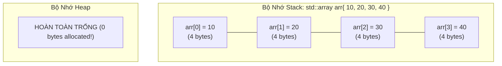

# 17.1 — Nhập Môn std::array (Introduction to std::array)

---

## 🎯 Mục Tiêu Bài Học
- Hiểu lý do `std::array` ra đời trong C++11 để thay thế hoàn toàn mảng kiểu C cổ điển.
- Nắm bắt cú pháp khai báo `std::array<T, N>` với kích thước cố định tại compile-time.
- Trực quan hóa cấu trúc bộ nhớ: `std::array` nằm hoàn toàn trên **Stack** (Zero Dynamic Allocation).
- Thực hành khởi tạo danh sách (List Initialization), khởi tạo rỗng, và suy luận kiểu CTAD (C++17).

---

## 1. Tại Sao Chúng Ta Cần `std::array`?

Ở chương trước, chúng ta đã làm quen với `std::vector` - cấu trúc dữ liệu mảng động tuyệt vời. Tuy nhiên, `std::vector` luôn phải cấp phát bộ nhớ trên Heap và quản lý qua 3 con trỏ trên Stack (24 bytes).

Khi bạn cần lưu trữ một tập hợp dữ liệu có **kích thước cố định và biết trước ngay khi biên dịch** (ví dụ: 12 tháng trong năm, 7 ngày trong tuần, 4 hướng Đông-Tây-Nam-Bắc):
- Dùng `std::vector` sẽ gây lãng phí bộ nhớ và phát sinh chi phí cấp phát Heap không cần thiết.
- Dùng mảng kiểu C cổ điển (`int arr[12];`) thì cực kỳ nguy hiểm vì thiếu an toàn kiểu, không tự biết kích thước của mình và dễ bị suy biến con trỏ (**Pointer Decay**).

**`std::array` (C++11)** ra đời trong thư viện `<array>` nhằm kết hợp:
1. **Tốc độ và tính gọn nhẹ tuyệt đối của mảng kiểu C**: Nằm hoàn toàn trên Stack, không tốn 1 byte cấp phát Heap nào.
2. **Sự an toàn và tiện lợi của một Container chuẩn STL**: Biết kích thước của chính mình qua `.size()`, hỗ trợ duyệt mảng, kiểm tra biên với `.at()`, không bị suy biến con trỏ!

---

## 2. Khai Báo và Khởi Tạo std::array

Cú pháp khai báo: `std::array<KiểuDữLiệu, SốLượngPhầnTử> tênBiến;`
Lưu ý: `SốLượngPhầnTử` bắt buộc phải là một **Biểu thức hằng số (Constant Expression / constexpr)** được tính toán tại compile-time!

```cpp
#include <iostream>
#include <array>

int main()
{
    // 1. Khởi tạo danh sách cụ thể
    std::array<int, 5> a1{ 1, 2, 3, 4, 5 };

    // 2. Khởi tạo một phần, các phần tử còn lại tự động nhận giá trị 0
    std::array<int, 5> a2{ 1, 2 }; // [1, 2, 0, 0, 0]

    // 3. Khởi tạo toàn bộ bằng 0 (Zero-initialization)
    std::array<int, 5> a3{}; // [0, 0, 0, 0, 0]

    // 4. C++17 CTAD: Tự suy luận kiểu và kích thước!
    std::array a4{ 1.1, 2.2, 3.3 }; // Suy ra std::array<double, 3>

    return 0;
}
```

---

## 3. Trực Quan Hóa Cấu Trúc Bộ Nhớ Stack Của `std::array`

Không giống như `std::vector` (chỉ có vỏ bọc trên Stack còn mảng thật trên Heap), `std::array` chứa toàn bộ các phần tử của nó **ngay bên trong Stack Frame** của hàm:



- Kích thước `sizeof(std::array<int, 4>)` đúng bằng $4 	imes 4 = \mathbf{16	ext{ bytes}}$.
- **Zero Overhead**: Hiệu năng truy cập nhanh ngang ngửa mảng C nguyên thủy vì các giá trị nằm trực tiếp trên Stack, bộ nhớ đệm CPU (L1 Cache) tải tức thì!

---

## 4. 💡 Hộp Thực Hành Tốt Nhất (Best Practice)

::: tip Quy tắc vàng
1. Bất cứ khi nào bạn cần một mảng có kích thước cố định tại compile-time: **Hãy luôn sử dụng `std::array` thay cho mảng kiểu C**.
2. Luôn khởi tạo với cặp ngoặc `{}` (ví dụ `std::array<int, 5> a{};`) để tránh việc mảng chứa giá trị rác ngẫu nhiên trên Stack.
:::

---

## 5. 📝 Hệ Thống Quiz & Bài Tập Tự Luyện

::: details Câu hỏi 1: Tại sao đoạn mã sau đây không thể biên dịch được?
```cpp
#include <array>
#include <iostream>

int main()
{
    int n;
    std::cin >> n;
    std::array<int, n> arr; // LỖI BIÊN DỊCH!
    return 0;
}
```
**Lời giải chi tiết**:
Tham số kích thước thứ hai của `std::array<T, N>` là một tham số template không phải kiểu (Non-type template parameter). Nó bắt buộc phải là một hằng số được biết trước tại thời điểm biên dịch (**compile-time constant**). Biến `n` được nhập từ bàn phím tại thời điểm chạy (**runtime**), do đó compiler không thể biết cần phân bổ bao nhiêu byte trên Stack để sinh mã máy. Trong tình huống này, ta bắt buộc phải sử dụng `std::vector<int> arr(n);`.
:::
