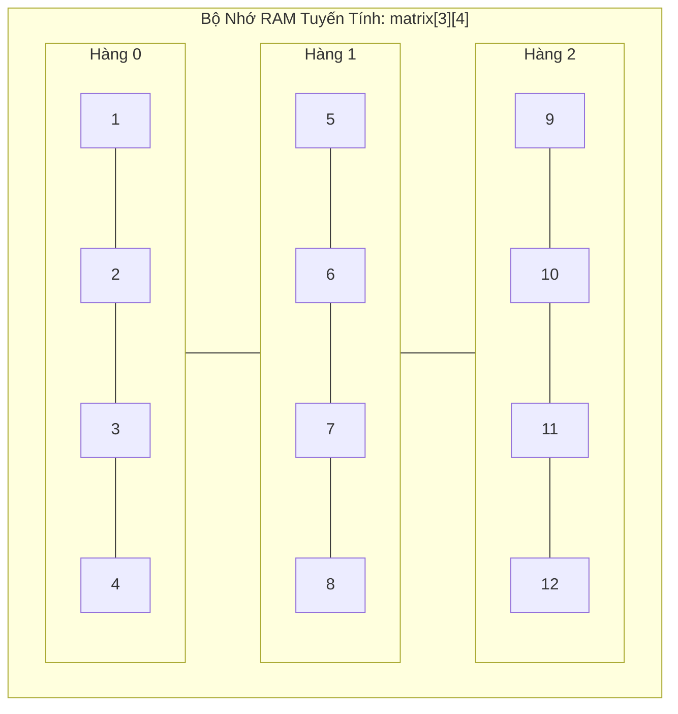

# 17.12 — Mảng Đa Chiều Kiểu C (Multidimensional C-Style Arrays)

---

## 🎯 Mục Tiêu Bài Học
- Khai báo và sử dụng mảng 2 chiều, 3 chiều kiểu C.
- Hiểu nguyên lý tổ chức bộ nhớ phẳng theo hàng (Row-Major Order) trong RAM.
- Duyệt mảng đa chiều bằng các vòng lặp lồng nhau (Nested Loops) và tối ưu hóa Cache Locality.

---

## 1. Khai Báo và Khởi Tạo Mảng 2 Chiều

Mảng 2 chiều có thể hình dung như một bảng gồm các hàng (Rows) và các cột (Columns):

```cpp
#include <iostream>

int main()
{
    // Mảng 3 hàng, 4 cột (Tổng 12 phần tử)
    int matrix[3][4]{
        { 1,  2,  3,  4 },  // Hàng 0
        { 5,  6,  7,  8 },  // Hàng 1
        { 9, 10, 11, 12 }   // Hàng 2
    };

    std::cout << "Phan tu tai hang 1, cot 2 la: " << matrix[1][2] << '
'; // 7

    return 0;
}
```

---

## 2. Bản Chất Thực Sự Trong Bộ Nhớ: Thứ Tự Ưu Tiên Hàng (Row-Major Order)

Bộ nhớ RAM của máy tính là một dải ô nhớ tuyến tính một chiều. **Không hề có khái niệm "ma trận 2 chiều" trong phần cứng!**

Trình biên dịch C++ lưu trữ mảng đa chiều theo nguyên tắc **Row-Major Order** (Lưu hết hàng thứ nhất, rồi đến hàng thứ hai, rồi đến hàng thứ ba...):



Công thức ánh xạ chỉ số $2D 	o 1D$:
$$	ext{Địa chỉ}(matrix[row][col]) = 	ext{base} + (row 	imes 	ext{TổngSốCột} + col) 	imes 	ext{sizeof}(T)$$

---

## 3. Cạm Bẫy Hiệu Năng: Thứ Tự Duyệt Vòng Lặp

Do dữ liệu được xếp theo hàng, bạn **bắt buộc phải duyệt hàng trước, cột sau** (Vòng lặp ngoài là `row`, vòng lặp trong là `col`):

```cpp
// CỰC NHANH (Cache Friendly): Đọc tuần tự từng ô nhớ liên tiếp
for (int r{ 0 }; r < 3; ++r)
    for (int c{ 0 }; c < 4; ++c)
        sum += matrix[r][c];

// CHẬM GẤP 10 ĐẾN 50 LẦN TRÊN MẢNG LỚN (Cache Thrashing):
for (int c{ 0 }; c < 4; ++c)
    for (int r{ 0 }; r < 3; ++r)
        sum += matrix[r][c]; // Nhảy cóc bộ nhớ liên tục!
```

---

## 4. 📝 Hệ Thống Quiz & Bài Tập Tự Luyện

::: details Câu hỏi 1: Tại sao khi khai báo mảng 2 chiều làm tham số hàm `void func(int arr[][4])`, ta có thể bỏ trống số lượng hàng nhưng bắt buộc phải ghi rõ số lượng cột `[4]`?
**Lời giải chi tiết**:
Dựa vào công thức ánh xạ địa chỉ của Row-Major Order: $	ext{Offset} = row 	imes 	ext{TổngSốCột} + col$.
Để tính được bước nhảy từ hàng này sang hàng tiếp theo, trình biên dịch **bắt buộc phải biết mỗi hàng có bao nhiêu cột**. Nếu không biết số cột, compiler không thể sinh mã máy để tính địa chỉ phần tử `arr[row][col]`. Còn tổng số hàng không ảnh hưởng đến bước nhảy giữa các phần tử nên có thể bỏ trống.
:::
