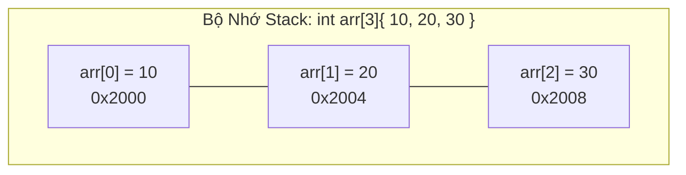

# 17.7 — Nhập Môn Mảng Kiểu C (Introduction to C-Style Arrays)

---

## 🎯 Mục Tiêu Bài Học
- Hiểu lịch sử và cú pháp khai báo mảng kiểu C (C-style Array).
- Nắm bắt quy tắc cấp phát bộ nhớ Stack của mảng kiểu C.
- Nhận biết các nguy cơ rủi ro cao: Thiếu an toàn biên (No Bounds Checking) và Tràn bộ đệm (Buffer Overflow).
- Định hình tư duy: Hiểu mảng C để đọc mã nguồn cũ, nhưng ưu tiên `std::array` / `std::vector` cho mã nguồn mới.

---

## 1. Mảng Kiểu C Là Gì?

**Mảng kiểu C (C-style Array)** là hình thức mảng cơ bản nhất được C++ kế thừa trực tiếp từ ngôn ngữ C sơ khai (1972).

Cú pháp khai báo:
```cpp
int arr[5]; // Mảng gồm 5 số nguyên int, chứa giá trị rác ngẫu nhiên trên Stack
int primes[5]{ 2, 3, 5, 7, 11 }; // Khởi tạo danh sách
int fibonacci[]{ 0, 1, 1, 2, 3, 5, 8 }; // Tự động đếm kích thước là 7
```

---

## 2. Bộ Nhớ Stack Của Mảng Kiểu C

Tương tự như `std::array`, mảng C-style lưu toàn bộ các phần tử liên tiếp nhau ngay trên Stack Frame:



Toán tử `sizeof(arr)` sẽ trả về tổng kích thước byte của toàn bộ mảng:
```cpp
int arr[5]{ 1, 2, 3, 4, 5 };
std::cout << sizeof(arr) << '
'; // 5 * 4 = 20 bytes
std::cout << sizeof(arr) / sizeof(arr[0]) << '
'; // 5 phần tử (Công thức C cổ điển)
```

---

## 3. Các Hiểm Họa Chí Mạng Của Mảng Kiểu C

1. **Không có bất kỳ cơ chế kiểm tra biên nào**:
   ```cpp
   int arr[3]{ 1, 2, 3 };
   arr[10] = 999; // Lỗi Tràn Bộ Đệm (Buffer Overflow) - Ghi đè vào biến khác trên Stack!
   ```
2. **Không tự biết kích thước của mình**: Mảng C không có hàm `.size()`.
3. **Không thể sao chép trực tiếp bằng phép gán**:
   ```cpp
   int a[3]{ 1, 2, 3 };
   int b[3];
   // b = a; // LỖI BIÊN DỊCH! Không thể gán mảng C bằng toán tử '='
   ```
4. **Hiện tượng Suy biến con trỏ (Pointer Decay)**: Hiểm họa lớn nhất sẽ được mổ xẻ ở bài 17.8!

---

## 4. 📝 Hệ Thống Quiz & Bài Tập Tự Luyện

::: details Câu hỏi 1: Trong C++17, hàm nào trong thư viện chuẩn giúp lấy số lượng phần tử của một mảng C-style an toàn hơn công thức `sizeof(arr) / sizeof(arr[0])`?
**Lời giải chi tiết**:
Từ C++17, thư viện `<iterator>` cung cấp hàm **`std::size(arr)`** (hoặc `std::ssize(arr)` trong C++20). Hàm này hoạt động được với cả mảng C-style lẫn các container STL như `std::vector`, `std::array`. Ưu điểm vượt trội của `std::size(arr)` là nếu bạn vô tình truyền một con trỏ vào, compiler sẽ báo lỗi ngay tại compile-time, trong khi công thức `sizeof` sẽ tính nhầm kích thước con trỏ (8 bytes) chia 4 thành 2!
:::
