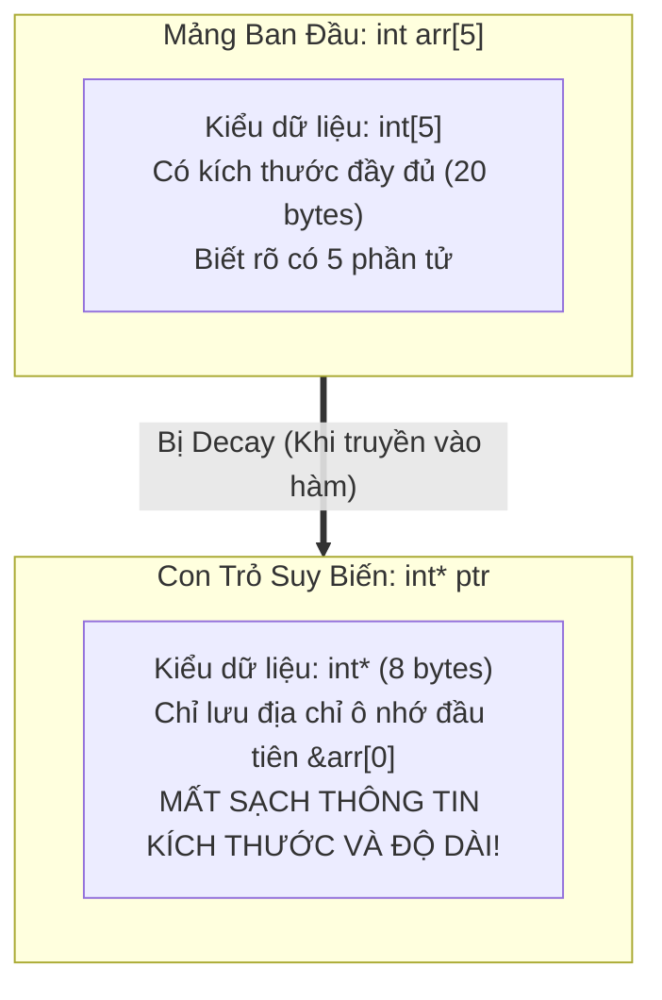

# 17.8 — Hiện Tượng Suy Biến Con Trỏ (C-Style Array Decay)

---

## 🎯 Mục Tiêu Bài Học
- Mổ xẻ hiện tượng **Suy biến con trỏ (Pointer Decay)** - nguồn gốc của hàng ngàn bug bảo mật trong C/C++.
- Hiểu tại sao mảng kiểu C bị "mất sạch" thông tin kích thước khi truyền vào hàm.
- Trực quan hóa sự biến đổi từ Mảng trên Stack thành Con trỏ trỏ tới phần tử đầu tiên.
- Phân tích cạm bẫy khi gọi `sizeof()` trên mảng đã bị suy biến.

---

## 1. Hiện Tượng Suy Biến Con Trỏ (Array Decay) Là Gì?

Trong hầu hết mọi ngữ cảnh, khi một mảng kiểu C được sử dụng trong một biểu thức, tên của mảng sẽ **tự động chuyển đổi ngầm định thành một con trỏ trỏ tới phần tử đầu tiên của mảng** (`&arr[0]`). Quá trình này được gọi là **Hiện tượng suy biến con trỏ (Array Decay)**.



---

## 2. Bi kịch Khi Truyền Mảng C Vào Hàm

Hãy xem xét đoạn mã kinh điển sau:

```cpp
#include <iostream>

// Trông giống như nhận mảng 5 phần tử, nhưng thực chất compiler biên dịch thành:
// void printSize(int* arr)
void printSize(int arr[5])
{
    // CẠM BẪY CHÍ MẠNG:
    // sizeof(arr) ở đây KHÔNG PHẢI là 20 bytes!
    // Nó là kích thước của con trỏ int* (8 bytes trên x64)!
    std::cout << "sizeof ben trong ham: " << sizeof(arr) << " bytes
"; // In ra: 8!
}

int main()
{
    int myArr[5]{ 1, 2, 3, 4, 5 };
    std::cout << "sizeof trong main: " << sizeof(myArr) << " bytes
"; // In ra: 20!

    printSize(myArr); // myArr bị suy biến thành con trỏ int* !

    return 0;
}
```

::: danger Cú pháp đánh lừa thị giác của ngôn ngữ C
Cú pháp `void printSize(int arr[5])` hoặc `void printSize(int arr[])` trong tham số hàm hoàn toàn là một **cú pháp lừa dối**. Trình biên dịch C++ sẽ âm thầm viết lại nó thành **`void printSize(int* arr)`**. Số `5` bên trong ngoặc vuông bị bỏ qua hoàn toàn!
:::

---

## 3. Hậu Quả Và Cách Khắc Phục Truyền Thống

Vì hàm không hề biết mảng có bao nhiêu phần tử, nên trong lập trình C truyền thống, người ta **bắt buộc phải truyền thêm một tham số độ dài**:

```cpp
void printElements(const int* arr, std::size_t length)
{
    for (std::size_t i{ 0 }; i < length; ++i)
        std::cout << arr[i] << ' ';
    std::cout << '
';
}
```

Nếu người gọi hàm truyền nhầm `length` lớn hơn kích thước thực tế của mảng, hàm sẽ đọc tràn bộ nhớ (Out-of-bounds Read) dẫn đến lỗi bảo mật thông tin!

---

## 4. Giải Pháp Hiện Đại: C++20 `std::span` Chấm Dứt Nỗi Đau

Để chấm dứt vĩnh viễn thảm họa Pointer Decay kéo dài suốt nửa thế kỷ của mảng C, C++20 đã mang đến **`std::span`**:

```cpp
#include <iostream>
#include <span>

// std::span bọc con trỏ VÀ kích thước lại với nhau một cách an toàn!
void safePrint(std::span<const int> s)
{
    std::cout << "So phan tu an toan: " << s.size() << '
';
    for (int x : s)
        std::cout << x << ' ';
    std::cout << '
';
}

int main()
{
    int cArr[]{ 10, 20, 30, 40 };
    safePrint(cArr); // Tự động đóng gói con trỏ + kích thước 4 an toàn tuyệt đối!
    return 0;
}
```

---

## 5. 📝 Hệ Thống Quiz & Bài Tập Tự Luyện

::: details Câu hỏi 1: Có hai trường hợp nào mà một mảng C-style KHÔNG bị suy biến thành con trỏ?
**Lời giải chi tiết**:
Một mảng kiểu C sẽ **không bị decay** thành con trỏ trong 2 trường hợp chính sau:
1. Khi làm đối số cho toán tử **`sizeof(arr)`**: Compiler trả về kích thước thực tế tính bằng byte của toàn bộ mảng.
2. Khi làm đối số cho toán tử lấy địa chỉ **`&arr`**: Biểu thức trả về con trỏ trỏ tới toàn bộ mảng (kiểu `int(*)[N]`) chứ không phải con trỏ trỏ tới phần tử đầu tiên.
(Trường hợp thứ ba từ C++11: khi truyền mảng vào tham chiếu mảng `int (&ref)[N]`).
:::
