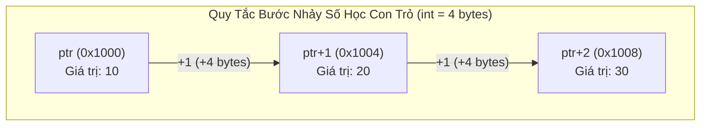

# 17.9 — Số Học Con Trỏ và Toán Tử Chỉ Số (Pointer Arithmetic & Subscripting)

---

## 🎯 Mục Tiêu Bài Học
- Hiểu bản chất thực sự của toán tử chỉ số: `arr[i]` thực chất là `*(arr + i)`.
- Nắm vững các quy tắc của **Số học con trỏ (Pointer Arithmetic)**: cộng, trừ con trỏ với số nguyên.
- Hiểu sự mở rộng bước nhảy theo kích thước kiểu dữ liệu (`sizeof(T)`).
- Giải thích sự kỳ dị nổi tiếng của ngôn ngữ C: Tại sao `i[arr]` hoàn toàn hợp lệ và tương đương `arr[i]`.

---

## 1. Số Học Con Trỏ (Pointer Arithmetic)

Khi bạn cộng một số nguyên vào một con trỏ, con trỏ không đơn thuần tăng thêm $n$ byte. Nó sẽ **nhảy tới ô nhớ cách đó $n$ phần tử**, tức là tăng thêm $n 	imes 	ext{sizeof}(T)$ bytes:

```cpp
#include <iostream>

int main()
{
    int arr[]{ 10, 20, 30, 40 };
    int* ptr{ arr }; // ptr trỏ tới arr[0] (giả sử địa chỉ 0x1000)

    std::cout << "ptr:     " << ptr << " -> Gia tri: " << *ptr << '
';     // 0x1000 -> 10
    std::cout << "ptr + 1: " << (ptr + 1) << " -> Gia tri: " << *(ptr + 1) << '
'; // 0x1004 (+4 bytes) -> 20
    std::cout << "ptr + 2: " << (ptr + 2) << " -> Gia tri: " << *(ptr + 2) << '
'; // 0x1008 (+8 bytes) -> 30

    return 0;
}
```



---

## 2. Bí Mật Của Toán Tử Chỉ Số `[]`

Trong ngôn ngữ C và C++, toán tử `arr[i]` không phải là một phép toán cơ bản độc lập. Nó được định nghĩa chính xác theo chuẩn ISO C++ như sau:

$$\mathbf{arr[i] \iff *(arr + i)}$$

Khi bạn viết `arr[2]`:
1. `arr` suy biến thành con trỏ trỏ tới phần tử `0`.
2. Thực hiện số học con trỏ: `arr + 2` nhảy tới địa chỉ của phần tử thứ 2.
3. Giải tham chiếu `*(...)` để lấy giá trị tại ô nhớ đó.

### Sự kỳ quặc nổi tiếng: `2[arr]`?
Vì phép cộng có tính chất giao hoán: `*(arr + 2)` giống hệt `*(2 + arr)`. Do đó, trong C/C++, biểu thức sau **hoàn toàn hợp lệ và chạy đúng**:
```cpp
int arr[]{ 10, 20, 30 };
std::cout << 2[arr] << '
'; // In ra 30! (Nhưng TUYỆT ĐỐI không viết thế này trong thực tế!)
```

---

## 3. 📝 Hệ Thống Quiz & Bài Tập Tự Luyện

::: details Câu hỏi 1: Giả sử con trỏ `double* p` có giá trị địa chỉ là `0x2000`. Biết `sizeof(double) == 8`. Biểu thức `p + 3` sẽ có giá trị địa chỉ là bao nhiêu?
**Lời giải chi tiết**:
Số học con trỏ tăng theo công thức: `Địa chỉ mới = Địa chỉ cũ + (Số bước * sizeof(Kiểu))`.
`p + 3` = `0x2000 + 3 * 8` = `0x2000 + 24 bytes` (trong hệ thập lục phân, 24 là `0x18`).
Do đó, địa chỉ mới là **`0x2018`**.
:::
