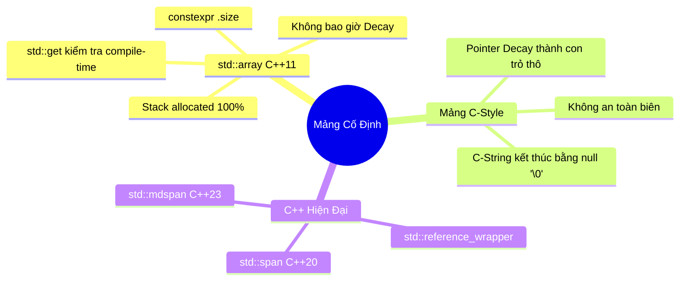

# 17.x — Tổng Kết Chương 17 & Bài Tập Toàn Diện (Chapter 17 Summary and Quiz)

---

## 🎯 Tổng Kết Kiến Thức Trọng Tâm Chương 17

Chương 17 đã khảo sát toàn diện thế giới của các mảng kích thước cố định: từ chuẩn mực hiện đại `std::array`, các nguy cơ của mảng kiểu C, đến hiện tượng suy biến con trỏ và các kỹ thuật C++20/C++23 tiên tiến.



---

## 1. Bảng So Sánh Quyết Định: Chọn Loại Mảng Nào?

| Tình huống | Lựa chọn tối ưu số 1 | Lý do |
| :--- | :--- | :--- |
| Số lượng phần tử biết trước lúc compile, kích thước nhỏ đến vừa | **`std::array`** | Nằm hoàn toàn trên Stack, không tốn Heap, an toàn, zero-overhead |
| Số lượng phần tử thay đổi lúc runtime, hoặc mảng rất lớn | **`std::vector`** | Quản lý bộ nhớ Heap tự động qua RAII, chống tràn Stack |
| Viết hàm tiện ích chỉ đọc mảng liên tục | **`std::span` (C++20)** | Nhận được cả `vector`, `std::array` lẫn mảng C mà không copy |
| Ma trận nhiều chiều cho AI / Đồ họa | **`std::mdspan` (C++23)** | View đa chiều trên vùng nhớ 1D liên tục |
| Mảng kiểu C nguyên thủy (`int a[]`) | **TUYỆT ĐỐI TRÁNH** | Quá nhiều lỗi bảo mật tiềm ẩn và suy biến con trỏ |

---

## 2. 📝 Bài Kiểm Tra Toàn Diện (Comprehensive Quiz)

::: details Câu hỏi 1: Viết một hàm mẫu `printEverySecondElement` nhận vào một `std::span<const int>` và in ra các phần tử ở vị trí lẻ (chỉ số 1, 3, 5...). Viết hàm `main` kiểm nghiệm hàm này với cả `std::array`, `std::vector`, và mảng C-style.
**Lời giải chi tiết**:
```cpp
#include <iostream>
#include <span>
#include <vector>
#include <array>

void printEverySecondElement(std::span<const int> s)
{
    for (std::size_t i{ 1 }; i < s.size(); i += 2)
    {
        std::cout << s[i] << ' ';
    }
    std::cout << '
';
}

int main()
{
    std::vector<int> v{ 10, 20, 30, 40, 50, 60 };
    std::array<int, 4> a{ 1, 2, 3, 4 };
    int raw[]{ 100, 200, 300 };

    std::cout << "Vector: ";
    printEverySecondElement(v); // 20 40 60

    std::cout << "Array:  ";
    printEverySecondElement(a); // 2 4

    std::cout << "C-Arr:  ";
    printEverySecondElement(raw); // 200

    return 0;
}
```
:::
