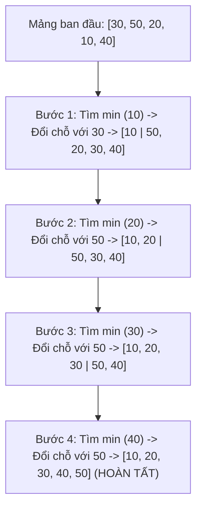

# 18.1 — Sắp Xếp Mảng Bằng Selection Sort (Sorting an Array Using Selection Sort)

---

## 🎯 Mục Tiêu Bài Học
- Hiểu bài toán sắp xếp dữ liệu (Sorting) trong khoa học máy tính.
- Nắm vững nguyên lý và cài đặt thuật toán **Sắp xếp chọn (Selection Sort)**.
- Phân tích độ phức tạp thời gian $O(N^2)$ và trường hợp áp dụng.
- Mở đầu tư duy chuyển đổi từ thuật toán thủ công sang các thuật toán chuẩn của STL.

---

## 1. Bài Toán Sắp Xếp Dữ Liệu

Sắp xếp là quá trình tổ chức lại các phần tử trong một container theo một trật tự xác định (tăng dần hoặc giảm dần). Đây là một trong những tác vụ nền tảng nhất của mọi hệ thống phần mềm: từ hiển thị danh sách sản phẩm theo giá, danh sách học sinh theo điểm số, cho đến tìm kiếm nhị phân ($O(\log N)$).

---

## 2. Ý Tưởng Thuật Toán Selection Sort

Thuật toán Selection Sort hoạt động bằng cách chia mảng thành hai phần: phần đã sắp xếp ở bên trái và phần chưa sắp xếp ở bên phải:
1. Tìm phần tử nhỏ nhất trong phần chưa sắp xếp.
2. Hoán đổi (Swap) phần tử nhỏ nhất đó với phần tử đầu tiên của phần chưa sắp xếp.
3. Thu hẹp phần chưa sắp xếp lại và lặp lại bước 1 cho tới khi duyệt hết mảng.



---

## 3. Cài Đặt Trong C++

```cpp
#include <iostream>
#include <vector>
#include <utility> // for std::swap

void selectionSort(std::vector<int>& arr)
{
    const std::size_t n{ arr.size() };

    for (std::size_t startIndex{ 0 }; startIndex < n - 1; ++startIndex)
    {
        std::size_t smallestIndex{ startIndex };

        // Tìm phần tử nhỏ nhất trong mảng con còn lại
        for (std::size_t currentIndex{ startIndex + 1 }; currentIndex < n; ++currentIndex)
        {
            if (arr[currentIndex] < arr[smallestIndex])
                smallestIndex = currentIndex;
        }

        // Hoán đổi với phần tử đầu mảng con
        std::swap(arr[startIndex], arr[smallestIndex]);
    }
}

int main()
{
    std::vector data{ 30, 50, 20, 10, 40 };
    selectionSort(data);

    for (int x : data)
        std::cout << x << ' '; // In ra: 10 20 30 40 50
    std::cout << '
';

    return 0;
}
```

---

## 4. Đánh Giá Độ Phức Tạp

- **Thời gian**: Vòng lặp lồng nhau thực hiện khoảng $rac{N(N-1)}{2}$ phép so sánh. Độ phức tạp là **$O(N^2)$** trong mọi trường hợp (tốt nhất, xấu nhất, trung bình).
- **Bộ nhớ phụ**: $O(1)$ (Sắp xếp tại chỗ - In-place).
- **Thực tế**: Selection Sort rất chậm đối với dữ liệu lớn. Trong thực tế, bạn không bao giờ nên tự viết Selection Sort, mà hãy sử dụng **`std::sort`** của thư viện chuẩn STL (chạy thuật toán Introsort với tốc độ $O(N \log N)$).

---

## 5. 📝 Hệ Thống Quiz & Bài Tập Tự Luyện

::: details Câu hỏi 1: Nếu một mảng gồm 10 phần tử đã được sắp xếp tăng dần từ trước, thuật toán Selection Sort sẽ thực hiện bao nhiêu phép so sánh?
**Lời giải chi tiết**:
Selection Sort luôn luôn thực hiện quét toàn bộ phần chưa sắp xếp để tìm phần tử nhỏ nhất mà không có cơ chế dừng sớm. Số phép so sánh luôn là $rac{10 	imes 9}{2} = \mathbf{45	ext{ phép so sánh}}$, bất kể dữ liệu đầu vào đã sắp xếp hay chưa.
:::
