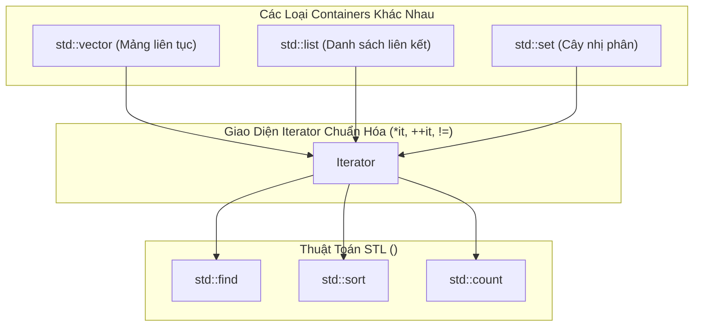
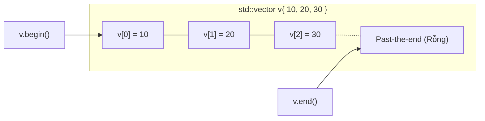

# 18.2 — Nhập Môn Iterator (Introduction to Iterators)

---

## 🎯 Mục Tiêu Bài Học
- Hiểu khái niệm **Iterator (Bộ lặp)** như một chiếc cầu nối trừu tượng giữa Container và Thuật toán.
- Thao tác các toán tử cơ bản của Iterator: toán tử giải tham chiếu `*`, toán tử tăng `++`, toán tử so sánh `!=`.
- Phân biệt giữa `begin()`, `end()`, `cbegin()`, `cend()`, `rbegin()`, `rend()`.
- Nhận thức sâu sắc về nguyên nhân và cách phòng tránh **Vô hiệu hóa Iterator (Iterator Invalidation)**.

---

## 1. Iterator Là Gì? Tại Sao Cần Iterator?

Hãy tưởng tượng bạn có 3 cấu trúc dữ liệu khác nhau trong STL:
- `std::vector`: Các phần tử nằm liên tục trong bộ nhớ, truy cập qua chỉ số `v[i]`.
- `std::list` (Danh sách liên kết đôi): Các node nằm rải rác trên Heap, **không thể dùng `list[i]`**!
- `std::map` (Cây đỏ đen): Dữ liệu tổ chức dạng cây nhị phân tìm kiếm.

Nếu không có Iterator, thư viện chuẩn sẽ phải viết lại hàng trăm thuật toán (như tìm kiếm, sắp xếp, đếm) cho từng loại container riêng biệt!

**Iterator (Bộ lặp)** là một đối tượng đóng vai trò như một **con trỏ thông minh trừu tượng**, cung cấp một giao diện đồng nhất để duyệt qua các phần tử của **BẤT KỲ container nào** mà không cần quan tâm bên dưới container đó được cài đặt như thế nào.



---

## 2. `begin()` và `end()`: Khái Niệm Nửa Mở `[begin, end)`

Mọi container trong STL đều cung cấp hai hàm cốt lõi:
- **`v.begin()`**: Trả về một iterator trỏ tới **phần tử đầu tiên** của container.
- **`v.end()`**: Trả về một iterator trỏ tới **vị trí ngay sau phần tử cuối cùng** (Past-the-end element). Vị trí này không chứa dữ liệu hợp lệ, chỉ dùng làm mốc báo dừng!

Dải duyệt của STL luôn là khoảng nửa mở: **`[begin, end)`** (Bao gồm `begin` nhưng không bao gồm `end`).



---

## 3. Duyệt Mảng Bằng Iterator Thủ Công

```cpp
#include <iostream>
#include <vector>

int main()
{
    std::vector nums{ 10, 20, 30, 40 };

    // Khởi tạo iterator trỏ tới đầu, lặp tới khi chạm v.end()
    for (auto it = nums.begin(); it != nums.end(); ++it)
    {
        std::cout << *it << ' '; // Toán tử giải tham chiếu '*' để lấy giá trị!
    }
    std::cout << '
';

    // Iterator hằng (Chỉ đọc - const_iterator)
    for (auto it = nums.cbegin(); it != nums.cend(); ++it)
    {
        // *it = 99; // LỖI BIÊN DỊCH: it trỏ tới dữ liệu chỉ đọc!
    }

    // Iterator duyệt ngược (Reverse iterator)
    std::cout << "Duyet nguoc: ";
    for (auto it = nums.rbegin(); it != nums.rend(); ++it)
    {
        std::cout << *it << ' '; // In ra: 40 30 20 10
    }
    std::cout << '
';

    return 0;
}
```

---

## 4. Cạm Bẫy Sống Còn: Vô Hiệu Hóa Iterator (Iterator Invalidation)

Một trong những cạm bẫy nguy hiểm nhất khi thao tác với STL là **sửa đổi cấu trúc container trong lúc đang duyệt bằng iterator**:

```cpp
#include <vector>
#include <iostream>

int main()
{
    std::vector<int> v{ 1, 2, 3, 4, 5 };

    // CẠM BẪY CHÍ MẠNG:
    for (auto it = v.begin(); it != v.end(); ++it)
    {
        if (*it == 3)
        {
            v.push_back(100); // NGUY HIỂM: push_back có thể gây REALLOCATION!
            // Khi reallocation xảy ra, toàn bộ iterator (bao gồm 'it') bị vô hiệu hóa!
            // Vòng lặp tiếp tục thực thi '++it' trên vùng nhớ rác -> CRASH / UB!
        }
    }

    return 0;
}
```

::: danger Quy tắc vàng chống Iterator Invalidation
Tuyệt đối không thêm (`push_back`, `insert`) hoặc xóa (`erase`) phần tử khỏi `std::vector` bên trong một vòng lặp sử dụng iterator, trừ khi bạn cập nhật lại giá trị trả về của hàm `erase` (`it = v.erase(it);`)!
:::

---

## 5. 📝 Hệ Thống Quiz & Bài Tập Tự Luyện

::: details Câu hỏi 1: Điều gì xảy ra nếu bạn giải tham chiếu iterator trả về từ `v.end()` (ví dụ `*v.end()`)?
**Lời giải chi tiết**:
`v.end()` trỏ tới vị trí "ngay sau phần tử cuối cùng", đây là một vị trí lính canh (sentinel) không chứa bất kỳ đối tượng hợp lệ nào của vector. Việc giải tham chiếu `*v.end()` là một hành vi không xác định (**Undefined Behavior**). Trong thực tế, chương trình sẽ đọc giá trị rác hoặc bị hệ điều hành tắt ngay lập tức vì lỗi Segmentation Fault.
:::
