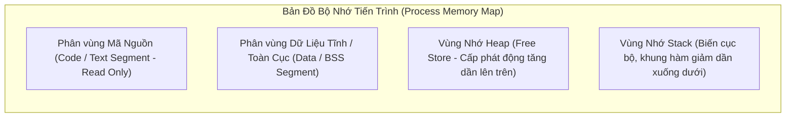

# 19.1 — Cấp Phát Bộ Nhớ Động Với new và delete (Dynamic Memory Allocation)

---

## 🎯 Mục Tiêu Bài Học
- Phân biệt sự khác nhau giữa cấp phát tĩnh (Static), tự động (Stack), và cấp phát động (Heap / Free Store).
- Cú pháp toán tử `new` và `delete` để xin và giải phóng bộ nhớ cho biến đơn.
- Nhận diện 3 hiểm họa chí mạng: **Rò rỉ bộ nhớ (Memory Leak)**, **Con trỏ lơ lửng (Dangling Pointer)**, và **Giải phóng kép (Double Free)**.
- Xử lý khi bộ nhớ cạn kiệt: ngoại lệ `std::bad_alloc` và `std::nothrow`.

---

## 1. Stack vs Heap: So Sánh Hai Vùng Bộ Nhớ

Mọi chương trình C++ khi thực thi đều chia bộ nhớ RAM thành các phân vùng chính:



| Tiêu chí | Bộ Nhớ Stack | Bộ Nhớ Heap (Free Store) |
| :--- | :--- | :--- |
| **Kích thước** | Rất nhỏ (thường chỉ 1MB - 8MB) | Rất lớn (giới hạn bởi dung lượng RAM vật lý) |
| **Tốc độ cấp phát** | Cực nhanh (chỉ dịch chuyển thanh ghi Stack Pointer) | Chậm hơn (hệ điều hành phải tìm khối nhớ trống) |
| **Quản lý vòng đời** | **Tự động 100%** khi rời khỏi cặp ngoặc `{}` | **Thủ công**: Lập trình viên phải tự xin và tự trả |
| **Nguy cơ** | Tràn bộ nhớ Stack (Stack Overflow) | **Rò rỉ bộ nhớ (Memory Leak)** |

---

## 2. Toán Tử `new` và `delete`

```cpp
#include <iostream>

int main()
{
    // 1. Cấp phát 1 số nguyên trên Heap:
    int* ptr{ new int{ 42 } }; // Xin 4 bytes trên Heap, khởi tạo giá trị 42

    std::cout << "Gia tri: " << *ptr << " tai dia chi Heap: " << ptr << '
';

    // 2. BẮT BUỘC GIẢI PHÓNG KHI DÙNG XONG:
    delete ptr; // Trả lại 4 bytes cho hệ điều hành

    // 3. CỰC KỲ QUAN TRỌNG: Gán về nullptr để chống con trỏ lơ lửng!
    ptr = nullptr;

    return 0;
}
```

---

## 3. Ba Hiểm Họa Kinh Hoàng Trong Quản Lý Bộ Nhớ C/C++

### 3.1. Rò Rỉ Bộ Nhớ (Memory Leak)
Xảy ra khi bạn cấp phát bộ nhớ trên Heap nhưng làm mất con trỏ trỏ tới vùng nhớ đó trước khi gọi `delete`:
```cpp
void leakMemory()
{
    int* p = new int{ 100 };
    // Quên gọi delete p;
} // Hàm kết thúc, con trỏ 'p' trên Stack chết đi, nhưng 4 bytes trên Heap bị cô lập vĩnh viễn!
```

### 3.2. Con Trỏ Lơ Lửng (Dangling Pointer)
Xảy ra khi bạn đã `delete ptr;` nhưng con trỏ `ptr` vẫn tiếp tục giữ địa chỉ cũ:
```cpp
int* ptr = new int{ 10 };
delete ptr; // Vùng nhớ bị thu hồi

// HIỂM HỌA: ptr trở thành con trỏ lơ lửng!
std::cout << *ptr; // Undefined Behavior: Đọc vùng nhớ đã chết!
```

### 3.3. Giải Phóng Kép (Double Free)
Gọi `delete` hai lần trên cùng một địa chỉ bộ nhớ:
```cpp
int* p = new int{ 5 };
delete p;
delete p; // CRASH NGAY LẬP TỨC: Heap corruption!
```
*(Ghi chú: Gọi `delete nullptr;` là hoàn toàn an toàn và được chuẩn C++ bảo đảm không làm gì cả)*.

---

## 4. 📝 Hệ Thống Quiz & Bài Tập Tự Luyện

::: details Câu hỏi 1: Tại sao việc gán `ptr = nullptr;` ngay sau câu lệnh `delete ptr;` lại là một thói quen lập trình phòng vệ xuất sắc?
**Lời giải chi tiết**:
1. Nó xóa bỏ trạng thái con trỏ lơ lửng (Dangling Pointer). Nếu vô tình có đoạn code nào kiểm tra `if (ptr != nullptr)` thì sẽ không bị lừa.
2. Nó ngăn ngừa hoàn toàn thảm họa Double Free: Trong chuẩn C++, gọi `delete nullptr;` là hoàn toàn vô hại và không làm sập chương trình.
:::
