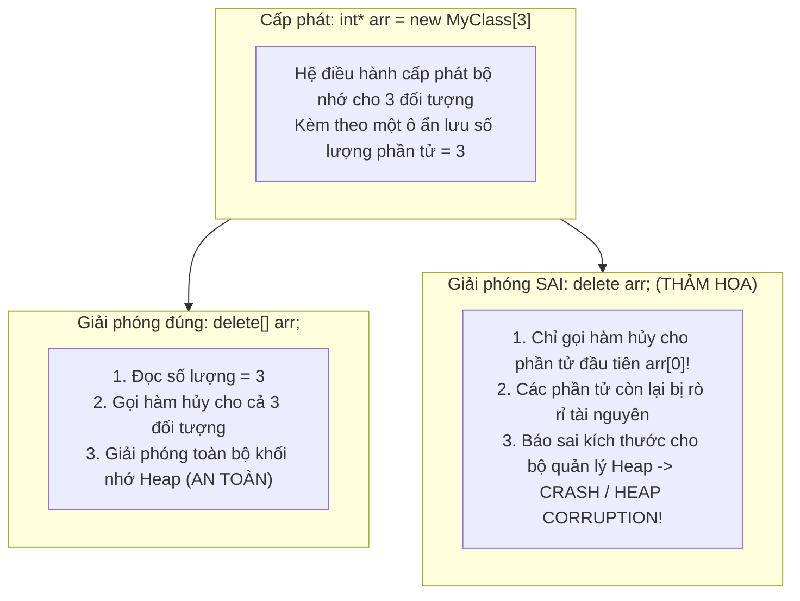

# 19.2 — Cấp Phát Động Cho Mảng (Dynamically Allocating Arrays)

---

## 🎯 Mục Tiêu Bài Học
- Cấp phát mảng có kích thước xác định tại runtime trên Heap với `new[]`.
- Nắm vững quy tắc bắt buộc: Phải giải phóng bằng **`delete[]`** thay vì `delete`.
- Phân tích cạm bẫy phá hủy heap (Heap Corruption) khi dùng nhầm toán tử giải phóng.

---

## 1. Cấp Phát Mảng Động Bằng `new[]`

Nếu kích thước mảng chỉ được biết khi người dùng nhập vào lúc chạy:

```cpp
#include <iostream>

int main()
{
    std::cout << "Nhap so luong phan tu: ";
    std::size_t length;
    std::cin >> length;

    // Cấp phát mảng động trên Heap
    int* array{ new int[length]{} }; // Cặp ngoặc {} khởi tạo tất cả về 0

    array[0] = 10;
    std::cout << "Phan tu dau tien: " << array[0] << '
';

    // BẮT BUỘC PHẢI DÙNG delete[] (CÓ NGOẶC VUÔNG):
    delete[] array;
    array = nullptr;

    return 0;
}
```

---

## 2. Cạm Bẫy Trí Mạng: `delete` vs `delete[]`



::: danger Quy tắc bất di bất dịch
- Bất cứ thứ gì được cấp phát bằng **`new`** (đơn lẻ) $\implies$ Phải giải phóng bằng **`delete`**.
- Bất cứ thứ gì được cấp phát bằng **`new[]`** (mảng) $\implies$ Bắt buộc phải giải phóng bằng **`delete[]`**.
- Vi phạm quy tắc này là **Undefined Behavior** nghiêm trọng!
:::

---

## 3. 📝 Hệ Thống Quiz & Bài Tập Tự Luyện

::: details Câu hỏi 1: Tại sao trong C++ hiện đại, lập trình viên hầu như không bao giờ nên tự tay viết `new[]` và `delete[]`?
**Lời giải chi tiết**:
Bởi vì C++ đã có **`std::vector`**. `std::vector` tự động thực hiện cấp phát động trên Heap, tự động gọi `delete[]` khi rời khỏi phạm vi thông qua nguyên lý RAII, tự động co giãn kích thước, và loại bỏ 100% các nguy cơ rò rỉ bộ nhớ hay dùng nhầm `delete` đơn lẻ.
:::
