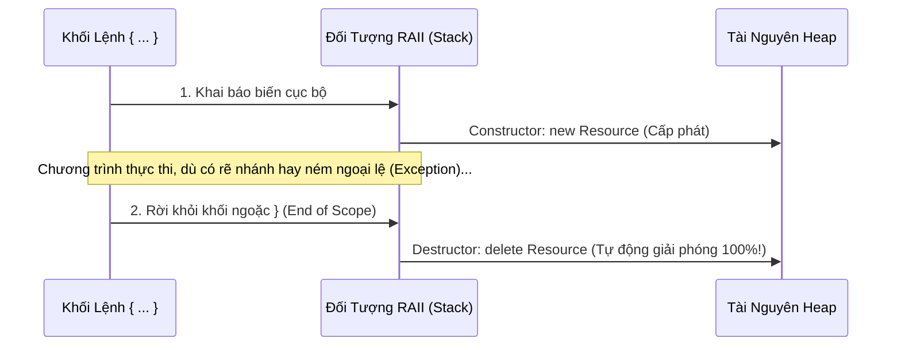

# 19.3 — Hàm Hủy (Destructors) và Nguyên Lý RAII

---

## 🎯 Mục Tiêu Bài Học
- Hiểu vai trò của **Hàm hủy (Destructor)** trong vòng đời của đối tượng C++.
- Khám phá triết lý vĩ đại nhất của C++: **RAII (Resource Acquisition Is Initialization)**.
- Xây dựng một lớp tự động quản lý tài nguyên Heap (Smart Array Wrapper).

---

## 1. Hàm Hủy (Destructor) Là Gì?

**Hàm hủy (Destructor)** là một hàm thành viên đặc biệt của class/struct, được trình biên dịch **tự động gọi chính xác tại thời điểm đối tượng chuẩn bị kết thúc vòng đời** (khi đối tượng rời khỏi phạm vi `{}` hoặc khi được giải phóng qua `delete`).

Cú pháp: Tên hàm hủy bắt đầu bằng dấu ngã `~` theo sau là tên lớp, không có kiểu trả về và không có tham số:

```cpp
class Simple
{
public:
    Simple() { std::cout << "Constructor: Khoi tao doi tuong!
"; }
    ~Simple() { std::cout << "Destructor: Huy doi tuong tu dong!
"; }
};
```

---

## 2. Trái Tim Của C++ Hiện Đại: Triết Lý RAII

**RAII** viết tắt của **Resource Acquisition Is Initialization (Chiếm giữ tài nguyên gắn liền với Khởi tạo)**:
1. **Khởi tạo**: Trong hàm tạo (Constructor), đối tượng sẽ chiếm giữ tài nguyên (cấp phát bộ nhớ Heap, mở file, kết nối socket, khóa mutex).
2. **Sử dụng**: Trong suốt vòng đời, đối tượng sở hữu và bảo vệ tài nguyên đó.
3. **Giải phóng**: Trong hàm hủy (Destructor), đối tượng **tự động giải phóng hoàn toàn tài nguyên**.



Nhờ có RAII, ngay cả khi hàm của bạn xảy ra lỗi hay ném ngoại lệ (Exception), trình biên dịch vẫn đảm bảo cơ chế **Tháo ngăn xếp (Stack Unwinding)** sẽ gọi hàm hủy của tất cả các biến cục bộ, triệt tiêu hoàn toàn nguy cơ rò rỉ bộ nhớ!

---

## 3. Tự Viết Lớp Quản Lý Mảng An Toàn Bằng RAII

```cpp
#include <iostream>

class AutoIntArray
{
private:
    int* m_data;
    std::size_t m_length;

public:
    AutoIntArray(std::size_t length)
        : m_data{ new int[length]{} }, m_length{ length }
    {
        std::cout << "Da cap phat mang " << m_length << " phan tu tren Heap.
";
    }

    // HÀM HỦY: TỰ ĐỘNG GIẢI PHÓNG KHI HẾT SCOPE!
    ~AutoIntArray()
    {
        delete[] m_data;
        std::cout << "HET SCOPE: Da tu dong thu hoi bo nho Heap!
";
    }

    int& operator[](std::size_t index) { return m_data[index]; }
};

int main()
{
    {
        AutoIntArray myArr(5);
        myArr[0] = 100;
        // Ra khỏi cặp ngoặc này, Destructor tự động được gọi!
    }
    std::cout << "Chuong trinh tiep tuc chay ma khong he ro ri 1 byte RAM nao!
";
    return 0;
}
```

---

## 4. 📝 Hệ Thống Quiz & Bài Tập Tự Luyện

::: details Câu hỏi 1: Nếu một hàm bị ngắt quãng giữa chừng do một ngoại lệ (Exception) được ném ra, các biến con trỏ thô (`int* p = new int;`) và các đối tượng tuân thủ RAII (`std::vector`) sẽ hành xử khác nhau như thế nào?
**Lời giải chi tiết**:
- Với con trỏ thô: Luồng thực thi bị ngắt lập tức nhảy ra khối `catch`, câu lệnh `delete p;` ở cuối hàm không bao giờ được chạm tới $\implies$ **Bị rò rỉ bộ nhớ (Memory Leak)**!
- Với đối tượng RAII: Quá trình Stack Unwinding sẽ tự động kích hoạt hàm hủy của `std::vector`, giải phóng sạch sẽ vùng nhớ Heap trước khi chuyển quyền điều khiển sang khối xử lý ngoại lệ $\implies$ **An toàn bộ nhớ 100%**!
:::
