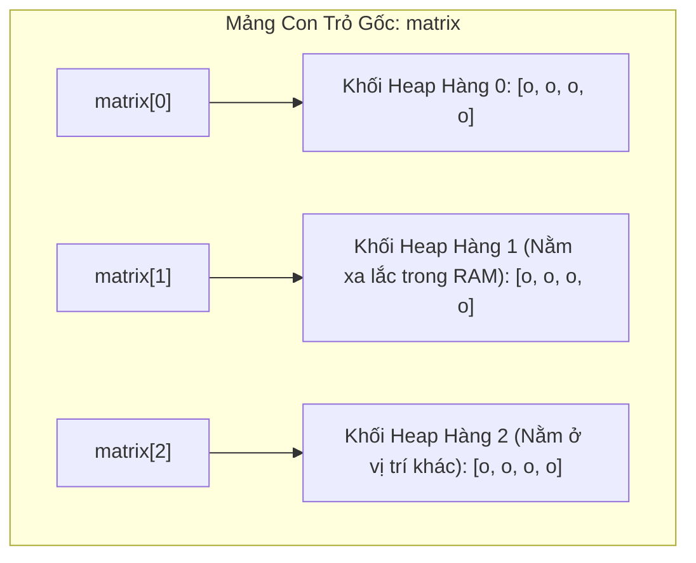

# 19.4 — Con Trỏ Tới Con Trỏ và Mảng Đa Chiều Động (Pointers to Pointers)

---

## 🎯 Mục Tiêu Bài Học
- Hiểu khái niệm con trỏ tới con trỏ (`T**`).
- Cấp phát mảng 2 chiều động bằng con trỏ cấp 2.
- Nhận diện nhược điểm phân mảnh bộ nhớ và giải pháp mảng 1D làm phẳng (Flattened Array).

---

## 1. Con Trỏ Tới Con Trỏ Là Gì?

Một con trỏ lưu trữ địa chỉ của một biến. Vậy **Con trỏ tới con trỏ (Pointer to Pointer - `T**`)** là một biến con trỏ lưu trữ địa chỉ của một **biến con trỏ khác**:

```cpp
int value{ 5 };
int* ptr{ &value };    // ptr trỏ tới value
int** ptrptr{ &ptr };  // ptrptr trỏ tới ptr

std::cout << **ptrptr; // Giải tham chiếu 2 lần để lấy ra số 5!
```

---

## 2. Cấp Phát Mảng 2 Chiều Động Bằng `int**`

Trong C cổ điển, để tạo một ma trận kích thước $M 	imes N$ tại runtime:
1. Cấp phát một mảng chứa $M$ con trỏ hàng (`int*`).
2. Với mỗi hàng, cấp phát một mảng chứa $N$ số nguyên (`int`).

```cpp
#include <iostream>

int main()
{
    int rows{ 3 };
    int cols{ 4 };

    // 1. Cấp phát mảng chứa 3 con trỏ:
    int** matrix{ new int*[rows] };

    // 2. Cấp phát từng hàng:
    for (int r{ 0 }; r < rows; ++r)
        matrix[r] = new int[cols]{};

    matrix[1][2] = 99; // Truy cập bình thường

    // 3. GIẢI PHÓNG: PHẢI GIẢI PHÓNG TỪNG HÀNG TRƯỚC!
    for (int r{ 0 }; r < rows; ++r)
        delete[] matrix[r];

    // Sau đó mới giải phóng mảng con trỏ gốc:
    delete[] matrix;

    return 0;
}
```

---

## 3. Tại Sao Cách Làm Này Bị Khuyên Bỏ Trong C++ Hiện Đại?



- **Phân mảnh bộ nhớ**: Thực hiện $M + 1$ lần gọi cấp phát Heap rời rạc.
- **Phá hủy CPU Cache**: Các hàng nằm rải rác ở các địa chỉ RAM khác nhau, mất hoàn toàn tính liên tục.
- **Dễ rò rỉ bộ nhớ**: Nếu quên một vòng lặp `delete[]`, hàng chục khối nhớ sẽ bị rò rỉ.

**Giải pháp C++ hiện đại**: Hãy dùng một mảng 1D phẳng `std::vector<int> matrix(rows * cols);` và ánh xạ chỉ số `matrix[r * cols + c]` (hoặc dùng `std::mdspan` trong C++23)!

---

## 4. 📝 Hệ Thống Quiz & Bài Tập Tự Luyện

::: details Câu hỏi 1: Điều gì xảy ra nếu bạn gọi `delete[] matrix;` trước khi giải phóng các hàng `delete[] matrix[r];`?
**Lời giải chi tiết**:
Mảng chứa các con trỏ hàng sẽ bị xóa sổ trước. Hậu quả là bạn mất hoàn toàn tất cả các địa chỉ con trỏ trỏ tới từng hàng dữ liệu trên Heap. Tất cả các hàng dữ liệu đó sẽ bị rò rỉ vĩnh viễn (**Memory Leak**) trong suốt thời gian chương trình chạy!
:::
