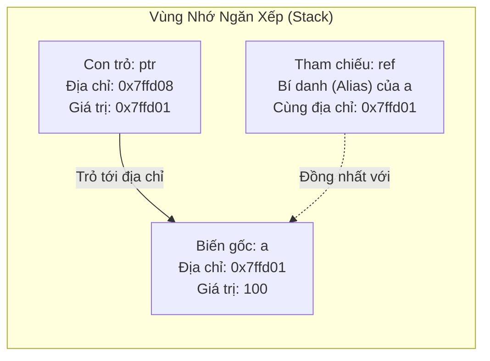

# 20.1 — Function Pointers

---

## 🎯 Mục Tiêu Bài Học
- Nắm vững bản chất lý thuyết và cơ chế hoạt động của **Function Pointers** trong tiêu chuẩn ISO C++.
- Hiểu rõ cách máy tính tổ chức bộ nhớ (RAM, CPU registers) khi thực thi mã nguồn liên quan.
- Nhận biết các cạm bẫy lỗi kinh điển (**Undefined Behavior**, Memory Leak, Bug logic) và cách phòng tránh.
- Áp dụng các quy tắc thực hành tốt nhất (**Best Practices**) chuẩn công nghiệp và cập nhật C++20/C++23 hiện đại.

---

# 20.1 &#8212; Function Pointers

Trong bài học [12.7 -- Introduction to các con trỏ](https://www.learncpp.com/cpp-tutorial/introduction-to-các con trỏ/), you learned that a con trỏ is a biến that holds the address of another biến.  Function các con trỏ are similar, except that instead of pointing to các biến, they point to các hàm!

Consider the following hàm:

```cpp
int foo()
{
    return 5;
}
```

Identifier `foo()` is the hàm’s name.  But what type is the hàm?  Functions have their own hàm type -- in this case, a hàm type that returns an integer and takes no tham số.  Much like các biến, các hàm live at an assigned address in memory (making them lvalues).

When a hàm is called (via `toán tử()`), execution jumps to the address of the hàm being called:

```cpp
int foo() // code for foo starts at memory address 0x002717f0
{
    return 5;
}

int main()
{
    foo(); // jump to address 0x002717f0

    return 0;
}
```

At some point in your programming career (if you haven’t already), you’ll probably make a simple mistake:

```cpp
#include <iostream>

int foo() // code starts at memory address 0x002717f0
{
    return 5;
}

int main()
{
    std::cout << foo << '\n'; // we meant to call foo(), but instead we're printing foo itself!

    return 0;
}
```

Instead of calling hàm `foo()` and printing the giá trị trả về, we’ve unintentionally sent hàm `foo` directly to `std::cout`.  What happens in this case?

When a hàm is referred to by name (without parenthesis), C++ converts the hàm into a hàm con trỏ (holding the address of the hàm).  Then `toán tử<<` tries to print the hàm con trỏ, which it fails at because `toán tử<<` does not know how to print hàm các con trỏ.  The standard says that in this case, `foo` should be converted to a `bool` (which `toán tử<<` does know how to print).  And since the hàm con trỏ for `foo` is a non-null con trỏ, it should always evaluate to Boolean `true`.  Thus, this should print:

```cpp
1
```

::: info Tip

Some các trình biên dịch (e.g. Visual Studio) have a trình biên dịch extension that prints the address of the hàm instead:

```cpp
0x002717f0
```

If your platform doesn’t print the hàm’s address and you want it to, you may be able to force it to do so by converting the hàm to a void con trỏ and printing that:

```cpp
#include <iostream>

int foo() // code starts at memory address 0x002717f0
{
    return 5;
}

int main()
{
    std::cout << reinterpret_cast<void*>(foo) << '\n'; // Tell C++ to interpret function foo as a void pointer (implementation-defined behavior)

    return 0;
}
```

This is implementation-defined behavior, so it may not work on all platforms.

:::

Just like it is possible to declare a non-hằng số con trỏ to a normal biến, it’s also possible to declare a non-hằng số con trỏ to a hàm.  In the rest of this lesson, we’ll examine these hàm các con trỏ and their uses.  Function các con trỏ are a fairly advanced topic, and the rest of this lesson can be safely skipped or skimmed by those only looking for C++ basics.

Pointers to các hàm

The syntax for creating a non-const hàm con trỏ is one of the ugliest things you will ever see in C++:

```cpp
// fcnPtr is a pointer to a function that takes no arguments and returns an integer
int (*fcnPtr)();
```

In the above snippet, fcnPtr is a con trỏ to a hàm that has no tham số and returns an integer.  fcnPtr can point to any hàm that matches this type.

The parentheses around *fcnPtr are necessary for precedence reasons, as `int* fcnPtr()` would be interpreted as a forward declaration for a hàm named fcnPtr that takes no tham số and returns a con trỏ to an integer.

To make a const hàm con trỏ, the const goes after the asterisk:

```cpp
int (*const fcnPtr)();
```

If you put the const before the int, then that would indicate the hàm being pointed to would return a const int.

::: info Tip

The hàm con trỏ syntax can be hard to understand.  The following articles demonstrates a method for parsing such declarations:

- [https://c-faq.com/decl/spiral.anderson.html](https://c-faq.com/decl/spiral.anderson.html)

- [https://web.archive.org/web/20110818081319/http://ieng9.ucsd.edu/~cs30x/rt_lt.rule.html](https://web.archive.org/web/20110818081319/http://ieng9.ucsd.edu/~cs30x/rt_lt.rule.html)

:::

Assigning a hàm to a hàm con trỏ

Function các con trỏ can be được khởi tạo with a hàm (and non-const hàm các con trỏ can be assigned a hàm). Like with các con trỏ to các biến, we can also use &foo to get a hàm con trỏ to foo.

```cpp
int foo()
{
    return 5;
}

int goo()
{
    return 6;
}

int main()
{
    int (*fcnPtr)(){ &foo }; // fcnPtr points to function foo
    fcnPtr = &goo; // fcnPtr now points to function goo

    return 0;
}
```

One common mistake is to do this:

```cpp
fcnPtr = goo();
```

This tries to assign the giá trị trả về from a call to hàm goo() (which has type `int`) to fcnPtr (which is expecting a value of type `int(*)()`), which isn’t what we want.  We want fcnPtr to be assigned the address of hàm goo, not the giá trị trả về from hàm goo().  So no parentheses are needed.

Note that the type (tham số and return type) of the hàm con trỏ must match the type of the hàm.  Here are some examples of this:

```cpp
// function prototypes
int foo();
double goo();
int hoo(int x);

// function pointer initializers
int (*fcnPtr1)(){ &foo };    // okay
int (*fcnPtr2)(){ &goo };    // wrong -- return types don't match!
double (*fcnPtr4)(){ &goo }; // okay
fcnPtr1 = &hoo;              // wrong -- fcnPtr1 has no parameters, but hoo() does
int (*fcnPtr3)(int){ &hoo }; // okay
```

Unlike các kiểu dữ liệu cơ bản, C++ *will* implicitly convert a hàm into a hàm con trỏ if needed (so you don’t need to use the address-of toán tử (&) to get the hàm’s address).  However, hàm các con trỏ will not convert to void các con trỏ, or vice-versa (though some các trình biên dịch like Visual Studio may allow this anyway).

```cpp
// function prototypes
	int foo();

	// function initializations
	int (*fcnPtr5)() { foo }; // okay, foo implicitly converts to function pointer to foo
	void* vPtr { foo };       // not okay, though some compilers may allow
```

Function các con trỏ can also be được khởi tạo or assigned the value nullptr:

```cpp
int (*fcnptr)() { nullptr }; // okay
```

Calling a hàm using a hàm con trỏ

The other primary thing you can do with a hàm con trỏ is use it to actually call the hàm.  There are two ways to do this.  The first is via explicit dereference:

```cpp
int foo(int x)
{
    return x;
}

int main()
{
    int (*fcnPtr)(int){ &foo }; // Initialize fcnPtr with function foo
    (*fcnPtr)(5); // call function foo(5) through fcnPtr.

    return 0;
}
```

The second way is via implicit dereference:

```cpp
int foo(int x)
{
    return x;
}

int main()
{
    int (*fcnPtr)(int){ &foo }; // Initialize fcnPtr with function foo
    fcnPtr(5); // call function foo(5) through fcnPtr.

    return 0;
}
```

As you can see, the implicit dereference method looks just like a normal hàm call -- which is what you’d expect, since normal hàm names are các con trỏ to các hàm anyway!  However, some older các trình biên dịch do not support the implicit dereference method, but all modern các trình biên dịch should.

Also note that because hàm các con trỏ can be set to nullptr, it’s a good idea to assert or conditionally test whether your hàm con trỏ is a null con trỏ before calling it.  Just like with normal các con trỏ, dereferencing a null hàm con trỏ leads to hành vi không xác định (Hành vi không xác định (Undefined Behavior - UB) - UB).

```cpp
int foo(int x)
{
    return x;
}

int main()
{
    int (*fcnPtr)(int){ &foo }; // Initialize fcnPtr with function foo
    if (fcnPtr) // make sure fcnPtr isn't a null pointer    
        fcnPtr(5); // otherwise this will lead to undefined behavior

    return 0;
}
```

Default đối số don’t work for các hàm called through hàm các con trỏ Advanced

When the trình biên dịch encounters a normal hàm call to a hàm with one or more default đối số, it rewrites the hàm call to include the default đối số.  This process happens at compile-time, and thus can only be applied to các hàm that can be resolved at compile time.

However, when a hàm is called through a hàm con trỏ, it is resolved at runtime.  In this case, there is no rewriting of the hàm call to include default đối số.

::: info Hiểu biết cốt lõi

Because the resolution happens at runtime, default đối số are not resolved when a hàm is called through a hàm con trỏ.

:::

This means that we can use a hàm con trỏ to disambiguate a hàm call that would otherwise be ambiguous due to default đối số.  In the following example, we show two ways to do this:

```cpp
#include <iostream>

void print(int x)
{
    std::cout << "print(int)\n";
}

void print(int x, int y = 10)
{
    std::cout << "print(int, int)\n";
}

int main()
{
//    print(1); // ambiguous function call

    // Deconstructed method
    using vnptr = void(*)(int); // define a type alias for a function pointer to a void(int) function
    vnptr pi { print }; // initialize our function pointer with function print
    pi(1); // call the print(int) function through the function pointer

    // Concise method
    static_cast<void(*)(int)>(print)(1); // call void(int) version of print with argument 1
    
    return 0;
}
```

Passing các hàm as đối số to other các hàm

One of the most useful things to do with hàm các con trỏ is pass a hàm as an đối số to another hàm.  Functions used as đối số to another hàm are sometimes called **callback các hàm**.

Consider a case where you are writing a hàm to perform a task (such as sorting an array), but you want the user to be able to define how a particular part of that task will be performed (such as whether the array is sorted in ascending or descending order).  Let’s take a closer look at this problem as applied specifically to sorting, as an example that can be generalized to other similar problems.

Many comparison-based sorting algorithms work on a similar concept: the sorting algorithm iterates through a list of numbers, does comparisons on pairs of numbers, and reorders the numbers based on the results of those comparisons.  Consequently, by varying the comparison, we can change the way the algorithm sorts without affecting the rest of the sorting code.

Here is our selection sort routine from a previous lesson:

```cpp
#include <utility> // for std::swap

void SelectionSort(int* array, int size)
{
    if (!array)
        return;

    // Step through each element of the array
    for (int startIndex{ 0 }; startIndex < (size - 1); ++startIndex)
    {
        // smallestIndex is the index of the smallest element we've encountered so far.
        int smallestIndex{ startIndex };
 
        // Look for smallest element remaining in the array (starting at startIndex+1)
        for (int currentIndex{ startIndex + 1 }; currentIndex < size; ++currentIndex)
        {
            // If the current element is smaller than our previously found smallest
            if (array[smallestIndex] > array[currentIndex]) // COMPARISON DONE HERE
            {
                // This is the new smallest number for this iteration
                smallestIndex = currentIndex;
            }
        }
 
        // Swap our start element with our smallest element
        std::swap(array[startIndex], array[smallestIndex]);
    }
}
```

Let’s replace that comparison with a hàm to do the comparison.  Because our comparison hàm is going to compare two integers and return a boolean value to indicate whether the elements should be swapped, it will look something like this:

```cpp
bool ascending(int x, int y)
{
    return x > y; // swap if the first element is greater than the second
}
```

And here’s our selection sort routine using the ascending() hàm to do the comparison:

```cpp
#include <utility> // for std::swap

void SelectionSort(int* array, int size)
{
    if (!array)
        return;

    // Step through each element of the array
    for (int startIndex{ 0 }; startIndex < (size - 1); ++startIndex)
    {
        // smallestIndex is the index of the smallest element we've encountered so far.
        int smallestIndex{ startIndex };
 
        // Look for smallest element remaining in the array (starting at startIndex+1)
        for (int currentIndex{ startIndex + 1 }; currentIndex < size; ++currentIndex)
        {
            // If the current element is smaller than our previously found smallest
            if (ascending(array[smallestIndex], array[currentIndex])) // COMPARISON DONE HERE
            {
                // This is the new smallest number for this iteration
                smallestIndex = currentIndex;
            }
        }
 
        // Swap our start element with our smallest element
        std::swap(array[startIndex], array[smallestIndex]);
    }
}
```

Now, in order to let the caller decide how the sorting will be done, instead of using our own hard-coded comparison hàm, we’ll allow the caller to provide their own sorting hàm!  This is done via a hàm con trỏ.

Because the caller’s comparison hàm is going to compare two integers and return a boolean value, a con trỏ to such a hàm would look something like this:

```cpp
bool (*comparisonFcn)(int, int);
```

So, we’ll allow the caller to pass our sort routine a con trỏ to their desired comparison hàm as the third tham số, and then we’ll use the caller’s hàm to do the comparison.

Here’s a full example of a selection sort that uses a hàm con trỏ tham số to do a user-defined comparison, along with an example of how to call it:

```cpp
#include <utility> // for std::swap
#include <iostream>

// Note our user-defined comparison is the third parameter
void selectionSort(int* array, int size, bool (*comparisonFcn)(int, int))
{
    if (!array || !comparisonFcn)
        return;

    // Step through each element of the array
    for (int startIndex{ 0 }; startIndex < (size - 1); ++startIndex)
    {
        // bestIndex is the index of the smallest/largest element we've encountered so far.
        int bestIndex{ startIndex };
 
        // Look for smallest/largest element remaining in the array (starting at startIndex+1)
        for (int currentIndex{ startIndex + 1 }; currentIndex < size; ++currentIndex)
        {
            // If the current element is smaller/larger than our previously found smallest
            if (comparisonFcn(array[bestIndex], array[currentIndex])) // COMPARISON DONE HERE
            {
                // This is the new smallest/largest number for this iteration
                bestIndex = currentIndex;
            }
        }
 
        // Swap our start element with our smallest/largest element
        std::swap(array[startIndex], array[bestIndex]);
    }
}

// Here is a comparison function that sorts in ascending order
// (Note: it's exactly the same as the previous ascending() function)
bool ascending(int x, int y)
{
    return x > y; // swap if the first element is greater than the second
}

// Here is a comparison function that sorts in descending order
bool descending(int x, int y)
{
    return x < y; // swap if the second element is greater than the first
}

// This function prints out the values in the array
void printArray(int* array, int size)
{
    if (!array)
        return;

    for (int index{ 0 }; index < size; ++index)
    {
        std::cout << array[index] << ' ';
    }
    
    std::cout << '\n';
}

int main()
{
    int array[9]{ 3, 7, 9, 5, 6, 1, 8, 2, 4 };

    // Sort the array in descending order using the descending() function
    selectionSort(array, 9, descending);
    printArray(array, 9);

    // Sort the array in ascending order using the ascending() function
    selectionSort(array, 9, ascending);
    printArray(array, 9);

    return 0;
}
```

This program produces the result:

```cpp
9 8 7 6 5 4 3 2 1
1 2 3 4 5 6 7 8 9
```

Is that cool or what?  We’ve given the caller the ability to control how our selection sort does its job.

The caller can even define their own “strange” comparison các hàm:

```cpp
bool evensFirst(int x, int y)
{
	// if x is even and y is odd, x goes first (no swap needed)
	if ((x % 2 == 0) && !(y % 2 == 0))
		return false;
 
	// if x is odd and y is even, y goes first (swap needed)
	if (!(x % 2 == 0) && (y % 2 == 0))
		return true;

        // otherwise sort in ascending order
	return ascending(x, y);
}

int main()
{
    int array[9]{ 3, 7, 9, 5, 6, 1, 8, 2, 4 };

    selectionSort(array, 9, evensFirst);
    printArray(array, 9);

    return 0;
}
```

The above snippet produces the following result:

```cpp
2 4 6 8 1 3 5 7 9
```

As you can see, using a hàm con trỏ in this context provides a nice way to allow a caller to “hook” their own functionality into something you’ve previously written and tested, which helps facilitate code reuse!  Previously, if you wanted to sort one array in descending order and another in ascending order, you’d need multiple versions of the sort routine.  Now you can have one version that can sort any way the caller desires!

Note: If a hàm tham số is of a hàm type, it will be converted to a con trỏ to the hàm type.  This means:

```cpp
void selectionSort(int* array, int size, bool (*comparisonFcn)(int, int))
```

can be equivalently written as:

```cpp
void selectionSort(int* array, int size, bool comparisonFcn(int, int))
```

This only works for hàm tham số, and so is of somewhat limited use.  On a non-hàm tham số, the latter is interpreted as a forward declaration:

```cpp
bool (*ptr)(int, int); // definition of function pointer ptr
    bool fcn(int, int);    // forward declaration of function fcn
```

Providing default các hàm

If you’re going to allow the caller to pass in a hàm as a tham số, it can often be useful to provide some standard các hàm for the caller to use for their convenience.  For example, in the selection sort example above, providing the ascending() and descending() hàm along with the selectionSort() hàm would make the caller’s life easier, as they wouldn’t have to rewrite ascending() or descending() every time they want to use them.

You can even set one of these as a default tham số:

```cpp
// Default the sort to ascending sort
void selectionSort(int* array, int size, bool (*comparisonFcn)(int, int) = ascending);
```

In this case, as long as the user calls selectionSort normally (not through a hàm con trỏ), the comparisonFcn tham số will default to ascending.  You will need to make sure that the `ascending` hàm is declared prior to this point, otherwise the trình biên dịch will complain it doesn’t know what `ascending` is.

Making hàm các con trỏ prettier with type aliases

Let’s face it -- the syntax for các con trỏ to các hàm is ugly.  However, type aliases can be used to make các con trỏ to các hàm look more like regular các biến:

```cpp
using ValidateFunction = bool(*)(int, int);
```

This defines a type alias called “ValidateFunction” that is a con trỏ to a hàm that takes two ints and returns a bool.

Now instead of doing this:

```cpp
bool validate(int x, int y, bool (*fcnPtr)(int, int)); // ugly
```

You can do this:

```cpp
bool validate(int x, int y, ValidateFunction pfcn) // clean
```

Using std::hàm

An alternate method of defining and storing hàm các con trỏ is to use std::hàm, which is part of the standard library <functional> header.  To define a hàm con trỏ using this method, declare a std::hàm object like so:

```cpp
#include <functional>
bool validate(int x, int y, std::function<bool(int, int)> fcn); // std::function method that returns a bool and takes two int parameters
```

As you see, both the return type and tham số go inside angled brackets, with the tham số inside parentheses.  If there are no tham số, the parentheses can be left empty.

Updating our earlier example with std::hàm:

```cpp
#include <functional>
#include <iostream>

int foo()
{
    return 5;
}

int goo()
{
    return 6;
}

int main()
{
    std::function<int()> fcnPtr{ &foo }; // declare function pointer that returns an int and takes no parameters
    fcnPtr = &goo; // fcnPtr now points to function goo
    std::cout << fcnPtr() << '\n'; // call the function just like normal

    std::function fcnPtr2{ &foo }; // can also use CTAD to infer template arguments

    return 0;
}
```

Type aliasing std::hàm can be helpful for readability:

```cpp
using ValidateFunctionRaw = bool(*)(int, int); // type alias to raw function pointer
using ValidateFunction = std::function<bool(int, int)>; // type alias to std::function
```

Also note that std::hàm only allows calling the hàm via implicit dereference (e.g. `fcnPtr()`), not explicit dereference (e.g. `(*fcnPtr)()`).

When defining a type alias, we must explicitly specify any template đối số.  We can’t use CTAD in this case since there is no initializer to deduce the template đối số from.

Type inference for hàm các con trỏ

Much like the *auto* keyword can be used to infer the type of normal các biến, the *auto* keyword can also infer the type of a hàm con trỏ.

```cpp
#include <iostream>

int foo(int x)
{
	return x;
}

int main()
{
	auto fcnPtr{ &foo };
	std::cout << fcnPtr(5) << '\n';

	return 0;
}
```

This works exactly like you’d expect, and the syntax is very clean.  The downside is, of course, that all of the details about the hàm’s tham số types and return type are hidden, so it’s easier to make a mistake when making a call with the hàm, or using its giá trị trả về.

Conclusion

Function các con trỏ are useful primarily when you want to store các hàm in an array (or other structure), or when you need to pass a hàm to another hàm.  Because the native syntax to declare hàm các con trỏ is ugly and error prone, we recommend using std::hàm.  In places where a hàm con trỏ type is only used once (e.g. a single tham số or giá trị trả về), std::hàm can be used directly.  In places where a hàm con trỏ type is used multiple times, a type alias to a std::hàm is a better choice (to prevent repeating yourself).

Hệ thống Câu hỏi & Quiz Tự Luyện

<ol start="1">
- In this quiz, we’re going to write a version of our basic calculator using hàm các con trỏ.

1a) Create a short program asking the user for two integer inputs and a mathematical operation (‘+’, ‘-‘, ‘*’, ‘/’).  Ensure the user enters a valid operation.

::: details Xem lời giải (Solution)
```cpp
#include <iostream>

int getInteger()
{
    std::cout << "Enter an integer: ";
    int x{};
    std::cin >> x;
    return x;
}

char getOperation()
{
    char op{};

    do
    {   
        std::cout << "Enter an operation ('+', '-', '*', '/'): ";
        std::cin >> op;
    }
    while (op!='+' && op!='-' && op!='*' && op!='/');

    return op;
}

int main()
{
    int x{ getInteger() };
    char op{ getOperation() };
    int y{ getInteger() };

    return 0;
}
```
:::

1b) Write các hàm named add(), subtract(), multiply(), and divide().  These should take two integer tham số and return an integer.

::: details Xem lời giải (Solution)
```cpp
int add(int x, int y)
{
    return x + y;
}

int subtract(int x, int y)
{
    return x - y;
}

int multiply(int x, int y)
{
    return x * y;
}

int divide(int x, int y)
{
    return x / y;
}
```
:::

1c) Create a type alias named ArithmeticFunction for a con trỏ to a hàm that takes two integer tham số and returns an integer.  Use std::hàm, and include the appropriate header.

::: details Xem lời giải (Solution)
```cpp
#include <functional>
using ArithmeticFunction = std::function<int(int, int)>;
```
:::

1d) Write a hàm named getArithmeticFunction() that takes an toán tử character and returns the appropriate hàm as a hàm con trỏ.

::: details Xem lời giải (Solution)
```cpp
ArithmeticFunction getArithmeticFunction(char op)
{
    switch (op)
    {
    case '+': return &add;
    case '-': return &subtract;
    case '*': return &multiply;
    case '/': return &divide;
    }

    return nullptr;
}
```
:::

1e) Modify your main() hàm to call getArithmeticFunction().  Call the giá trị trả về from that hàm with your inputs and print the result.

::: details Xem lời giải (Solution)
```cpp
#include <iostream>

int main()
{
    int x{ getInteger() };
    char op{ getOperation() };
    int y{ getInteger() };

    ArithmeticFunction fcn{ getArithmeticFunction(op) };
    if (fcn)
        std::cout << x << ' ' << op << ' ' << y << " = " << fcn(x, y) << '\n';

    return 0;
}
```
:::

Here’s the full program:

::: details Xem lời giải (Solution)
```cpp
#include <iostream>
#include <functional>

int getInteger()
{
    std::cout << "Enter an integer: ";
    int x{};
    std::cin >> x;
    return x;
}

char getOperation()
{
    char op{};

    do
    {   
        std::cout << "Enter an operation ('+', '-', '*', '/'): ";
        std::cin >> op;
    }
    while (op!='+' && op!='-' && op!='*' && op!='/');

    return op;
}

int add(int x, int y)
{
    return x + y;
}

int subtract(int x, int y)
{
    return x - y;
}

int multiply(int x, int y)
{
    return x * y;
}

int divide(int x, int y)
{
    return x / y;
}

using ArithmeticFunction = std::function<int(int, int)>;

ArithmeticFunction getArithmeticFunction(char op)
{
    switch (op)
    {
    case '+': return &add;
    case '-': return &subtract;
    case '*': return &multiply;
    case '/': return &divide;
    }

    return nullptr;
}

int main()
{
    int x{ getInteger() };
    char op{ getOperation() };
    int y{ getInteger() };

    ArithmeticFunction fcn{ getArithmeticFunction(op) };
    if (fcn)
        std::cout << x << ' ' << op << ' ' << y << " = " << fcn(x, y) << '\n';

    return 0;
}
```
:::

</a>
  	<a class="nav-link" href="/">
  
    <i class="fa fa-home" aria-hidden="true"></i>
    
      Back to table of contents
    
</a>
  	<a class="nav-link" href="https://www.learncpp.com/cpp-tutorial/void-các con trỏ/">
  
    <i class="fa fa-chevron-circle-left" aria-hidden="true"></i>
    
      Previous lesson
      
        19.5Void các con trỏ
      
    
  </a>


---





::: danger Cạm Bẫy Thực Chiến: Con Trỏ Lơ Lửng (Dangling Pointer) & UB
Tuyệt đối không giải phóng vùng nhớ mà con trỏ đang trỏ tới rồi tiếp tục truy cập nó, hoặc trả về tham chiếu/con trỏ tới một biến cục bộ trên Stack. Khi hàm kết thúc, biến cục bộ bị hủy và con trỏ sẽ trỏ vào vùng nhớ rác, dẫn đến **Hành vi không xác định (Undefined Behavior)** cực kỳ nguy hiểm!
:::


::: tip Nâng Cấp C++ Hiện Đại: Thay Thế Con Trỏ Thô Bằng Smart Pointers
Trong C++ hiện đại (C++11 đến C++23), hãy hạn chế tối đa việc sử dụng con trỏ thô (`T*`) cùng các toán tử `new`/`delete`. Thay vào đó, hãy luôn ưu tiên:
- `std::unique_ptr<T>`: Sở hữu độc quyền tài nguyên (Zero-overhead, tự động giải phóng RAII).
- `std::shared_ptr<T>`: Sở hữu chia sẻ tài nguyên có cơ chế đếm tham chiếu (Reference counting).
- `std::span<T>` (C++20) hoặc `std::string_view` (C++17): Xem qua vùng nhớ mà không sở hữu, an toàn và tốc độ cực cao.
:::


::: tip 💡 Tóm Tắt Quy Tắc Vàng (Core Guidelines)
1. Luôn hiểu rõ vòng đời và quyền sở hữu (Ownership) của dữ liệu trước khi viết code.
2. Ưu tiên khởi tạo đồng nhất với dấu ngoặc nhọn `{}` để ngăn chặn lỗi thu hẹp kiểu dữ liệu (Narrowing conversions).
3. Bật toàn bộ cờ cảnh báo `-Wall -Wextra -Wpedantic` để compiler giúp bạn phát hiện bug từ sớm!
:::
