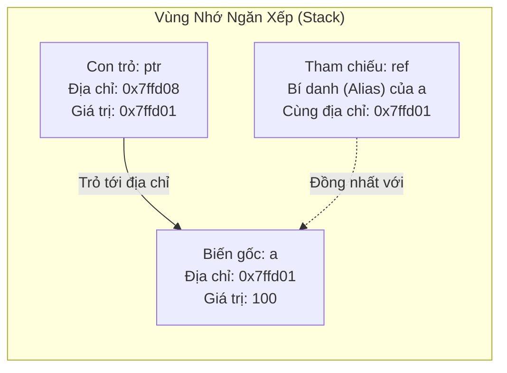

# 22.2 — R-value references

---

## 🎯 Mục Tiêu Bài Học
- Nắm vững bản chất lý thuyết và cơ chế hoạt động của **R-value references** trong tiêu chuẩn ISO C++.
- Hiểu rõ cách máy tính tổ chức bộ nhớ (RAM, CPU registers) khi thực thi mã nguồn liên quan.
- Nhận biết các cạm bẫy lỗi kinh điển (**Undefined Behavior**, Memory Leak, Bug logic) và cách phòng tránh.
- Áp dụng các quy tắc thực hành tốt nhất (**Best Practices**) chuẩn công nghiệp và cập nhật C++20/C++23 hiện đại.

---

# 22.2 &#8212; R-value các tham chiếu

In chapter 12, we introduced the concept of value categories ([12.2 -- Value categories (lvalues and rvalues)](https://www.learncpp.com/cpp-tutorial/value-categories-lvalues-and-rvalues/)), which is a property of biểu thức that helps determine whether an biểu thức resolves to a value, hàm, or object.  We also introduced l-values and r-values so that we could discuss l-value các tham chiếu.

If you’re hazy on l-values and r-values, now would be a good time to refresh on that topic since we’ll be talking a lot about them in this chapter.

L-value các tham chiếu recap

Prior to C++11, only one type of tham chiếu existed in C++, and so it was just called a “tham chiếu”.  However, in C++11, it’s called an l-value tham chiếu.  L-value các tham chiếu can only be được khởi tạo with modifiable l-values.

</p>

L-value tham chiếu
Can be được khởi tạo with
Can modify

Modifiable l-values
Yes
Yes

Non-modifiable l-values
No
No

R-values
No
No

<p>L-value các tham chiếu to const đối tượng can be được khởi tạo with modifiable and non-modifiable l-values and r-values alike.  However, those values can’t be modified.

</p>

L-value tham chiếu to const
Can be được khởi tạo with
Can modify

Modifiable l-values
Yes
No

Non-modifiable l-values
Yes
No

R-values
Yes
No

<p>L-value các tham chiếu to const đối tượng are particularly useful because they allow us to pass any type of đối số (l-value or r-value) into a hàm without making a copy of the đối số.

R-value các tham chiếu

C++11 adds a new type of tham chiếu called an r-value tham chiếu.  An r-value tham chiếu is a tham chiếu that is designed to be được khởi tạo with an r-value (only).  While an l-value tham chiếu is created using a single ampersand, an r-value tham chiếu is created using a double ampersand:

```cpp
int x{ 5 };
int& lref{ x }; // l-value reference initialized with l-value x
int&& rref{ 5 }; // r-value reference initialized with r-value 5
```

R-values các tham chiếu cannot be được khởi tạo with l-values.

</p>

R-value tham chiếu
Can be được khởi tạo with
Can modify

Modifiable l-values
No
No

Non-modifiable l-values
No
No

R-values
Yes
Yes

R-value tham chiếu to const
Can be được khởi tạo with
Can modify

Modifiable l-values
No
No

Non-modifiable l-values
No
No

R-values
Yes
No

<p>R-value các tham chiếu have two properties that are useful.  First, r-value các tham chiếu extend the lifespan of the object they are được khởi tạo with to the lifespan of the r-value tham chiếu (l-value các tham chiếu to const đối tượng can do this too).  Second, non-const r-value các tham chiếu allow you to modify the r-value!

Let’s take a look at some examples:

```cpp
#include <iostream>
 
class Fraction
{
private:
	int m_numerator { 0 };
	int m_denominator { 1 };
 
public:
	Fraction(int numerator = 0, int denominator = 1) :
		m_numerator{ numerator }, m_denominator{ denominator }
	{
	}
 
	friend std::ostream& operator<<(std::ostream& out, const Fraction& f1)
	{
		out << f1.m_numerator << '/' << f1.m_denominator;
		return out;
	}
};
 
int main()
{
	auto&& rref{ Fraction{ 3, 5 } }; // r-value reference to temporary Fraction
	
	// f1 of operator<< binds to the temporary, no copies are created.
	std::cout << rref << '\n';
 
	return 0;
} // rref (and the temporary Fraction) goes out of scope here
```

This program prints:

```cpp
3/5
```

As an anonymous object, Fraction(3, 5) would normally go out of phạm vi truy cập (scope) at the end of the biểu thức in which it is defined.  However, since we’re initializing an r-value tham chiếu with it, its duration is extended until the end of the block.  We can then use that r-value tham chiếu to print the Fraction’s value.

Now let’s take a look at a less intuitive example:

```cpp
#include <iostream>

int main()
{
    int&& rref{ 5 }; // because we're initializing an r-value reference with a literal, a temporary with value 5 is created here
    rref = 10;
    std::cout << rref << '\n';

    return 0;
}
```

This program prints:

```cpp
10
```

While it may seem weird to khởi tạo an r-value tham chiếu with a hằng giá trị (literal) value and then be able to change that value, when initializing an r-value tham chiếu with a hằng giá trị (literal), a temporary object is constructed from the hằng giá trị (literal) so that the tham chiếu is referencing a temporary object, not a hằng giá trị (literal) value.

R-value các tham chiếu are not very often used in either of the manners illustrated above.

R-value các tham chiếu as hàm tham số

R-value các tham chiếu are more often used as hàm tham số.  This is most useful for hàm overloads when you want to have different behavior for l-value and r-value đối số.

```cpp
#include <iostream>

void fun(const int& lref) // l-value arguments will select this function
{
	std::cout << "l-value reference to const: " << lref << '\n';
}

void fun(int&& rref) // r-value arguments will select this function
{
	std::cout << "r-value reference: " << rref << '\n';
}

int main()
{
	int x{ 5 };
	fun(x); // l-value argument calls l-value version of function
	fun(5); // r-value argument calls r-value version of function

	return 0;
}
```

This prints:

```cpp
l-value reference to const: 5
r-value reference: 5
```

As you can see, when passed an l-value, the overloaded hàm resolved to the version with the l-value tham chiếu.  When passed an r-value, the overloaded hàm resolved to the version with the r-value tham chiếu (this is considered a better match than an l-value tham chiếu to const).

Why would you ever want to do this?  We’ll discuss this in more detail in the next lesson.  Needless to say, it’s an important part of move semantics.

Rvalue tham chiếu các biến are lvalues

Consider the following snippet:

```cpp
int&& ref{ 5 };
	fun(ref);
```

Which version of `fun` would you expect the above to call: `fun(const int&)` or `fun(int&&)`?

The answer might surprise you.  This calls `fun(const int&)`.

Although biến `ref` has type `int&&`, when used in an biểu thức it is an lvalue (as are all named các biến).  The type of an object and its value category are independent.

You already know that hằng giá trị (literal) `5` is an rvalue of type `int`, and `int x` is an lvalue of type `int`.  Similarly, `int&& ref` is an lvalue of type `int&&`.

So not only does `fun(ref)` call `fun(const int&)`, it does not even match `fun(int&&)`, as rvalue các tham chiếu can’t bind to lvalues.

Returning an r-value tham chiếu

You should almost never return an r-value tham chiếu, for the same reason you should almost never return an l-value tham chiếu.  In most cases, you’ll end up returning a hanging tham chiếu when the referenced object goes out of phạm vi truy cập (scope) at the end of the hàm.

Hệ thống Câu hỏi & Quiz Tự Luyện

Câu hỏi #1

State which of the following lettered câu lệnh will not compile:

```cpp
int main()
{
	int x{};

	// l-value references
	int& ref1{ x }; // A
	int& ref2{ 5 }; // B

	const int& ref3{ x }; // C
	const int& ref4{ 5 }; // D

	// r-value references
	int&& ref5{ x }; // E
	int&& ref6{ 5 }; // F

	const int&& ref7{ x }; // G
	const int&& ref8{ 5 }; // H
	
	return 0;
}
```

::: details Xem lời giải (Solution)

B, E, and G won’t compile.

Recapping the binding combinations:

- Non-const l-value các tham chiếu can only bind to non-const l-values.

- Const l-value các tham chiếu can bind to non-const l-values, const l-values, and r-values.

- R-value các tham chiếu can only bind to r-values.

`x` is a non-const l-value, so we can bind a non-const l-value tham chiếu (A) and a const l-value tham chiếu (C) to it.  We cannot bind a non-const l-value tham chiếu to an r-value (B).

`5` is an rvalue, so we can bind a const l-value tham chiếu (D) and r-value tham chiếu (F & H) to it.  We cannot bind an rvalue tham chiếu to an l-value (E & G).

:::

</a>
  	<a class="nav-link" href="/">
  
    <i class="fa fa-home" aria-hidden="true"></i>
    
      Back to table of contents
    
</a>
  	<a class="nav-link" href="https://www.learncpp.com/cpp-tutorial/introduction-to-smart-các con trỏ-move-semantics/">
  
    <i class="fa fa-chevron-circle-left" aria-hidden="true"></i>
    
      Previous lesson
      
        22.1Introduction to smart các con trỏ and move semantics
      
    
  </a>


---





::: danger Cạm Bẫy Thực Chiến: Con Trỏ Lơ Lửng (Dangling Pointer) & UB
Tuyệt đối không giải phóng vùng nhớ mà con trỏ đang trỏ tới rồi tiếp tục truy cập nó, hoặc trả về tham chiếu/con trỏ tới một biến cục bộ trên Stack. Khi hàm kết thúc, biến cục bộ bị hủy và con trỏ sẽ trỏ vào vùng nhớ rác, dẫn đến **Hành vi không xác định (Undefined Behavior)** cực kỳ nguy hiểm!
:::


::: tip Nâng Cấp C++ Hiện Đại: Thay Thế Con Trỏ Thô Bằng Smart Pointers
Trong C++ hiện đại (C++11 đến C++23), hãy hạn chế tối đa việc sử dụng con trỏ thô (`T*`) cùng các toán tử `new`/`delete`. Thay vào đó, hãy luôn ưu tiên:
- `std::unique_ptr<T>`: Sở hữu độc quyền tài nguyên (Zero-overhead, tự động giải phóng RAII).
- `std::shared_ptr<T>`: Sở hữu chia sẻ tài nguyên có cơ chế đếm tham chiếu (Reference counting).
- `std::span<T>` (C++20) hoặc `std::string_view` (C++17): Xem qua vùng nhớ mà không sở hữu, an toàn và tốc độ cực cao.
:::


::: tip 💡 Tóm Tắt Quy Tắc Vàng (Core Guidelines)
1. Luôn hiểu rõ vòng đời và quyền sở hữu (Ownership) của dữ liệu trước khi viết code.
2. Ưu tiên khởi tạo đồng nhất với dấu ngoặc nhọn `{}` để ngăn chặn lỗi thu hẹp kiểu dữ liệu (Narrowing conversions).
3. Bật toàn bộ cờ cảnh báo `-Wall -Wextra -Wpedantic` để compiler giúp bạn phát hiện bug từ sớm!
:::
